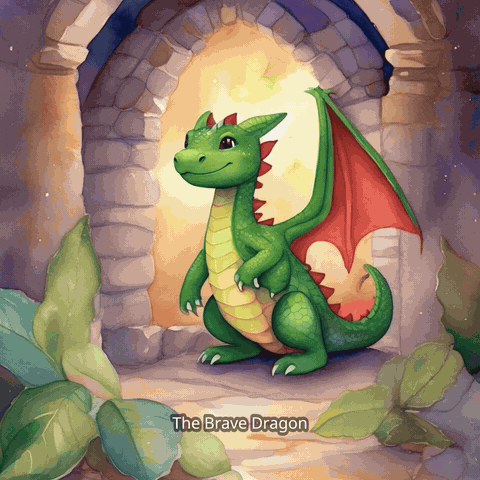
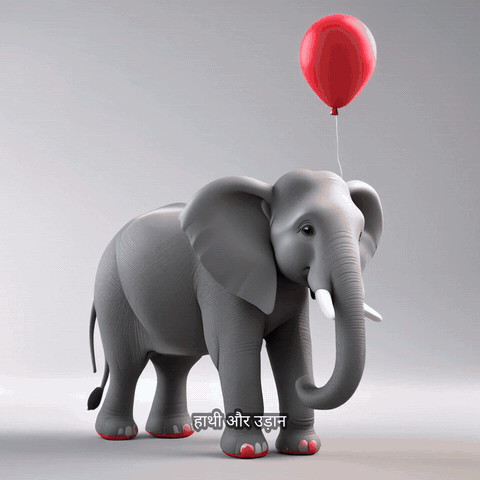
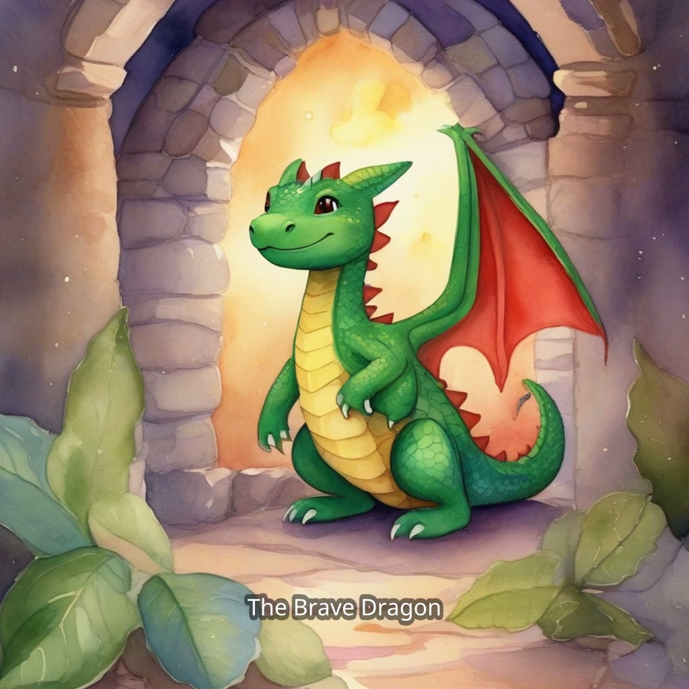
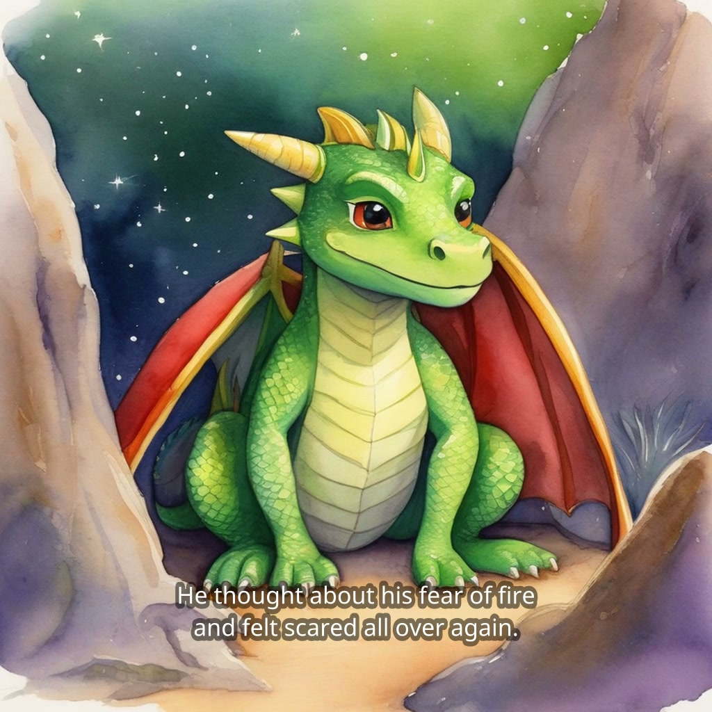
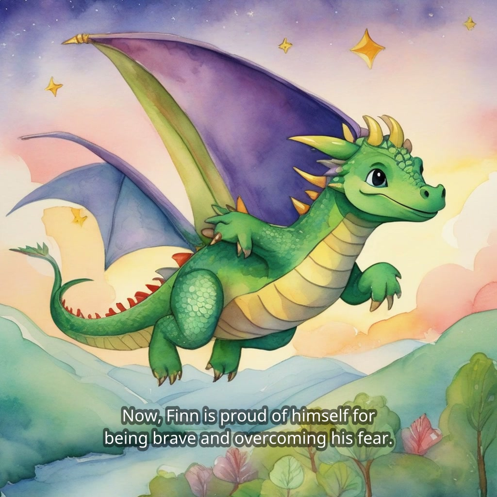
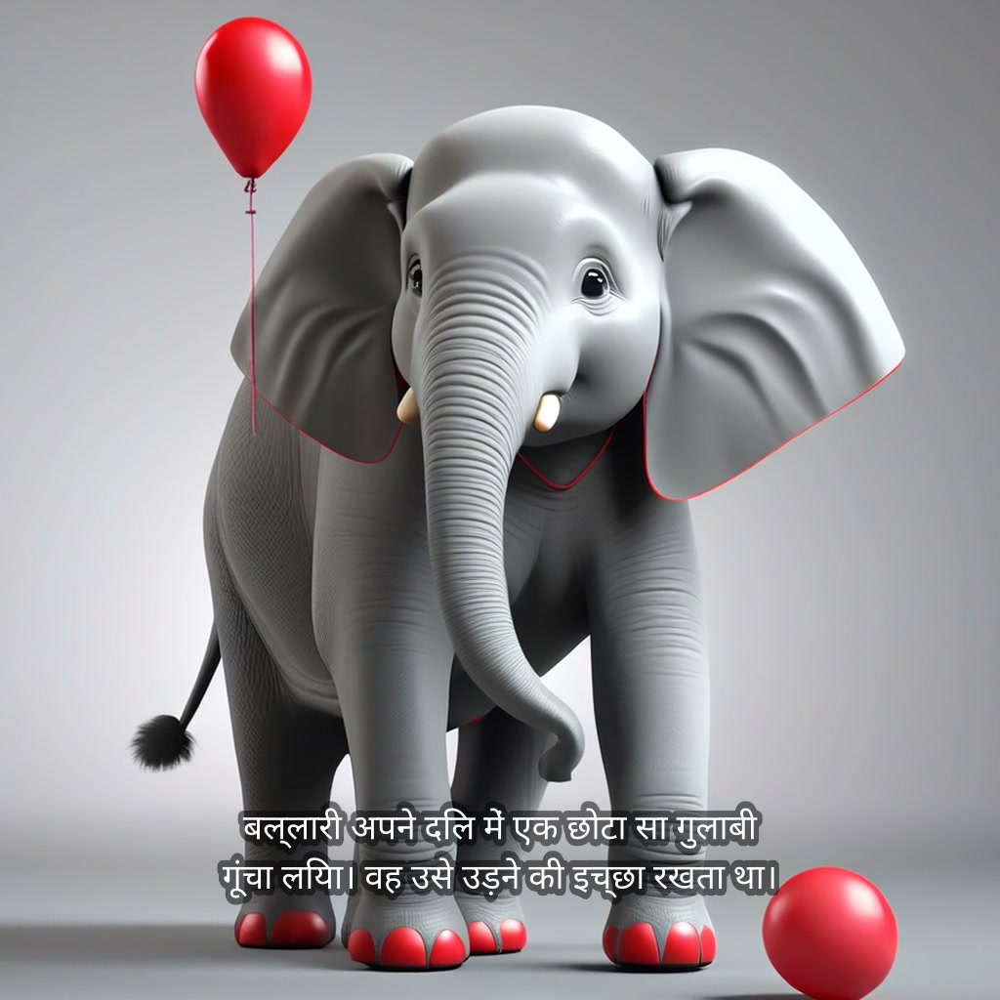

# Katha 🎙️📖 — Track 1 Submission

**Speak a story idea — in English, Hindi, or six other languages — and get back a
narrated, illustrated storybook video. Every model runs locally on an AMD Radeon GPU.**

<p>


</p>

*Two storybooks playing — English watercolor and Hindi 3D-animation, both generated
end-to-end on the Radeon. Full demo with sound: [`demo-video.mp4`](demo-video.mp4).*

| | |
|---|---|
| Track | 1 — Multimodal AI (content creation tools) |
| Team | **N DIVIJ** (solo developer) |
| Application | Katha |
| Source code | **https://github.com/N-45div/Katha** (MIT) |
| Hardware | AMD Radeon PRO W7900 · gfx1100 · 48 GB · Radeon Cloud |
| Stack | ROCm 7.2.1 · PyTorch 2.9.1 (HIP) · Transformers · Diffusers · Gradio · ffmpeg |
| Models | Whisper large-v3-turbo · Qwen2.5-7B-Instruct · SDXL + IP-Adapter · Kokoro-82M |

## Submission materials (this folder)

| File | What it is |
|---|---|
| [`demo-video.mp4`](demo-video.mp4) | Demo video — real run on a Radeon Cloud W7900, CLI/GUI to final result |
| [`PROJECT_PROFILE.pdf`](PROJECT_PROFILE.pdf) | Project profile: background, users & scenarios, architecture, models, ROCm adaptation |
| [`KATHA_DECK.pdf`](KATHA_DECK.pdf) | Slide deck — creative scenarios & practical value |
| [`images/`](images/) | Real output frames from two storybooks (English watercolor · Hindi 3D-animation) |

## Real output — two languages, one GPU

**"The Brave Dragon"** — spoken idea *"a dragon who is afraid of fire"*, watercolor style,
narrated in English, same hero on every page:

<p>



</p>

**The Hindi book** — idea *"एक हाथी जो उड़ना चाहता था"* (an elephant who wanted to fly),
3D-animation style, story text **and narration in Hindi**:

<p>


</p>

## Measured performance (from a real run's `benchmark.json`)

| Stage | Time | Peak VRAM |
|---|---|---|
| story — Qwen2.5-7B fp16 | 30.5 s | 14.3 GB |
| illustrate — SDXL, 5×1024² @ 30 steps | 60.5 s | 9.7 GB |
| narrate — Kokoro-82M | 48.4 s | 0.8 GB |
| assemble — ffmpeg | 17.4 s | — |

**≈ 2.6 minutes end-to-end**, ~7 s per illustration steady-state. Stages load/unload
sequentially, so peak VRAM is one model at a time — the same code runs on a 16 GB
consumer Radeon.

## Reproduce (any ROCm box)

```bash
git clone https://github.com/N-45div/Katha && cd Katha
bash setup_rocm.sh
python cli.py --text "a dragon who is afraid of fire" --style watercolor
# or the web UI (microphone input):
bash scripts/run_ui.sh
```

Full environment configuration, startup guide, and dependency list:
[Katha README](https://github.com/N-45div/Katha#readme).
