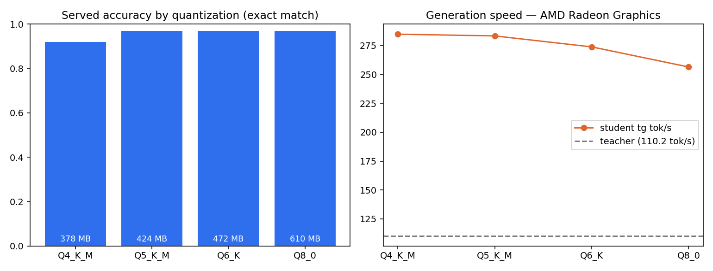
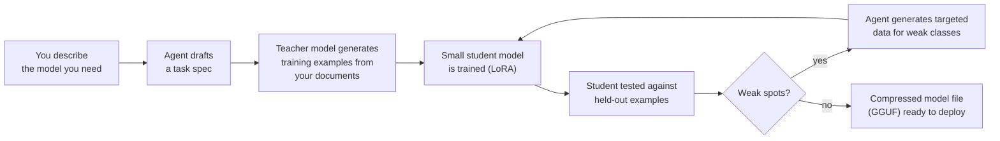

# Foundry

**Describe the model you need in plain English. Foundry builds it — on one AMD GPU, in about 20 minutes, without your data ever leaving the machine.**

Foundry is an AI agent that *manufactures small AI models*. You tell it something like *"I need a model that sorts support tickets by category and priority — the rules are in this policy document"* and it does the rest: plans the work, generates training data, trains a tiny model, tests it, finds its weaknesses, fixes them with more data, and hands you a finished model file you can run anywhere — even on a laptop with no GPU.

Built solo for the **AMD AI DevMaster Hackathon, Track 2 (Agentic AI)**. Every number below was measured on the contest-granted AMD Radeon (gfx1100, 48 GB, ROCm), and every measurement's raw output is in this repository.

**▶ Demo video:** [`foundry-demo.mp4`](foundry-demo.mp4) — 3 minutes: a second-domain model (expense-claim routing) being built **live** on the Radeon from one plain-English sentence, including the agent reading the policy documents itself and the code-enforced approval gate firing on camera.

---

## The result, in one table

A 30-billion-parameter "teacher" model taught a 0.6-billion-parameter "student" to triage support tickets:

| | Before training | After Foundry | The teacher itself |
|---|---|---|---|
| Correct answers (vs. written policy, 100 unseen tickets) | 14% | **95%** | 95% |
| On tickets with one defensible answer | — | **100%** | 100% |
| Size on disk | — | **424 MB** | 17,700 MB |
| Speed (tokens/sec on the Radeon) | — | **283** | 110 |

The student **matches its teacher's accuracy at 1/42 the size and 2.6× the speed** — and runs at useful speed on an ordinary CPU (64–90 tokens/sec, no GPU at all).



## How it works



Everything in that diagram runs on **one GPU**: the teacher (which also serves as the agent's brain), the training, and the finished student. The agent is a compact tool-calling loop — no frameworks — with a web interface that streams every action live, including GPU telemetry.

**The improvement loop is real, not aspirational:** in a measured run, the agent diagnosed one weak ticket category, generated focused examples for it (keeping the test set frozen so the comparison is honest), retrained, and lifted exact-match accuracy from 67% → 83% on the identical test.

**It generalizes:** a second, completely different model (expense-claim routing, using three policy documents with retrieval) was built from one conversation and zero code changes — first at pilot scale, then **live at full scale on the Radeon** (the run in the demo video): base 24% → **88% exact match** on a 100-claim holdout, with the agent discovering and reading the policy documents itself and running an autonomous augmentation round. A teacher-model A/B test (report §4.6) showed the factory also *measures* which teacher labels best — the newer, benchmark-stronger model actually produced a worse student.

## Why this needs a local GPU (and can't be an API wrapper)

1. **Fine-tuning creates new model weights** — no chat API can do that.
2. **Volume:** one build pushes ~2 million tokens through the teacher. Locally that's free, so the agent can iterate; hosted, every iteration has a bill.
3. **Privacy:** the policy documents that define your labels never leave the machine — and neither does anything derived from them.

## Try it

You need: a GPU (AMD via ROCm, or NVIDIA — same code), Python 3.11+, [llama.cpp](https://github.com/ggml-org/llama.cpp) binaries, and two open-weights models from Hugging Face (teacher + student — see `configs/`).

```bash
pip install torch transformers peft flask matplotlib requests sentencepiece
# + gguf-py from your llama.cpp checkout

# One-shot factory run (data → train → eval → GGUF):
python run_slice.py --config configs/local_4060.toml

# The agent, with web UI:
python serve_ui.py --config configs/local_4060.toml   # then open http://127.0.0.1:8300

# Benchmark a finished build across quantization levels:
python run_bench.py --config <config> --run-dir runs/<run>
```

The `configs/` files show the only thing that changes between an NVIDIA dev laptop and the Radeon: file paths and capacity numbers. Same code.

## What's in this repository

| Path | What it is |
|---|---|
| `foundry/` | The system: agent loop, tools, data generation, training, evaluation, benchmarking, retrieval |
| `serve_ui.py` + `static/` | Web interface (chat + live tool calls + GPU telemetry) |
| `run_slice.py` / `run_bench.py` | Run the pipeline / the benchmark harness directly |
| `configs/` | One file per machine; the teacher swap is a config edit |
| `seeds/` | The policy documents the demo models are grounded in |
| `specs/` | Task definitions (what each manufactured model does) |
| `runs/` | **The evidence.** Every measured run: datasets, eval reports, benchmark JSON, charts |
| `eval_fixtures/` | Fixed 100-ticket test set with hand-checked ground-truth labels + per-ticket rationale |
| `evidence/` | Screenshots backing specific claims in the report |
| `notes/` | Engineering journal — every lesson, failure, and measurement, dated |
| `SUBMISSION_REPORT.md` | The full technical report (also as `foundry-report.pdf`) |
| `foundry-demo.mp4` / `stills/` | The 3-minute demo video · full-resolution stills from it |
| `FOUNDRY.md` | The decision record: why this project, the rubric math, the plan |
| `PPT_OUTLINE.md` | Slide outline (deck: `foundry-slides.pptx`) |

## Small glossary

- **Teacher / student:** a large model that *generates labeled examples*, and a small model that *learns from them*. The small one is the product.
- **Distillation:** teaching a small model to behave like a big one on a specific task.
- **LoRA:** a cheap way to fine-tune — trains ~1% of the weights.
- **Quantization:** compressing a model (e.g., 4-bit numbers instead of 16-bit) to make it smaller and faster; Foundry measures exactly what each level costs in accuracy.
- **GGUF:** the standard single-file format for running models with llama.cpp on almost any hardware.
- **ROCm:** AMD's GPU compute stack — this project's training and inference all run on it.
