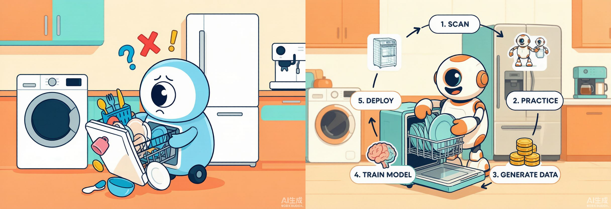
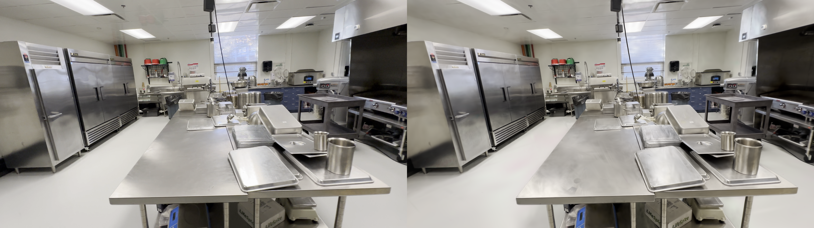
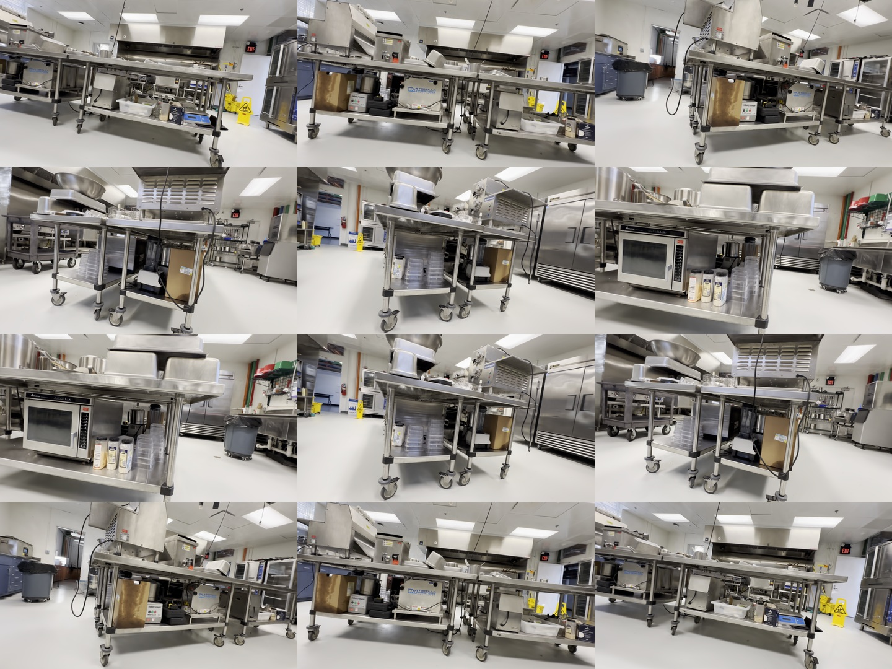
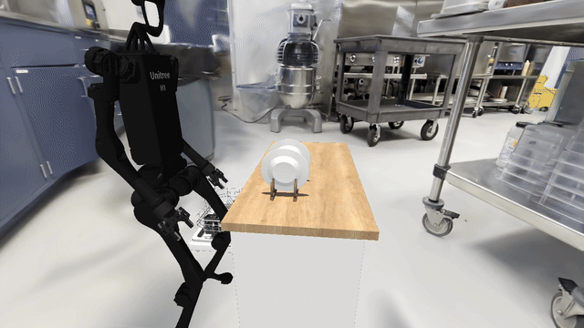
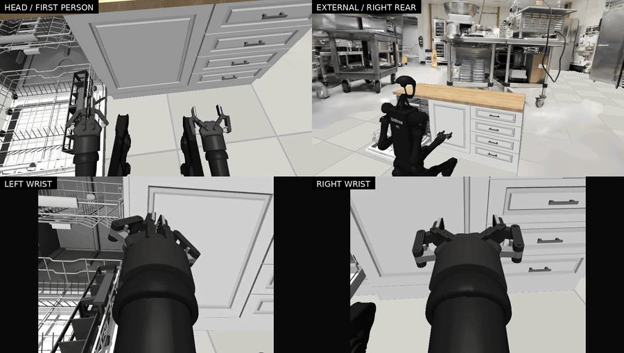
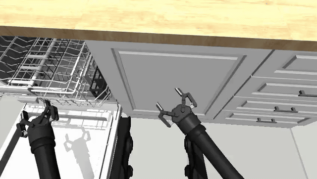

# AMD Radeon-hackathon-2026-07 Track 3 (Physical AI) Technology Report


## RoboNativeManipulation: Bridging the gap between robots and home appliances with high-fidelity simulation data



**Target application**: let a robot learn to operate appliances in photorealistic home scenes. This project uses BiGym's "dishwasher cutlery unload" long-horizon task as the closed-loop validation vehicle, and builds an end-to-end pipeline of "real-scene 3DGS reconstruction → data-replay collection → dual-framework VLA post-training → single-card AMD inference → closed-loop evaluation". Every key stage runs end-to-end on a single AMD Radeon GPU.

## Key results at a glance

Every stage runs end-to-end on a **single AMD Radeon PRO W7900D (gfx1100, 48 GB) + ROCm 7.2.1**. The table below is the measured figure for each stage (real runs, not estimates):

| Stage | Key metric |
| --- | --- |
| 3DGS shell reconstruction | 352 × 1080p photos → ~1.45 M Gaussians (1,458,354 after cleanup), held-out view **PSNR 27.9 / SSIM 0.937** |
| 3DGS runtime rendering | three cameras (head 480×848, left/right wrist 480×640) ~**2.7 GiB** VRAM (measured on the Pi0.5 evaluation side) |
| Training · Pi0.5 (JAX+ROCm) | steady **1.2 s/step**, peak VRAM **35.3 GiB** (steady mean 33.6 GiB), GPU utilization **95.6%** |
| Training · DM0.5 (PyTorch+ROCm) | measured **1.5295 samples/s** (micro-batch 12 × accum 4), peak VRAM **28.74 GiB**, GPU utilization **99.47%**; the optimization method delivers +24.4% over baseline on the ReachTarget throughput benchmark |
| Inference · Pi0.5 | end-to-end **≈240 ms/call** (≈4.2 calls/s) |
| Inference · DM0.5 | end-to-end **438.72 ms/call** (4-step diffusion-operator benchmark; the release success-rate protocol uses 10 steps), peak VRAM **12.79 GiB**, GPU utilization **67.68%** |
| Closed-loop · DM0.5 (50 seeds) | native **25/50 = 50%** · 3DGS shell **20/50 = 40%** |
| Closed-loop · Pi0.5 (50 seeds) | 3DGS shell **5/50 = 10%** (no native evaluation performed) |
| Dual-framework verification | the same card runs both **PyTorch+ROCm (DM0.5)** and **JAX+ROCm (Pi0.5)** SOTA VLA paths |

**Compared with the BiGym paper baselines (task: dishwasher unload cutlery long):**

> **Key premise**: the seven baselines in the BiGym paper were **all evaluated on the clean native BiGym scene (without the 3DGS shell)**, whereas this work's results (except the native row) were **all obtained on the harder visual domain with the photorealistic 3DGS shell** — in other words, we compare against the paper on a harder track.

| Method | Evaluation scene | Success rate (%) |
| --- | --- | --- |
| BiGym paper · BC | clean (no 3DGS) | 1.3 ± 2.3 |
| BiGym paper · ACT | clean (no 3DGS) | 14.7 ± 8.3 |
| BiGym paper · DiffPolicy | clean (no 3DGS) | 5.3 ± 5.8 |
| BiGym paper · DrQV2 / AWAC / IQL / CQN | clean (no 3DGS) | 0.0 ± 0.0 |
| **This work · DM0.5 (native)** | **clean (no 3DGS)** | **50%** |
| **This work · DM0.5 (PyTorch+ROCm)** | **with 3DGS shell** | **40%** |
| **This work · Pi0.5 (JAX+ROCm)** | **with 3DGS shell** | **10%** |

- **Same-track comparison (clean scene, same basis as the paper)**: DM0.5 native **50%**, about 3.4× the paper's strongest baseline ACT (14.7%); the paper's other baselines (BC / DiffPolicy / DrQV2 / AWAC / IQL / CQN) are only 0–5%.
- **Harder-scene comparison (with 3DGS shell)**: even after switching to the photorealistic visual domain, DM0.5 still achieves **40%**, still significantly higher than **all** of the paper's clean-scene baselines; under the same premise Pi0.5 provides a **10%** baseline, and DM0.5 improves about **300% (4×)** relative to that baseline.

## Background and pain points

Software is undergoing an "AI-Native" shift — no rewrite needed, just wrap a Skill layer and AI can take over. Appliances in the home will see the same paradigm migration, from "designed for humans" to "usable by robots". We call this Robotics Native.

The real world, however, is still designed for humans. The industry is betting on humanoid robots to fit human environments, but cost-constrained robots still lag real humans in dexterity and joint degrees of freedom. On one side sit precise, complex man-made appliances; on the other, robot embodiments whose capabilities still fall short. This "mismatch of form and capability" is the single biggest obstacle to robots entering the home.

## Our pipeline

Use 3DGS to reconstruct the home scene, drop the digital assets of appliances into this simulation, and let a robot repeatedly "get familiar" with one appliance after another and rehearse daily operations inside an extremely realistic environment — continuously producing data of "a robot operating these objects".

- **Short term · lightweight post-training**: starting from the open-source DM0.5 and Pi0.5 foundation models, fine-tune efficiently with the data our pipeline produces. A single AMD card is enough for a robot to master operating a specific appliance while retaining general common sense — the most deployment-ready option, suited to appliance makers validating their own products quickly.
- **Long term · high-value pre-training empowerment**: inject the high-quality manipulation data our pipeline produces, as high-density samples, into the pre-training corpus of the next-generation foundation model, so future base models natively internalize appliance-operation ability rather than relying on late patches — true Robotics Native.

## Why these two models were chosen

We deliberately chose two SOTA VLA foundation models belonging to the two mainstream frameworks, to verify the maturity of ROCm's coverage of the mainstream deep-learning ecosystem:

- **Pi0.5 (JAX)**: built on the **JAX** framework — a widely used deep-learning framework in industry. Getting it working amounts to verifying ROCm's support for the mainstream industrial tech stack.
- **DM0.5 (PyTorch)**: a well-known VLA foundation model, built on the **PyTorch** framework — likewise a mainstream framework we want to support.

Both are **large-scale pre-trained** foundation models that have already internalized a great deal of general manipulation common sense; we only need to do **lightweight post-training (LoRA fine-tuning, single-card) on top of them** to achieve decent results on specific appliance tasks at low cost — this is exactly the core advantage of the post-training paradigm over training from scratch.

## Overall architecture: three repositories coordinated, closed loop on one card

The entire Physical-AI pipeline is coordinated across three repositories to form a closed loop on a single AMD card. **The core repository `rocm_bigym_3dgs` is the hub**, responsible for 3DGS shell generation, shell-based data-replay collection, and the final closed-loop evaluation orchestration; once the data is produced it is **fed separately to the Pi0.5 (JAX) and DM0.5 (PyTorch) training paths**, each of which starts an inference service on the AMD card, and is then handed back to the neutral evaluator and HTTP protocol provided by the core repository for closed-loop evaluation, yielding a success rate.

```text
   [Stage 1] 3DGS shell generation   (core repo rocm_bigym_3dgs)
   real kitchen photos → modified OpenSplat/HIP reconstruction  →  Gaussian room shell
        (gfx1100, PSNR 27.9)

   [Stage 2] shell-based data replay   (core repo)
   BiGym + gsplat render replay  →  LeRobot v3 dataset (32 episodes)
                              │
              ┌───────────────┴─────────────────┐
              ▼                                   ▼
   [Stage 3] Pi0.5 training (JAX+ROCm)       DM0.5 training (PyTorch+ROCm)
              │                                   │
              ▼                                   ▼
   [Stage 4] Pi0.5 HTTP inference service     DM0.5 HTTP inference service
              │                                   │
              └───────────────┬───────────────────┘
                              ▼
   [Stage 5] closed-loop evaluation orchestration   (core repo · run_model_matrix)
     BiGym+3DGS simulation  ↔  inference service  →  success rate
```

**Responsibilities of the three repositories:**

| Repository | Role | Framework / stack |
| --- | --- | --- |
| `rocm_bigym_3dgs` (core repository) | 3DGS shell generation + data-replay collection + closed-loop evaluation orchestration | PyTorch + gsplat + MuJoCo / HIP |
| `rocm_pi05` (openpi adaptation) | Pi0.5 fine-tuning + HTTP inference service | **JAX + ROCm** (+ CPU torch) |
| `rocm_dm05` (OpenDM adaptation) | DM0.5 fine-tuning + merge + inference + evaluation | **PyTorch + ROCm** |

**Standardization is the precondition that lets this pipeline interoperate**: the three repos unify on LeRobot Dataset v3.0 for data, on a provider-neutral HTTP interface (`/health` + `/process_frame`, protocol v2) for inference, and on the same BiGym+3DGS simulation for evaluation. Changing the model only changes one service address — the simulation and recording code are untouched. This is also the fundamental reason the two models can be compared fairly later.

## Stage 1: 3DGS shell generation

Before a robot can learn to operate appliances, it must have an environment realistic enough to rehearse in repeatedly. A real kitchen is too expensive, non-repeatable, and unsafe; a purely synthetic kitchen is too fake. 3D Gaussian Splatting (3DGS) can synthesize near-photorealistic novel views from a set of real photos, so we use it to reconstruct a real commercial kitchen and bring it into simulation.

The reconstructor used here is **OpenSplat**. OpenSplat officially does not support AMD ROCm/HIP; **we adapted it for AMD** (build patches `reconstruction/patches/opensplat-rocm-home.patch`, `opensplat-force-rocm-include.patch`, letting it compile and run with the native HIP backend on gfx1100), and completed the full chain from reconstruction to collection and evaluation on the modified OpenSplat. The entire reconstruction was done on a single W7900D.

There is one key engineering judgment here: 3DGS appears in the pipeline at **two entirely different stages** that must be handled separately. The first stage is the "training reconstruction" that trains Gaussians from photos and exports them, using the **modified OpenSplat native HIP backend** — because gsplat, on the wave32 target of gfx1100, trips rocPRIM's wave64 static assertion, and the official prebuilt wheels contain no gfx1100 code objects, so it cannot even compile. The second stage is the real-time "rendering" of the three BiGym runtime cameras, using **gsplat 1.4 + our gfx1100 compatibility patch** (see "AMD/ROCm engineering notes" below). The two steps are accepted independently and are not interchangeable: being able to `import gsplat` does not count as passing — it must actually run one rasterization, do a GPU sync, and verify valid output.

The second key design makes the real kitchen a **purely visual background**, fully decoupled from physics: MuJoCo owns physics (collision, reward, control) and 3DGS owns appearance, and the two are composited into the same frame — take the camera intrinsics/extrinsics and the segmentation map from MuJoCo, let gsplat render the kitchen background, then composite the robot, workbench, and task objects back over it according to the segmentation. The receipt forcibly records the background physics as empty (body/geom/collision counts of 0), but this only proves "3DGS did not enter the physics world" — it cannot replace human visual review.





Top-left is the held-out real frame, top-right is the reconstruction render after 15,000 training steps on AMD Radeon PRO W7900D, bottom-left is the real kitchen source photos used for reconstruction.



The reconstruction is not limited to the single held-out view above: the camera orbits freely around the scene and the kitchen renders consistently from continuous, arbitrary novel viewpoints, with the BiGym Unitree H1 robot composited at the workbench. This continuous free-view sweep is the most direct visual evidence that the 3DGS room shell is genuinely three-dimensional and view-consistent, rather than a frozen back-projection tied to one training pose.

**Measured result**: from 352 × 1920×1080 photos trained for 15,000 steps we obtained a kitchen scene of about 1.45 million Gaussians (1,458,354 after cleanup) with held-out view **PSNR 27.9 and SSIM 0.937**; after cleaning projected streaks and all-camera-invisible floating outliers, a room shell with separated wall/floor/ceiling layers was exported. At runtime, the three-camera rendering coexists with the policy service on the same card using only about **2.7 GiB** of VRAM and does not trigger OOM.

## Stage 2: shell-based data replay and collection

With the real kitchen shell in hand, the next step is to let the robot work inside it, recording "how to operate this appliance" as training data. We use BiGym (a MuJoCo-based dual-arm humanoid H1 + two wrist-joint grippers) running inside the reconstructed 3DGS kitchen, executing the "unload cutlery from the dishwasher into the drawer" task, recording synchronously from the head and left/right wrist viewpoints, aligned to the mainstream LeRobot v3 format (state/action both 16-dimensional).





> Full 31-second demo video (head, left/right wrist, external views): [bigym-3dgs-shell-reference.mp4](./rocm_bigym_3dgs/docs/videos/bigym-3dgs-shell-reference.mp4)

There is a real and thorny problem here: BiGym's official demo trajectories are **not "drop-in usable"** — they were recorded on BiGym 4.0 / MuJoCo 3.1.5 but collected on 4.1 / 3.10, a version mismatch; the trajectories also mix absolute / delta action representations. Any drift turns a playable trajectory into a failed one (reward goes to zero), and accepting them as-is would mean treating failure data as training data.

The fix is a two-stage fail-closed flow that "only releases genuinely successful data": ① first run a camera-free, 3DGS-free pure-physics pre-check, and only trajectories with reward=1 are written into the formal collection plan; ② convert delta-source actions to absolute labels and cross-check the error in a separate absolute environment. For collection robustness, each episode is persisted independently (metadata cache set to 1, the writer closed immediately on success, progress updated only after a re-readable commit), eliminating the "video saved, Parquet half-written" partial state caused by container restarts.

Before the formal 32-episode collection, a smoke run must pass (683 frames, 2,052 3DGS renders) while satisfying replay reward=1.0, full H.264 decode on all three streams, zero errors and zero fallback in 3DGS strict mode, render count exactly equal to (frames + resets)×3, and empty background physics. Only after all of this passes does the formal 32-episode collection start, ultimately producing a clean, standardized dataset in which every episode is a genuine success sample, ready to feed both training paths.

> **Dataset evidence boundary (honest statement)**: the 32 LeRobot replay episodes released this time are a **cross-platform reference baseline** (manifest `data/manifests/cutlery32-dataset.public.json`, `runtime: reference-baseline`, `status: technical_pass_visual_approval_pending`) — its runtime environment is a historical comparison baseline (not ROCm), **used only for traceability and comparison, and should not be taken as evidence that "the AMD ROCm main-line training/collection has been accepted as complete"**. The external claims and reproduction path of the AMD ROCm main line are based on the single-card gfx1100: the standard room reconstruction has been reproduced on the Radeon in real hardware (receipt `amd_rocm_reproduction_passed`), and the core repository also provides a complete AMD-oriented data-generation toolchain (`make collect` / `make validate` gfx1100 native paths). However, the independent acceptance of the 32 formal replays on AMD (native gsplat rasterization, strict three-camera replay, full video decode, manual visual review) is still an independent acceptance phase that has not yet been closed, and will not be automatically judged as passed just because the reconstruction receipt passed.

## Stage 3: dual-framework training (same dataset, two AMD paths)

The same LeRobot v3 dataset is fine-tuned along two paths — JAX and PyTorch — on a single gfx1100.

### Pi0.5 (JAX + ROCm)
A ROCm-only end-to-end delivery for single-card (open-sourced at `WuChao-2024/openpi_lerobot_plus`, `rocm` branch). The entire ROCm stack is installed with just system python3.12 + apt ffmpeg + one `.venv`, **no conda dependency**; running pi05 on a 48 GiB single card **requires LoRA** (freeze the base; full-param does not fit on one card). Two practical improvements in delivery: **decoupling the hardcoded 3 cameras** (the π05 network itself has no camera-count-bound learnable parameters — the upstream hardcoding of 3 cameras is only in preprocessing; after our change any number of named cameras is supported, and camera identity is determined solely by input order), and **one-command CLI training + HTTP inference** (`compute_norm_stats.py` / `train_jax.py` / `inference_server.py` are fully CLI, with no need to edit config.py), plus arbitrary action-dimension adaptation (32-dim base ↔ 16-dim robot).

| Metric | Measured (Pi0.5 LoRA, horizon 20, bs=4) |
| --- | --- |
| Steady throughput | **1.2 s/step** (≈ 0.83 step/s, ≈ 3.33 samples/s) |
| Peak VRAM | **35.3 GiB** (steady mean 33.6 GiB) |
| Steady GPU utilization | **95.6%** |
| loss trajectory | 0.2649 → ≈0.0165 (monotone convergence) |

### DM0.5 (PyTorch + ROCm)
Open-sourced at `Kyrie-w8/amd-bigym-3dgs-opendm`; on W7900D + ROCm 7.2.1 + PyTorch 2.8 we completed LoRA (r32/alpha16, all linear modules, micro-batch 12, gradient accumulation 4, effective batch 48, 10,000 steps, model sequence length 896) fine-tuning with resumable continuation. We ran a systematic tuning pass on DM0.5 training throughput on AMD: ROCprofiler localized GEMM as the largest time-consuming category, and we optimized item by item against that:

| Configuration | step time | throughput | peak VRAM |
| --- | --- | --- | --- |
| Long-term reference baseline | 6.430 s | 1.244 samples/s | ~56% |
| Cache episode metadata (sequence 896) | 5.614 s | 1.425 samples/s | 57% |
| + shorten sequence 896→880 (ReachTarget throughput benchmark experiment only) | 5.505 s | 1.453 samples/s | 55% |
| + TunableOp offline tuning replay over all GEMM shapes (**final**) | **5.169 s** | **1.548 samples/s** | **~55%** |

The final configuration improves throughput **+24.4%** over baseline, matching ROCprofiler's total-kernel-time −9.03% and **GEMM-time −14.29%**. Note: the "896→880" row in the table above is a benchmark experiment done on ReachTarget to isolate software throughput; the released CutleryLong model training keeps the sequence length at **896**. Applied to the formal CutleryLong training (micro-batch 12 × gradient accumulation 4, effective batch 48), the measured figures are: throughput **1.5295 samples/s**, peak VRAM **28.74 GiB (≈60%)**, steady **GPU utilization 99.47%** (mb12 has the highest throughput among the mb8/12/16 sweep under the same configuration, and is set as the release default). The three effective optimizations are: cache JSONL metadata inside persistent workers (eliminating per-frame repeated parsing), and offline-tune the rocBLAS/hipBLASLt implementation for the 90 GEMM shapes that actually appear in the training graph, then only replay (online tuning disabled, avoiding per-step jitter). Each checkpoint contains adapter/optimizer/scheduler/trainer state and normalization statistics, for exact resumption.

## Stage 4: inference services (one each on the AMD card)

After the two models finish training, each starts an HTTP inference service on the AMD card, exposing a unified `/health` + `/process_frame` (protocol v2) interface that accepts three RGB streams + 16-dim state and returns a finite action chunk. This way the evaluation end does not care which framework's model sits behind it.

| Metric | Pi0.5 (JAX) | DM0.5 (PyTorch) |
| --- | --- | --- |
| End-to-end latency | **≈240 ms/call** (p50 216 / p95 284) | **438.72 ms/call** |
| Model forward (minus HTTP/decode) | 150–180 ms | — |
| Sustained throughput | ≈4.2 calls/s | — |
| Inference peak VRAM | ≈10 GiB | **12.79 GiB** |
| Inference GPU utilization | — | **67.68%** |

The latency gap mainly comes from model architecture: Pi0.5 produces an action chunk in a single forward pass, end-to-end ≈240 ms; DM0.5 is a multi-step Flow Matching diffusion (the release success-rate protocol uses 10 steps; the 4-step operator benchmark is 438.72 ms end-to-end), so each call is slower. We applied three lossless optimizations on the DM0.5 inference side — load the already-merged weights directly (removing the redundant GEMM of the empty LoRA wrapper), `torch.inference_mode()` to drop the autograd bookkeeping, and Action Expert KV-workspace reuse (the stable prefix is copied once and only the suffix is updated, saving about 10.1 ms of `aten::cat` per call) — and the action tensor is element-wise unchanged. After optimization, DM0.5 inference (4-step operator benchmark) is **438.72 ms** end-to-end, peak VRAM **12.79 GiB**, GPU utilization **67.68%** (the training side, by contrast, is near saturation — see Stage 3, 99.47%).

## Stage 5: closed-loop evaluation and dual-model comparison

Once a policy is trained, the fundamental questions are: can it actually complete the task? What is the success rate? And it must be fair, reproducible, and identical for any model. The core repository's `evaluation/bigym-3dgs/src/run_model_matrix.py` is this evaluation-orchestration entry point; each model repository runs its own closed loop based on this neutral evaluator and the HTTP protocol, yielding the success rates in the table below.

It is a **genuine closed loop**: the simulator sends the current three-camera views, robot state, and task instruction over HTTP to the inference service, the service returns actions, the robot executes them in simulation, and we see whether the task is completed — what is measured is the policy's performance in real closed-loop interaction, not an offline metric. The most important design is being **model-agnostic**: the inference service self-reports its identity in `/health` (provider/model/version/adapter hash), and every field is verified and frozen before evaluation; any mismatch within an episode is an instant failure, preventing "swapping the model mid-evaluation".

**Why evaluation must be split into two processes**: JAX (policy) and PyTorch/gsplat (simulation + 3DGS rendering) each bring their own ROCm runtime, and stuffing both into one process triggers MIOpen/rocBLAS symbol conflicts. So the closed loop is split into a policy service and a simulator client — two independent processes time-sharing the GPU on one card, never putting both framework stacks into the same process. This is the runtime defense that keeps the evaluator from being bound to either model; at the source level there are also test assertions that the orchestrator does not `import torch/jax/transformers`.

Evaluation protocol: DM0.5 uses task `DishwasherUnloadCutleryLong`, seeds 200000–200049, 50 episodes, 20 Hz, chunk 16, 10 diffusion steps, execute 8, max 800 steps, sequence length 896; Pi0.5 uses the same task, 50 episodes, with the 3DGS shell, horizon 20 (Pi0.5 did not undergo native evaluation). The evaluator supports any custom number of episodes, and the 50-episode results for both models are based on the same neutral evaluation code and the same AMD card.

**Measured success rates (same 3DGS shell, same seed basis, single AMD card):**

| Model (framework) | native BiGym | with 3DGS shell |
| --- | --- | --- |
| **DM0.5 (PyTorch+ROCm)** | **25/50 = 50%** | **20/50 = 40%** |
| **Pi0.5 (JAX+ROCm)** | — (not tested) | 5/50 = 10% |

This is an **honest, unvarnished fair comparison**: same kitchen, same task, same evaluation code, same AMD card. DM0.5 is clearly stronger on this long-horizon household task (40% under 3DGS vs. Pi0.5's 10%, a relative improvement of about 300%), and it drops only 10 percentage points from native to 3DGS, showing the policy is quite robust to photorealistic visual-domain transfer; Pi0.5, fine-tuned with only 32 demos via LoRA, is weaker on this long-horizon task. The value of these numbers is not their absolute height but the proof that **two SOTA VLAs from different mainstream frameworks can each complete the full "data → training → inference → closed-loop evaluation" flow on a single Radeon, and yield quantifiable, falsifiable, mutually comparable success rates that significantly exceed the BiGym paper baselines** — rather than a non-reproducible demo video.

Whole-card resource usage during evaluation (Pi0.5 + gsplat on the same card): GPU utilization **≈100%** (sustained), VRAM **38.68 GiB (about 80% of the 48 GB card)** steady (jax policy pre-reserves ~36 GiB + gsplat/MuJoCo ~2.7 GiB). The DM0.5 3DGS strict end-to-end gate (seed 200009) for a single episode: 567 control steps, 71 model calls, mean single `policy.infer()` within the closed loop 726.6 ms, wall-clock 91.9 s (higher than the 438.72 ms standalone 4-step inference benchmark in Stage 4: this gate uses 10 steps, and each call includes the extra overhead of the evaluation framework).

Acceptance is layered and independent: service-ready, contract probe, closed-loop results, recording verification, summary, then final human review of the three cameras — only a formal evaluation that passes everything counts; smoke runs and failed trajectories are not release evidence.

## AMD/ROCm engineering notes

This pipeline runs because several gfx1100 / ROCm-specific hard problems were each solved (these are exactly the kind of engineering depth the "Physical AI on AMD" track values most):

- **OpenSplat AMD adaptation**: OpenSplat officially does not support ROCm/HIP. We used build patches (`opensplat-rocm-home.patch`, `opensplat-force-rocm-include.patch`) to let it locate the ROCm toolchain and force HIP includes, so it compiles and runs with the native HIP backend on gfx1100, supporting the full reconstruction → collection → evaluation chain.
- **gsplat 1.4.0 bfloat16 compile fix**: the HIP kernels fail to compile under ROCm 7.2.1; the root cause is the hipify mechanism — it regenerates `hip/csrc/types.cuh` from `cuda/csrc/types.cuh` every time, and ROCm 7.2.1 has renamed `__hip_bfloat16` to `hip_bfloat16`, so editing `hip/csrc/*` is pointless (overwritten). You must change the token at the source `cuda/csrc/types.cuh`, then add an empty `cooperative_groups/reduce.h` shim. The build uses the repo's own ROCm compiler wrapper and does not touch `/opt/rocm`.
- **Pi0.5 JAX version selection & dependencies**: AMD does not publish ROCm JAX on PyPI; **JAX 0.6.0 (rocm7.0.2) is the only** version that both meets the orbax≥0.5 lower bound and stays closest to the fork ecosystem; **ml-dtypes must be 0.5.4** (jaxlib 0.6.0 needs `float4_e2m1fn` at runtime; 0.4.1 crashes on `import jax` — the most hidden trap); torch goes CPU to avoid the dual-ROCm-runtime symbol conflict between jax-rocm and torch-rocm.
- **Training segfault & autotune**: on gfx1100 / jax0.6.0, `bs=4 horizon=20` with default autotune `SIGSEGV`s at step 500–600 (XLA gemm-fusion autotuning picks a bad kernel); setting `XLA_FLAGS=--xla_gpu_autotune_level=1` to turn it off fixes it, and residual sporadic issues are covered by `--resume` continuation; **note this flag is for training only** — setting it for inference makes the output all-NaN, so inference must use default autotune.
- **DM0.5 GEMM tuning**: use TunableOp to offline-tune the 90 actual GEMM shapes and only replay during formal training, turning off online-tuning jitter, raising throughput 24.4%.
- **Two-process evaluation**: the JAX policy and the PyTorch/gsplat simulator run in separate processes and time-share one card, avoiding MIOpen/rocBLAS symbol conflicts.

## Upstream open-source community contributions

During the competition we split the general improvements into small upstream PRs, giving back to several upstream projects such as gsplat, BiGym, and OpenDM, focusing on improving AMD/ROCm platform support; among them, **OpenDM PR #1 (shared DM0.5 policy loader + `/health`/`/process_frame` protocol-v2 service) was merged into upstream `main` on 2026-08-06**, and is the only upstream PR merged in this work. **The complete PR list and the use of each are in [`README_cn.md` § Upstream open-source contributions](./README_cn.md)** (status verified on 2026-08-06; details are also in the core repository's `docs/upstream-contributions.md`).

## Deliverables list

| Deliverable | Location / link | Notes |
| --- | --- | --- |
| 3DGS kitchen shell | `eustance/amd-bigym-3dgs-kitchen-shell` @ `amd-rocm-w7900d-20260804` | Calibrated from real W7900D captures; combined shell SHA-256 `67ab42e9…` (CC BY-NC 4.0) |
| DM0.5 weights | `wangbin08/DM05-BiGym-CutleryLong-50pct` | Full merged checkpoint for native 50% / 3DGS 40% |
| Pi0.5 LoRA weights | `WuChao-Cauchy/AMD_OpenSource_dishwasher_unload_cutlery_long_pi05_lora` | horizon 20, directly usable for inference / evaluation; the evaluation version is pinned to `WuChao-Cauchy/pi05_ckpts` rev `b20a8efa` |
| Robot dataset | `eustance/openSource_AMD_AI_DevMaster_Hackathon_202608`; `WuChao-Cauchy/bigym_plus` | 32 LeRobot v3 `DishwasherUnloadCutleryLong` success trajectories (**cross-platform reference baseline**, `status: technical_pass_visual_approval_pending`; for the evidence boundary see "Stage 2") |
| Demo video | `rocm_bigym_3dgs/docs/videos/bigym-3dgs-shell-reference.mp4` (31.45s / 1696×960) + two runtime GIFs | Three-view runtime reference |
| Three source repositories | `rocm_bigym_3dgs` / `rocm_pi05` / `rocm_dm05` | See the responsibilities table in "Overall architecture" |

## Base components

### BiGym
A MuJoCo-based dual-arm robotic dexterous-manipulation simulation benchmark, using the Unitree H1 humanoid with two Robotiq 2F-85 grippers (each with a driven wrist joint), providing multi-task scenarios with articulated furniture such as dishwashers and cabinets, plus expert demonstration trajectories, used for data generation and policy evaluation.

### 3DGS (3D Gaussian Splatting)
A representation method that synthesizes near-photorealistic novel views from a set of real photos. In this project it has two stages: the modified OpenSplat/HIP for "training reconstruction" (exporting the PLY room shell), and gsplat 1.4 + the gfx1100 patch for "runtime three-camera rendering", used only as a purely visual background that does not enter the physics world.

### DM0.5 (PyTorch path)
Dexmal's embodied-native foundation model for the open world, inheriting DM0's native training route, aimed at open instructions, long-horizon tasks, dynamic interference, and multiple robot embodiments. In this project, on a single W7900D, we completed LoRA fine-tuning (`Kyrie-w8/amd-bigym-3dgs-opendm`), throughput tuning (+24.4%), and lossless inference optimization (4-step benchmark end-to-end 438.72 ms), with a 3DGS closed-loop success rate of 40% (native 50%).

### Pi0.5 (JAX path)
Physical Intelligence's open-source VLA foundation model. In this project we made a ROCm-only end-to-end adaptation for a single gfx1100 (`WuChao-2024/openpi_lerobot_plus`): a no-conda `.venv+apt` route, arbitrary camera count, one-command CLI training + HTTP inference, arbitrary action-dimension adaptation, and released directly-usable LoRA weights. 3DGS closed-loop success rate 10%.


---

## Team Contributions

- Team Name: KINESYS
- Application Name: RoboNativeManipulation
- Note: All members are registered in the AMD Developer Program at https://developer.amd.com.cn.

| Contributor | AMD Developer Program | GitHub | Contribution |
|-------------|-----------------------|--------|--------------|
| Bin Wang    | No. 00037411          | Kyrie-w8 | Built the DM0.5 model on AMD ROCm (PyTorch) and produced a working robot policy. |
| LongTao Wu  | No. 00039028          | eust-w | Built the BiGym data pipeline and the reproducible closed-loop evaluation, and prototyped the 3DGS scene-reconstruction pipeline (incl. the OpenSplat AMD adaptation) for photorealistic data augmentation. |
| Chao Wu     | No. 00037405          | WuChao-2024 | Built the Pi0.5 model on AMD ROCm (JAX) and produced a working robot policy.  |

---

## License

### Repositories

| Name | URL | License |
|------|------|------|
| Physical-Intelligence/openpi | https://github.com/Physical-Intelligence/openpi | Apache-2.0 |
| NeuracoreAI/bigym | https://github.com/NeuracoreAI/bigym | Apache-2.0 |
| dexmal/opendm | https://github.com/dexmal/opendm | Apache-2.0 |
| eust-w/amd-bigym-openpi-eval | https://github.com/eust-w/amd-bigym-openpi-eval | Apache-2.0 |
| WuChao-2024/openpi_lerobot_plus | https://github.com/WuChao-2024/openpi_lerobot_plus | Apache-2.0 |
| WuChao-2024/bigym_plus | https://github.com/WuChao-2024/bigym_plus | Apache-2.0 |

### Weights

| Name | URL | License |
|------|------|------|
| pi0 / pi0.5 base | https://huggingface.co/physical-intelligence/pi0.5 | Gemma Terms of Use |
| Dexmal DM0.5 | https://huggingface.co/Dexmal/DM05 | Gemma Terms of Use |
| Gemma / PaliGemma | https://ai.google.dev/gemma/terms | Gemma Terms of Use |

### Datasets

| Name | URL | License |
|------|------|------|
| openSource_AMD_AI_DevMaster_Hackathon_202608 | https://huggingface.co/datasets/WuChao-Cauchy/openSource_AMD_AI_DevMaster_Hackathon_202608 | CC BY-NC 4.0 |
| bigym_plus_datasets | https://huggingface.co/datasets/WuChao-Cauchy/bigym_plus_datasets | CC BY-NC 4.0 |
| BiGym demos | https://github.com/NeuracoreAI/bigym_data | Apache-2.0 |
| DL3DV-10K | https://github.com/DL3DV-10K/Dataset | CC BY-NC 4.0 |
| amd-bigym-3dgs-kitchen-shell | https://huggingface.co/datasets/eustance/amd-bigym-3dgs-kitchen-shell | CC BY-NC 4.0 |

Note: the visual observations in these two datasets contain reconstructed backgrounds derived from DL3DV (CC-BY-NC), and the robot trajectories are derived from BiGym (Apache-2.0) demonstrations; therefore the datasets are released under CC-BY-NC 4.0, and downstream users must comply with the NonCommercial restriction and retain source attribution.

### Libraries

| Name | URL | License |
|------|------|------|
| MuJoCo | https://github.com/google-deepmind/mujoco | Apache-2.0 |
| JAX | https://github.com/google/jax | Apache-2.0 |
| PyTorch | https://github.com/pytorch/pytorch | BSD-3-Clause |
| LeRobot | https://github.com/huggingface/lerobot | Apache-2.0 |
| gsplat | https://github.com/nerfstudio-project/gsplat | Apache-2.0 |
| OpenSplat | https://github.com/pierotofy/OpenSplat | GPL-3.0 |
| Liger Kernel | https://github.com/linkedin/Liger-Kernel | BSD-2-Clause |
| transformers | https://github.com/huggingface/transformers | Apache-2.0 |
| Flax | https://github.com/google/flax | Apache-2.0 |
| Orbax | https://github.com/google/orbax | Apache-2.0 |
| Chex | https://github.com/deepmind/chex | Apache-2.0 |
| Optax | https://github.com/deepmind/optax | Apache-2.0 |
| ml-dtypes | https://github.com/jax-ml/ml_dtypes | Apache-2.0 |
