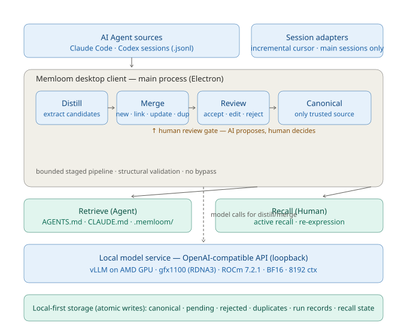

# Memloom — Project Specification

> AMD AI DevMaster Hackathon 2026-07 · **Track 2: Development & Local Deployment of Private AI Agents**
> Application: **Memloom** — a local private AI agent knowledge layer (two-way knowledge system)
> Team: **memloom** · Author: Luke
> All inference runs locally on AMD Radeon GPU (ROCm). English submission materials only.

---

## 1. Application scenarios

**Memloom is a two-way knowledge layer between people and AI assistants.** High-frequency AI users lose knowledge silently: tasks get done, but the methods, judgments, and lessons from collaboration never compound. The assistant falls back to generic behavior across sessions, and the human keeps re-explaining the same background.

| Scenario | What Memloom does |
|---|---|
| Research (graduate/doctoral) | Distills methods, judgment criteria, and research threads from AI collaborations into confirmed knowledge |
| Writing | Captures style, structure, and recurring decisions so the assistant stops repeating mistakes |
| Programming | Records project constraints and lessons learned; deploys them back to the assistant |
| Long-running projects | Removes repeated explanation and re-surfacing of old errors across sessions |

**Target users**: graduate students, doctoral students, and knowledge workers who use AI at high frequency, have long-running projects, and large volumes of digital collaboration records.

**Core product claim** (in one sentence):

> AI surfaces candidates; humans decide what deserves long-term retention; the same confirmed knowledge then serves both the human (review & recall) and the assistant (rules & context) — from a single source that never drifts.

---

## 2. Agent architecture diagram



The system has two independently usable paths (lightweight skills and a desktop client) that share the same product model. The desktop client runs a **bounded, staged pipeline** in the main process:

1. **Capture** — session adapters read Claude Code / Codex `.jsonl` records incrementally from the last cursor (main sessions only).
2. **Distill** — the model extracts long-term valuable candidates; no qualifying candidate is a valid result (anti-bloat).
3. **Merge** — each candidate is classified as **new / link / update / duplicate** against the formal store.
4. **Review** — a **human review gate**: accept / edit / reject / defer. The system can never bypass this gate.
5. **Canonicalize** — confirmed knowledge becomes the single trusted source.
6. **Reuse** — **Retrieve**: assistant-facing versions deploy to `AGENTS.md` / `CLAUDE.md` + `.memloom/`; **Recall**: human-facing versions support active recall and re-expression.

All model calls go to a **local OpenAI-compatible endpoint on loopback** (vLLM on the AMD Radeon GPU). Storage is **local-first** (atomic JSON writes): canonical / pending / rejected / duplicates / run records / recall state — no cloud dependency, no upload.

Key architecture constraints (from the technical design):

- Never automatically trust model-generated knowledge.
- Human-facing and assistant-facing versions come from the same formal knowledge.
- Formal knowledge is the source; deployment files are re-generable views.
- Reading knowledge must not implicitly modify it.
- The first version has no cloud accounts, no cloud sync, no full voice interaction.

---

## 3. Core capabilities

| Capability | Description |
|---|---|
| **Distill** | Automatically extracts long-term valuable candidates from real Agent sessions — no extra note-taking |
| **Merge** | Classifies new / link / update / duplicate and completes relationship chains, preventing a knowledge base bloated with similar fragments |
| **Review** | Visual one-by-one review: accept / edit / reject / defer; reviewing is itself the first lightweight recall |
| **Dual versions** | The same reviewed knowledge has a human version (explanation, mechanism, boundary, examples) and an agent version (rules, constraints, invocation conditions) — never maintained separately |
| **Attribution & evidence** | Every knowledge unit keeps its source (user position / AI explanation / external material / tool observation) and evidence quotes from the original session |
| **Retrieve** | Deploys confirmed knowledge as Agent-readable files (`AGENTS.md` / `CLAUDE.md` + `.memloom/`), or per-task retrieval; the reader tool filters to agent versions only |
| **Recall** | Human-facing review: today's recommendations, active recall Q&A, mastery feedback, scenario practice |
| **Local-first privacy** | Data stays on the machine; keys in system secure storage; exportable and deletable |

---

## 4. Model introduction & local deployment plan

### 4.1 Model selection (14 models measured on AMD Radeon Cloud, gfx1100)

| Model | Weights | TTFT p50 | Throughput | v1 success | Recommendation |
|---|---:|---:|---:|---:|---|
| **Qwen2.5-14B-Instruct** | 28 GB | 26.7 s | 11.8 t/s | **90.5%** | **Production pick** (quality first, structured output) |
| Qwen3-4B | 7.6 GB | 55 ms (v2) | 44.6 t/s | 85.7% | Speed / small VRAM (best latency-sensitive value) |
| Qwen3-14B | 28 GB | 0.8 s | 11.7 t/s | 85.7% | TTFT-sensitive tasks |
| gemma-3-12b-it | 23 GB | 129 ms (v2) | 13.9 t/s | 100% | Full-score reference |
| phi-4 | 28 GB | 177 ms (v2) | 12.4 t/s | — | v2 highest total score (51.17) |

Excluded: DeepSeek-V2-Lite (MLA inference unavailable on ROCm without flash-attn), Llama/Mistral (weak JSON adherence), Qwen3-Coder-30B (57 GB BF16 does not fit 48 GB VRAM; FP8 unsupported on RDNA3).

### 4.2 Local deployment plan

Standard vLLM launch on the AMD Radeon GPU (loopback, verified on gfx1100 / ROCm 7.2.1):

```bash
vllm serve /path/to/model \
  --host 127.0.0.1 --port 8000 \
  --max-model-len 8192 \
  --gpu-memory-utilization 0.9 \
  --enforce-eager \
  --trust-remote-code
```

- **Quantization**: BF16 (FP8 has no hardware instructions on RDNA3).
- **VRAM budget**: BF16 weights must stay < 48 GB (actual usable VRAM is 47.98 GB); preferred dense 4B–14B models.
- **Runtime**: all inference on the AMD GPU; the desktop client and skills call the loopback OpenAI-compatible endpoint.
- **Two delivery paths**: lightweight Python-stdlib skills (`skills/`) and the Electron desktop client (`zhiyi-desktop/`).

---

## 5. AMD Radeon GPU inference speed optimization

Measured on 6 AMD Radeon Cloud instances (gfx1100 / RDNA3 / ROCm 7.2.1), BF16, 8192 context, loopback. Full detail: `amd-radeon-gpu-inference-optimization.md`.

| Optimization | Method | Measured effect |
|---|---|---|
| Inference engine | vLLM with native ROCm support | TTFT 13–27 s → **55–179 ms** |
| Attention backend | Uninstall CUDA flash-attn, use ROCm-native kernels | Fixed startup crashes on Qwen-family models |
| Graph mode | `--enforce-eager` (RDNA3 has no stable CUDA-graph path) | Stable inference on gfx1100 |
| Quantization | BF16 | Controllable weights/VRAM |
| Model selection | 14-model × 21 runs (v1) + 12-model × 54 runs (v2) benchmark | Optimal model per scenario |

**Before / after (early V2-Lite era → Qwen3-4B / v2 environment):**

| Metric | Before | After | Improvement |
|---|---:|---:|---:|
| TTFT p50 | 12,972 ms | **55 ms** | **236x** |
| Output throughput | 22.1 t/s | **44.6 t/s** | **2.0x** |
| Peak VRAM | 46.56 GB | **7.6 GB** | **6.1x saving** |
| JCT p50 | 6,726 ms (unstable) | 4.5 s (stable) | stable & reproducible |

**Key lessons**: (1) the core of ROCm optimization is removing CUDA dependencies — flash-attn is the largest compatibility blocker; (2) `--enforce-eager` is mandatory on gfx1100; (3) speed optimization must stay tied to quality — success rate is measured by a 7-task (v1) / 18-task (v2) benchmark, and a faster-but-failing run scores zero.

---

## 6. Benchmark & quality evidence

Memloom ships a reproducible quality system for measuring a fixed pipeline + model on AMD GPUs:

- **v1** (7 tasks): smoke / regression — keyword-group matching.
- **v2** (18 tasks, stateful): extraction / governance / lifecycle / downstream reuse / local evidence, weighted score `S = 0.30E + 0.20G + 0.20L + 0.25R + 0.05P` — validates the product claim (a confirmed knowledge item improves downstream Agent decisions), including strict zero-output cases and counterfactual reuse tests.
- Reports: `evals/reports/2026-08-03-amd-track2-v2-13-models.md` (13 models) and `evals/reports/2026-08-02-amd-multi-model-comparison.md` (14 models).
- All runs: loopback local inference, no test content in production prompts, suite/dataset SHA-256 frozen.

---

## 7. Submission materials index

| Material | Location / status |
|---|---|
| Project specification | This document |
| Agent architecture diagram | `assets/agent-architecture.svg` (editable mermaid: `agent-architecture.md`) |
| Inference optimization detail | `amd-radeon-gpu-inference-optimization.md` |
| Source code | Repo: `zhiyi-desktop/` (Electron client), `skills/` (6 skills), `benchmarks/`, `evals/` |
| README (env config, startup, dependencies) | `README.en.md` |
| Demo video (English, 4:55, 720p MP4) | `videos/846643ac6c72860d0439e6834823e0e3_raw.mp4` |
| Slide deck / poster | `Memloom-5min-EN.pptx` |
| Benchmark reports | `evals/reports/*.md` |

> PR title: **`Track 2, memloom, Memloom`**. Team name: `memloom`; application name: `Memloom`.
