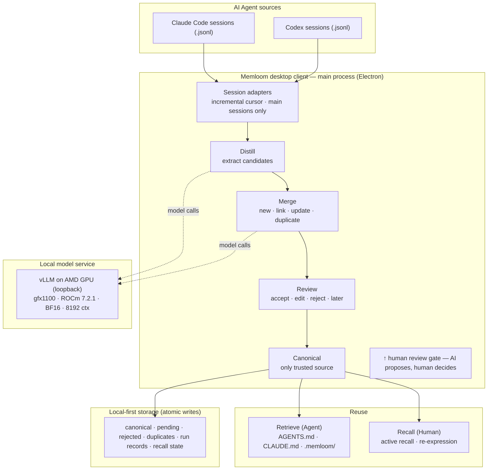

# Memloom Agent Architecture (Track 2)

> English architecture diagram for the AMD Track 2 submission. A rendered SVG is at `assets/agent-architecture.svg`; an editable Mermaid version is below.

## Rendered diagram

## Mermaid source (editable)

## Component description

| Layer | Components | Responsibility |
|---|---|---|
| Agent sources | Claude Code / Codex session files | Raw collaboration records, read incrementally from the last cursor position |
| Desktop client (main process) | Session adapters → Distill → Merge → Review → Canonical | Bounded staged pipeline: extract long-term valuable candidates, classify new/link/update/duplicate, gate on human confirmation, store the single trusted version |
| Human review gate | Review UI (renderer) | The user accepts, edits, rejects, or defers each candidate; the system never bypasses this gate |
| Reuse | Retrieve / Recall | Deploy assistant-facing versions to `AGENTS.md`/`CLAUDE.md` + `.memloom/`; support human re-expression and recall |
| Local model service | vLLM on AMD GPU | OpenAI-compatible endpoint on loopback; all inference runs on the AMD Radeon GPU (gfx1100, ROCm 7.2.1, BF16) |
| Local-first storage | Atomic JSON files | canonical / pending / rejected / duplicates / run records / recall state — no cloud dependency |
