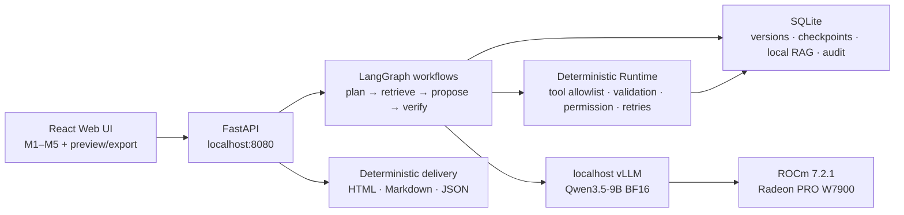

# Experience Asset

**A private local Agent for turning lived experience into evidence-bound,
reusable knowledge.**

Experience Asset turns fragmented first-person notes into a durable asset that
separates source facts, user judgments, Agent inferences, and unresolved gaps.
The user reviews five visible milestones, can correct or resume the asset, and
then generates route-aware HTML, Markdown, and JSON deliverables. External
sharing stays blocked until the exact version passes privacy review and receives
explicit approval.

This repository contains the complete Track 2 application: React Web UI,
FastAPI service, LangGraph workflows, deterministic Runtime policy, SQLite
persistence and retrieval, renderers, tests, frozen model/runtime identities,
and sanitized W7900/ROCm evidence.

## User flow

1. **M1 — Experience Brief:** establish the source boundary and goal.
2. **M2 — Critical Moment Map:** identify the moments that changed the path.
3. **M3 — Decision and Evidence Ledger:** connect alternatives, decisions,
   actions, results, and evidence.
4. **M4 — Insight and Boundary Map:** extract lessons, limitations, and transfer
   conditions. Cross-asset discovery remains locked until the Knowledge Card is
   accepted.
5. **M5 — Route Readiness:** evaluate private, beginner, peer,
   customer/evaluator, and public routes; surface privacy risks; preview and
   export only what the evidence and approval state permit.

The canonical asset is autosaved and versioned. M1–M4 retrieval is limited to
the current source and prior versions of the same asset. After M4 readiness,
cross-asset discovery returns summary-only candidates; detailed history is read
only after the user confirms a relation.

## Agent architecture



The model produces structured proposals; it never grants tool execution,
retrieval, export, deletion, or publication permission. Those decisions belong
to the Runtime and application policy.

## Frozen final stack

| Layer | Final identity |
|---|---|
| GPU | AMD Radeon PRO W7900, `gfx1100`, 48 GiB |
| ROCm/HIP | Radeon Cloud ROCm 7.2.1; accepted evidence reports HIP `7.2.53211` |
| Model | `Qwen/Qwen3.5-9B`, ModelScope revision `460979c3d11864dd16408d860ac930a360a2fac2` |
| Serving | vLLM `0.26.0+rocm723`, BF16, 20K context, localhost only |
| Final profile | `P1-prefix-cache`; immediate rollback profile `S0` |
| Agent | Python 3.12, FastAPI, LangGraph, Pydantic, SQLite |
| Web | React 18, TypeScript, Vite; Node 20+ and npm 10+ |

Dependency sources of truth:

- Agent environment: [`requirements-agent.txt`](requirements-agent.txt) and
  [`pyproject.toml`](pyproject.toml)
- Web environment: [`web/package-lock.json`](web/package-lock.json)
- vLLM ROCm wheel and SHA-256:
  [`config/runtime/vllm-rocm721-qwen35.env`](config/runtime/vllm-rocm721-qwen35.env)
- model revision and per-file hashes:
  [`config/models/qwen3.5-9b.modelscope.json`](config/models/qwen3.5-9b.modelscope.json)
- final serving arguments and rollback:
  [`config/serving/final-p1-prefix-cache.json`](config/serving/final-p1-prefix-cache.json)

## Reproduce on Radeon Cloud

Only `/workspace` is persistent on Radeon Cloud. Keep the repository, virtual
environments, model, databases, caches, and logs under that path. The Agent and
vLLM use separate Python environments.

### 1. Clone and verify the host

```bash
cd /workspace
git clone https://github.com/kinnyuww/amd-devmaster-track2-agent.git \
  amd-track2-agent/repo
cd /workspace/amd-track2-agent/repo

bash scripts/bootstrap_workspace.sh
bash scripts/verify_remote_dev.sh
bash scripts/verify_rocm_env.sh
```

### 2. Install the two environments

```bash
cd /workspace/amd-track2-agent/repo
bash scripts/install_agent_env.sh
bash scripts/install_vllm_qwen35_rocm721.sh

cd web
npm ci
```

The vLLM installer downloads the frozen ROCm wheel, verifies its SHA-256, and
fails closed if the installed version, HIP runtime, ROCm platform, or GPU tensor
smoke test does not match.

### 3. Download and verify the exact model snapshot

Install a reviewed ModelScope CLI in the cloud environment, then run:

```bash
modelscope download \
  --model Qwen/Qwen3.5-9B \
  --revision 460979c3d11864dd16408d860ac930a360a2fac2 \
  --local_dir /workspace/amd-track2-agent/models/Qwen3.5-9B-460979c3d118

cd /workspace/amd-track2-agent/repo
python3 scripts/verify_model_snapshot.py \
  --manifest config/models/qwen3.5-9b.modelscope.json \
  --model-dir /workspace/amd-track2-agent/models/Qwen3.5-9B-460979c3d118
```

The verifier hashes every declared file before the model server starts.

### 4. Start the complete application

Terminal 1 — final local model service:

```bash
cd /workspace/amd-track2-agent/repo
bash scripts/serve_final_vllm.sh
```

To roll back the selected Stage 1 factor without changing the application:

```bash
SERVING_PROFILE=S0 bash scripts/serve_final_vllm.sh
```

Terminal 2 — Agent API:

```bash
cd /workspace/amd-track2-agent/repo
source /workspace/amd-track2-agent/venvs/agent/bin/activate

export OPENAI_BASE_URL=http://127.0.0.1:8000/v1
export OPENAI_API_KEY=EMPTY
export SERVED_MODEL_NAME=Qwen3.5-9B
export CODE_COMMIT="$(git rev-parse HEAD)"
# Set VERIFIED only on the accepted W7900/ROCm host after both verification
# scripts above pass. Leave the default NOT_VERIFIED elsewhere.
export GPU_VIABILITY=VERIFIED

uvicorn app.experience_asset.api.main:app \
  --host 127.0.0.1 --port 8080
```

Terminal 3 — live Web UI:

```bash
cd /workspace/amd-track2-agent/repo/web
VITE_DATA_SOURCE=live \
VITE_PROXY_TARGET=http://127.0.0.1:8080 \
npm run dev -- --host 127.0.0.1 --port 5173
```

Open:

```text
http://127.0.0.1:5173/?view=m1&source=live
```

The browser talks to FastAPI through the same-origin Vite proxy. FastAPI and
vLLM remain bound to loopback. Do not expose vLLM directly; public Web access
requires the separately documented authenticated tunnel procedure.

## Verification

Repository contract checks:

```bash
bash -n scripts/*.sh
python3 -m py_compile scripts/*.py
python3 -m unittest discover -s qa/tests -v
bash qa/gates/pr_gate.sh --mode contract
```

Agent checks:

```bash
source /workspace/amd-track2-agent/venvs/agent/bin/activate
pytest
ruff check .
```

Web checks:

```bash
cd web
npm run verify:contracts
npm run typecheck
npm run lint
npm run test
npm run build
npm run e2e:install   # first run only
npm run e2e           # live journeys skip unless E2E_LIVE_BASE_URL is set
```

For a live browser run with FastAPI already running:

```bash
cd web
E2E_LIVE_BASE_URL=http://127.0.0.1:8080 \
VITE_PROXY_TARGET=http://127.0.0.1:8080 \
npm run e2e
```

## W7900 evidence and optimization boundary

- The integrated A0 functional checkpoint passed on real local
  Qwen3.5-9B/W7900/ROCm at implementation commit
  `c9ec07489d17a2abb74bac66a23ade2c775c1b06`; see
  [`evidence/milestones/e8-a0-w7900/20260806T122806Z/`](evidence/milestones/e8-a0-w7900/20260806T122806Z/).
- Stage 1 selected `P1-prefix-cache` under its frozen service benchmark.
- Stage 2 confirmed one complete synthetic Agent journey on both S0 and P1
  without an observed functional or safety regression; see
  [`docs/kinnyu/FINAL_MODEL_SERVICE_DECISION.md`](docs/kinnyu/FINAL_MODEL_SERVICE_DECISION.md)
  and
  [`evidence/performance/stage2-minimal/20260806T124938Z/`](evidence/performance/stage2-minimal/20260806T124938Z/).

Stage 2 was a one-case compatibility check, not a statistical application-speed
study. Its observed P1 cache-hit rate was `0.0%`, so this project does not claim
that prefix caching caused a generalized end-to-end speedup. S0 remains the
documented rollback because P1 Stage 1 warm-up reliability was `85%`.

## Repository map

```text
app/          Agent domain, workflows, policy, persistence, API and renderers
web/          React/Vite product UI and browser tests
contracts/    JSON Schema, OpenAPI and public contract examples
config/       frozen model, runtime and serving identities
scripts/      setup, verification, serving and evidence helpers
tests/        backend unit and integration tests
qa/           public competition contract gates and fixtures
evidence/     sanitized, reproducible evidence packets
docs/         product, architecture, environment and decision records
spec/         stable engineering and evidence governance entry point
```

## Security and privacy boundaries

- No remote closed-model API is part of the core inference path.
- Model output is untrusted until Runtime validation and permission checks pass.
- Cross-asset detail retrieval requires explicit relation confirmation.
- External export approval is bound to the exact asset version and hashes;
  changing the content invalidates the approval.
- Model weights, secrets, private user data, raw private evidence, and generated
  exports are intentionally excluded from Git.

The product does not claim to eliminate hallucinations. It reduces unsupported
claims through source references, visible unresolved states, user correction,
deterministic validation, and bounded permissions.
