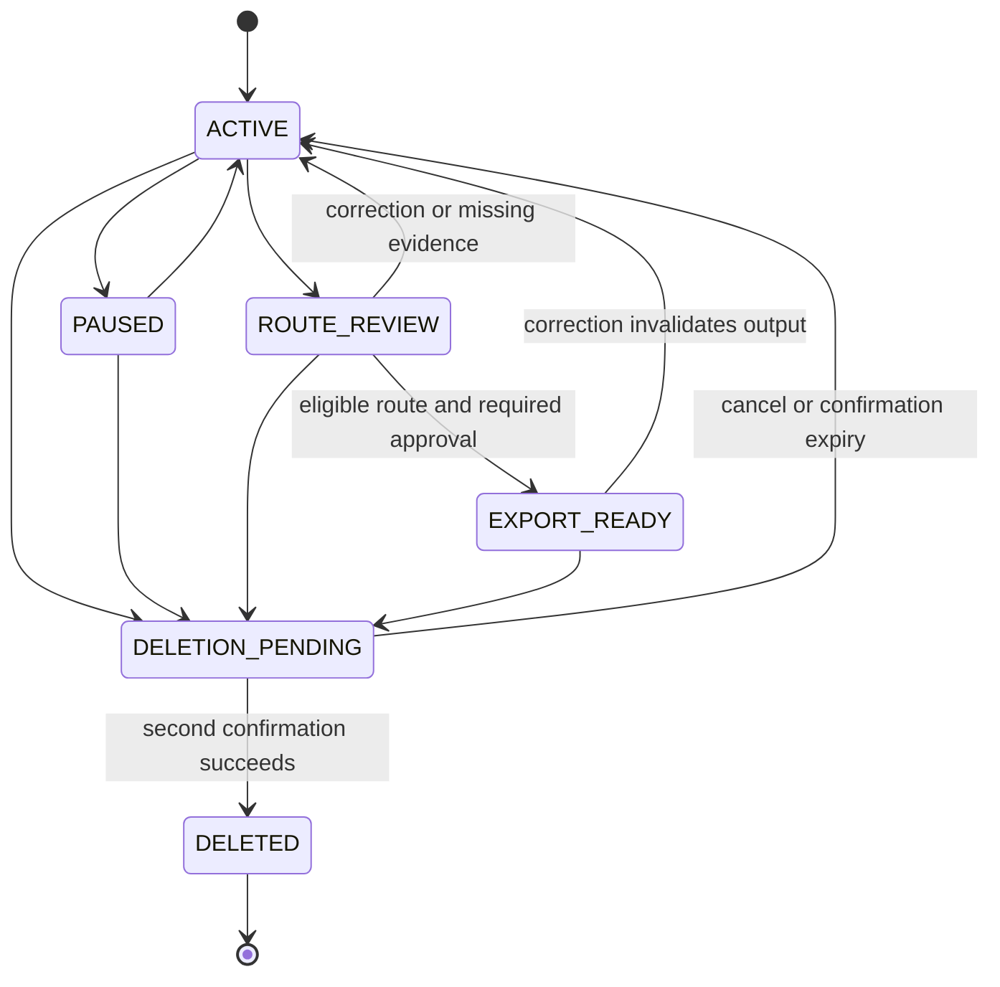

# Experience Asset P0 — L3 Engineering Execution Plan

## Status

- Plan ID: `EXP-ASSET-P0-L3`
- Parent iteration: `EXP-ASSET-P0`
- Plan status: `APPROVED`
- Product requirement: `APPROVED`
- Product implementation: `E1 ACCEPTED / E2 NOT STARTED`
- Baseline status: `NOT RECORDED`
- Created: 2026-07-24 AEST
- Revised: 2026-08-03 AEST for the approved two-layer performance screen
- Current work packages: Issue #5 / PR #7 (`E1-A`), Issue #6 / PR #8
  (`E1-B`) and PR #12 are accepted and merged at
  `main@cc5281af5a6b4ac2d8c2e593f7c8e7f014feb31d`
- Current gate: T06 is `PASS`; the accepted exact-current-commit W7900 packet
  is `evidence/milestones/e1-combined/20260727T055758Z/`
- Pending execution review: the user approved
  [`E2_E8_PIPELINE_EXECUTION_PLAN.md`](E2_E8_PIPELINE_EXECUTION_PLAN.md);
  it changes E2–E7 ownership and permits bounded N+1 preparation, but takes
  effect only after quality-owner acceptance
- Implementation gate: satisfied by explicit owner approval on 2026-07-24 AEST

This document converts the approved L1 product journey and L2 capability gates
into an executable L3 plan. It is intentionally more specific than the product
requirement but cannot weaken or silently reinterpret `AC-01` through `AC-32`.
When this document conflicts with `CURRENT_ITERATION.md`, the latter wins and
the conflict must be raised before implementation.

## 1. Engineering outcome

Deliver one correctness-first, private-by-default vertical product that:

1. accepts a first-person experience as conversation, pasted text, `.txt`, or
   `.md`;
2. exposes and autosaves all five refinement artifacts;
3. preserves statement status, provenance, versions, corrections, and
   unresolved information;
4. evaluates all five audience routes without fabricating eligibility;
5. separates private preview/download from external-audience sharing and blocks
   every shareable external export until risk handling and explicit approval
   are complete;
6. renders preview, HTML, Markdown, and JSON from the same saved asset version;
7. exposes a visible Agent loop that plans, grounds M1-M4 in the current
   experience, delays cross-asset discovery until the Knowledge Card is ready,
   retrieves detailed history only after relation confirmation, proposes
   bounded tool calls, passes deterministic Runtime validation,
   verifies effects, and terminates explicitly;
8. runs core generation through local vLLM on W7900/ROCm; and
9. freezes a reproducible `S0` service baseline and screens declared serving
   profiles before the product is complete, then freezes the complete Agent as
   `A0` and permits product promotion only after identical end-to-end business
   evaluation.

## 2. Explicit non-goals

The L3 implementation must not add:

- Idea Asset or Method Asset product paths;
- raw image, audio, video, receipt, or screenshot understanding;
- unreviewed web research as evidence;
- external publishing, email, messaging, or social-platform APIs;
- multi-user accounts, collaboration, or remote synchronization;
- PDF, slides, long-image, or social-card renderers;
- medical, legal, financial, or safety advice;
- fine-tuning, LoRA, distillation, or training in the P0 performance screen;
- a remote closed-model fallback for private/core generation;
- a hard latency target before the relevant `S0` or `A0` baseline is measured; or
- performance changes hidden inside correctness or feature PRs.

## 3. Engineering route

### 3.1 Route choice

Use a correctness-first modular monolith delivered as thin vertical slices.
The Web UI and Agent API are one application deployment, while vLLM remains a
separate process and Python environment.

```text
React/Vite Web UI
    -> FastAPI command/query API and progress stream
        -> application services and LangGraph workflow
            -> deterministic runtime policy
            -> SQLite repositories
            -> local OpenAI-compatible vLLM client
            -> deterministic HTML/Markdown/JSON renderers
```

This route minimizes deployment and distributed-state risk for a single-user
hackathon product while preserving module boundaries that can be tested
independently.

The selected Agent architecture is one durable orchestration Agent with
specialized LangGraph nodes, not a free-form multi-Agent system. Its exact
plan/retrieve/propose/validate/execute/verify/persist loop, local-memory scope,
tool contracts and Track 2 mapping are frozen in
[`AGENT_ARCHITECTURE.md`](../team-alignment/AGENT_ARCHITECTURE.md).

### 3.2 Selected P0 technology choices

| Concern | Proposed choice | Boundary |
|---|---|---|
| Backend | Python 3.12, FastAPI, Pydantic v2 | Owns API validation and application commands |
| Workflow | LangGraph | Owns milestone orchestration only; not durable truth |
| Local retrieval | Repository interface backed first by SQLite FTS5/BM25 | Current-source grounding is allowed in M1-M4; cross-asset summary discovery waits for the post-M4 readiness gate; detailed history waits for relation confirmation; no external search |
| Product data | SQLite in persistent project storage | Single-user transactional source of truth |
| Model serving | vLLM in its existing separate ROCm environment | Owns model loading and inference only |
| Model client | OpenAI-compatible localhost client | No remote fallback in the core path |
| Initial model profile | Frozen ModelScope Qwen2.5-14B-Instruct revision, BF16, 8K context | Starting profile, not a performance claim; acceptance remains E1-A3-gated |
| Web UI | React + Vite | User-approved P0 frontend; talks only to the application API |
| HTML renderer | Deterministic Jinja2 template | Must not call an LLM |
| Markdown/JSON | Deterministic serializers | Must use the same saved version as HTML |
| Tests | pytest plus the existing `qa/` gates | Private blind evaluation remains outside Git |
| Trace | Redacted structured JSONL plus run metadata in SQLite | Raw prompt/response capture is disabled by default |

The selected E1 source is ModelScope revision
`3957bf39753cf01f98f6560295c4811c2b5df001`, cross-referenced to the official
Hugging Face upstream revision and recorded with Apache-2.0 license plus
per-file SHA-256 in
`config/models/qwen2.5-14b-instruct.modelscope.json`. At selection time this
was only a frozen input, not accepted runtime evidence. PR #7 later accepted
the E1-A3 downloaded-snapshot, W7900 load, tool-parsing and dependency evidence;
PR #12/T06 subsequently accepted the exact-current-commit combined E1 packet.
Those accepted packets supersede the earlier unverified state without turning
the frozen input declaration itself into a performance claim.

## 4. Repository and module boundaries

The first implementation may adjust names during scaffold review, but must
preserve these responsibilities:

```text
app/
  experience_asset/
    domain/          # Pydantic domain models, enums, invariants, errors
    application/     # commands, queries, milestone and correction services
    workflow/        # LangGraph nodes and transitions
    retrieval/       # scoped local source/related-asset indexing and search
    inference/       # local model interface, vLLM adapter, structured proposals
    tools/           # model-visible tool schemas, registry and bounded adapters
    persistence/     # SQLite migrations and repositories
    policy/          # evidence, route, privacy, approval and deletion policy
    renderers/       # deterministic preview, HTML, Markdown and JSON output
    observability/   # run IDs, events, metrics and sanitized traces
    api/             # FastAPI routes, dependency wiring and progress stream
web/                 # React/Vite application
tests/
  unit/
  integration/
  e2e/
qa/                  # existing public contract, fixtures and gates
```

Hard boundaries:

- `inference/` returns structured proposals; it cannot save data, grant
  permission, approve export, delete content, or decide test results.
- `tools/` exposes only reviewed schemas/adapters; registering a tool does not
  grant a model permission to execute it.
- `workflow/` coordinates application services; it cannot treat in-memory
  LangGraph state as the durable canonical asset.
- `retrieval/` exposes separate current-source, cross-asset-candidate and
  confirmed-relation detail operations. It cannot widen asset scope, cross the
  Knowledge Card/confirmation gates, mutate canonical state, grant permission,
  or treat retrieved instructions as policy.
- `persistence/` stores validated domain records; it cannot call the model.
- `policy/` makes deterministic permission decisions and may use model output
  only as an untrusted detection input.
- `renderers/` receive a stored route draft and version; they cannot add claims.
- `api/` cannot bypass application services to write SQLite directly.
- `web/` cannot infer approval or completion from visual state alone.

## 5. Core domain contract

### 5.1 Identity and immutable version rules

Use opaque UUIDs for:

- `asset_id`;
- `version_id`;
- `source_id`;
- `statement_id`;
- `artifact_id`;
- `question_id`;
- `route_draft_id`;
- `finding_id`;
- `approval_id`;
- `export_id`; and
- `run_id`.

Every saved content change creates a new immutable `version_id` with:

- `asset_id`;
- `parent_version_id`, except the first version;
- `schema_version`;
- `change_kind`;
- `change_reason`;
- `created_at`;
- the complete validated canonical payload; and
- a content hash.

The mutable `assets.current_version_id` pointer identifies the active version.
Existing versions are never edited in place.

For P0, a “complete JSON snapshot” means one validated structured copy of the
canonical Experience Asset at that version. It does **not** duplicate uploaded
files, model weights, exports, or raw conversation logs. This trade-off is
selected because it makes correction, comparison, rollback, audit, and
quality-owner reproduction simple and reliable for a single-user hackathon
product. `schema_version`, the repository interface, and migrations isolate
the storage choice, so a later iteration may normalize hot fields or adopt an
event/delta model without changing the API or losing existing snapshots.

### 5.2 Statement contract

Every material statement must contain:

| Field | Rule |
|---|---|
| `statement_id` | Stable across unchanged copied versions |
| `text` | User-visible statement |
| `status` | `SOURCE_FACT`, `USER_JUDGMENT`, `AGENT_INFERENCE`, or `UNRESOLVED` |
| `source_refs` | Zero or more source spans/IDs; required for `SOURCE_FACT` |
| `derived_from` | Upstream statement IDs; required for material Agent inference |
| `confirmation` | `UNCONFIRMED`, `CONFIRMED`, `CORRECTED`, or `REJECTED` |
| `evidence_strength` | `DIRECT`, `INDIRECT`, `SELF_REPORTED`, or `NONE` |
| `sensitivity_tags` | Zero or more privacy categories |
| `created_in_version` | First version that introduced the statement |
| `last_changed_in_version` | Most recent content/status change |

An Agent inference cannot be promoted to `SOURCE_FACT` merely because the user
confirms it. Promotion requires a newly recorded, traceable conversation or
source span that directly supports the statement. A confirmation without such
evidence remains `USER_JUDGMENT`. Missing evidence remains `UNRESOLVED`; it is
not filled for narrative fluency.

### 5.3 Source reference contract

Each `SourceReference` records:

- source kind: `CONVERSATION`, `PASTED_TEXT`, `TXT_FILE`, `MD_FILE`, or
  `ADAPTED_PUBLIC_FIXTURE`;
- display label;
- original file name where applicable;
- source hash;
- local asset-relative storage reference;
- optional source URL and adapted-provenance notice;
- text span or message reference;
- ingestion timestamp; and
- whether the content is user-authored, third-party, or adapted research.

The public office-chair fixture must retain its provenance URL and
`ADAPTED_PUBLIC_FIXTURE` status without storing the original username or copying
the source post verbatim.

### 5.4 Canonical `ExperienceAssetV1`

The canonical payload must include:

- identity, schema version, lifecycle state, current milestone, and timestamps;
- sources and source boundaries;
- context, goal, constraints, and user intent;
- material statements and their evidence/status metadata;
- ordered critical moments, cues, changes, surprises, and conflicts;
- alternatives, decisions, reasons, actions, observed results, and evidence;
- lessons, counterfactuals, limitations, counterexamples, and applicability;
- unresolved questions and user decisions to answer, skip, or defer;
- five milestone artifact envelopes and states;
- five route decisions and their reasons/missing evidence;
- privacy and claim-risk findings and their resolutions;
- selected route drafts and language;
- user-confirmed related-asset links;
- the Knowledge Card readiness decision, summary-only relation candidates and
  the user action that confirmed or declined each relation;
- approval references;
- current/superseded export references; and
- version lineage and derivation metadata.

### 5.5 Common milestone artifact envelope

Each milestone artifact is stored inside a common envelope:

- `artifact_id`;
- `artifact_type`;
- `asset_id` and `version_id`;
- `milestone`;
- `state`;
- `statement_ids`;
- `unresolved_question_ids`;
- `generated_by_run_id`;
- `user_review_status`;
- `created_at` and `updated_at`;
- `invalidated_by_version_id`, when applicable; and
- milestone-specific payload.

Milestone-specific payloads are:

| Milestone | Artifact | Required payload |
|---|---|---|
| M1 | `ExperienceBriefV1` | provenance, event boundary, goal, constraints, first useful structure |
| M2 | `CriticalMomentMapV1` | ordered events, cues, changes, surprises, conflicts, critical moments |
| M3 | `DecisionEvidenceLedgerV1` | alternatives, reasons, decisions, actions, results, evidence/status links |
| M4 | `InsightBoundaryMapV1` | lessons, support, counterfactuals, limits, counterexamples, transfer conditions |
| M5 | `RouteReadinessMatrixV1` | five route decisions, missing support, privacy findings, approval readiness |

### 5.6 Question contract

A clarification question records:

- one concrete question;
- why the answer matters;
- the affected milestone and statement IDs;
- deterministic priority inputs;
- state: `OPEN`, `ANSWERED`, `SKIPPED`, or `DEFERRED`;
- answer/source link when answered; and
- the run and version that created or resolved it.

The runtime returns at most three open questions in a normal round. `SKIPPED`
and `DEFERRED` never mean answered and cannot turn missing content into fact.

### 5.7 Route, privacy, approval, and export contracts

Every one of the five routes has a `RouteDecision`:

- route: `PRIVATE_SELF`, `BEGINNER`, `PEER`, `CUSTOMER_EVALUATOR`, or `PUBLIC`;
- eligibility: `ELIGIBLE`, `INELIGIBLE`,
  `ELIGIBLE_AFTER_PRIVACY_APPROVAL`, or `BLOCKED`;
- deterministic reason codes and user-visible explanation;
- supporting and missing statement IDs;
- canonical version used; and
- policy and model run versions.

Every route also follows this minimum content contract:

| Route | Required content | Ineligibility / prohibited shortcut |
|---|---|---|
| `PRIVATE_SELF` | decision record, unresolved items, personal lessons, next-time checklist | never hide uncertainty merely because the output remains private |
| `BEGINNER` | prerequisites, ordered steps, glossary, common mistakes, non-applicability | no unexplained expert shorthand or unsupported universal advice |
| `PEER` | alternatives, failed attempts, evidence strength, trade-offs, constraints, counterexamples | no removal of uncertainty to produce a cleaner comparison |
| `CUSTOMER_EVALUATOR` | goal, qualifying role/context, method, verifiable result, limitations | ineligible without sufficient professional/project/result evidence |
| `PUBLIC` | short summary, event arc, transferable lesson, boundaries and disclosures | no sensitive detail, professional advice or universalized conclusion |

The system evaluates all five routes but generates only the user-selected
eligible route. Route eligibility, content/evidence maturity and share/privacy
approval are independent states.

Every `PrivacyFinding` records a category, affected statement/source reference,
severity, explanation, proposed actions, and resolution:
`OPEN`, `KEEP`, `GENERALIZE`, `REMOVE`, or `ACKNOWLEDGED`.

Every shareable-external-audience `ApprovalRecord` binds:

- user action and timestamp;
- `asset_id`, `version_id`, route, language, and route-draft hash;
- privacy-review hash and all finding resolutions; and
- approval scope `SHAREABLE_EXPORT`.

Approval becomes stale after any bound content, route, language, risk
resolution, renderer-input, or canonical version changes.

Every `ExportRecord` binds the same canonical version and route-draft hash to
one of `HTML`, `MARKDOWN`, or `JSON`, plus file hash, path, creation time, and
state `CURRENT`, `SUPERSEDED`, `BLOCKED`, `FAILED`, or `DELETED`.

### 5.8 Public artifact serialization boundary

Domain enums use uppercase names in Python. The public JSON adapter must emit
the lowercase values already frozen by `qa/schema/experience_asset.schema.json`:

| Domain value | Public JSON value |
|---|---|
| `SOURCE_FACT` | `source_fact` |
| `USER_JUDGMENT` | `user_judgment` |
| `AGENT_INFERENCE` | `agent_inference` |
| `UNRESOLVED` | `unresolved` |
| `ELIGIBLE` | `eligible` |
| `INELIGIBLE` | `ineligible` |
| `ELIGIBLE_AFTER_PRIVACY_APPROVAL` | `eligible_after_privacy_approval` |
| `BLOCKED` | `blocked` |

Missing support is represented as `BLOCKED` with a reason code such as
`MISSING_EVIDENCE`; it is not a fifth public eligibility value. Contract tests
must round-trip every mapping and validate the exported asset with the public
schema and artifact gate.

User-facing copy must not present `SOURCE_FACT` as externally verified truth.
Display it as “source-supported statement” / “来源陈述（本人回忆）” together
with `evidence_strength`; the domain enum remains stable.

### 5.9 Agent run, plan, tool and verification contracts

`AgentRunStateV1` contains at minimum the run/asset/base-version/command IDs,
user goal and acceptance checks, permission snapshot, current milestone,
bounded `WorkPlanV1`, retrieved evidence references, proposed tool calls, tool
observations, structured proposal, validation findings, verification result,
step/model-call/retry budgets, exact model/server identity, last durable
version and terminal state.

Retrieval state additionally records `retrieval_scope` (`CURRENT_SOURCE`,
`CROSS_ASSET_SUMMARY`, or `CROSS_ASSET_DETAIL`), the bound Knowledge Card
version/hash, readiness decision, relation-candidate IDs, confirmed relation
IDs, returned provenance references and a visible no-match/declined result.

Each `WorkPlanV1` step records a finite `step_kind`, reason, dependencies,
required evidence, required permission, status and stop condition. P0 step
kinds are limited to `RETRIEVE`, `ASK`, `EXTRACT`, `CLASSIFY`,
`UPDATE_ARTIFACT`, `VERIFY`, `EVALUATE_ROUTE`, `PRIVACY_REVIEW`, and `RENDER`.
The model may rank or revise steps inside the current milestone but cannot
bypass dependencies, budgets, Runtime policy or approval.

`ToolCallProposal`, `ToolExecutionRecord`, `PolicyDecision` and
`VerificationReport` are separate typed records. A proposal is never treated
as an execution record, and a semantic model critique is never treated as a
deterministic policy approval.

`ProgressEventV1` must use the same public progress contract as the QA gate.
When it emits a determinate percentage it records
`percent_basis="milestones_done/milestones_total"`, `milestones_done`,
`milestones_total`, and the derived `percent`. An implementation may retain
more detailed internal work-unit counters, but those counters do not replace
the public basis fields. Indeterminate work omits `percent`; an ETA is omitted
until its named basis has at least three comparable historical runs. Contract
tests must exercise both determinate and indeterminate events.

## 6. State machines

### 6.1 Asset lifecycle



An execution error ends a run, not the asset. The last valid asset version
remains resumable unless confirmed deletion succeeds.

### 6.2 Milestone state

Each milestone uses:

- `NOT_STARTED`;
- `IN_PROGRESS`;
- `NEEDS_INPUT`;
- `REVIEW_READY`;
- `CONFIRMED`;
- `COMPLETE_WITH_GAPS`;
- `INVALIDATED`; or
- `FAILED`.

Rules:

1. M1 starts after successful ingestion.
2. A user may confirm a milestone or continue with explicit gaps.
3. M2–M5 normally follow order, but a confirmed earlier artifact can be
   revisited.
4. Reopening creates a new asset version and records the reason. Reopening M1-M4
   invalidates `KnowledgeCardReady`, relation candidates and any downstream
   detailed-retrieval result until the readiness/confirmation gates are passed
   again for the new version.
5. A correction invalidates only dependent downstream artifacts.
6. An invalidated artifact is never presented as current.
7. Progress uses these real states and known work units only.

### 6.3 Run terminal state

Every command/run finishes with exactly one terminal result:

- `SUCCEEDED`;
- `NEEDS_USER_INPUT`;
- `PAUSED`;
- `CANCELLED`;
- `TIMED_OUT`;
- `MODEL_UNAVAILABLE`;
- `MODEL_OOM`;
- `INVALID_MODEL_OUTPUT`;
- `STORAGE_ERROR`;
- `POLICY_BLOCKED`;
- `DELETION_FAILED`; or
- `INTERNAL_ERROR`.

Each terminal result records the last durable version, retryability, safe user
message, internal error class, elapsed time, model-call count, and recovery
action. Silent fallback to a weaker model or remote API is prohibited.

## 7. Correction and dependency propagation

All derived objects record the statement IDs and artifact IDs they depend on.
A correction command must:

1. load the current version;
2. validate the user edit and affected source/statement;
3. create a new immutable version;
4. copy unrelated confirmed content unchanged;
5. mark dependent statements, artifacts, route decisions, route drafts,
   approvals, previews, and exports stale;
6. identify the earliest affected milestone;
7. regenerate only deterministic derivatives immediately;
8. schedule or request approval for model-dependent regeneration;
9. present the exact affected items to the user; and
10. keep the prior version available in history.

Old exports remain version-labelled historical records but are not offered as
the current deliverable. Public approval never carries across a content or
risk-relevant version change.

## 8. Persistence model

Use SQLite with migrations and foreign-key enforcement. Minimum logical tables:

| Table | Responsibility |
|---|---|
| `assets` | Asset identity, lifecycle and current-version pointer |
| `asset_versions` | Immutable complete canonical JSON snapshots and hashes |
| `runs` | Commands, model/config identity, terminal state and timing |
| `run_checkpoints` | Redacted plan, retrieval, tool/policy and last-durable-version checkpoints |
| `approvals` | Version-bound explicit user approvals |
| `exports` | Version-bound files, hashes and current/superseded state |
| `audit_events` | Non-secret policy, state, correction and deletion events |
| `deletion_requests` | Expiring second-confirmation challenges |

The complete canonical JSON snapshot is the P0 write model. Index only the
fields needed for asset lookup, current version, run lookup, approval checks,
and export management. Avoid premature relational decomposition of every
statement.

Default persistent locations on Radeon Cloud:

```text
/workspace/amd-track2-agent/data/experience_asset.sqlite3
/workspace/amd-track2-agent/exports/<asset_id>/<version_id>/
/workspace/amd-track2-agent/logs/
/workspace/amd-track2-agent/benchmarks/
```

All paths must be configurable for local tests. Database files, exports,
private source text, raw traces, and benchmark records containing user content
must remain ignored by Git.

Autosave means that every accepted user command returns only after the new
version transaction commits. UI-only draft keystrokes may be debounced, but
must display `saving`, `saved`, or `save_failed` truthfully.

## 9. Runtime, model, and structured-output contract

The model client accepts:

- stage-specific system policy;
- compact canonical context;
- source excerpts identified by source/span IDs;
- an explicit Pydantic output schema;
- generation limits and timeout; and
- a `run_id`.

It returns a `StructuredProposal`, raw response metadata, timing, token usage
where available, and a local-server identity. The runtime then:

1. rejects unknown fields or invalid enums;
2. verifies referenced source/statement IDs exist;
3. prevents proposed facts without evidence/status;
4. limits one normal question round to three questions;
5. retries only the failed node with bounded attempts;
6. records every failed attempt;
7. persists only a validated proposal; and
8. emits one explicit terminal state.

The orchestration graph implements this bounded loop:

```text
load durable state
  -> retrieve approved current-source memory
  -> create or revise an explicit refinement plan
  -> request one structured local-model proposal
  -> validate schema, evidence, tool, arguments, identity and policy
  -> execute an allowed local tool or return a visible denial
  -> verify the real effect and acceptance state
  -> persist one immutable version when valid
  -> deliver, request input, re-plan, adjust or stop safely
```

The generic loop does not authorize early cross-asset retrieval. During M1-M4,
`retrieve` means current source spans or prior versions of the same asset only.
After M4 is `CONFIRMED`, or `COMPLETE_WITH_GAPS` is explicitly accepted by the
user, the Runtime records `KnowledgeCardReady` for the exact version/hash and
may run summary-only candidate discovery. Detailed cross-asset retrieval is a
separate call and is denied until the user confirms the selected relation.

The first model-visible tools are `search_current_experience`,
`discover_related_experience_candidates`, `read_confirmed_related_evidence`,
`read_source_spans`, `inspect_evidence_gaps`,
`evaluate_route_readiness`, and `render_private_preview`. The model can propose
these calls but cannot grant execution authority. `save_validated_version`,
`create_shareable_exports`, approval mutation and destructive deletion remain
Runtime/application commands rather than model-callable tools. The detailed
graph and Track 2 mapping are in
[`AGENT_ARCHITECTURE.md`](../team-alignment/AGENT_ARCHITECTURE.md).

The starting input profile freezes the proposed Qwen2.5-14B-Instruct BF16
model manifest and the repository's historically known-good vLLM wheel
identity, with an 8K context ceiling. It is not an accepted runtime profile:
the current pod has not yet passed the real 14B gate. Reliability
settings required to make the route run are allowed before `S0`; later tuning
must follow the frozen two-layer contract in Section 16.

### 9.1 Untrusted-input boundary

Conversation text, pasted content, uploaded files, fixtures, retrieved text,
and model output are untrusted data. They are wrapped as source content and
cannot replace system/runtime policy, register tools, grant permissions,
approve an export, trigger deletion, or alter the output schema. The runtime
accepts only allowlisted application commands after schema, identity, argument,
and policy validation. Public negative tests must include direct and indirect
prompt-injection attempts and prove that denial is visible and terminal.

Historical Experience Assets are also untrusted evidence. They may suggest a
comparison, supplement, counterexample, prerequisite, follow-up or method reuse,
but they do not retroactively become current-experience facts. Applying a
historical insight to the current card requires an explicit user edit and a new
version with its own statement status and provenance.

### 9.2 Privacy-preserving observability

Default JSONL and SQLite traces retain IDs, hashes, sizes, timestamps, model and
configuration identity, timing, token counts, policy decisions, validation
outcomes, and terminal states. They do not retain raw prompts, raw model
responses, source excerpts, uploaded text, or generated private deliverables.
Errors are classified and redacted before persistence.

Raw capture is disabled by default. A quality owner may explicitly enable a
bounded local debug capture for one identified run after confirming the data is
safe. Such material stays under ignored `/workspace` storage, is never attached
to a PR, and is deleted when the debug task closes or within 24 hours,
whichever comes first. Sanitized contest evidence is exported separately.

## 10. Permission, export and deletion contract

### 10.1 Model tools and Runtime-only commands

The model-visible P0 allowlist contains only bounded product-local proposals:

- search the current asset's approved sources and same-asset versions;
- after `KnowledgeCardReady`, discover summary-only candidates among approved
  Experience Assets;
- after explicit relation confirmation, read bounded evidence from only the
  confirmed related assets;
- read approved source-linked spans;
- inspect deterministic evidence gaps;
- evaluate route readiness; and
- render an in-application private preview.

Writing versioned state, creating downloadable/shareable files, mutating an
approval and deleting product-managed data are Runtime-only commands. They are
reachable only from typed application flows after schema, identity, argument,
scope and policy validation. Every attempted effect preserves the lifecycle
`ToolCallProposal -> PolicyDecision -> ToolExecutionRecord ->
VerificationReport`; a proposal is never proof of execution.

There is no external publishing, messaging, shell, arbitrary-file, database
administration, or network-research tool exposed to the model.

### 10.2 Preview, private download and shareable export

P0 distinguishes three operations:

1. `IN_APP_PREVIEW` renders inside the private application and may show blocked
   material with visible findings; it does not require export approval.
2. `PRIVATE_DOWNLOAD` creates a self-use file and visibly marks it as not
   approved for external sharing.
3. `SHAREABLE_EXTERNAL_EXPORT` creates a file intended for any external
   audience—beginner, peer, customer/evaluator or public—and requires the full
   gate below.

A `SHAREABLE_EXTERNAL_EXPORT` succeeds only when all of these are true for the
exact current version:

- the selected external route is `ELIGIBLE`, or it is
  `ELIGIBLE_AFTER_PRIVACY_APPROVAL` and the required bound approval exists;
- all risk findings are resolved or explicitly acknowledged;
- the route draft and language are final;
- an explicit approval binds the current content and privacy-review hashes; and
- deterministic cross-render validation passes.

Creating shareable files remains blocked until that gate passes. Route
eligibility and sharing approval are independent. Automatic detection is
review assistance, not a guarantee that all private or identifying information
was found.

### 10.3 Destructive deletion

The first command creates an expiring deletion request and shows exactly what
the product manages. Because SQLite cannot atomically include filesystem
deletion, the second explicit confirmation starts a durable, idempotent
two-phase workflow:

1. in one SQLite transaction, revalidate the challenge, lock the asset, create
   a deletion job, record the exact managed paths/records, and move the asset to
   `DELETION_PENDING`;
2. remove product-managed exports and source attachments one path at a time,
   recording verified completion so retries are safe;
3. after every managed file is absent, delete content-bearing asset versions,
   approvals, runs, and related records in a final SQLite transaction;
4. retain only a content-free tombstone and deletion-job result needed to
   report the action; and
5. report success and explain that external/user-created copies cannot be
   recalled.

Any partial failure produces `DELETION_FAILED`, keeps the asset mutation-locked,
and exposes a retry/recovery action. Re-running the job is safe. The system must
never report successful deletion while a known product-managed copy or
content-bearing record remains.

## 11. Module handoff contracts

| Producer | Output | Consumer | Failure route |
|---|---|---|---|
| Ingestion service | Validated `SourceBundle` | M1 workflow | Unsupported/invalid file → visible input error |
| vLLM adapter | `StructuredProposal` + metrics | Runtime validator | Timeout/OOM/invalid JSON → bounded retry or terminal state |
| Runtime validator | Validated milestone proposal | Canonical service | Unknown refs/unsupported facts → reject and record |
| Canonical service | New immutable version | UI, workflow, policies | SQLite failure → retain prior version and report |
| Question selector | Up to three `QuestionRecord`s | UI | No valuable question → generate with visible gaps |
| Route policy | Five `RouteDecision`s | M5/UI | Insufficient support → `BLOCKED` with reason / `INELIGIBLE` |
| Privacy policy | Version-bound findings | Approval service/UI | Open finding → external shareable export blocked |
| Approval service | Version/hash-bound approval | Export service | Stale/missing approval → `POLICY_BLOCKED` |
| Route generator | Claim-linked stored route draft | Preview/renderers | Unsupported claim → reject draft |
| Renderers | Private preview or three hashed outputs | UI/export repository | Cross-render mismatch → all affected exports fail |
| Observability | Sanitized events and metrics | QA/benchmark tools | Instrumentation failure is visible and blocks claims |

## 12. API and UI command boundary

The exact URL naming may change during API review, but the application must
provide typed commands/queries for:

- create/list/open an asset;
- ingest conversation, pasted text, `.txt`, or `.md`;
- get current version and version history;
- submit an answer, edit, skip, defer, pause, resume, or generate-with-evidence;
- inspect and confirm/reopen each milestone;
- evaluate all five routes;
- select route and Chinese/English;
- inspect and resolve privacy findings;
- create an in-app private preview;
- create a visibly unapproved private/self download;
- review and approve the exact selected external-audience route/version;
- create approved shareable HTML/Markdown/JSON outputs;
- request and confirm deletion; and
- stream or poll real progress/run terminal events.

The UI must always show:

- current milestone and artifact;
- current asset version and autosave state;
- confirmed and unresolved counts;
- route readiness and concrete ineligibility reasons;
- statement status/provenance controls;
- current run activity or terminal state;
- stale/invalidation notices; and
- external-share approval state.

## 13. Engineering iterations and future GitHub Issues

E0 is accepted and merged. E1 ran through only the two authorized work
packages, Issue #5 / PR #7 and Issue #6 / PR #8; both are now accepted and
merged. One work-package Issue maps to one short-lived branch and one
reviewable PR. The whole E1-E9 backlog is not opened at once; later Issues are
created only when their input contract is stable enough to avoid stale
instructions.

### 13.1 Three-person responsibility model

| Role | Default owner | Primary responsibility | Must not do alone |
|---|---|---|---|
| Quality owner and integration gate | `kinnyuww` with the primary Codex reviewer | Requirement interpretation, Issue acceptance text, public/hidden QA separation, milestone gate, PR review and merge authorization | Implement a feature and self-approve it; disclose private tests or exact scoring |
| Lane A — Agent core and local inference | `Eas000n` | `domain/`, `application/`, `workflow/`, `inference/`, `persistence/`, `policy/`, `api/`, `observability/`, migrations, model/GPU evidence | Change UI-owned behavior without review; weaken public QA or approval policy |
| Lane B — Product experience and delivery | `1olaqua616-web` | `web/`, typed API client, milestone interaction, progress/terminal-state UX, `renderers/`, browser/E2E evidence | Invent backend state, edit durable schema/API unilaterally, bypass policy in the UI |

Ownership is a conflict-avoidance default, not a permanent lock. An Issue may
reassign a component prospectively when it records the reason, affected files,
contract impact, reviewer, and quality-owner approval. Existing evidence and
historical baselines are not rewritten.

Subject to quality-owner acceptance of
[`E2_E8_PIPELINE_EXECUTION_PLAN.md`](E2_E8_PIPELINE_EXECUTION_PLAN.md), E2–E7
use one accountable milestone owner rather than paired A/B Issues:

| Milestone owner | Accountable stages | Cross-Lane condition |
|---|---|---|
| `Eas000n` | E2, E4, E6 and E8-A | May deliver the required UI in those milestone Issues, while preserving typed API and UI policy contracts |
| `1olaqua616-web` | E3, E5, E7 and E8-B | May deliver the required API/persistence work in those milestone Issues, while preserving Runtime, RAG and durable-schema contracts |
| `kinnyuww` | All quality gates | Approves prospective cross-Lane file scope, contract changes, promotion and merge |

The user approved this exact proposed assignment on 2026-07-27 after reviewing
the E2–E8 scope and dependencies, replying “没问题，单独创建一个pr” and
requesting an independent planning PR. That approval authorizes quality review
of the proposal; it does not replace the quality-owner gate or authorize E2
implementation before the plan is accepted.

An accountable milestone owner is not the sole contributor and cannot
self-verify. The other developer may provide bounded, prospectively documented
support under the same Issue and PR when cross-stack risk warrants it. The
Issue must name the support scope, files, contract impact and reviewer;
`kinnyuww` retains independent public/private review and merge authority.

### 13.2 Contract-first parallel development

Both developers started after E0 merged, using separate branches/worktrees and
their own development instance where available:

1. Lane A owns the first checked-in domain JSON Schema, public-serialization
   adapter, OpenAPI contract, progress-event schema, and terminal-state schema.
2. Lane B reviews those contracts and builds React/Vite against checked-in mock
   responses; it does not wait for a live model or direct SQLite access.
3. A contract change after freeze requires a small explicit contract change in
   the owning Issue/PR, generated-client/mock updates, and both-lane review.
4. The two PRs may be implemented in parallel, but merge in dependency order:
   contract/backend first when the frontend depends on it, then frontend.
5. The quality owner evaluates the combined `main` state at each milestone
   gate. Passing one lane alone does not promote the milestone.

For E2–E7, each milestone has one Issue, one accountable owner, one branch and
one PR. Work is pipelined rather than made dependency-free:

1. stage N is the only stage allowed to integrate shared schemas, API entry
   points, migrations and live predecessor state;
2. after the quality owner confirms the predecessor contract is stable, the
   other developer may prepare stage N+1 fixtures, mocks, tests, isolated
   modules and a dependency-blocked Draft PR;
3. stage N+1 may not modify shared entry points or migration numbering, become
   Ready for review, merge or claim promotion before stage N is merged and its
   quality gate passes;
4. after stage N promotion, the N+1 owner synchronizes current `main`, performs
   real integration and completes the same evidence gate;
5. at most two adjacent product stages may be active. Stage N+2 stays closed.

E8 remains split into W7900/model evidence and complete product/UX evidence
before one final quality gate. The detailed scope, conflict-control rules and
rollback are authoritative in
[`E2_E8_PIPELINE_EXECUTION_PLAN.md`](E2_E8_PIPELINE_EXECUTION_PLAN.md).

Every E2–E7 Issue and PR must expose three named, sequential checkpoints:

1. **Contract / Schema + Fixture** — freeze public inputs/outputs/errors,
   affected shared contracts, fixtures, negative cases and evidence plan;
2. **Runnable Backend / UI Vertical Slice** — prove the real local service,
   typed client and UI main path plus at least one explicit
   failure/denial/recovery terminal path; and
3. **Evidence / Promotion** — bind tests, artifacts, failures, rollback and
   reproducible commands to the exact commit, then obtain the independent
   quality-owner decision.

A calendar target cannot waive a checkpoint. Before all three pass, the stage
cannot become Ready, merge or claim promotion.

### 13.3 Cross-cutting evidence retention

Every E1-E9 Issue and PR must follow
[`spec/EVIDENCE_RETENTION.md`](../../spec/EVIDENCE_RETENTION.md). The Issue
declares its evidence checkpoint, public fixture or approved sanitized scenario,
packet files/storage tier, exact commands, and rollback evidence before work
starts. The Agent creates evidence with the behavior rather than reconstructing
it at submission time.

Product version snapshots and engineering evidence packets are separate:

- the product saves one complete validated canonical JSON snapshot after each
  accepted user/content change; and
- the engineering workflow saves sanitized, reproducible packets for PRs,
  milestone gates, GPU runs, Baseline/Candidates, and E9 submission freeze.

Small public packets are committed under `evidence/` or `benchmarks/`; large raw
records stay under `/workspace/amd-track2-agent`; private QA stays outside the
shared repository and pod. Once a gate decision is made, history is append-only:
later correction links and supersedes a prior packet without overwriting its
conditions, failures, or decision.

### 13.4 Contest timebox and cut line

The following UTC+8 targets protect submission time; they are planning gates,
not evidence that the affected behavior has passed:

| Target | Required checkpoint |
|---|---|
| July 25 | E1-A1 contracts, E1-B scaffold, remote wheel/model source decision |
| July 27 | E1-A2/A3 and combined E1 compatibility gate |
| July 30 | One real M1–M3 Agent vertical slice with plan/retrieval/tool/verify/persist |
| August 1 | M4/M5, five route decisions and share/privacy gate |
| August 2 | E7 deterministic exports and trial; functional freeze begins only after E7 quality acceptance |
| August 3 | Freeze and implement the Stage 1 serving contract; if E7 is accepted, also record and review E8 `A0` |
| August 4 10:00 | Stage 1 evidence/ranking frozen; English README/specification/video/PPT production continues in parallel |
| August 5 14:00 | Stage 2 complete; by 20:00 sanitized plots/evidence are frozen and no unmeasured service swap remains |
| August 5 | Clean reproduction, rehearsal and official PR package ready |
| August 6 | Submission buffer; no unmeasured model/runtime swap |

The non-negotiable contest slice is a complete useful user journey, visible
Agent loop, local W7900/ROCm proof, durable state, bounded tool/permission
behavior, route/privacy correctness, one polished selected deliverable and
reproducible evidence. Live public tunnelling, multiple optimization
Candidates, extra renderers, full visual polish for every route and additional
domain suites must not displace that slice. Removing an approved AC still
requires an explicit owner scope decision; a missed date is a re-planning
signal, not silent permission to claim incomplete work.

The schedule uses three different freezes:

- the P0/L3 **scope freeze** is already active and blocks unapproved new
  requirements;
- the **functional freeze** starts only after the E7 trial is accepted and
  blocks non-critical behavior changes; and
- the Stage 1 **service freeze** starts when `S0`, profiles, workloads and
  scorer hashes are accepted; the Stage 2 **application freeze** starts when
  immutable `A0` is accepted. Any later material service or application change
  requires the corresponding new baseline version and complete rerun.

### E0 — Freeze the L3 engineering contract

- Proposed Issue: `[E0] Freeze Experience Asset P0 engineering contract`
- Branch: `codex/l3-engineering-plan`
- Depends on: approved L1/L2 and active public QA framework
- Deliverable: this document and the linked Section 13 status update
- AC/L1/L2: planning maps implementation to AC-01–32; this documentation PR
  directly supplies planning/governance evidence for AC-22–32 only and does
  not verify any product criterion
- Verification: repository checks, link review, authority/conflict review
- Non-goal: no product code, dependency installation, benchmark, or deployment

### E1 — Parallel foundation and model-viability gate

- Current work packages:
  - Issue #5 / PR #7, `[E1-A] Build canonical state, local runtime, and
    W7900 model viability`, assigned to `Eas000n`;
  - Issue #6 / PR #8, `[E1-B] Build React shell and typed
    milestone-status experience`, assigned to `1olaqua616-web`.
- Current review state: PR #7, PR #8 and PR #12 are accepted and merged. The
  first combined packet remains retained with its failed review; the bounded
  terminal-state/parser corrections and exact-current-commit
  W7900/ROCm/14B packet were accepted with PR #12. T06 is `PASS`.
- Depends on: E0 merged
- Deliverable:
  - Python/application and React/Vite scaffolds on separate work packages;
  - domain enums, full Pydantic models and JSON Schemas;
  - public serialization, OpenAPI, progress-event and terminal-state contracts;
  - SQLite migrations/repositories;
  - immutable versions and current pointer;
  - run IDs, terminal states and sanitized observability;
  - localhost vLLM interface with test fake;
  - application health/status page driven by typed mock/live API state;
  - mandatory real W7900/ROCm Qwen2.5-14B BF16 viability evidence: model load,
    GPU identity/use, localhost OpenAI-compatible serving, one validated
    structured response, and one parsed tool-call proposal that grants no
    execution permission.
- AC/L1/L2: AC-03, AC-04, AC-11, AC-17, AC-19, AC-22;
  cross-cutting; Canonical state, Persistence and resume, Local inference,
  Failure behavior, Observability
- Public evidence: schema tests, migration/repository restart tests, fake-model
  contract tests, public adapter round-trip tests, React build/browser status
  capture, existing contract gate, and sanitized model-viability manifest
- GPU boundary: this is a mandatory compatibility gate, not `S0` or `A0` and not
  a performance-improvement claim. Lane B may use mocks while Lane A completes
  the gate, but E1 cannot pass without the real evidence.
- E1-A review checkpoints, all retained in Issue #5 / PR #7 but
  independently reviewable:
  1. **E1-A1 Contract** — domain, `AgentRunStateV1`, `WorkPlanV1`, tool/event,
     OpenAPI, progress and terminal-state contracts frozen for Lane B;
  2. **E1-A2 Durable fake loop** — SQLite versions/checkpoints, scoped local
     retrieval interface, Runtime policy, fake model/tool loop, restart and
     denial tests; and
  3. **E1-A3 Real W7900 gate** — exact model/runtime manifest plus real local
     structured response, retrieval/tool proposal, Runtime allow/deny and
     terminal-state evidence.

Lane B may consume E1-A1 after cross-lane review; it does not need to wait for
E1-A2/A3 to begin typed mock integration. E1 promotion still requires all
three checkpoints and the combined E1 gate.

### E2 — M1 boundary, goal, and first useful artifact

- Proposed Issue: `[E2] Deliver M1 Experience Brief vertical slice`, owned
  end to end by `Eas000n`
- Depends on: both E1 work packages merged and E1 quality gate passed
- Deliverable:
  - conversation/paste/`.txt`/`.md` ingestion;
  - source provenance and boundary detection;
  - editable/autosaved `Experience Brief v0.1`;
  - statement classification and source links;
  - up to three explained questions;
  - edit/answer/skip/defer/pause/resume/generate-current controls;
  - actual state-derived progress;
  - one visible bounded Agent plan, current-source retrieval, structured local
    tool proposal, Runtime validation, verified effect and explicit terminal
    state in the first vertical slice;
  - untrusted imported instructions remain source content and cannot alter
    runtime policy, tool access, schema, or approval state.
- AC/L1/L2: AC-01–04, AC-10, AC-13, AC-15–17, AC-22–25; M1;
  Canonical state, Persistence and resume, Evidence discipline, Failure
  behavior, Observability
- Public fixtures: complete, incomplete, conflicting, resume
- Evidence: M1 artifact, progress event, restart test, UI capture, artifact
  gate, direct/indirect prompt-injection denial tests, plus two named records:
  `Vertical Slice V1` for the first complete M1 product journey and `Serving
  Reference S1` for a small public model-service/tool-call workload using the
  accepted E1 model profile. S1 freezes an exact manifest and repeated
  operating measurements early enough to expose compatibility or capacity
  risk. The historical packet alone is not `S0` or `A0`; Stage 1 may freeze S1
  conditions as `S0` only through the approved benchmark contract and hashes.

### E3 — M2 timeline and critical moments

- Proposed Issue: `[E3] Deliver M2 Critical Moment Map`, owned end to end by
  `1olaqua616-web`
- Depends on: E2 merged and quality gate passed for integration, Ready state
  and merge; bounded preparation may begin only under Section 13.2
- Deliverable:
  - ordered events and changes;
  - cues, surprises, conflicts and turning points;
  - editable `Critical Moment Map`;
  - missing/conflicting-source behavior;
  - M1-to-M2 correction invalidation.
- AC/L1/L2: AC-02, AC-03, AC-09, AC-10, AC-15–17, AC-22–25; M2;
  Canonical state, Evidence discipline, Failure behavior
- Public fixtures: complete, incomplete, conflicting, correction
- Evidence: M2 artifact/invariants, correction trace, UI capture

### E4 — M3 decisions, actions, results, and evidence

- Proposed Issue: `[E4] Deliver M3 Decision and Evidence Ledger`, owned end to
  end by `Eas000n`
- Depends on: E3 merged and quality gate passed for integration, Ready state
  and merge; bounded preparation may begin only under Section 13.2
- Deliverable:
  - alternatives, reasons, decisions, actions and observed results;
  - evidence/status links for every material statement;
  - editable `Decision and Evidence Ledger`;
  - bounded structured-output retry;
  - correction propagation and unsupported-claim rejection;
  - model tool-call proposals remain inert until deterministic allowlist,
    argument, identity, policy, and required human-approval checks pass.
- AC/L1/L2: AC-02, AC-03, AC-09, AC-10, AC-15, AC-16, AC-18,
  AC-22–25; M3; Canonical state, Evidence discipline, Failure behavior,
  Runtime permission
- Public fixtures: complete, incomplete, conflicting, correction
- Evidence: ledger, unsupported-claim and forged-tool-call negative tests,
  permission-denied terminal state, invalid-output recovery

### E5 — M4 lessons, counterfactuals, and applicability

- Proposed Issue: `[E5] Deliver M4 Insight and Boundary Map with gated RAG`,
  owned end to end by `1olaqua616-web`
- Depends on: E4 merged and quality gate passed for integration, Ready state
  and merge; bounded preparation may begin only under Section 13.2
- Deliverable:
  - evidence-linked lessons;
  - counterfactuals, limitations, counterexamples and transfer conditions;
  - a version/hash-bound `KnowledgeCardReady` decision after M4 is confirmed or
    the user explicitly accepts visible gaps;
  - only after readiness, summary-only candidate discovery over allowed local
    Experience Assets, with title/summary, proposed relation kind, reason,
    provenance and an explicit no-match state;
  - explicit user confirmation or decline for each candidate; detailed
    cross-asset evidence retrieval is permitted only for confirmed relations;
  - editable `Insight and Boundary Map`;
  - prevention of universalized or advice-like unsupported claims and of any
    silent historical rewrite of current-experience statements.
- AC/L1/L2: AC-02, AC-03, AC-09, AC-10, AC-15, AC-16,
  AC-22–25, AC-30; M4 and M4→M5 relation gate; Canonical state, Evidence
  discipline, Retrieval phase integrity, Persistence and resume, Runtime
  permission, Failure behavior
- Public fixtures: complete, incomplete, conflicting, correction
- Evidence: M4 artifact, boundary/adversarial tests, correction trace,
  retrieval-phase trace proving pre-readiness and pre-confirmation denial,
  no-match/decline behavior and current-asset non-contamination

### E6 — M5 route readiness, privacy, and approval

- Scope note (2026-08-01): a reduction of this milestone's breadth is proposed
  in `E6_E7_SCOPE_REDUCTION_PROPOSAL.md` and is **pending quality-owner
  decision**. Until that decision is recorded, the definition below stands as
  approved.
- Proposed Issue: `[E6] Deliver M5 route, privacy, and approval gate`, owned
  end to end by `Eas000n`
- Depends on: E5 merged and quality gate passed for integration, Ready state
  and merge; bounded preparation may begin only under Section 13.2
- Deliverable:
  - all five `RouteDecision`s;
  - eligible, ineligible, eligible-after-privacy-approval, and blocked states
    with deterministic reasons;
  - `Route Readiness Matrix`;
  - privacy/claim-risk findings and keep/generalize/remove/acknowledge actions;
  - version/hash-bound shareable-export approval for every external-audience
    route;
  - stale-approval behavior after correction.
- AC/L1/L2: AC-05, AC-07, AC-08, AC-09, AC-10, AC-14–18,
  AC-22–25, AC-30; M5; Canonical state, Evidence discipline, Retrieval phase
  integrity, Runtime permission, Privacy and publication, Failure behavior
- Public fixtures: complete, privacy-risk, route-ineligible, correction
- Evidence: route matrix, permission-state tests, privacy UI capture

### E7 — Preview, exports, bilingual delivery, and deletion

- Scope note (2026-08-01): a reduction of this milestone's breadth is proposed
  in `E6_E7_SCOPE_REDUCTION_PROPOSAL.md` and is **pending quality-owner
  decision**. Until that decision is recorded, the definition below stands as
  approved.
- Proposed Issue: `[E7] Deliver deterministic preview, export, and deletion`,
  owned end to end by `1olaqua616-web`
- Depends on: E6 merged and quality gate passed for integration, Ready state
  and merge; bounded preparation may begin only under Section 13.2
- Deliverable:
  - stored Chinese or English route drafts;
  - preview and self-contained HTML;
  - Markdown and canonical JSON;
  - cross-render version/hash checks;
  - superseded-output handling;
  - second-confirmation, two-phase idempotent deletion and visible retry/failure
    recovery.
- AC/L1/L2: AC-05, AC-06, AC-08, AC-09, AC-12, AC-14, AC-17,
  AC-18, AC-22–25; M5/rendering; Canonical state, Runtime permission,
  Privacy and publication, Failure behavior
- Public fixtures: complete, privacy-risk, correction, route-ineligible
- Evidence: browser inspection, cross-render test, deletion/audit test,
  injected filesystem/SQLite partial-failure and retry tests

### E8 — Complete Agent loop and immutable `A0`

- Proposed Issues: `[E8-A] Record W7900 model/Agent A0 baseline` for Lane A;
  `[E8-B] Verify complete product and refinement UX evidence` for Lane B
- Owners: `Eas000n` for E8-A; `1olaqua616-web` for E8-B
- Depends on: E7 merged and quality gate passed
- Deliverable:
  - all seven public fixture categories run through relevant paths;
  - recorded complete Track 2 scenario;
  - real W7900/ROCm/vLLM proof;
  - server, Agent-task and refinement-UX metric records;
  - validated immutable `A0 Application Baseline` manifest and report;
  - failure/recovery and interactive/background/stress evidence;
  - milestone sign-off drafts and full public evidence pack.
- AC/L1/L2: AC-01–32; M1–M5 and rendering; all L2 gates
- Public fixtures: all seven categories
- Evidence: artifact gates, E2E recording/trace, manifests, JSONL records,
  summaries, retained failures, quality-owner review result class
- Performance boundary: measure the correctness-first implementation without
  introducing a tuning Candidate in this Issue

### E9 — Submission and demo freeze

- Proposed Issues: `[E9-A] Freeze reproducible submission and performance
  evidence` for Lane A; `[E9-B] Produce English demo and submission package`
  for Lane B, with the quality owner coordinating final review
- Depends on: E8 `A0` accepted; any demonstrated finalist separately
  promoted under Section 16; all blocking defects closed
- Deliverable:
  - English Project Specification Document covering application scenario,
    Agent architecture, core capabilities, model/local deployment, and AMD
    Radeon inference optimization;
  - complete source and reproducible English README with environment, startup,
    dependency and judge reproduction steps;
  - recommended 3–5 minute video showing the real user workflow, actual W7900 /
    ROCm execution, functional completion, failure/recovery evidence, and a
    comparable Baseline/promoted-Candidate result when an optimization is
    claimed;
  - one English PPT or Poster;
  - final sanitized evidence index with stable links/checksums for large media;
  - official contest-repository Pull Request prepared with title
    `Track 2, <Team Name>, <Application Name>`.
  - when the optional public WebUI is separately authorized, the deployment
    gate defined in
    [`E9_PUBLIC_DEMO_ACCESS_AND_QUEUE_REQUIREMENTS.md`](E9_PUBLIC_DEMO_ACCESS_AND_QUEUE_REQUIREMENTS.md):
    temporary access-code sessions, a visible bounded queue, overload and
    restart handling, one exposed WebUI port, and a recorded-demo fallback.
- AC/L1/L2: AC-18–25 and AC-27–29; complete flow; Local inference, Failure
  behavior, Observability, Persistence and resume, Privacy and publication
- Public evidence: clean-checkout reproduction, final manifests/reports,
  retained failure index, demo rehearsal capture, document/link/access review,
  secret/privacy scan, and source-to-claim audit
- Publication boundary: creating or exposing a public demo, uploading final
  media, or opening the official submission PR remains a separately authorized
  external action. E9 may prepare these artifacts without silently publishing
  them.
- Public-demo architecture boundary: access and queueing are deployment/WebUI
  adapter concerns. They must not rewrite M1–M5/E7 business behavior,
  LangGraph topology, Runtime permission or the canonical product schema.
- Non-goal: no post-hoc metric selection, hidden-test disclosure, unsupported
  performance claim, general multi-user product, or unreviewed last-minute
  model swap

## 14. Issue and PR contract

Each GitHub Issue must contain:

1. user/engineering outcome;
2. parent `AC-*`;
3. L1 milestone and L2 capability gates;
4. dependency Issue/PR;
5. affected modules/files;
6. public fixtures and expected evidence;
7. explicit non-goals;
8. failure, privacy, persistence and rollback considerations;
9. test commands; and
10. Definition of Done.

Each implementation PR must:

- close or reference exactly one primary engineering Issue;
- use the repository PR template;
- contain no unrelated feature expansion or performance tuning;
- pass the repository checks and relevant application/QA tests;
- attach only public/non-sensitive artifacts and traces;
- report all failures and unverified areas;
- link the sanitized evidence packet required by
  `spec/EVIDENCE_RETENTION.md` and the exact commit it describes;
- remain unmerged until teammate/Codex review and quality-owner decision; and
- never be merged by the same implementation Agent.

Recommended review loop:

```text
approved L3
  -> create Issue
  -> create short-lived task branch
  -> implement the bounded iteration
  -> run public/static/GPU checks as applicable
  -> inspect diff and secret/private-data boundary
  -> commit and push only with current user authorization
  -> open PR and provide link to teammate
  -> teammate Codex review plus quality-owner result
  -> fix or hold
  -> human-authorized merge
```

## 15. Definition of Done for every iteration

An iteration is complete only when:

- its specified user or engineering behavior exists;
- affected acceptance criteria are mapped but not falsely marked verified;
- relevant unit, integration, E2E, public fixture and browser/GPU checks pass;
- every run has a visible terminal state;
- confirmed state survives the tested interruption/restart boundary;
- no unsupported material fact is silently added;
- permissions, privacy and local-inference boundaries remain intact;
- documentation and reproducible commands match the implementation;
- no secret, private source data, raw private trace, model weight, database, or
  export is in Git;
- the required evidence packet exists at the correct storage tier, references
  the exact commit, and preserves relevant failures instead of only the best
  observation;
- the PR evidence pack includes rollback and remaining risk; and
- the quality owner returns `PASS` or an allowed, recorded `CONDITIONAL`.

`Critical` or `High` findings block promotion. A `Medium` conditional requires
an owner, residual risk, and deadline. `Low` findings enter Backlog.

## 16. Two-layer performance selection

The implementation-ready contract is
[`SERVING_BENCHMARK_ENGINEERING_PLAN.md`](SERVING_BENCHMARK_ENGINEERING_PLAN.md).
It supersedes the former rule that all formal performance comparison must wait
for E8. This change does not promote a product early: it separates a formal
model-service screen from the later formal application decision.

### 16.0 `S0` service baseline and Stage 1 screen

The accepted E2 `Serving Reference S1` is frozen as `S0 Serving Baseline` with
the exact Qwen2.5-14B-Instruct revision, BF16, 8192 max model length, W7900,
ROCm/vLLM identity and known-good launch arguments. Before measurements are
scored, Stage 1 freezes eight declared BF16 profiles, four business-shaped
service workloads expressed as separate fixed-token performance and
natural-output quality lanes, deterministic quality checks, sample counts,
scoring code and hashes.

Stage 1 prioritizes concurrency 1, observes concurrency 2 secondarily and uses
concurrency 4 only as diagnostic stress. It measures quality preservation,
p95 TTFT, p95 TPOT, request latency, output throughput, peak VRAM and
reliability/goodput. Local
inference, restart/rollback, 8K capability, quality, unsupported-fact,
VRAM-headroom and complete-evidence gates override the numeric score. At most
three hard-gate passers advance.

Stage 1 compares factor-isolated BF16 serving parameters and Radeon attention
backends before the UI is complete. Quantization is a separately versioned,
three-hour compatibility probe only when exact W7900/wheel/model support is
proven; AWQ/GPTQ are not part of the deadline-critical ranked v1 matrix. Stage
1 permits at most one mechanically selected composite of safe, confirmed,
orthogonal factor gains; it must run the full confirmation schedule. Stage 1
cannot change the accepted application default or support an end-to-end product
claim.

### 16.1 `A0` complete-application baseline and Stage 2

After the complete Agent is accepted, freeze `A0 Application Baseline` from
the exact application commit, prompts, runtime policy, database seed, fixtures,
generation settings and evidence method. Plug each Stage 1 finalist into that
unchanged application and repeat the complete business/safety workload.

The frozen Stage 2 public matrix runs seven fixture categories once for
eligibility, then adds two clean repetitions each for the complete, correction,
and resume cases (13 measured flows per passing unique profile). `A0` is not
duplicated when S0 appears in the Top 3. Runs use isolated database/artifact
state and an A0 bookend invalidates timing comparison when TTFA/E2E drifts over
10% or deterministic behavior changes.

Stage 2 ranks only candidates that preserve M1–M5 behavior, phase-gated RAG,
Runtime tool validation, correction, resume, route/privacy policy, factual
support, valid terminal states and local W7900 evidence. The weighted decision
then considers Experience Asset quality, completion/recovery, first-artifact
time and question burden, end-to-end latency, correction/pause/resume and
VRAM/model-call efficiency. A service-only speed result cannot waive these
gates.

### 16.2 Reproducibility and scoring separation

Both baselines and all candidates retain:

- code commit, benchmark contract and workflow/schema versions;
- hardware, OS/container, driver, ROCm, PyTorch and vLLM versions;
- model source, immutable revision, license, dtype/quantization and file hashes;
- complete context, output, server and generation arguments;
- workload hashes, warm-up, repetitions, concurrency, seed and timestamps;
- TTFT, throughput, latency, VRAM, completion, failure and recovery records;
- deterministic quality results and bounded judge provenance when applicable;
- rollback result and every failed observation, not only best runs.

Builder Codex implements and executes the frozen contract. After the evidence
pack records commit and file hashes, Scorer Codex reads it without modifying
profiles, workloads, results or score definitions. A fixed external judge may
receive only public, synthetic or de-identified outputs; deterministic checks
and human review can veto it. Private blind fixtures and exact private
aggregation remain outside the shared repository and Pod.

A material service contract change creates `S0-v2`; a material complete-Agent
change creates `A0-v2`. Historical packets remain append-only. If no Candidate
passes or provides a worthwhile quality-safe gain, rollback to the applicable
known-good baseline is the accepted outcome.

## 17. Risks and rollback

| Risk | Prevention | Rollback |
|---|---|---|
| LLM output corrupts canonical state | Pydantic validation, ID checks, immutable versions | Reject proposal and keep last valid version |
| SQLite/schema migration loses data | Forward migration tests and pre-change copy | Revert code and reopen prior compatible DB copy |
| Correction leaves stale output active | Explicit dependency invalidation and hashes | Mark all affected derivatives stale and regenerate |
| Approval applies to changed content | Bind approval to version/content/review hashes | Invalidate approval on any relevant change |
| Renderer introduces contradictory text | Claim-linked route draft and deterministic renderers | Fail all affected renders and retain prior version |
| Model/VLLM failure blocks workflow | Bounded node retry and resumable durable state | Stop safely on last valid version |
| React UI outruns backend truth | API-derived state and terminal events | Reload current durable version; never infer progress |
| Scope expands before baseline | Issue non-goals and one-outcome PRs | Close/re-scope Issue; move idea to Backlog |
| Performance work changes quality | Immutable Baseline and prospective Candidate plan | Restore the known-good Baseline profile |
| Private data enters Git evidence | ignored data paths, review scans, sanitized artifacts | stop PR, remove from branch/history through approved incident process |

## 18. Approval checkpoint

The owner accepted this complete revision on 2026-07-24 AEST. The approved
decisions are:

- correctness-first modular monolith, with the Agent application and vLLM in
  separate processes/environments;
- FastAPI, Pydantic v2, LangGraph, SQLite, Jinja2, deterministic serializers,
  and a React/Vite frontend. The user explicitly selected React/Vite;
- complete immutable canonical JSON snapshots for P0, with the scope,
  rationale, and migration boundary defined in Section 5.1;
- `kinnyuww` as quality/integration gate, `Eas000n` as Lane A default owner,
  and `1olaqua616-web` as Lane B default owner;
- E0 contract merge followed by parallel E1-A/E1-B Issues, then paired
  milestone work packages and combined milestone gates rather than a fully
  serial E1-E8 branch chain;
- mandatory real-model W7900 compatibility at E1, first-slice reference run at
  E2, frozen `S0` service screening under the 2026-08-03 contract, and immutable
  complete-product `A0` at E8; and
- one primary Issue/branch/PR per bounded work package, with human-authorized
  merge after independent review; and
- append-only milestone/benchmark evidence captured during development, plus an
  E9 English submission/demo freeze assembled from that retained history.
- phase-gated RAG: current-source grounding through M4, version/hash-bound
  `KnowledgeCardReady`, summary-only candidate discovery, explicit relation
  confirmation, then bounded detail retrieval from selected historical assets.

Approval evidence: the user replied “确认l3” and required competition and other
project constraints to remain readable and enforceable for all GitHub
collaborators and their Agents.

RAG-order revision evidence: on 2026-07-24 the user clarified that historical
association must start only after a reasonably complete Knowledge Card, then
approved updating GitHub-visible requirements, engineering contracts and the
quality/testing framework to the same rule.

E2–E8 execution-proposal evidence: on 2026-07-27 the user reviewed the exact
milestone ownership and staggered dependency plan, replied “没问题，单独创建一个pr”,
and requested independent review through PR #13. Until the quality owner
accepts that PR, the paired E2–E7 route above remains the operational default.

The 2026-07-24 L3 approval became operational when PR #4 merged into `main` and
historically authorized only the then-next E1-A/E1-B work packages through
their generated Issues. PR #4, E1 and the combined T06 gate are now complete.

If PR #13 is accepted by the quality owner, that acceptance authorizes only
creation and freeze of the first bounded E2 Issue, including its named
contract/schema + fixture, runnable backend/UI vertical-slice, and
evidence/promotion checkpoints. It does not itself promote E2 or authorize E3.
Subsequent E2 -> E7 milestone promotion remains sequential and requires each
preceding evidence/promotion gate; E8 evidence work remains gated by accepted
E7 product behavior and its own Baseline rules. Neither approval authorizes
production deployment, public exposure, external publication, destructive
operations, hidden-QA disclosure, or unbounded scope expansion.
