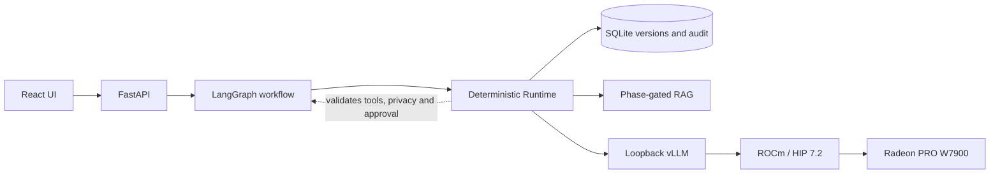

# Experience Asset

## A Private Local Agent for Turning Lived Experience into Evidence-Bound, Reusable Knowledge

**AMD AI DevMaster Hackathon 2026 - Track 2**

**Document status:** submission-ready; Demo video is delivered separately

**Evidence snapshot:** `main@c4d14bf`; tested application `c9ec074`

**Material snapshot ID:** `EA-SUBMISSION-E9-20260806-R8`

## 1. Executive Summary

Personal experience contains decisions, constraints, evidence and lessons, but
ordinary notes and one-shot AI writing flatten them into prose that is hard to
verify, correct, resume or reuse.

Experience Asset is a private local Agent that turns one first-person
experience into a versioned, evidence-bound asset. The user progresses through
five visible artifacts, corrects facts before downstream reuse, and prepares
audience-specific deliverables from one canonical version.

React and FastAPI provide the product surface. LangGraph maintains the durable
multi-step workflow. A deterministic Runtime owns tool permissions, argument
validation, phase-gated retrieval, privacy, approval, retries, persistence and
verification. The model proposes structured actions but cannot authorize
execution or disclosure. Core inference runs locally through loopback vLLM,
ROCm and Radeon PRO W7900.

## 2. Application Scenario, Users and Non-goals

The target user has a real experience, practice, professional insight or
product exploration worth preserving, but finds it difficult to separate what
happened from what was judged, inferred or left uncertain. The primary task is
not "write me a post." It is "help me build a correctable asset that I can
inspect, continue and responsibly reuse."

The engineering Demo uses a public synthetic shopping experience. P0 excludes
automatic publishing, platform growth strategy, traffic prediction,
medical/legal/financial advice, unreviewed web research, raw multimodal
understanding and multi-user collaboration.

The product does not claim that one person's experience is universal or that
hallucinations are eliminated. It exposes sources, uncertainty, boundaries and
permission decisions so unsupported output is easier to detect and block.

## 3. Product Workflow and Outputs

| Milestone | Visible artifact | Core question |
|---|---|---|
| M1 | Experience Brief | What happened, what is the source boundary, and what does the user want? |
| M2 | Critical Moment Map | Which cues and turning points changed the experience? |
| M3 | Decision and Evidence Ledger | What was decided, why, what action followed, and what evidence supports the result? |
| M4 | Insight and Boundary Map | What was learned, what is the counterfactual, and where does the lesson stop applying? |
| M5 | Route Readiness Matrix | Which audience routes are eligible, private and approved? |

Each milestone is editable, saved, resumable and versioned. A material
correction creates a new canonical identity and invalidates dependent
evaluation, approval or export state. The canonical asset supports in-app
preview plus consistent HTML, Markdown and JSON exports. Route selection never
overrides deterministic eligibility, privacy or approval policy.

PR #52 merged the complete integration. Exact implementation `c9ec074` passed a
real local-model W7900 journey covering M1-M4 generation, evidence inspection,
upstream correction, invalidation and regeneration. A real M5 evaluation then
exposed five routes, kept disallowed external routes blocked or ineligible, and
delivered private HTML, Markdown and JSON outputs.

## 4. Agent Architecture and Track 2 Capabilities



The observable Agent loop is: inspect state, choose a bounded step, retrieve
authorized evidence, propose a structured action, validate policy, execute an
allowed effect, verify the result, then persist or stop safely.

This demonstrates all five listed Track 2 capabilities: multi-step planning,
local RAG, governed tool invocation, persistent multi-turn memory and
permission/privacy control. The Agent application and vLLM remain in separate
environments, and private services bind to `127.0.0.1` by default.

## 5. Grounding, Phase-gated RAG, Privacy and Approval

Material statements remain typed as source fact, user judgment, Agent
inference or unresolved information. Schemas, source-span identities,
deterministic recomputation and version invalidation constrain unsupported or
stale output.

```text
M1-M4: current source and prior versions of this asset only
  -> M4 Knowledge Card reaches explicit readiness
  -> summary-only cross-asset candidate discovery
  -> user confirms one relation
  -> detailed retrieval from that relation only
```

No match, declined relation and permission denial are normal outcomes. External
output requires privacy review and approval bound to the exact canonical
version, relation evidence, route, language, policy and renderer input. A
material change makes the approval stale. Route drafts validate canonical
statement identities and route-bound evidence links; editable final wording
still remains subject to user or editor review.

## 6. Local Model Deployment and Radeon Optimization

The accepted complete-product path uses local `Qwen/Qwen3.5-9B`, immutable
revision `460979c3d11864dd16408d860ac930a360a2fac2`, BF16 and no
quantization. It is served by vLLM 0.26.0 on ROCm/HIP 7.2 and a 48 GiB Radeon
PRO W7900. The integrated profile uses a 20K context, GPU memory utilization
0.82, `max-num-seqs=2`, Qwen3 tool/reasoning parsers and loopback binding.
Thinking is disabled for bounded structured output.

The frozen Stage 1 W7900 service comparison is intentionally separate from the
product evidence. P1 versus S0 lowers p95 TTFT from `1710.910 ms` to `275.670 ms`
(83.89%), lowers median E2EL from `34763.366 ms` to `33256.475 ms` (4.33%),
and raises output throughput from `16.232` to `16.308 tokens/s` (0.47%). P1
warm-up reliability is 85% and remains visible beside the latency result.

The bounded 20K overlay records service-usability passes for S0/P1/P4/P3 while
retaining semantic advisories. It does not create a second ranking or claim
complete-product quality at every 20K boundary.

The deadline-minimal Stage 2 check ran the same complete Agent, model and
synthetic journey on S0 and P1. Both passed without an observed functional or
safety regression. S0 completed in about 2.0 minutes; P1 completed in 109.21
seconds. This is one observation, not a statistical latency claim. The P1 run
reported a 0.0% cache-hit rate, so the timing difference is not attributed to
prefix caching. P1 is selected for launch because it won the frozen Stage 1
service screen and passed this integration check; S0 remains the rollback.

## 7. Validation and Evidence Boundary

| Scope | Verified result | Boundary |
|---|---|---|
| Complete product A0 | W7900 PASS at implementation `c9ec074` | Functional checkpoint, not a statistical performance sample |
| Product flow | M1-M4 live journey, correction/invalidation/regeneration, real M5 route evaluation and private three-format delivery | Public synthetic scenario; no public service exposure |
| Regression surface | 34 repository QA tests; backend pytest/Ruff; frontend lint/type/build, 18 contract checks, 223 tests and 16 non-live browser tests | Counts remain separate rather than combined into one score |
| Stage 1 serving | Qwen3.5-9B BF16/8K W7900 service result in PR #39/#44 | Service only; P1 reliability 85% |
| 20K overlay | S0/P1/P4/P3 service-usability PASS | Semantic advisories retained; no ranking change |
| Stage 2 | S0 and P1 complete journey PASS; P1 109.21 s in the one observed run | No causal/cache or statistical claim; peak Stage 2 VRAM not measured |

The tested application, device evidence and final P1 launcher are frozen. The
Demo video is delivered separately. The current PPT uses an authentic product
snapshot; any later screenshot-only replacement does not expand the evidence
claim. An application, model or launch-Profile change must trigger
proportional revalidation.

## 8. Reproduction, Team and References

The cloud workspace uses `/workspace/amd-track2-agent`, keeps the Agent and
vLLM in separate environments, and treats GitHub as the source of truth. The
repository README provides the current judge path. The validated implementation
and its evidence packet are:

```text
Application: c9ec07489d17a2abb74bac66a23ade2c775c1b06
Product packet: evidence/milestones/e8-a0-w7900/20260806T122806Z/
Stage 2 packet: evidence/performance/stage2-minimal/20260806T124938Z/
Public scenario: web/e2e/m4.spec.ts
```

Team contributions are recorded from traceable Git and PR outcomes: `kinnyuww` led
requirements, quality, W7900 serving optimization and Stage 2 evidence;
`Eas000n` delivered runtime foundations, M1/M3/M5 work and E9 materials;
`1olaqua616-web` delivered the React shell, M2, gated M4 retrieval and E5-E8
integration. Several accepted outcomes were collaborative and converged in PR
number 52.

References:

- Official organizer repository: https://github.com/AMD-DEV-CONTEST/Radeon-hackathon-2026-07
- Team repository: https://github.com/kinnyuww/amd-devmaster-track2-agent
- Integrated W7900 product evidence: https://github.com/kinnyuww/amd-devmaster-track2-agent/pull/52
- Stage 1 W7900 evidence and report materials: https://github.com/kinnyuww/amd-devmaster-track2-agent/pull/44
- Minimal Stage 2 result: https://github.com/kinnyuww/amd-devmaster-track2-agent/pull/57
- Final P1 launcher and S0 rollback: https://github.com/kinnyuww/amd-devmaster-track2-agent/pull/58
- Demo and PPT plan: https://github.com/kinnyuww/amd-devmaster-track2-agent/pull/55
