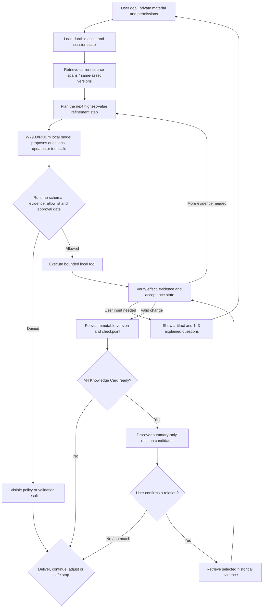

# Experience Asset P0 — Track 2 Agent Architecture

## Decision

P0 uses **one durable orchestration Agent with specialized workflow nodes**, not
a free-form multi-Agent team. LangGraph coordinates the state machine, vLLM
serves the local model, and deterministic application services own state,
permissions, persistence, validation and rendering.

This is intentionally a bounded Agent rather than a chat wrapper:

- it creates and revises an explicit multi-step refinement plan;
- it grounds the current experience first, then retrieves prior experience
  assets only through explicit readiness and relation-confirmation gates;
- the model can propose structured calls to meaningful local tools;
- the Runtime validates every proposal before execution;
- durable local memory survives pause, restart and correction; and
- a verifier decides whether to deliver, ask for input, re-plan or stop safely.

It is also intentionally not a multi-Agent system. Multiple personas would add
latency, duplicated context and failure modes without improving the P0 user
outcome. Specialist nodes can later be separated only if measured evidence
shows that the single orchestration graph is the bottleneck.

## End-to-end loop

Every run ends in one explicit terminal state. A failed run never silently
changes the last valid asset version or falls back to a remote model.

## Nodes and ownership

| Node/service | Responsibility | Model authority |
|---|---|---|
| Goal and boundary | Normalize user goal, source boundary, privacy scope and acceptance state | May propose; user/runtime confirms |
| Current-source grounding | Search approved current sources and prior versions of the same asset during M1-M4 | May request retrieval; cannot expand scope or search other assets |
| Relation discovery | After post-M4 readiness, search approved summary cards and propose relation reasons | May propose candidates; cannot read detailed history or create a confirmed link |
| Confirmed-relation retrieval | Read bounded evidence from only user-confirmed related assets | May request evidence; cannot rewrite current facts or widen the confirmed set |
| Planner/question selector | Rank unresolved items and choose the next milestone action or up to three questions | Produces a structured proposal only |
| Refinement generator | Propose statements, questions, links and route content from supplied evidence | Cannot persist or promote evidence status |
| Runtime validator | Validate schema, references, evidence status, tool identity, arguments, policy and approvals | Deterministic; model cannot override |
| Tool executor | Execute an allowlisted local operation with timeout, retry and audit | Executes only after Runtime approval |
| Result verifier | Check tool effect, artifact invariants, unsupported claims, route readiness and terminal outcome | May use model critique, but deterministic gates win |
| Canonical service | Save an immutable version and update the current pointer transactionally | Never directly model-controlled |
| Preview/export policy | Render a private preview or execute a separately approved export command from one stored route draft | Deterministic; no new claims and no approval implied by preview |

## Local RAG and memory contract

P0 retrieval is deliberately small, private and phase-gated:

1. chunk approved `.txt`/`.md` sources and confirmed canonical statements with
   stable source, span, statement, asset and version IDs;
2. index them locally through a repository interface, using SQLite FTS5/BM25
   for the first implementation;
3. during M1-M4, search only the current asset's sources and prior versions of
   that same asset; no other Experience Asset may influence elicitation or the
   current Knowledge Card;
4. after M4 is `CONFIRMED`, or the user explicitly accepts a visible
   `COMPLETE_WITH_GAPS` card, bind `KnowledgeCardReady` to that version/hash;
5. only then search approved cross-asset summaries and return bounded candidate
   titles, relation kinds, reasons and provenance—never detailed history;
6. ask the user to confirm or decline each relation; only confirmed relation
   IDs unlock bounded detailed evidence retrieval;
7. place every retrieved result in a clearly delimited untrusted-data block,
   retain provenance/evidence status, and never silently rewrite current facts;
8. report no-match, declined relation and denied retrieval as normal visible
   outcomes.

This is genuine retrieval-augmented generation without requiring a vector
database. Local embeddings or hybrid retrieval remain a measured later option,
not an E1 dependency. If no related asset exists, the Agent reports that state
instead of inventing memory.

Memory has three separate layers:

- **working state** — compact context for the active run;
- **session/asset memory** — immutable versions, confirmed statements,
  unresolved questions and milestone checkpoints in SQLite; and
- **cross-asset candidate index** — summary cards exposed only after
  `KnowledgeCardReady`; and
- **confirmed cross-asset memory** — detailed evidence exposed only for
  user-confirmed relations through a separately scoped retrieval tool.

Raw chat history is not treated as an ever-growing prompt. The canonical asset
and source references are the durable truth.

## Model-visible tools and permission boundary

The useful P0 tool combination is:

| Tool | Business purpose | Required Runtime checks |
|---|---|---|
| `search_current_experience` | Ground M1-M4 in current sources and same-asset versions | current asset/version scope, top-k/query limits, privacy scope |
| `discover_related_experience_candidates` | After card readiness, find summary-only possible relations | `KnowledgeCardReady` version/hash, allowed summary index, top-k/query limits, no detailed payload |
| `read_confirmed_related_evidence` | Compare selected prior evidence only after user confirmation | confirmed relation/asset IDs, bounded spans, privacy scope, provenance |
| `read_source_spans` | Retrieve exact local evidence for a proposed statement | approved source IDs, bounded spans, path isolation |
| `inspect_evidence_gaps` | Return deterministic missing/conflicting support for the current milestone | current version, statement IDs, no policy override |
| `evaluate_route_readiness` | Evaluate which audience routes the evidence supports | current version and deterministic route contract |
| `render_private_preview` | Produce an in-app preview from a stored route draft without creating a shareable file | current version/draft hash, route state, visible risk findings, no export side effect |

`save_validated_version`, `approve_shareable_export`,
`create_shareable_exports`, `request_deletion`, and `confirm_deletion` are
Runtime/application commands, not model-visible tools. An approved proposal can
never call them by changing its tool name. Approval originates from an explicit
user action bound to the current version and hashes; deletion originates from an
explicit UI command and requires a second confirmation.

Tool-call parsing such as vLLM `--enable-auto-tool-choice` only converts model
output into a structured proposal. It never grants permission.

## Frozen delivery operations

Preview, private download and external sharing are three different operations:

| Operation | Intended use | Approval contract |
|---|---|---|
| `IN_APP_PREVIEW` | Inspect a route draft inside the application, including blocked content and visible findings | No external-share approval; it creates no shareable file |
| `PRIVATE_DOWNLOAD` | Download a private/self artifact for the user's own storage | Allowed with a visible label that it is not approved for external sharing |
| `SHAREABLE_EXTERNAL_EXPORT` | Create HTML, Markdown or JSON intended for a beginner, peer, customer/evaluator or public audience | Requires an eligible route, resolved or acknowledged risks, deterministic validation, and explicit version/hash-bound approval |

If the user later intends to share a `PRIVATE_DOWNLOAD`, it must re-enter the
`SHAREABLE_EXTERNAL_EXPORT` review flow. Route eligibility, preview visibility,
private download and external-share approval remain independent states.

## Five audience route content contracts

The five routes are different products derived from one canonical asset, not
five tone variants:

| Route | Must contain | Must not claim / eligibility boundary |
|---|---|---|
| Private/self | decision record, unresolved items, personal lessons and next-time checklist | never hide uncertainty merely because the output remains private |
| Beginner | prerequisites, ordered steps, glossary, common mistakes and non-applicability | no unexplained expert shorthand or unsupported universal advice |
| Peer | alternatives, failed attempts, evidence strength, trade-offs, constraints and counterexamples | no removal of uncertainty to produce a cleaner comparison |
| Customer/evaluator | goal, qualifying role/context, method, verifiable result and limitations | ineligible without sufficient professional/project/result evidence |
| Public | short summary, event arc, transferable lesson, boundaries and disclosures | no sensitive detail, professional advice or universalized conclusion |

The P0 contract requires evaluation of all five decisions while generation is
limited to the user-selected eligible route. These rows are the required minimum
contract; summaries, checklists, examples or richer layouts are optional
enhancements only after the minimum remains intact. Every
`SHAREABLE_EXTERNAL_EXPORT` receives a risk review and explicit
version/hash-bound approval. Route eligibility and export approval remain
independent.

## Track 2 capability mapping

| Official Track 2 capability | P0 design target | Required judge-visible proof |
|---|---|---|
| Local RAG | current-source grounding followed by post-M4 summary discovery and user-confirmed detailed retrieval | an allowed current-source query, denied early cross-asset query, summary candidates, confirmation, selected source IDs, no-match path and grounded comparison |
| Tool invocation | structured model proposal plus allowlisted Runtime execution | allowed call and a denied/invalid call in the trace |
| Multi-step planning | visible refinement plan and milestone/question selection | plan changes after missing evidence or correction |
| Local multi-turn memory | SQLite versions, checkpoints, unresolved state and related-asset retrieval | pause/restart/resume without loss |
| Permission/privacy | deterministic tool, route, share, approval and deletion gates | blocked export followed by version-bound approval |

The architecture therefore targets all five listed capabilities while the
formal minimum is two. A capability counts only after implementation and real
W7900 evidence; this document does not claim that any capability has already
passed.

## Evidence-stage names

These names describe evidence maturity and must not be used as interchangeable
claims:

| Stage | Meaning |
|---|---|
| E1 compatibility gate | Real 14B BF16 load, structured response and inert tool-call proposal on W7900/ROCm; not a performance baseline |
| E2 `Serving Reference S1` | Frozen small model-serving/tool-call workload used to expose early latency, VRAM and compatibility risks |
| E2 `Vertical Slice V1` | First functional plan/retrieve/propose/validate/execute/verify/persist product slice |
| Pre-E8 `Q0 compatibility probe` / exploratory serving experiment | Reversible investigation only; cannot change the product default or support an optimization claim |
| E8 `Baseline v1` | Immutable correctness-first complete-product reference with model, Agent-task and refinement-UX evidence |
| Post-baseline `Quantized Candidate Q1` | Formal declared quantization comparison against Baseline v1, with repeated runs, quality floors and rollback |

## Required final demonstration

The recorded scenario must show, in one coherent journey:

1. goal, source/privacy scope and acceptance state;
2. an explicit plan and current-source retrieval while M1-M4 remain independent
   of historical assets;
3. W7900/ROCm local inference and a structured tool proposal;
4. Runtime allow/deny evidence and the actual tool effect;
5. persistence plus pause/resume or correction;
6. result verification and one visible safe failure/recovery path;
7. a completed Knowledge Card, summary-only relation discovery, an explicit
   confirm/decline action and a scoped detailed-retrieval or visible no-match;
8. route eligibility, preview/private-download distinction, privacy review and
   one approved `SHAREABLE_EXTERNAL_EXPORT`; and
9. the same scenario under E8 Baseline v1 and the formal post-baseline
   Quantized Candidate Q1 when that optimization is claimed.

The official rules, current requirement, L3 plan and quality contract remain
authoritative. This document explains the selected architecture to teammates
and their coding Agents; it does not expand permissions or authorize external
publication.
