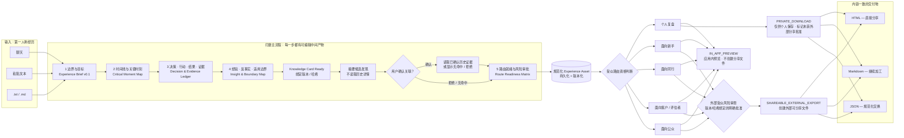
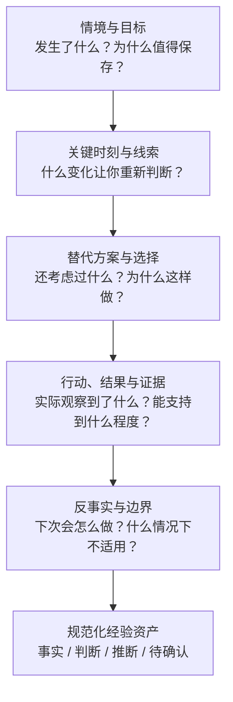
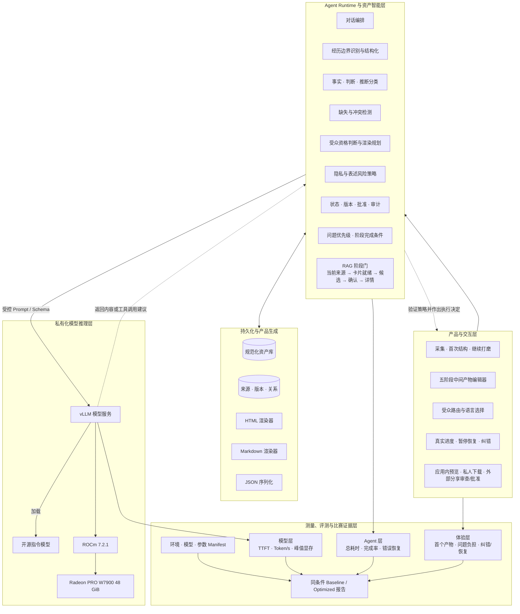
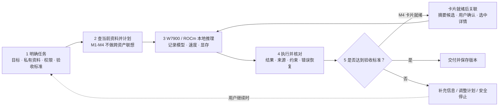
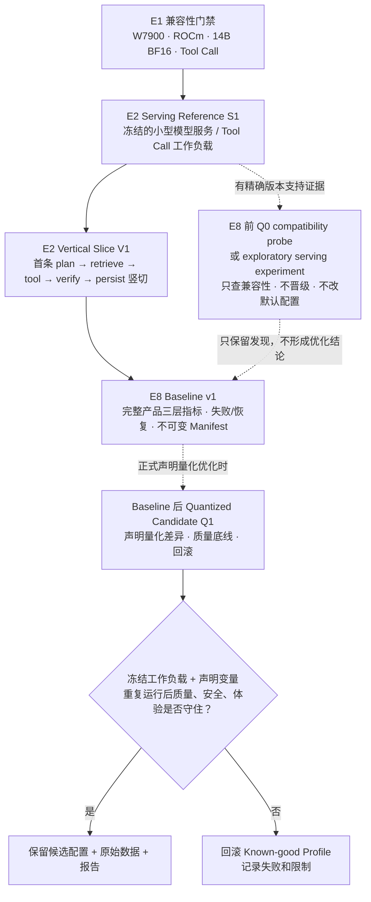
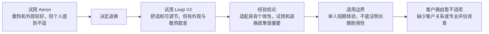

# Experience Asset P0 — 产品拍板蓝图

## 一句话定义

这是一个持续演化的个人经验资产化 Agent：它把零散的第一人称经历整理成
有证据、有边界、可持续维护的经验资产，再从同一份资产生成适合不同受众的
交付产品。

P0 的重点不是“一次聊天后生成一篇文章”，而是让用户在打磨过程中不断看见
自己的经历从模糊变清晰，并且随时能检查、纠正、暂停和继续。

## 已经拍板的内容

| 维度 | 确认结论 |
|---|---|
| P0 资产类型 | Experience Asset（经验资产） |
| 核心价值 | 把隐形知识可复用化 |
| “持续运行”的含义 | 用户主动输入，系统跨会话保存、演化和保留版本；不是自动监控用户 |
| 事实原则 | 区分来源事实、用户判断、Agent 推断和待确认信息 |
| P0 体验重心 | 经历/经验打磨本身；发布与导出是后半段交付 |
| 首次价值 | 初次输入后先给可编辑的 `Experience Brief v0.1`，不让用户完成长访谈后才看到结果 |
| 打磨节奏 | 五个真实里程碑，每轮通常只问 1–3 个最高价值问题 |
| 进度反馈 | 展示真实阶段、已确认事实、待处理问题、路由就绪和保存版本；不伪造百分比或倒计时 |
| 交付逻辑 | 一份规范化资产，经过条件判断进入五类受众路由 |
| 最终产物 | 应用内预览，以及内容一致的 HTML、Markdown、JSON |
| 语言 | 每次生成由用户选择中文或英文 |
| 外部分享边界 | 任何面向外部受众的可分享导出，都先做隐私与表述风险检查，再由用户对当前版本和内容哈希明确批准 |
| 主测试夹具 | 公开办公椅试用与退换案例的匿名改编版 |
| 比赛证据 | 分开测模型服务、Agent 任务和打磨体验；同条件对比 baseline/optimized，并保留环境与失败记录 |

## 项目开发的三层分解

我们用三个层级推进项目，防止产品决策和具体开发任务过早混在一起。

| 层级 | 回答的问题 | 当前状态 |
|---|---|---|
| L1 — 产品体验框架 | 用户怎样逐步看见经历被梳理、补全和交付？ | 已定义并批准 |
| L2 — 系统能力框架 | 系统怎样保障事实、权限、本地推理、恢复和可核验性能？ | 已定义；具体技术选型留给工程方案 |
| L3 — 工程任务清单 | 谁做什么、先后顺序、依赖和验收测试是什么？ | 已批准；E0 已合并，仅当前就绪的 E1-A/E1-B 获准实现 |

L3 工程计划见
[`../kinnyu/L3_ENGINEERING_PLAN.md`](../kinnyu/L3_ENGINEERING_PLAN.md)。它把当前
方案拆为 E0–E9：先冻结工程合同，再依次实现基础设施、M1–M5、确定性导出与删除，
然后完成全流程验证并冻结 W7900 Baseline v1，最后冻结英文提交与演示包。
Baseline v1 被接受前不开展性能 Candidate；后续阶段仍需通过前一组合里程碑门禁，
不能因为 L3 已批准而一次性越级开工。

## L1 — 产品体验框架

这里冻结三种不同操作：`IN_APP_PREVIEW` 只用于应用内检查，可以显示阻断内容和
风险提示；`PRIVATE_DOWNLOAD` 只面向个人保存，并明确标记“未经外部分享审批”；
`SHAREABLE_EXTERNAL_EXPORT` 才会创建面向新手、同行、客户/评估者或公众的可分享
文件，必须通过路由资格、风险处理、确定性校验和绑定当前版本/哈希的明确批准。
私人下载如果之后要分享，也必须重新进入外部受众审查流程。

贯穿五个阶段的界面始终显示：当前阶段、已确认事实、待处理问题、可用路由、
当前版本和自动保存状态。用户随时可以编辑、跳过、稍后处理、暂停/恢复，或用
现有证据直接生成；未回答内容仍保持“待确认”，不会被模型润色成事实。

M1–M4 只用当前经历的来源片段和同一资产历史版本进行校正/恢复，不检索其他
Experience Asset。M4 卡片被确认或用户明确接受可见缺口后，系统才做摘要级候选
发现；用户确认某条关系后才读取那一条历史资产的详细证据。历史内容只能作为
带来源的比较材料，不能静默倒灌成当前事实。

### 打磨阶段如何真正补全经验

这种问法参考 Critical Incident Technique 与 Cognitive Task Analysis 的
思路：围绕具体事件、被注意到的线索、关键决策和结果追问，而不是让用户做一
次抽象自我总结。它是知识提取方法，不是心理诊断。

路由系统可以输出“当前不适合生成，并说明原因”。这也是正确结果。系统不能
为了凑齐五种交付而虚构客户关系、专业身份或缺失证据。

### 五条受众路由的内容合同

五条路由不是把同一篇文章换五种语气。它们共享同一规范资产和事实边界，但
分别服务不同任务；缺少支撑时必须返回 `BLOCKED` 或 `INELIGIBLE` 及具体原因。

| 路由 | 用户要完成的任务 | 合格交付至少包含 | 不得生成或必须阻断的情况 |
|---|---|---|---|
| 个人复盘 | 以后能恢复当时的判断并改进下一次行动 | 决策记录、未决问题、个人经验、下次检查表 | 不能因为内容保持私密就隐藏不确定性 |
| 面向新手 | 帮助第一次遇到类似问题的人安全入门 | 前置条件、有序步骤、术语解释、常见错误、不适用情况 | 不使用未解释的专家术语，不给出无依据的普遍建议 |
| 面向同行 | 让有基础的读者评估方法、证据和权衡 | 备选方案、失败尝试、证据强弱、权衡、约束、反例 | 不为得到更整洁的比较而删除不确定性 |
| 客户 / 评估者 | 让对方核验个人或项目如何解决问题 | 目标、合格的角色/情境、方法、可核验结果、限制 | 缺少足够的专业/项目角色或结果证据时必须标记不适用 |
| 面向公众 | 让陌生读者快速理解经历并获得可迁移启发 | 短摘要、事件脉络、可迁移经验、适用边界、必要披露 | 不包含敏感细节、专业建议或普遍化结论 |

路由生成器只能组织已经存储且可追溯的陈述；HTML、Markdown 和 JSON 渲染器
不能增加新主张。上表是与 L3 和 Agent 架构一致的最低内容合同；更短摘要、更多
示例、图表、检查表或视觉包装只能作为可选增强，不能替代最低合同。应用内预览
不等于导出批准；任何面向外部受众的可分享文件都必须完成对应风险审查和绑定
当前版本/哈希的明确批准。

## L2 — 系统能力框架

权限、参数验证、人工批准、重试、状态和审计都由 Runtime 负责，而不是由
模型决定。vLLM 负责在本地加载和服务模型，不负责定义产品流程，也不会因为
模型输出了 Tool Call 就自动授予执行权限。

### Track 2 的完整任务闭环

这张图直接对应赛事演讲中的 Track 2 完整流程：一次模型回答不是终点，规划、
本地资料、执行、核对、记忆/状态和达标判断缺一不可。

## 让用户愿意完成打磨：具体交互策略

| 用户心理负担 | P0 的设计回应 | 验证方式 |
|---|---|---|
| “问了很久还不知道会得到什么” | 初次输入后立即生成可编辑的 `Experience Brief v0.1` | Time to first useful artifact |
| “问题太多，像填调查表” | 每轮通常 1–3 个最高价值问题，并解释为什么问 | 问题数、轮数、放弃率 |
| “系统是不是理解偏了” | 每阶段展示中间产物，标出事实/判断/推断/待确认，支持就地纠正 | 纠错率与纠错恢复 |
| “不知道还差什么” | 固定五阶段；显示完成产物、待确认项和路由就绪原因 | 阶段完成与 route readiness |
| “现在没时间做完” | 自动保存、暂停/恢复、跳过/稍后处理、现有证据直接生成 | 恢复成功率 |
| “进度条可信吗” | 只按真实工作单元显示确定进度；不确定时显示当前活动而非假百分比 | 状态到 UI 的一致性测试 |
| “还剩几分钟？” | 无历史数据不报 ETA；有相似样本后只给带依据的区间与不确定性 | ETA 校准误差和样本来源 |
| “系统一直夸我但没实质变化” | 只反馈具体成果，如“已确认 2 个关键转折、补齐 1 条证据” | 用户对清晰度/控制感/信任的评分 |

这里不采用虚假的“已完成 20%”或强行赠送起始进度。研究表明视觉动效和
“被赋予进度”会影响坚持感，但本项目只展示真实已完成工作，例如来源已读取、
初始结构已保存；不会用行为操控替代透明度。进度条在可计算时使用 determinate，
不可计算时使用 indeterminate，并为无障碍界面提供正确的进度语义。

## ROCm 与 Benchmark 拍板方案

E1 只证明目标模型、结构化响应和 Tool Call 提议能在真实 W7900/ROCm 路径运行；
E2 `Serving Reference S1` 冻结小型模型服务工作负载，E2 `Vertical Slice V1` 冻结
第一条真实产品竖切；它们都不是优化成绩。E8 前只允许可回滚的 `Q0 compatibility
probe` 或 exploratory serving experiment，用来提前暴露精确 W7900/ROCm/vLLM 组合
的兼容性风险，不得改变产品默认配置或形成比赛性能结论。E8 才冻结覆盖完整产品
的不可变 Baseline v1；正式量化比较使用 Baseline 后的 `Quantized Candidate Q1`，
保留兼容性失败和回滚，不把实验结果追写进 Baseline。量化对比可以支撑“针对性
推理速度优化”的证据，但不等于自动获得规则中的全部可选 Bonus。

### 比赛演讲指标如何落地

| 演讲指标 | 我们记录什么 | 必须说明的条件 |
|---|---|---|
| 响应速度 | 首 Token 时间 TTFT、任务总耗时 | 输入、输出上限、并发、预热 |
| 推理吞吐 | output tokens/s；可可靠拆分时另报 prefill | 模型、量化、上下文、tokenizer |
| GPU 显存 | 峰值 VRAM | 同模型、上下文和并发 |
| 任务完成率 | 多次运行的成功分子/分母、终态、工具错误与恢复 | 夹具版本、验收标准、失败分类 |
| 本地运行证据 | W7900/ROCm/vLLM 环境、模型来源、localhost Trace | 驱动/ROCm/PyTorch/vLLM 精确版本 |

正式优化比较必须冻结任务、输入/夹具、验收条件、测量方法和所有未声明配置。
`Quantized Candidate Q1` 在运行前声明量化及其同一目的的必要配套差异；模型来源/
固定 revision、工作负载、上下文、生成设置和测量方式保持不变。执行预热与重复
运行，保留失败，并报告样本量、
mean/median/p95（适用时）和失败率。不得在看到结果后追加变量或更换判定目标。
详细字段、七个冻结夹具和建议目录见 `BENCHMARK_PLAN.md`。

## 办公椅夹具如何贯穿验证

这一个夹具可以同时验证：时间线提取、候选方案比较、事实与推断分类、信息
缺失、隐私审查、拒绝不适合的路由、中英文生成、不同格式内容一致性、用户
纠错、跨会话持久化和删除。

## 方案依据

本方案没有把 HCI 原则当作“能保证用户坚持”的心理学承诺，而是把它们转成
可测试的交互约束：尽早说明能力、及时显示相关状态、方便纠错、保持用户控制、
用真实状态表达进度。

- [Microsoft: Guidelines for Human-AI Interaction](https://www.microsoft.com/en-us/research/articles/guidelines-for-human-ai-interaction-eighteen-best-practices-for-human-centered-ai-design/)
- [CHI 2019 paper: Guidelines for Human-AI Interaction](https://doi.org/10.1145/3290605.3300233)
- [Apple Human Interface Guidelines: Progress indicators](https://developer.apple.com/design/human-interface-guidelines/progress-indicators)
- [Material Design: Progress indicators](https://m2.material.io/components/progress-indicators)
- [WAI-ARIA: progressbar semantics](https://www.w3.org/TR/wai-aria-1.0/complete#progressbar)
- [Flanagan: The Critical Incident Technique](https://doi.org/10.1037/h0061470)
- [Klein: The Value Added by Cognitive Task Analysis](https://journals.sagepub.com/doi/pdf/10.1177/154193129503900920)
- [vLLM performance optimization](https://docs.vllm.ai/en/stable/configuration/optimization/)
- [vLLM GPU/ROCm installation](https://docs.vllm.ai/en/latest/getting_started/installation/gpu/)
- [AMD ROCm vLLM inference documentation](https://rocm.docs.amd.com/projects/ai-ecosystem/en/latest/inference/vllm.html)

## P0 明确不做

- Idea Asset 和 Method Asset 完整路径
- 自动发布、发邮件或发消息
- 多用户协作
- 原始图片、音频和视频理解
- 把未经审查的网页搜索直接当作事实依据
- 在形成可测量基线前进行训练或微调

严格范围和验收条件以 `docs/kinnyu/CURRENT_ITERATION.md` 为准。
