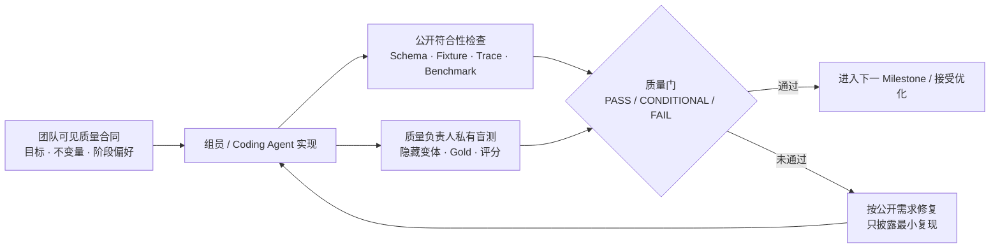

# Experience Asset P0 — 团队质量合同

> **2026-08-05 最后冲刺修订：**
> [`spec/FINAL_SPRINT_EXECUTION_PACKAGE.md`](../../spec/FINAL_SPRINT_EXECUTION_PACKAGE.md)
> 已获项目负责人批准并立即生效。E5–E9 不再设置逐阶段人工审批或私有盲测晋级门；
> 已知的全部评测意图、七类用例和对抗/故障清单均已公开。仓库核查确认从未实现
> 私有测试代码、隐藏夹具、Gold Answer、秘密权重或未公开阈值。下文涉及“隐藏测试”、
> “质量负责人批准”或同步晋级的内容仅保留为历史设计，若与最后冲刺包冲突，以后者
> 为准。事实、隐私、权限、RAG 阶段、本地推理、持久化、证据和比赛硬要求不降低。

## 状态与用途

- 状态：`ACTIVE`，用户于 2026-07-24 AEST 批准
- 适用对象：三位组员及其 Coding Agent
- 目的：让实现始终对齐产品目标，同时允许有边界、可回滚的性能优化

本合同说明“产品必须做到什么、每个阶段偏好什么、提交什么证据”。它不会公开
质量负责人的隐藏测试代码、私有夹具、Gold Answer、精确权重、通过分数线或
聚合算法。组员和 Agent 不应推测、索取或针对隐藏评分进行特调。



## 总原则

1. 优化对象是完整业务任务，不是单独追求 Token/s。
2. 任何速度提升都不能交换掉事实忠实、证据边界、用户控制、隐私或状态可靠性。
3. 五个打磨里程碑都是真实交付门，不是内部随意节点。
4. 模型输出是候选内容或工具建议，不是事实、权限或验收结论。
5. 性能实验必须先声明目标阶段和主要指标，再冻结任务、模型、上下文与测量方法。
6. 测试发现偏移时先修复业务逻辑；不得修改测试目标来适配当前实现。
7. 本合同锁定业务结果、风险底线和证据责任，不锁死组件实现、模型名称或永久不变的优化优先级。

## 受控可演进机制

组员可以根据组件特性、真实基线或新发现，提出更适合的性能指标、测量方法或
阶段优化方向。调整不是例外流程，而是正常工程迭代的一部分，但必须满足：

1. 在 Candidate 实验或实现结果被用于决策前提出，说明受影响组件、业务场景、
   当前瓶颈、拟调整项和为什么原方向不再合适；
2. 同时声明不可回退的业务质量、安全、隐私、状态和本地推理护栏，以及潜在
   副作用和回滚方案；
3. 用版本化的 Benchmark/质量合同变更记录保存旧定义和新定义；历史结果不得
   用新口径静默重写；
4. 由质量负责人确认该调整仍服务于公开业务目标后生效；重大产品目标变化需要
   重新进入 Discover，而不是仅修改性能口径；
5. 不得在看到私有盲测结果后为单个失败样本定制指标、权重、流程或模型路由。

因此，下文的“性能偏好”和“允许重点优化”是当前默认方向，不是组件实现清单。
工程证据显示更合适的方向时可以调整，但 Critical/High 阻断项以及事实、权限、
隐私、持久化和本地推理底线不能被性能提案豁免。

## 阻断规则

以下问题直接阻断里程碑推进或优化配置晋级：

- 生成来源中不存在的关键事实；
- 绕过隐私、公开导出或工具执行批准；
- 丢失、覆盖或错误恢复用户已经确认的状态；
- Canonical Asset 与预览/导出出现矛盾事实；
- 核心推理离开 W7900/ROCm 本地路径；
- 错误、超时或失败没有可见终态和记录；
- 为提升速度而未经说明切换到不满足当前阶段质量要求的模型或配置。

非关键问题可以由质量负责人给出 `CONDITIONAL`，但必须记录负责人、剩余风险和
处理时间。具体内部评分不属于团队共享信息。

## 风险分级审查与审查效率

审查以产品和比赛风险为准，不以 PR 文案、注释数量或模板格式为准：

- `BLOCKER`：业务错误、自动化/联调失败、数据丢失、公共合同或 API 不兼容、
  安全/隐私/权限绕过、RAG 阶段越权、核心推理不在 W7900/ROCm 路径，或会让
  比赛能力/证据声明失真的问题。必须修复后才能合并或提升。
- `CONDITIONAL`：不影响当前主路径、但有明确剩余风险的问题。必须记录负责人、
  风险和期限；是否阻断由其实际影响决定。
- `NIT/BACKLOG`：注释措辞、历史时态、命名偏好、重复说明、PR 模板排版、可从
  链接或 diff 明确推断出的元数据等。默认不阻断合并，集中留作后续清理。

每个阻断意见必须同时给出：受影响的业务/比赛要求、可观察证据以及最小修复。
同一轮审查结束后，不得再用新发现的纯格式或文案偏好制造移动靶；只有新增的
实质风险证据可以升级为阻断。格式不完整可以由审查者补充、评论或记录警告，
不得替代对真实功能、代码、测试、隐私和证据的判断。

## L1：五个里程碑的业务合同

| 里程碑 | 业务目标 | 必须呈现的能力 | 性能偏好 | 允许重点优化 |
|---|---|---|---|---|
| M1 边界与目标 | 快速让用户看到经历的基本形状 | 来源、事件边界、目标、约束和 `Experience Brief v0.1`；可编辑、自动保存 | 快速，但不得牺牲忠实性 | TTFT、首个有用产物时间、短 Prompt、缓存、流式展示 |
| M2 时间线与关键时刻 | 不遗漏决定经历走向的重要事件 | 事件顺序、变化、线索、冲突、关键转折；缺失内容保持待确认 | 平衡，偏重召回 | 结构化抽取、长文本分块、独立步骤并行、来源解析缓存 |
| M3 决策与证据 | 还原“为什么这样做”和“实际发生了什么” | 线索、替代方案、决策、行动、结果和证据状态可追踪 | 偏重证据精度 | 更强推理预算、Schema 校验、针对性重试；延迟是次要指标 |
| M4 经验与边界 | 形成不受历史经验锚定、可复用但不过度泛化的当前知识卡片 | 经验结论、支持证据、反事实、限制、反例和适用条件；明确的 `KnowledgeCardReady` 版本/哈希 | 偏重推理质量 | 最强获批推理配置、紧凑当前上下文、证据关联核对；M4 就绪前禁止跨资产检索 |
| M4→M5 关联门 | 在当前卡片完整后发现关联，又不让历史内容污染当前事实 | 只读摘要候选、关系理由、无命中状态、用户确认/拒绝；确认后才可读取选中资产详细证据 | 偏重忠实性与用户控制 | 候选检索召回、确认负担、限定资产读取；禁止预确认详细 RAG 和静默改写 |
| M5 路由与审批 | 只生成当前证据与已确认历史关系支持且可安全交付的版本 | 五路由资格、理由、隐私/表述风险、用户批准和一致预览 | 偏重策略与安全 | 确定性策略优先、模型辅助检测、人工批准；只并行独立渲染任务 |
| 渲染与进度 | 快速、稳定地呈现同一资产版本 | HTML/Markdown/JSON 一致；进度来自真实状态 | 确定性与速度优先 | 模板、缓存、增量更新、格式并行；可确定完成的工作不调用 LLM |

## L2：系统能力质量门

| 能力门 | 组员必须证明的行为 |
|---|---|
| Canonical state | 所有中间产物、路由和导出引用明确版本；纠错只更新受影响结果 |
| Persistence and resume | Pod/进程重启或跨会话后能从已保存检查点继续，历史版本仍可追踪 |
| Evidence discipline | 事实、用户判断、Agent 推断和待确认信息保持可区分、可追溯 |
| Retrieval phase integrity | 当前材料检索与跨资产 RAG 分离；M4 就绪前跨资产检索拒绝，关系确认前详细历史读取拒绝，历史内容不得静默改写当前事实 |
| Runtime permission | 工具参数、权限、审批、超时、重试和终态由 Runtime 管理 |
| Privacy and publication | 风险检查和最终批准不可绕过；P0 不进行外部自动发布 |
| Local inference | 核心模型、推理服务和私有数据路径位于受控 Radeon Cloud 环境 |
| Failure behavior | OOM、超时、工具失败、格式错误和用户中断都有明确状态、恢复或安全停止 |
| Observability | 运行能关联代码版本、模型/配置、Fixture、阶段结果和失败分类 |

## 性能实验合同

开始实验前，提交：

- 目标阶段与业务原因；
- 主要优化指标，例如 TTFT、首个产物时间、任务总耗时、吞吐、显存、并发或调用数；
- 不允许回退的业务质量与安全条件；
- Baseline 与 Candidate 的唯一配置差异；
- 冻结的模型、量化、上下文、生成参数、任务和测量方法；
- 失败后的回滚配置。

若实验需要改变既有指标或阶段偏好，还必须附上版本化的“评测调整提案”，列明
旧口径、新口径、适用组件、业务理由和兼容/迁移方式。经批准后只对后续实验
生效，禁止用调整后的口径追认已经失败的 Candidate。

团队可见指标定义与比赛证据按 `BENCHMARK_PLAN.md` 执行。是否晋级由质量负责人
结合公开证据和私有盲测决定；精确阈值和打分不在本合同中公开。

## 并发与降级方向

- 单个活跃打磨会话是首要体验，首先保证交互响应和状态正确。
- 后台导出、评测或独立路由可以并发，但不能引用错误资产版本。
- 压力测试用于发现队列、显存和失败边界，不等于承诺多用户产品能力。
- 资源不足时，质量敏感的 M3–M5 应进入可见队列或安全停止，不能静默切换弱模型。
- 缓存、预取或并发优化不得绕过 `KnowledgeCardReady` 和关系确认门；即使
  后台提前读取能降低延迟，也属于阻断性权限/业务偏移。
- 任意降级必须可见、可记录、可恢复，并保持隐私与权限门。

## 历史证据保留合同

组员和 Coding Agent 必须按
[`spec/EVIDENCE_RETENTION.md`](../../spec/EVIDENCE_RETENTION.md) 在开发过程中同步
保留证据，不能等到最终录屏时凭记忆补做。这里区分两类历史：

- 产品历史：每次用户接受内容变更后保存完整、校验通过的 Canonical Asset JSON
  版本，用于纠错、暂停/恢复、旧版本查看和路由审批失效；
- 工程历史：每个 PR 至少保留可追溯的检查结果和风险/回滚记录；里程碑深审、
  GPU Gate、Baseline/Candidate 和最终演示冻结保存完整、去敏、可复现的证据包。

完整工程证据包至少关联 commit SHA、Issue/PR、AC/L1/L2、环境/模型/配置、
Fixture 或去敏场景、复现命令、结果/失败/恢复、关键产物或 UI 快照、未验证项
和回滚信息。普通 PR 可复用链接到下一深审门的累计证据，不必复制完整包。
门禁通过后证据只追加新版本，不覆盖旧配置、旧失败或不理想的 Baseline。

小型、公开、去敏且复现必需的 Manifest、摘要和产物快照进入 `evidence/` 或
`benchmarks/` 并随分支提交；大型原始记录留在 `/workspace/amd-track2-agent`，最终
视频/PPT/Poster 可进入批准的外部存储并在 Git 中记录稳定引用与校验值。私有用户
内容、数据库、原始私密 Prompt/Response、凭据、权重、私有 QA 和隐藏评分不得
进入共享仓库。

## 按风险提供 PR 证据

所有 PR 只需要让审查者能够确认结果、主要风险、已运行检查和回滚方式。以下
完整证据包只在里程碑深审、GPU Gate、性能实验、RAG/权限/隐私边界变化或最终
提交证据发生变化时强制提供：

1. 影响的 `AC-*`、里程碑和 L2 能力门；
2. 行为变化和明确非目标；
3. 开发者可见测试与 Fixture 结果；
4. 关键中间产物或 Trace 的无敏感信息快照；
5. 如果涉及性能，提供 Baseline/Candidate Manifest 和完整失败记录；
6. 已知风险、回滚办法和仍未验证的内容。
7. 符合证据保留合同的 packet 路径、commit SHA、存储层和历史关联。

普通实现 PR 可以链接 Issue、自动化结果或已有证据包，不因字段顺序、标题、
空白项或可以从链接/diff 明确推断的信息被驳回。若缺失信息会导致审查者无法
判断 Critical/High 风险，则审查者只要求补充完成该判断所需的最小信息。

不得要求质量负责人提前提供隐藏测试答案。质量负责人反馈
`PASS / CONDITIONAL / FAIL`、公开需求映射、严重度和修复所需的最小复现信息。

## 里程碑完成定义

E2、E4、E6、E7 是合并式深审门；E3、E5 是轻量技术提升门。深审门只有同时
满足以下条件才能提升；轻量门只需通过受影响的公开检查、代码/联调审查且没有
Critical/High 风险，私有盲测在下一深审门统一覆盖：

E2 的用户产品审阅是异步的：技术门通过后不阻塞 E3，反馈须在 E4 提升前处理
或明确裁决。E4/E6 的深审由质量负责人异步完成；E7 是唯一计划内必须由用户
作最终产品确认的硬门。只有出现新的产品取舍或具体 Critical/High 风险时才临时
请求额外用户决策。

- 产品行为符合当前批准合同；
- 开发者可见检查通过；
- 没有阻断问题；
- 质量负责人完成盲测和业务审查；
- 性能基线或性能变更证据已记录；
- 失败、风险、未验证项和回滚信息完整；
- 没有秘密、私有数据、模型权重或私有 QA 材料进入 Git。

## 给 Coding Agent 的约束

```text
实现公开产品合同，不推测隐藏评分。
不得修改或生成“更容易通过”的测试目标来适配当前输出。
不得请求、搜索、读取或提交 private-qa、hidden-fixtures、gold-private、
quality-owner-only 等质量负责人材料。
性能优化必须先声明目标阶段、主要指标、质量护栏和回滚配置。
遇到公开合同不明确时报告问题，不以猜测补全产品行为。
```
