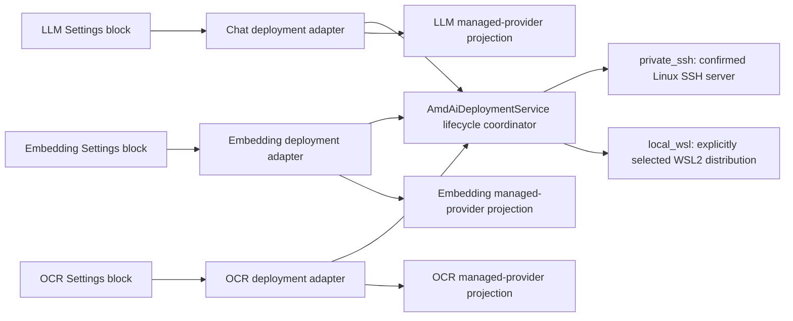

# Xenix Radeon Edition

Xenix Radeon Edition is a Windows desktop AI workbench for private document
analysis and agent workflows. Its Radeon capability deploys fixed,
manifest-verified Chat (LLM), Embedding, and OCR runtimes independently and on
demand, then registers each resulting endpoint through Xenix's ordinary
provider boundaries.

This repository is the dedicated entry for Track 2 of the 2026 AMD AI DevMaster
Radeon GPU Hackathon.

## Track 2 submission pack

The judge-facing, non-video materials are collected under
[`submission/track2`](submission/track2/README.md):

- Project specification: [Markdown](submission/track2/PROJECT_SPEC.md) ·
  [PDF](submission/track2/PROJECT_SPEC.pdf)
- [Evidence and claim boundaries](submission/track2/EVIDENCE.md)
- [Pull-request description draft](submission/track2/PR_DESCRIPTION.md)
- [A3 landscape poster (PDF)](submission/track2/poster/Xenix-Radeon-Edition-Track-2-Poster.pdf)
  with [PNG](submission/track2/poster/Xenix-Radeon-Edition-Track-2-Poster.png)
  and [editable HTML source](submission/track2/poster/index.html)
- [Submission checklist](submission/track2/SUBMISSION_CHECKLIST.md)

The poster and specification deliberately separate measured acceptance from
performance work that is not yet complete. They make no comparative-speedup,
generic-Radeon-compatibility, native-Windows-ROCm, or accepted-Local-WSL claim.

## Capability-scoped Radeon deployment

Each capability has a fixed deployment adapter and packaged option catalog.
Chat lets the user choose among revision-pinned, Radeon-verified LLM recipes;
Embedding and OCR currently expose one recipe per verified placement. The user
cannot supply an arbitrary model, runtime, launch flag, CPU fallback, or
external-API fallback. The adapters
share AmdAiDeploymentService as their lifecycle coordinator, but a deployment
is never a mutable Chat-plus-Embedding-plus-OCR bundle.

| Capability | Fixed deployment adapter | Xenix provider boundary |
| --- | --- | --- |
| Chat (LLM) | Model-specific Chat profiles | One Chat provider per deployment |
| Embedding | Embedding capability profile | Embedding provider |
| Page OCR | OCR capability profile | OCR provider |

The manifest for the selected capability option owns the exact runtime, model,
artifact revisions and hashes, compatibility cell, capacity observation,
protocol checks, and self-test. A successful deployment adds only that
capability's managed provider projection. It never selects a provider for the
user.



The two current locations for new deployments are private_ssh and local_wsl.
They are execution locations, not provider types:

- Private SSH uses a Linux Radeon server confirmed by the user. The guided flow
  takes host, user, port, and a local identity-file path, discovers the
  server's public key, and displays its fingerprint for explicit confirmation.
  There is no server-public-key form field.
- Local WSL uses an explicitly selected existing WSL2 distribution on this
  Windows PC. It has no SSH host, identity, or host-key step, and Xenix does
  not install WSL, a distribution, a driver, or an SSH daemon.

Private SSH is a product deployment path, not an ML Worker or an offline claim.
Local WSL is a distinct Windows-to-WSL2 path, not native Windows ROCm. This
repository does not claim that this PC's WSL distribution, or any local WSL
Radeon target, has passed Radeon/ROCm acceptance; its own preflight and
self-tests remain authoritative.

## Requirements and admission

Run the desktop on Windows 10/11 x64 with Python 3.14.2 and PDM 2.26.6.
Private SSH also needs the Windows OpenSSH client and a key-based Linux server.
Local WSL requires an already-installed WSL2 distribution chosen explicitly in
the guided flow.

The admitted target cell is defined by the selected manifest. Xenix checks
artifact identity, target compatibility, per-capability capacity, authenticated
loopback access, protocol behavior, and real ROCm workload evidence before
provider registration. It rejects a target that fails those checks instead of
trying a best-effort alternative.

## Run from source

```powershell
pdm install
pdm run dev
```

Radeon runtime support is part of this edition in both source and packaged
runs. There is no Radeon build feature flag, runtime feature flag, optional
package mode, or retirement-only mode.

## Deploy one Radeon capability

1. Open **Settings**, find the Radeon deployment control in the relevant Chat,
   Embedding, or OCR block, and choose the capability to manage. For Chat, choose
   one of the models admitted for the selected execution location. Qwen3.5 9B is
   the recommended Private SSH model and Qwen3.5 4B is its lightweight option;
   neither is advertised for Local WSL without physical acceptance.
2. Choose **Private SSH** or **This PC (WSL2)**. For Private SSH, enter host,
   user, port, and the local identity-file path; compare the displayed server
   fingerprint with the server or cloud owner before choosing **Trust and
   continue**. For Local WSL, explicitly choose the distribution; no SSH form
   is shown.
3. Keep the guided dialog open to view semantic activity milestones for trust
   or local inspection, checkpoints, Radeon/ROCm preflight, preparation,
   startup, self-test, and provider registration. The activity view is not raw
   SSH or package output and does not fabricate download percentages.
4. After a capability becomes available, close Settings and explicitly reopen
   it before its provider list refreshes. Select the managed provider in that
   capability's normal Settings owner and save it explicitly; deployment never
   changes the selection or overwrites an open draft.
5. Use **Repair** only to continue the same capability's forward lifecycle.
   **Remove** persists a retirement request; it is not a claim that the target
   was physically cleaned. Later identity-fenced cleanup follows the inventory
   state.

Xenix never stores private-key bytes. It pins an accepted Private SSH server key
and fails closed when that identity later changes. Live URLs, ports, bearer
secrets, target paths, process facts, and raw target output remain session-local
and are excluded from Settings and diagnostics.

Operational detail and recovery behavior are documented in
[Managed Radeon Capability Deployments](docs/40-deployment/managed-amd-runtime.md).
The decision history is [ADR 0010](docs/20-product-tdd/adr/0010-managed-amd-rocm-deployments.md),
[ADR 0012](docs/20-product-tdd/adr/0012-radeon-edition-composition.md), and
[ADR 0013](docs/20-product-tdd/adr/0013-capability-scoped-radeon-deployments.md),
and [ADR 0014](docs/20-product-tdd/adr/0014-radeon-llm-deployment-options.md).

## Development and verification

```powershell
pdm run check
pdm run test
pdm run smoke
pdm run package
pdm run smoke-package
```

This edition intentionally contains no repository-owned GitHub Actions or
remote publication scripts. Development, verification, packaging, and the Agent
Harness benchmarks are explicit local commands; see [CONTRIBUTING.md](CONTRIBUTING.md).

## Repository layout

- src/xenix/ui: PySide6/Qt Widgets desktop UI
- src/xenix/services/amd: Radeon deployment control plane
- src/xenix/services/llm, embedding, and ocr: generic capability owners
- src/xenix/resources/amd: fixed profiles, manifests, and target-side servers
- src/xenix/services/ml: native ML execution and optional ML Worker adapters
- native/knowledge_ocr: local Windows OCR worker source and lock
- tests and benchmarks: automated acceptance and Agent Harness evaluation
- scripts: local development, verification, diagnostics, and packaging helpers
- docs: product, architecture, unit, and deployment knowledge

## Rights and third-party software

This repository is publicly viewable but is **not open-source software**. Except
where a file or third-party component states its own terms, no license is
granted to use, copy, modify, distribute, sublicense, sell, or commercialize the
Xenix-owned source. See [COPYRIGHT.md](COPYRIGHT.md),
[TRADEMARKS.md](TRADEMARKS.md), and
[THIRD_PARTY_NOTICES.md](THIRD_PARTY_NOTICES.md).

Separate contest terms or written agreements may grant their own rights. The
repository notices neither expand nor narrow those separate grants.
