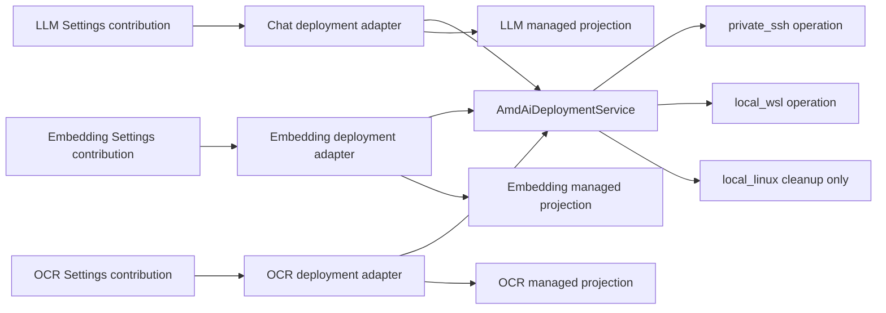

# ADR 0013: Scope Radeon deployments by capability

- Status: accepted
- Date: 2026-08-03
- Partially supersedes: the single combined-profile, all-capability lifecycle,
  and Private-SSH-only placement portions of
  [ADR 0010](0010-managed-amd-rocm-deployments.md); and the
  Private-SSH-only deployability rule of
  [ADR 0012](0012-radeon-edition-composition.md)
- Retains: ADR 0012's always-present Radeon Edition composition and absence of
  build/runtime feature flags; ADR 0010's manifest identity, no-fallback,
  session-fact, SSH-trust, forward-reconcile, and identity-fenced retirement
  boundaries where this record does not change them
- Relates to: [ADR 0007](0007-remote-integrations-remain-adapters.md),
  [ADR 0008](0008-canonical-llm-conversation-boundary.md),
  [ADR 0009](0009-official-paddle-native-local-ocr.md), and
  [ADR 0011](0011-kserve-page-ocr-provider-boundary.md)

## Context

ADR 0010 introduced a fixed Radeon profile that materialized Chat, Embedding,
and OCR together. ADR 0012 made its control plane native to the Radeon Edition
and preserved Private SSH as the only current placement. Those decisions
correctly separated deployment lifecycle from provider selection, but the
deployment unit is too broad: a user may need one capability without reserving,
installing, or retiring the other two.

The current desktop also needs a Windows-local Linux route without confusing it
with native Windows ROCm or SSH. A WSL2 distribution is a distinct, explicitly
selected execution location with a different trust and transport boundary.

## Decision

### Topology and lifecycle unit

The application composition root creates three AMD control-plane
AmdCapabilityDeploymentAdapter instances: one fixed to Chat (LLM), one to
Embedding, and one to OCR. These are deployment adapters, not the existing
inference-time LLM, Embedding, or OCR adapters. Each accepts commands only for
its fixed capability and resolves one admitted single-capability profile.

AmdAiDeploymentService is the shared lifecycle coordinator beneath those
adapters. It creates, observes, reconciles, repairs, self-tests, and retires
one capability deployment at a time. It does not own a generic bundle,
provider selection, a Settings draft, or request-time inference binding.

The fixed profile for a capability owns exact runtime, model, artifact,
compatibility, capacity, protocol, and self-test requirements. There is no
model chooser, ambient plugin discovery, automatic combined-capacity arithmetic,
or CPU, placement, or external-API fallback. A target-scoped operation gate
serializes Xenix's commands and each materialization obtains a fresh
per-capability capacity observation.

### Execution locations

New deployment intent is admitted only for these typed execution locations:

- private_ssh identifies a user-confirmed Linux SSH server by host, user, port,
  and a local identity-file reference. The guided flow discovers the presented
  server public key and displays its fingerprint for explicit user confirmation;
  it has no server-public-key form field. Acceptance pins that exact key. Its
  durable target enrollment remains independently discoverable even after every
  capability installation using it has been removed.
- local_wsl identifies one explicitly selected WSL2 distribution on the Windows
  desktop. It has no SSH credentials, server-key, or host-key concept. A change
  to Windows' default distribution cannot redirect it.

Private SSH retains ADR 0010's pinned-key, key-based-authentication boundary.
Local WSL invokes its selected distribution through a bounded local operation
and must prove Windows-to-WSL loopback, manifest compatibility, real Radeon/ROCm
availability, capacity, protocol behavior, and self-test before provider
registration. The product neither installs WSL, distributions, drivers, or an
SSH daemon nor claims native Windows ROCm.

The old local_linux same-host placement is not a synonym for local_wsl. It is
retained only to inspect or execute identity-fenced cleanup for historical
records. It cannot accept new installation, repair, or resume intent.

### Authority and Settings behavior

| Owner | Authority |
| --- | --- |
| AmdCapabilityDeploymentAdapter | Fixed capability command boundary and its managed provider projection |
| AmdAiDeploymentService | Shared lifecycle coordination, inventory observation, forward reconcile, and retirement |
| private_ssh or local_wsl operation | Placement-specific trust/transport and live target session facts |
| SQLite target enrollment | Immutable Private SSH target identity and opaque local security references, independently of installation lifecycle |
| SQLite installation inventory | Installation identity, capability, immutable placement, desired presence, generation lifecycle, and bounded attestations |
| LLM, Embedding, and OCR settings owners | Their provider list and the sole authority to select a provider |
| Settings dialog | User draft and presentation; it has no Radeon lifecycle or selection authority |

The adapter may ensure or retire only its own immutable managed provider
projection. It never selects an LLM, Embedding, or OCR provider. A provider
availability change only requests a Settings refresh; Settings applies it on the
next explicit close and reopen and must not overwrite an open draft or silently
replace an unavailable selection.

Runtime URLs, ports, tokens, target files, process facts, loopback forwards, and
health remain session-local. They never become Settings, SQLite lifecycle, UI
status, or diagnostic facts. Long-running work exposes only a bounded semantic
activity stream for inspection, checkpoints, preparation, startup, self-test,
and provider registration; it is neither raw target output nor lifecycle
authority.

### Migration, retirement, and no rollback

New rows carry exactly one capability and one immutable execution location. A
private_ssh row retains its target identity; a local_wsl row carries an explicit
WSL distribution reference and never an SSH target identity. A current
capability adapter permits one active deployment for a capability/location pair.
The same target can therefore host separately managed Chat, Embedding, and OCR
deployments. Its target enrollment is not an installation projection: removing
the last capability must not hide the trusted target from a later deployment.

Existing combined-profile rows, their manifests, and historical provider
references remain readable as historical cleanup records. They are not
automatically split into three rows, reclassified as local_wsl, redirected to a
new provider, or used to infer capacity. A forward migration adds the new
placement and capability semantics without rewriting released migrations or
triggering target-side changes.

Remove commits only the durable desired-absence or retirement request for the
exact capability deployment. It is not a physical-cleanup acknowledgement. The
coordinator subsequently uses inventory state and exact identity/control fences
to decide whether it can stop a process, remove target assets, and retire a
projection. Unknown or unproven target state remains honest inventory state.

Reconcile, Repair, upgrade, restart, and retirement move forward only. There is
no rollback journal, aggregate ready state, automatic compensation, failed
operation replay, automatic legacy-row splitting, or provider-selection rewrite.
A new generation receives a new provider identity; an older Install or Repair
completion cannot overwrite a later retirement request.

## Consequences

- Radeon support remains native to this edition with no build or runtime feature
  flag, while its individual Chat, Embedding, and OCR deployments become
  independently requested and retired.
- A successful deployment adds only its own capability provider. The user must
  explicitly choose it in the capability's Settings owner after a close-and-
  reopen refresh.
- Private SSH and Local WSL share a narrow Linux-recipe/session layer only
  behind their placement boundary; they do not share credentials or trust
  semantics.
- local_wsl is a supported product boundary subject to actual preflight and
  acceptance. This ADR does not assert that this machine or any local WSL
  distribution has been Radeon/ROCm verified.
- Package or source rollback cannot roll back SQLite inventory, a WSL target,
  or a remote target. It grants no authority to clean an unverified target.
