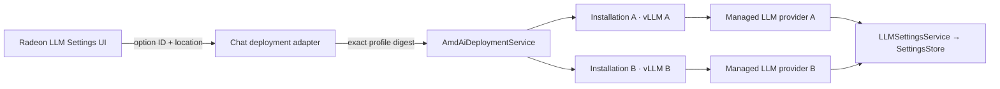

# ADR 0014: Make Radeon LLM recipes independent deployment options

- Status: accepted
- Date: 2026-08-05
- Partially supersedes: ADR 0013's one-profile-per-capability adapter shape,
  absence of a model chooser, and one-capability-per-location exclusion rule
- Retains: ADR 0013's capability-scoped adapters, shared lifecycle coordinator,
  placement operations, Settings ownership, forward-only reconciliation, and
  identity-fenced retirement
- Relates to: [ADR 0008](0008-canonical-llm-conversation-boundary.md),
  [ADR 0010](0010-managed-amd-rocm-deployments.md), and
  [ADR 0013](0013-capability-scoped-radeon-deployments.md)

## Context

One fixed Chat recipe forces every Radeon user to deploy the same lower-quality
model and prevents a second independently useful LLM at the same target. The existing
installation, component-generation, runtime-binding, and managed-provider
identities are already installation-specific; the restriction exists only in
the Chat adapter's catalog shape and the coordinator's admission key.

Radeon Cloud acceptance also showed that Qwen3.5 9B and Qwen3.5 4B can run as
independent vLLM services on one 48 GiB `gfx1100`. They retain different model
keys and together consume about 36.2 GB VRAM. Gemma 4 12B failed the exact pinned
runtime before service readiness, so a branded model family or nominal weight
size cannot be treated as admission evidence.

## Decision

The Chat capability adapter owns a packaged, read-only deployment-option catalog.
Each option resolves an opaque option ID to one current, admitted execution
profile and its exact single Chat component. The UI receives only safe model,
license, context, capacity, placement, and capability metadata. It never receives
or authors manifest digests, artifact paths, runtime commands, parser choices, or
memory fractions.

One model deployment remains one installation, one exact component generation,
one process, and one managed LLM provider. Choosing another model creates another
installation; it is not an upgrade, replica, model-list mutation, or replacement.
Provider identity continues to include installation and component generation.

Chat admission at one execution location excludes only an already-owned exact
component-manifest digest. Different exact Chat components may coexist. The
existing location operation gate still serializes fresh target capacity
observation and materialization. There is no resource ledger, rollback, eviction,
automatic stop, model swapping, or attempt to make room for a new installation.

Model availability is placement- and compatibility-specific. The first new
Private SSH options are revision-pinned Qwen3.5 9B (recommended) and Qwen3.5 4B
(lightweight) on their verified Radeon Cloud cell. They are not offered for
Local WSL until physical Radeon WSL acceptance exists. The superseded Chat
recipe is not retained as a compatibility option because no external Radeon
Edition deployment exists; development-only projections are removed directly.

Installing a model only ensures its model-specific managed provider projection.
The LLM Settings owner remains the sole authority for default, turn-completion
guard, and thread-title selection; a new deployment never changes those roles or
overwrites an open Settings draft.

## Consequences

- Users can deploy either admitted Qwen model, or both when current observed
  capacity permits, and select each through ordinary LLM Settings.
- An exact duplicate at the same location is rejected before target mutation;
  another model is not disturbed when a new installation fails or is removed.
- Embedding and OCR retain one packaged option per verified placement and the
  same capability adapter interface without displaying a redundant model chooser.
- Arbitrary Hugging Face IDs, custom launch flags, unverified quantizations, and
  hosted API choices remain outside the Radeon deployment catalog.
- A transient read-only SSH identity-probe failure cannot collapse a healthy
  realization into an unrecoverable orphan. The operation is denied until a
  later probe proves the exact same receipt; actual identity mismatch still
  destroys the forward.
- A generation that failed before provider publication can retire because its
  exact projection is already absent; existing projections keep their ordinary
  LLM Settings selection blockers.
- Removing the Radeon feature remains a bounded cut through AMD composition,
  resources, Settings contribution, and AMD-owned tests/docs; generic LLM code
  does not import the catalog.
