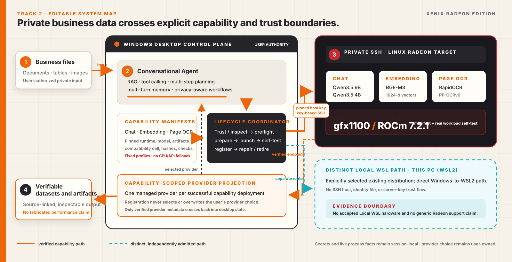

# Xenix Radeon Edition — Project Specification

## Executive summary

Xenix Radeon Edition turns private business files into reviewable decisions for
people who do not operate notebooks, databases, model servers, or GPU tooling.
Its primary work surface is a conversation: a user imports local knowledge,
attaches tabular data, asks a business question, observes Tool activity, and
opens the resulting local Dataset or Artifact.

For this Track 2 entry, Xenix manages the core inference path itself. It deploys
revision-pinned Chat, Embedding, and OCR runtimes independently to a
participant-controlled Radeon Linux environment, admits them only after
compatibility, capacity, protocol, authentication, and real ROCm workload
self-tests, and projects each successful runtime through the corresponding
ordinary Xenix provider boundary. It does not use a remote model API or a fully
closed Agent platform for the core function.

The judge-facing scenario is rainy-season restocking: retrieve a purchasing
rule from a scanned policy, apply it to an inventory table, create a separate
derived Dataset, cite the rule, and answer a grounded follow-up. The exact
oracle is `U100 = 130` and `R200 = 75`; `B500` must be excluded. The repository
contains a black-box outcome benchmark for this workflow. The final accepted
Radeon Hero capture and the follow-up turn are still pending and are not claimed
as complete in this document.

## Business scenario

**User:** an operations employee at a small or medium business.

**Problem:** the current inventory is in a CSV file, while the seasonal buying
rule is trapped in a scanned policy. The user should not need SQL, Python, OCR
configuration, vector-database administration, or knowledge of GPU launch flags.

**Input:** a public-safe fictional inventory extract and scanned policy.

**Requested outcome:** find the applicable rule through semantic retrieval,
calculate the restock quantities, create a Dataset containing only items that
require restocking, preserve both source files, cite the policy, and explain a
follow-up exclusion using the same conversation context.

**Reviewable result:** the answer, source excerpt, Tool events, Dataset lineage,
and separately registered local output remain available to the desktop user.

## Agent flow

The flow below describes the implemented product path and the intended final
demo sequence. It does not assert that the pending final Hero capture has passed.

| Step | Actor | Observable operation | Authority or result |
| --- | --- | --- | --- |
| 1 | User | Imports the scanned policy into the Knowledge Library | The selected source remains unchanged |
| 2 | OCR provider | RapidOCR/PP-OCRv6 extracts page content | Xenix owns page identity, canonical assembly, and publication |
| 3 | Knowledge services | Create source-located Knowledge Units and a BGE-M3 vector index | Canonical content, lineage, and index state remain local |
| 4 | User | Attaches the inventory CSV and asks the restocking question | One persisted conversation Thread owns the interaction |
| 5 | Chat model | Chooses `knowledge.lookup` with semantic retrieval | A bounded source name, location, and excerpt return as a Tool Result |
| 6 | Chat model | Inspects and transforms the registered Dataset through structured Tools | Tool calls and typed results are visible; hidden chain-of-thought is not exposed |
| 7 | Local services | Validate and register the derived Dataset/Artifact | The original source is not overwritten |
| 8 | Chat model | Reports the rule, quantities, citation, uncertainty, and action | The assistant response is persisted locally |
| 9 | User | Asks why `B500` was excluded | Finalized prior messages and Tool results are replayed as multi-turn context |

The Agent loop continues after each Tool Result until the model emits a final
assistant answer. A pause is an admission barrier: it lets the current exchange
settle but does not silently start another provider request.

## Architecture



The topology has three explicit authority zones:

| Zone | Owns | Does not own |
| --- | --- | --- |
| Windows Xenix desktop | UI, conversation Threads, Tool orchestration, provider selection, Knowledge, Datasets, SQLite state, and canonical Artifacts | Radeon processes, live ports, or target caches |
| Managed Radeon Linux runtime | Fixed model/runtime artifacts, loopback-only processes, live bindings, and transient inference | Business state, provider selection, or canonical outputs |
| Private SSH trust boundary | Explicit target identity, pinned host key, key-based transport, and local forwarding | Password fallback, SSH-agent fallback, global SSH configuration, or silent host-key changes |

The separation lets Radeon inference remain private and self-hosted without
turning the execution target into a second application backend. Live URLs,
ports, bearer secrets, paths, process facts, and health are session-local. They
are not copied into Settings, SQLite lifecycle rows, or diagnostics.

## Core Agent capability mapping

Xenix implements all five capability categories named by Track 2, although the
contest requires only two. The final video must still demonstrate the pending
end-to-end and multi-turn evidence called out below.

| Track 2 capability | Xenix implementation | Judge-visible proof and present boundary |
| --- | --- | --- |
| Local RAG | Imported documents become local canonical Knowledge Units. BGE-M3 creates 1024-dimensional embeddings, and `knowledge.lookup` returns bounded source-located excerpts. | OCR import, vector readiness, semantic Tool result, and citation should be visible. Final exact Hero retrieval remains pending. |
| Tool calling | A typed Tool registry exposes Knowledge, Dataset, preparation, analysis, graph, and model operations. Calls and typed results are persisted and rendered as observable events. | The Chat manifest self-test requires an automatic Tool call. The complete Hero Tool trace remains pending. |
| Multi-step planning and execution | The model selects a Tool, Xenix validates and executes it, the Tool Result is appended to the Thread, and the next inference step continues until a final response. | This is an iterative execution loop, not a claim that hidden reasoning is shown. Final Hero completion remains pending. |
| Local multi-turn memory | Finalized user, assistant, Tool-call, and Tool-result messages are stored in the local conversation Thread and projected back into later provider requests. | The planned `B500` follow-up must demonstrate meaningful reuse of the same policy and inventory context; that capture is pending. |
| Permission and privacy controls | Local state is authoritative; source files are preserved; SSH identity is explicitly confirmed and pinned; managed endpoints are loopback-only and authenticated; provider selection is an explicit user action. | Redacted trust/setup footage and source-lineage evidence are appropriate. Endpoints, credentials, secrets, raw logs, and private paths are prohibited. |

Implementation anchors include the
[Agent execution loop](../../src/xenix/services/agent/harness_service.py),
[Knowledge Tool](../../src/xenix/services/agent/knowledge_tool.py),
[typed Tool registry](../../src/xenix/services/agent/tools.py), and
[conversation context projection](../../src/xenix/services/llm/conversation.py).

## Three independent capability lifecycles

Chat, Embedding, and OCR are not one mutable deployment bundle. Each capability
has its own adapter, immutable installation identity, component generation,
runtime process, self-test, managed provider projection, Repair path, and Remove
request. They share only the lifecycle coordinator and placement operation gate.

```text
Choose one capability option and execution location
  -> confirm placement identity / inspect local WSL
  -> admit exact compatibility and current capacity
  -> acquire and verify pinned artifacts
  -> start an authenticated loopback runtime
  -> run protocol + real ROCm workload self-test
  -> register only that capability's provider projection
  -> user explicitly selects the provider in ordinary Settings
```

For Chat, each Qwen model is a separate installation and provider. Deploying a
second admitted model is not an upgrade or replacement of the first. Removal of
one model cannot remove another model's process, files, or provider. Embedding
and OCR retain the same lifecycle shape with one packaged option per verified
placement.

Lifecycle state moves forward. **Repair** continues the same capability toward
its desired state. **Remove** first records desired absence; physical cleanup
occurs only after exact installation, generation, manifest, process, and target
identity fences pass. A Remove acknowledgement is therefore not an assertion
that remote files have already been erased.

See the accepted decisions for the
[managed control plane](../../docs/20-product-tdd/adr/0010-managed-amd-rocm-deployments.md),
[OCR provider boundary](../../docs/20-product-tdd/adr/0011-kserve-page-ocr-provider-boundary.md),
[Radeon Edition composition](../../docs/20-product-tdd/adr/0012-radeon-edition-composition.md),
[capability-scoped lifecycle](../../docs/20-product-tdd/adr/0013-capability-scoped-radeon-deployments.md),
and [independent Chat options](../../docs/20-product-tdd/adr/0014-radeon-llm-deployment-options.md).

## Models and local deployment plan

| Capability | Fixed model and runtime | Protocol | Current admission floor | Deployment boundary |
| --- | --- | --- | --- | --- |
| Chat | Qwen3.5 9B (recommended) or Qwen3.5 4B (lightweight), FP16, revision-pinned, served by the pinned vLLM ROCm 7.2.1 wheel | OpenAI-compatible Chat Completions with Tool calling | 9B: 24 GB free VRAM, 32 GiB system memory, 34 GB persistent space; 4B: 16 GB, 32 GiB, 22 GB | Admitted Private SSH `gfx1100` cell; no Local WSL Chat claim |
| Embedding | BAAI BGE-M3, FP16 pooling through the same pinned vLLM ROCm wheel | OpenAI-compatible Embeddings; fixed 1024-dimensional output | 12 GB free VRAM, 16 GiB system memory, 8 GB persistent space | Verified Private SSH cell; Local WSL remains subject to its own physical preflight and acceptance |
| Page OCR | RapidOCR 3.9.2 with PP-OCRv6 small Torch models, pinned PyTorch and Triton ROCm 7.2.1 wheels | KServe V2 binary tensor request; PAGE 2024-07-15 response | 3 GB free VRAM, 16 GiB system memory, 5 GB persistent space | Verified Private SSH cell; Local WSL remains subject to its own physical preflight and acceptance |

The manifests pin source revisions, artifact sizes and SHA-256 digests, runtime
versions, protocol fields, launch constraints, compatibility cell, self-tests,
and capacity floors. An artifact mirror may provide the same bytes only; it
cannot change the declared model or revision. A failed hash, compatibility
check, capacity check, protocol check, or ROCm workload check rejects the
deployment instead of choosing a CPU, another placement, or an external API.

The desktop runs on Windows. The currently evidenced route is **Private SSH**
to a participant-controlled Linux Radeon target. Xenix uses strict, key-based
SSH and local port forwarding; this is a private/self-hosted split deployment,
not an offline or same-device claim. **Local WSL** is a separate supported
product boundary for an explicitly selected existing WSL2 distribution. Xenix
does not install WSL, a distribution, a driver, or an SSH daemon, and no local
WSL Radeon target is claimed as physically accepted.

## Radeon optimization strategy

The present optimization work is architectural and configuration-bound. It is
not presented as a measured speedup.

1. **Capability-sized deployment.** Chat, Embedding, and OCR are materialized
   independently, so a user does not need to reserve all three runtimes for a
   one-capability task. Different Chat models remain independent rather than
   being swapped behind one endpoint. This is a resource-shaping decision, not
   a quantified performance result.
2. **Fixed ROCm runtime cells.** The admitted recipes pin Python, the ROCm 7.2.1
   vLLM or PyTorch/Triton wheels, model revisions, FP16 execution, context and
   sequence bounds, and per-runtime GPU memory fractions. Arbitrary model IDs,
   launch flags, plugins, quantizations, and runtime substitutions are excluded.
3. **Admission before publication.** A fresh per-capability capacity observation
   checks GPU count, free VRAM, system memory, and persistent space. No process
   is stopped, resized, evicted, or silently moved to make room.
4. **Real workload self-tests.** Chat must complete an automatic Tool call and a
   Chat response; Embedding must return the required vector shape; OCR must use
   Torch for detection/classification/recognition and satisfy the PAGE contract.
   Every self-test also requires ROCm workload evidence and rejection of an
   unauthenticated request before a provider is registered.

The project currently makes **no** tokens-per-second, TTFT, Embedding latency,
OCR latency, throughput, speedup, energy, or cross-vendor claim. A timestamped,
repeated, same-input measurement on the exact declared cell is still required.
If no reproducible baseline/optimized pair is completed, the submission must
describe the fixed strategy above and omit uplift language.

## Tested Radeon/ROCm cell

The exact admitted and observed Private SSH cell used by the current
Qwen3.5 9B, BGE-M3, and RapidOCR evidence is:

| Field | Exact value |
| --- | --- |
| Operating system | Ubuntu 24.04 |
| Kernel | `6.8.0-106-generic` |
| Architecture | `x86_64` |
| GPU architecture | `gfx1100` |
| AMDGPU driver | `6.16.6` |
| ROCm | `7.2.1` |
| HIP | `7.2.53211-e1a6bc5663` |
| Python | `3.12.3` |
| Placement | Private SSH Linux target |

The Qwen3.5 4B manifest is also admitted for this exact cell, but the current
Hero path uses Qwen3.5 9B. This is evidence for one precise compatibility cell,
not a claim for every `gfx1100` device, every Radeon GPU, every driver/kernel
pair, Windows-native ROCm, or Local WSL.

The exact current component manifests are
[Qwen3.5 9B](../../src/xenix/resources/amd/manifests/components/qwen3.5-9b.json),
[Qwen3.5 4B](../../src/xenix/resources/amd/manifests/components/qwen3.5-4b.json),
[BGE-M3](../../src/xenix/resources/amd/manifests/components/bge-m3-v2.json), and
[RapidOCR/PP-OCRv6](../../src/xenix/resources/amd/manifests/components/rapidocr-3.9.2-pp-ocrv6-v2.json).

## Security and privacy

- Windows SQLite, local services, and local canonical files own conversations,
  Knowledge, Datasets, model records, and Artifacts. The execution target owns
  only managed runtime files, processes, caches, live bindings, and transient
  inference.
- Private SSH validates fields before discovery, shows the discovered host-key
  fingerprint for explicit comparison, pins the accepted key, and fails closed
  if it changes. Password authentication, agent fallback, global SSH config,
  `ProxyCommand`, and `ProxyJump` are not used.
- Xenix stores a local identity-file reference, never private-key bytes. Each
  runtime incarnation receives a fresh protected secret. Managed services are
  loopback-only and must reject unauthenticated requests.
- Endpoint URLs, ports, bearer secrets, remote paths, PIDs, raw model output,
  and process health remain session-local and are excluded from Settings and
  diagnostics.
- Deployment registers a provider but never selects it. The user explicitly
  chooses each Chat, Embedding, or OCR provider in the capability's normal
  Settings owner.
- Selected source files are not mutated or deleted. Prepared data is registered
  as a separate derived Dataset, and user-openable outputs are local Artifacts.

## User experience

1. In the relevant Chat, Embedding, or OCR Settings block, choose a fixed
   capability option and **Private SSH** or **This PC (WSL2)**.
2. For Private SSH, enter the host, user, port, and local identity-file path,
   independently verify the displayed fingerprint, and choose **Trust and
   continue**. For Local WSL, select an existing distribution; no SSH form is
   shown.
3. Keep the guided dialog open while it reports bounded semantic milestones for
   trust/inspection, checkpoints, preflight, preparation, startup, self-test,
   and provider registration. It shows truthful elapsed time rather than
   fabricated download percentages.
4. Close and reopen Settings, explicitly select the new managed provider in its
   ordinary capability owner, and save. This preserves open user drafts and
   prevents deployment from silently changing provider policy.
5. Import Knowledge, attach a Dataset, ask a business question, inspect Tool and
   source evidence, and open the registered result.

## Known limitations and open evidence gates

- Hardware acceptance currently covers only the exact Private SSH cell above.
- No Local WSL distribution has passed physical Radeon/ROCm acceptance for this
  submission, and Chat options are not advertised there.
- Private SSH is not an offline or same-device inference claim. A Linux target,
  Windows OpenSSH client, network path, and key-based access are required.
- First materialization may transfer large pinned artifacts and compile/load
  runtimes. The UI reports semantic stages and elapsed time, not a predictive
  percentage.
- Provider registration requires an explicit Settings close/reopen and user
  selection. It never rewrites an open Settings draft.
- Lifecycle operations are forward-only. Remove records desired absence before
  identity-fenced physical cleanup; there is no rollback journal or automatic
  eviction/resource ledger.
- Xenix is a single-local-operator product; accounts, roles, tenancy, and
  concurrent-user coordination are outside current scope.
- The final correct Hero capture (`U100 = 130`, `R200 = 75`, `B500` excluded),
  grounded follow-up, synchronized request-path telemetry, and repeated
  same-cell performance measurements remain incomplete.

## Run and verify

### Desktop prerequisites

- Windows 10/11 x64
- Python `3.14.2`
- PDM `2.26.6`
- For Private SSH: Windows OpenSSH client, a compatible user-controlled Linux
  Radeon target, and key-based access
- For Local WSL: an existing WSL2 distribution selected explicitly; acceptance
  still depends on that distribution's actual preflight and self-tests

Dependencies and exact resolutions are declared in
[`pyproject.toml`](../../pyproject.toml) and [`pdm.lock`](../../pdm.lock).

```powershell
pdm install
pdm run dev
```

Open Settings and follow the capability-specific deployment flow described
above. Do not substitute an arbitrary runtime, model, launch flag, or API; the
packaged manifest is the admission authority.

Repository verification commands are:

```powershell
pdm run check
pdm run test
pdm run smoke
pdm run package
pdm run smoke-package
```

`pdm run test` verifies the repository's manifest topology and automated
contracts. Hardware acceptance is a separate product operation: successful
provider publication requires the selected target to pass its exact live
preflight, capacity check, protocol check, authenticated loopback check, and
ROCm workload self-test. See the
[managed deployment runbook](../../docs/40-deployment/managed-amd-runtime.md)
and [contributor verification policy](../../CONTRIBUTING.md).

## Judging alignment

| Scoring area | Xenix evidence | Honest boundary |
| --- | --- | --- |
| Functional completeness and application value — 60 points | Specific operations scenario; local RAG; structured Tool calling; iterative multi-step execution; persisted multi-turn context; separate derived Dataset and source-linked result | The final exact Hero and follow-up capture are still required |
| Radeon/ROCm adaptation and optimization — 40 points | Fixed ROCm 7.2.1 runtime and model manifests; one exact `gfx1100` cell; capacity admission; authenticated loopback; real workload self-tests; independent capability lifecycles | Same-cell throughput/latency and any baseline-to-optimized comparison are still required; no uplift is claimed |
| Optional Radeon Cloud model-API optimization — up to 20 points | Not submitted | Xenix's core path is self-hosted managed inference, not the optional hosted model-API category |

The complete claim-by-claim record is in [EVIDENCE.md](EVIDENCE.md).
