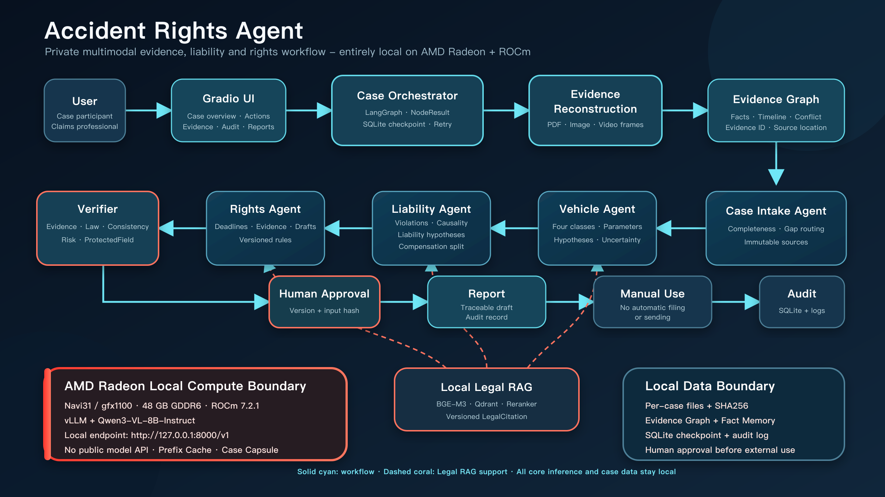

# Accident Rights Agent

**DataLink - AMD AI DevMaster Hackathon, Track 2: Private AI Agent Development and Local Deployment**

Accident Rights Agent is a private, multimodal AI workspace for reconstructing
traffic-accident evidence, testing liability hypotheses, and turning procedural
deadlines into reviewable rights-protection tasks. Core inference runs locally
on an AMD Radeon GPU through ROCm and vLLM. Case files, legal retrieval,
workflow state, and audit records remain inside the local deployment boundary.

The system is decision support, not a substitute for traffic authorities,
courts, appraisal institutions, insurers, or qualified legal counsel. It never
submits a document or represents an external action as completed without human
approval.

## Why this scenario matters

After a collision, the useful evidence window is short. A vehicle owner or
claims professional may need to reconcile dashcam video, scene photos, an
accident determination, vehicle specifications, appraisal reports, policy
documents, and service receipts. The materials can conflict, and a missed
review or re-appraisal deadline can remove practical options.

General chat assistants are a poor fit for this workflow because they can:

- turn unverified observations into definitive facts;
- confuse technical compliance with legal vehicle classification;
- merge accident liability, civil compensation, and insurance payment into one
  unsupported conclusion;
- cite a rule without a version, effective date, article, or source location;
- produce an apparently final document before a human has checked the evidence.

Accident Rights Agent starts with evidence, preserves uncertainty, and produces
an auditable draft that a person can review, reject, or revise.

## Practical value

### Vehicle owners

- see which evidence is missing, conflicting, or time-sensitive;
- understand alternative liability and vehicle-classification hypotheses;
- receive a prioritized checklist for review, appraisal, and document
  preparation;
- keep every recommendation traceable to evidence and legal sources.

### Insurance and claims teams

- work from one structured case state instead of disconnected messages and
  attachments;
- review the same evidence graph, deadlines, citations, and draft version;
- reduce unsupported assertions and repeated manual evidence sorting;
- hand work to a human decision maker with a complete audit trail.

### Rights-service and legal operations teams

- use versioned legal retrieval and deterministic deadline rules;
- separate fact extraction, legal analysis, and external action approval;
- resume long workflows from SQLite checkpoints;
- retain the ability to audit or reproduce each Agent decision.

## Submission materials

- [Project specification PDF](docs/submission/project_description.pdf)
- [Creative scenario and practical-value presentation](docs/submission/accident_rights_agent_submission.pptx)
- [Demo video - 4:54, Mac-compatible H.264 MP4](docs/submission/demo_video.mp4)
- [Agent architecture PNG](docs/submission/architecture.png) and [editable SVG](docs/submission/architecture.svg)
- [AMD Radeon optimization report](docs/submission/amd_optimization.md)
- [Test report](docs/submission/test_report.md)
- [Privacy and security statement](docs/submission/privacy_security.md)
- [Models and licenses](docs/submission/model_license.md)
- [Submission checklist](docs/submission/submission_checklist.md)

The final video uses English narration and bilingual subtitles. Recording
scripts and operator notes remain internal working files and are not part of
the public submission package.

## Track 2 capability coverage

The project implements all five capabilities listed in the Track 2 rules:

| Capability | Implementation |
|---|---|
| Local knowledge retrieval | Versioned legal corpus, BM25 + local vector retrieval, local reranker, `LegalCitation` |
| Tool use | Evidence parsers, deterministic deadline calculator, rules, report export, safety checks |
| Multi-step planning | LangGraph Case Orchestrator and Rights Workflow |
| Local multi-turn memory | Immutable sources, Fact Memory, Working Memory, Case Capsule |
| Access control and privacy | Local-only endpoint policy, per-case storage, Human Approval, audit trail |



## How the Agent works

1. **Case Intake** stores immutable source files with SHA256 and validates file
   type, size, path, and role.
2. **Evidence Reconstruction** parses PDFs and images, samples video frames, and
   creates source-linked evidence nodes.
3. **Evidence Graph** organizes facts, events, conflicts, gaps, confidence, and
   source locations.
4. **Case Intake Agent** identifies missing materials and routes evidence gaps.
5. **Vehicle Agent** separates technical parameters from legal status and keeps
   multiple hypotheses when classification is uncertain.
6. **Liability Agent** builds violation, causal-force, and counterfactual
   analyses while keeping accident liability, civil compensation, and insurance
   payment separate.
7. **Rights Agent** calculates deadlines with versioned rules, creates evidence
   tasks, and drafts review or appraisal documents.
8. **Legal RAG** supplies effective-date-aware citations from a local corpus.
9. **Verifier** checks evidence IDs, legal IDs, consistency, risk language, and
   protected fields.
10. **Human Approval** is required before any document can be prepared for
    manual external use.

## Local-only model policy

`local_vllm` mode accepts only the loopback endpoint
`http://127.0.0.1:8000/v1`. The policy rejects non-HTTP URLs, non-loopback
hosts, unexpected ports, credentials, query strings, fragments, and paths
outside `/v1`. If the local endpoint doctor fails, execution stops. There is no
fallback to a public Qwen, DeepSeek, OpenAI, or other hosted model API.

Two modes are intentionally separated:

- `mock`: deterministic adapters for functional testing without a GPU;
- `local_vllm`: real multimodal inference through the co-located Radeon vLLM
  service.

Both modes use the same evidence graph, workflow, legal rules, memory,
Verifier, and user interface. Mock results are never reported as Radeon model
performance.

## Validated Radeon environment

| Component | Validated configuration |
|---|---|
| GPU | AMD Navi31 / `gfx1100`, 48 GB GDDR6 |
| ROCm | 7.2.1 |
| Python | 3.10.12 on Radeon; 3.12.13 fresh-install validation |
| PyTorch ROCm | `2.9.1+gitff65f5b` |
| vLLM | `0.16.1.dev0+g89a77b108.d20260318` |
| Primary model | `Qwen/Qwen3-VL-8B-Instruct`, BF16 |
| Model endpoint | `127.0.0.1:8000` only |
| UI endpoint | `127.0.0.1:7860` by default |

The validated Radeon image requires
`FLASH_ATTENTION_TRITON_AMD_ENABLE=TRUE`. Exact validated versions are recorded
in `config/radeon-validated-versions.txt`.

## Measured AMD results

All values below come from committed Radeon Cloud JSON/CSV evidence under
`benchmarks/results/`. They are not Mock measurements.

| Metric | Baseline | Optimized |
|---|---:|---:|
| Input tokens | 11,808 | 5,795 (-50.9%) |
| TTFT p50 | 9.003 s | 0.113 s (-98.8%) |
| TTFT p95 | 9.007 s | 0.113 s |
| Latency p95 | 23.407 s | 15.228 s |
| Output throughput | 15.417 tok/s | 25.689 tok/s |
| Peak VRAM | 44,246 MB | 43,984 MB |
| ProtectedField retention | 100% | 100% |
| Success / OOM | 100% / 0 | 100% / 0 |

Concurrency 1, 2, and 4 each completed 20/20 requests with 100% business
Verifier pass rate and zero OOM events. The 30-minute stability run completed
298/298 requests with zero OOM; the vLLM process, UI/API, and SQLite integrity
remained stable.

The fixed short-output performance and stability loads do not contain the full
business ID list, so their `verifier_pass_rate=0` is not used as a semantic
quality claim. Business quality is demonstrated by the full semantic
concurrency workload and Golden Case.

## Repository structure

```text
app/
  agents/          Case intake, vehicle, liability, model adapters
  demo/            Synthetic Golden Case and experience fixtures
  evidence/        File intake, PDF/image/video reconstruction, VLM client
  graph/           LangGraph workflow, checkpointing, Verifier
  memory/          Fact Memory, Working Memory, Case Capsule, protected fields
  policy/          Local-only endpoint and external-action controls
  rag/             Versioned corpus, local index, retrieval, reranking
  rights/          Deadline rules, task planning, draft generation
  schemas/         Evidence, legal, memory, workflow, and UI contracts
  services/        Case and report services
  ui/              Gradio workspace and preflight doctor
benchmarks/        AMD, retrieval, memory, and orchestration experiments
config/            Validated versions and policy/rule configuration
data/laws/         Curated legal manifest, verified snapshots, quote audit
docs/submission/   English submission materials
experiments/       Dynamic-memory and sparse-feedback evaluation
release_check/     Internal freeze and readiness evidence
scripts/           Setup, launch, verification, and benchmark entry points
tests/             Unit, integration, UI, policy, and benchmark tests
```

## Environment requirements

### Mock mode

- macOS or Linux;
- Python 3.10-3.13 recommended;
- enough disk space for Python dependencies and generated fixtures.

### Radeon local-inference mode

- AMD Radeon GPU supported by the selected ROCm image;
- ROCm-compatible PyTorch and vLLM;
- local Qwen3-VL model weights;
- optional local BGE-M3 and bge-reranker-v2-m3 model directories;
- no public model endpoint.

## Install

```bash
git clone <YOUR_FORK_OR_SUBMISSION_REPOSITORY>
cd accident-rights-agent
python3 -m venv .venv
.venv/bin/pip install -r requirements.lock
```

If `files.pythonhosted.org` is slow on the current network, keep the same lock
file and change only the package index:

```bash
.venv/bin/pip install \
  --index-url https://pypi.tuna.tsinghua.edu.cn/simple \
  -r requirements.lock
```

Verified legal snapshots and `data/laws/quote_audit.json` are included in the
submission candidate. On first launch, the project builds the local SQLite and
Qdrant hash index after the 59/59 quote-audit gate passes. Generated databases
and indexes are not committed.

## Access Modes

### 1. AMD Radeon Cloud Evaluation

The Agent runs on AMD Radeon Cloud with local vLLM inference.

Services inside the Radeon Cloud instance:

- Gradio: `127.0.0.1:7860`
- vLLM: `127.0.0.1:8000`

Evaluation path:

```text
Mac Chrome (http://127.0.0.1:7860)
  -> SSH tunnel (-L 7860:127.0.0.1:7860)
  -> Radeon Cloud Gradio (127.0.0.1:7860)
  -> LangGraph Agent
  -> local vLLM (127.0.0.1:8000)
  -> AMD Radeon GPU
```

The Radeon Cloud Jupyter interface is not used to display the application UI.
Use SSH port forwarding to expose only the loopback Gradio port to the local
Mac browser:

```bash
ssh -N \
  -i <ssh_private_key> \
  -L 7860:127.0.0.1:7860 \
  root@<HOST> \
  -p <PORT>
```

Open the browser on the Mac:

```text
http://127.0.0.1:7860
```

The browser and UI display run on the Mac. LangGraph, local vLLM inference, and
AMD Radeon GPU execution remain inside the Radeon Cloud instance. Port `8000`
is not forwarded or exposed publicly.

### 2. Local Development

Run locally:

```bash
bash scripts/run_demo.sh
```

Access:

```text
http://127.0.0.1:7860
```

### 3. Demo Recording

For the AMD Radeon Cloud Demo recording:

- the Mac browser accesses the UI through the SSH tunnel;
- the browser records `http://127.0.0.1:7860` locally;
- model inference remains inside Radeon Cloud;
- GPU metrics are monitored in a Radeon Cloud terminal through `amd-smi`;
- neither Gradio nor vLLM is bound to a public interface.

## One-command functional demo

```bash
DEMO_MODE=mock bash scripts/run_demo.sh
```

Open `http://127.0.0.1:7860`, load `CASE-GOLDEN-DEMO`, and select **Analyze /
Update Current Accident**. Mock mode demonstrates the complete product and
workflow without claiming GPU inference quality or speed.

Preflight and non-UI Golden Case:

```bash
bash scripts/doctor.sh --mode mock --prepare
.venv/bin/python scripts/run_golden_e2e.py --mode mock
```

## Run on AMD Radeon with local vLLM

Copy the environment template and point every model path to a local directory:

```bash
cp config/model.env.example config/model.env
```

Start the loopback-only vLLM service with the validated interactive settings:

```bash
VLLM_GPU_MEMORY_UTILIZATION=0.95 \
VLLM_MAX_NUM_BATCHED_TOKENS=8192 \
VLLM_MAX_MODEL_LEN=16384 \
ENABLE_PREFIX_CACHING=1 \
bash scripts/serve_vllm.sh
```

Verify the endpoint and listener:

```bash
.venv/bin/python scripts/verify_endpoint.py
.venv/bin/python scripts/verify_loopback_listener.py
```

Start the application in real local-inference mode:

```bash
MODEL_MODE=local_vllm bash scripts/run_demo.sh
```

The launch stops if `127.0.0.1:8000/v1/models` is unavailable. It never falls
back to a public model API.

For remote evaluation and recording, use the Gradio-only SSH tunnel documented
under **Access Modes**. Do not forward vLLM port `8000`, and do not expose port
`8000` or `7860` publicly.

## Legal RAG

The curated manifest currently contains 15 official-source documents and 59
reviewed excerpts. Every excerpt stores document identity, issuing authority,
jurisdiction, version, effective dates, article/paragraph/item, source URL,
source location, verbatim text, and content hash.

Re-run the local quote audit and build the deterministic hash index:

```bash
.venv/bin/python scripts/audit_legal_quotes.py
EMBEDDING_PROVIDER=hash \
  .venv/bin/python scripts/ingest_laws.py --embedding-provider hash
```

Production-like local retrieval can use local BGE directories:

```bash
EMBEDDING_PROVIDER=bge \
BGE_M3_MODEL_PATH=/persistent/models/bge-m3 \
EMBEDDING_DEVICE=cuda \
  .venv/bin/python scripts/ingest_laws.py --embedding-provider bge
```

PyTorch uses the device name `cuda` for ROCm GPU execution. Remote model IDs
are rejected.

Run retrieval regression:

```bash
.venv/bin/python benchmarks/legal_retrieval.py \
  --embedding-provider hash \
  --reranker-provider heuristic
```

## Test and quality gates

```bash
.venv/bin/pytest -q
.venv/bin/ruff check app tests benchmarks experiments scripts
.venv/bin/mypy app
git diff --check
```

Latest release-candidate results:

```text
164 passed, 1 skipped, 2 warnings
Ruff: passed
mypy app: 82 source files passed
```

The warnings are the Python 3.14 LangChain Pydantic V1 compatibility warning and
a FastAPI TestClient deprecation warning. Python 3.10-3.13 is the supported
release range.

## Benchmark entry points

```bash
bash scripts/run_baseline.sh
bash scripts/run_amd_concurrency.sh
bash scripts/run_memory_sparse_feedback.sh
```

Detailed parameter definitions, fairness controls, and result limitations are
in [docs/submission/amd_optimization.md](docs/submission/amd_optimization.md).

## Golden Case and safety behavior

The clean Golden Case contains 12 sources, 18 facts, three timeline events, and
nine valid synthetic PDFs, plus JPEG and H.264 MP4 evidence. The source
materials are synthetic and contain no real personal data.

Expected final workflow state:

- zero failed nodes;
- one warning that preserves the evidence/human-approval boundary;
- document status `draft`;
- approval status `pending`;
- Policy Gate `pass_with_warnings`;
- Markdown and HTML reports generated;
- checkpoint cache hit on repeated eligible nodes.

## Privacy and security

- raw case files are stored per case and hashed before atomic write;
- path traversal, symlinks, empty files, false extensions, and oversized files
  are rejected;
- original evidence is never lossily compressed or overwritten by the UI;
- local model, embedding, reranking, legal index, checkpoint, and logs remain
  within the deployment boundary;
- demo fixtures are synthetic;
- external-use documents remain drafts until Human Approval;
- public model endpoint and API-key scans returned zero matches.

See [docs/submission/privacy_security.md](docs/submission/privacy_security.md)
for the full boundary and production gaps.

## Models and licenses

| Component | License | Use |
|---|---|---|
| Project source code | Apache License 2.0 | Agent, workflow, UI, evaluation, deployment code |
| Qwen3-VL-8B-Instruct | Apache License 2.0 | Multimodal evidence and Agent inference |
| BAAI/bge-m3 | MIT | Local legal embeddings |
| BAAI/bge-reranker-v2-m3 | Apache License 2.0 | Local legal reranking |

See [docs/submission/model_license.md](docs/submission/model_license.md) and
the root [LICENSE](LICENSE).

## Known limitations

1. Evaluation uses one Navi31 48 GB GPU, an 8B model, and synthetic Golden
   Cases; it does not establish real-world accident recognition accuracy.
2. Prefix Cache gains depend on repeated, stable prompt prefixes.
3. `gpu_memory_utilization=0.95` leaves limited headroom; production should
   begin lower and test real multi-image loads.
4. Legal retrieval covers a curated national corpus, not every jurisdiction or
   local rule.
5. The competition build does not provide production-grade multi-tenant IAM,
   RBAC, KMS, malware sandboxing, centralized immutable audit, or disaster
   recovery.
6. Verifier and quality scores are engineering gates, not legal correctness
   guarantees.
7. No document is automatically delivered, filed, or sent.

## License

Copyright 2026 DataLink.

Licensed under the Apache License, Version 2.0. See [LICENSE](LICENSE).
