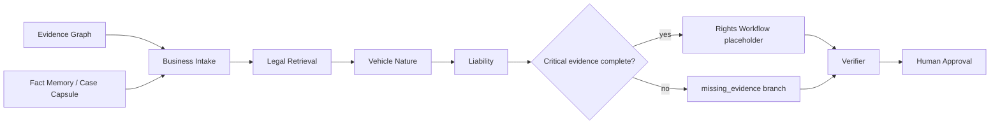

# Business Agents Architecture

## 1. Scope

This phase implements AGT-01 through AGT-08 on top of the existing immutable
Evidence Graph, legal RAG, four-layer memory, and LangGraph checkpointer. It
does not rerun OCR, video parsing, or image understanding.

The default development adapter is deterministic and requires no GPU. The
production adapter calls the existing OpenAI-compatible vLLM service through
`LocalVLLMClient`; the local-only policy still rejects any host other than
`127.0.0.1`, `localhost`, or `::1` on port 8000.

## 2. Shared state and execution flow



The business nodes read and write one existing `CaseState`. New state fields
include:

- `blocking_issues`
- `missing_evidence`
- `vehicle_nature_result`
- `parameter_comparison`
- `violation_matrix`
- `causation_matrix`
- `liability_result`
- `responsibility_probabilities`
- `accident_responsibility`
- `civil_compensation_allocation`
- `insurance_payment_estimate`
- `counterfactual_analysis`

Before each business node, the orchestrator builds a protected task context
from the current Case Capsule, Fact Memory, and `LegalCitation` objects. Fact
Memory status is projected into the facts given to each business agent.

Each node continues to use the existing `NodeResult` envelope:

```text
status / started_at / finished_at / inputs_hash / outputs / warnings /
errors / retry_count / metrics
```

Schema and JSON failures are repaired and retried once. The established node
timeout and SQLite checkpoint behavior is unchanged.

## 3. Case Intake Agent

`assess_business_intake` accepts:

- existing `SourceFile` records;
- existing fact rows;
- existing Evidence Nodes;
- existing conflicts.

It returns `CaseIntakeResult`. Material categories cover:

1. accident determination;
2. delivery information;
3. dashcam video;
4. scene photos;
5. road/signal evidence;
6. vehicle registration/plate;
7. vehicle certificate/CCC;
8. vehicle technical parameters;
9. vehicle-nature appraisal;
10. inquiry record;
11. medical/repair materials;
12. insurance policy/terms.

A missing material has:

```json
{
  "category": "vehicle_registration_plate",
  "reason": "登记及管理方式是车辆法律属性的重要独立因素",
  "required_for": ["车辆法律属性", "赔偿路径"],
  "priority": "P0",
  "collection_method": "核验号牌、登记证或属地登记查询结果",
  "related_agent": "vehicle_nature",
  "blocks_conclusions": ["车辆法律属性", "赔偿路径"]
}
```

No reconstructed nodes/facts blocks all business conclusions. Missing scene
trajectory blocks a unique accident-responsibility result. Missing
registration/appraisal blocks definite vehicle classification and the final
compensation regime, but does not prevent multi-hypothesis analysis.

## 4. Vehicle parameter rule engine

`config/vehicle_parameter_rules.json` is a versioned nationwide ruleset with:

```text
ruleset_id / jurisdiction / effective_date / expiry_date / source_law_id
```

The deterministic engine independently evaluates:

- design maximum speed;
- complete vehicle mass, including battery-dependent thresholds;
- rated continuous motor power;
- nominal battery voltage as a recorded review field;
- conditional pedal-riding capability;
- anti-tamper and speed-limiter evidence;
- vehicle dimensions;
- product certificate and CCC;
- registration and plate type;
- modification evidence.

Every `ParameterComparison` carries fact IDs, Evidence IDs, effective dates,
jurisdiction, source Law ID, and source article. Its status is limited to:

```text
compliant / non_compliant / unknown / conflicting / not_applicable
```

The tool cannot return a legal motor/non-motor classification.

## 5. Vehicle Nature Agent

The agent combines:

- technical comparisons;
- registration and plate facts;
- product and CCC factors;
- appraisal opinions;
- modification evidence;
- the accident date;
- evidence conflicts;
- versioned `LegalCitation` objects.

Example:

```json
{
  "classification": "suspected_motor_vehicle",
  "confidence": 0.52,
  "conclusion_status": "disputed",
  "supporting_facts": [],
  "contradicting_facts": [],
  "missing_evidence": [],
  "parameter_comparison": [],
  "registration_and_management_factors": [],
  "appraisal_factors": [],
  "legal_basis": [],
  "alternative_hypotheses": [
    {
      "hypothesis_id": "VH-1",
      "classification": "non_motor_vehicle",
      "probability": 0.45,
      "supporting_fact_ids": [],
      "contradicting_fact_ids": [],
      "missing_evidence": [],
      "compensation_regime_impact": "motor_vs_non_motor_or_pedestrian",
      "explanation": "比较假设"
    },
    {
      "hypothesis_id": "VH-2",
      "classification": "motor_vehicle",
      "probability": 0.55,
      "supporting_fact_ids": [],
      "contradicting_fact_ids": [],
      "missing_evidence": [],
      "compensation_regime_impact": "motor_vs_motor",
      "explanation": "比较假设"
    }
  ],
  "warning": "技术参数比较不直接替代车辆法律属性判断",
  "explanation": "结构化解释"
}
```

The actual schema requires complete nested objects; the shortened arrays above
only show the outer contract.

Decision constraints:

- parameter non-compliance alone can produce
  `suspected_motor_vehicle`, never `motor_vehicle`;
- conflicting registration/appraisal evidence caps confidence and sets
  `conclusion_status=disputed`;
- definite motor/non-motor output requires a relevant LegalCitation;
- at least two alternative hypotheses are always returned.

## 6. Liability Agent

### 6.1 Violation matrix

The matrix produces one row for both parties across all twelve categories:

```text
travel_direction / lane_usage / traffic_control / right_of_way / speed /
observation / braking_avoidance / wrong_way / crossing /
illegal_passenger / night_lighting / modification
```

`confirmed` requires valid Fact IDs, Evidence IDs, and legal citations. If any
part is missing or disputed, the status remains `possible` or `unknown`.

### 6.2 Causation

Only active findings enter the causation matrix. Roles are:

```text
triggering_cause / primary_cause / secondary_cause /
conditional_factor / no_causal_relation
```

The configurable baseline weights directness, avoidability, fact confidence,
and finding status. It does not count violations.

### 6.3 Multi-hypothesis responsibility

The current transparent baseline compares three scenarios:

- two-wheeler major / motor minor;
- equal responsibility;
- motor major / two-wheeler minor.

Party causation scores are converted by softmax. Temperature is higher when
critical evidence is missing, producing a less concentrated distribution.
Probabilities always sum to 1 and represent a model-confidence distribution,
not a judicial probability.

### 6.4 Three separate result objects

```json
{
  "accident_responsibility": {
    "status": "multiple_hypotheses_only",
    "selected_hypothesis_id": null,
    "levels_allowed": ["full", "major", "equal", "minor", "none"],
    "explanation": "当前证据不足以选择唯一方案"
  },
  "civil_compensation_allocation": {
    "status": "insufficient_evidence",
    "regime": "pending_vehicle_classification",
    "share_ranges": [],
    "assumptions": [],
    "legal_basis": [],
    "explanation": "车辆属性前置问题未解决"
  },
  "insurance_payment_estimate": {
    "status": "insufficient_data",
    "currency": "CNY",
    "estimated_amount": null,
    "required_inputs": [
      "保险单与适用保险条款",
      "交强险及商业险责任限额",
      "经核验的损失项目与金额"
    ],
    "explanation": "不生成具体金额"
  }
}
```

The compensation regimes are:

```text
motor_vs_motor
motor_vs_non_motor_or_pedestrian
pending_vehicle_classification
insufficient_evidence
```

## 7. Counterfactual analysis

The agent always reports five evidence types:

- intersection surveillance;
- original dashcam;
- vehicle-nature appraisal;
- signal phase;
- collision point and brake marks.

Each entry states whether the evidence is currently available, how to collect
it, and two conditional branches. Branches describe which hypothesis would
increase or decrease if condition A or B were later established. They never
assert that either condition is true.

Vehicle classification evidence normally changes the compensation regime, not
the physical cause of the collision; its responsibility increase/decrease
lists therefore remain empty.

## 8. Model adapters and validation

`DeterministicAgentModelAdapter` makes tests repeatable without a GPU.
`LocalVLLMAgentModelAdapter` reuses the local OpenAI-compatible client. The
model may only produce explanation text from already-validated structured
results; it cannot add facts, IDs, ratios, or amounts.

The Verifier validates:

- strict business schemas;
- every referenced Fact ID and Evidence ID;
- every global and nested LegalCitation against the local corpus and date;
- vehicle classification versus compensation regime;
- `confirmed` violation provenance;
- protected fields;
- forbidden high-risk phrases.

## 9. Rights Workflow interface

The next phase can consume:

- `intake_assessment.next_collection_actions`;
- `vehicle_nature_result.missing_evidence`;
- `liability_result.missing_evidence`;
- `liability_result.counterfactual_analysis`;
- `civil_compensation_allocation.regime`;
- Case Capsule citations and protected dates.

It must preserve the current `draft`/`pending` Human Approval boundary.
