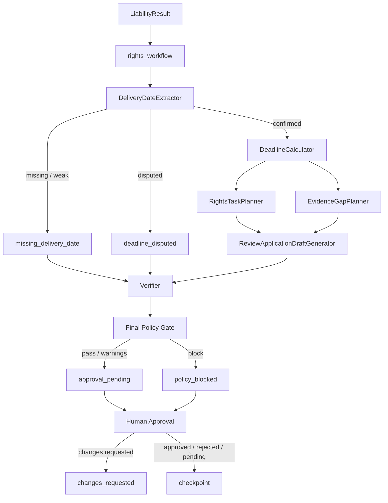

# Rights Workflow、规则引擎与 Verifier 架构

## 1. 设计边界

本阶段只增加 `liability → rights_workflow → verifier → human_approval`
链路，不重新解析原始材料、不重建 Evidence Graph、Fact Memory、Case
Capsule、Legal RAG 或三类业务 Agent。所有节点复用现有 `CaseState`、
`NodeResult`、输入哈希、超时、单次 JSON 修复重试和 SQLite checkpoint。

系统生成的是辅助判断、取证计划和文书草稿。它不会自动向交管机关、法院、
保险公司或任何第三方发送材料。

## 2. 状态流



`rights_branch_reason` 保存权益流程分支，不覆盖业务 Agent 已产生的
`branch_reason`。恢复时，已完成且输入哈希一致的节点不会重新运行。

## 3. Rights Workflow schema

### 3.1 DeliveryDateResult

核心字段：

- `status`: `confirmed | disputed | weak_evidence | missing`
- `date_type`、`extracted_date`、`original_date_text`
- `source_type`、`source_id`、`evidence_id`
- `extraction_method`、`confidence`、`timezone`
- `ambiguity`、`alternatives`
- `requires_human_confirmation`

解析完全由确定性代码执行。文书落款、作出或签发日期不能自动成为期限
触发日期；多个可信送达日期不同则 `extracted_date=null`。

### 3.2 DeadlineResult

核心字段：

- `deadline_id`、`matter_type`
- `trigger_date`、`original_trigger_text`
- `rule_id`、`law_id`、`legal_citations`
- `calculation_method`、`due_at`、`remaining_duration`
- `status`: `not_started | active | due_soon | expired | disputed`
- `assumptions`、`requires_human_confirmation`
- `legal_review_status`

当前支持事故认定复核和检验/鉴定异议。规则以工作日为单位、排除触发日，
且只在规则、送达日期、官方日历和法律引用均可核验时计算。其他年份、冲突
日期或适用规则不明确时输出 `disputed/needs_legal_review`。

### 3.3 RightsTask 与 EvidenceCollectionItem

任务携带：

- 截止时间、优先级、阻断性和负责人角色；
- 相关 Fact、Evidence、Law ID；
- 前置条件和合法建议动作；
- `human_approval_required=true`。

补证项携带重要性、影响结论、最晚时间、合法取得方式、替代证据、不可取得
时的降级处理和条件化反事实影响。反事实只描述“若证据支持 A/B”的方向，
不生成或假设证据内容。

### 3.4 ReviewApplicationDraft

草稿包含申请人、被申请文书、请求事项、事实、争议焦点、理由、证据目录、
法律依据、附件、签名和日期占位。每个事实句必须同时引用 Fact ID 与
Evidence ID；争议事实附加“待核实/申请调取”限定。字段不足时仍可生成，
但 `blocking_fields` 和 `not_submittable_reasons` 会明确阻断提交。

### 3.5 HumanApprovalState

状态只允许：

```text
pending | approved | rejected | changes_requested | expired
```

审批记录绑定 `approver + timestamp + decision + comments +
document_version + inputs_hash + audit_event_id`。任何文书版本或关键输入哈希
变化都会使旧批准失效。批准不改变文书的 `draft` 状态，也不代表已经提交。

## 4. 版本化规则

统一 `RuleDefinition` 含来源、版本、发布日期、生效/失效日期、管辖范围、
层级、条件、决定逻辑、异常、置信度策略和 `content_hash`。规则加载时先
校验内容哈希，再按 `as_of_date` 和 `jurisdiction` 解析：

- 无有效版本：`not_found`；
- 多个适用版本：`conflict`，不得静默覆盖；
- 内容哈希不一致：加载失败；
- proposed、expired 或未来生效版本：不进入现行规则选择。

当前规则包：

| Rule ID | 用途 |
|---|---|
| `RULE-CN-DEADLINE-ACCIDENT-REVIEW-2017` | 事故认定复核期限 |
| `RULE-CN-DEADLINE-APPRAISAL-OBJECTION-2017` | 检验/鉴定异议期限 |
| `RULE-CN-VEHICLE-NATURE-GUARDRAIL-2024` | 技术符合性与法律属性分离 |
| `RULE-CN-COMPENSATION-REGIME-2021` | 民事赔偿路径 |
| `RULE-CN-INSURANCE-LAYER-2020` | 交强险、商业险、未覆盖损失层次 |

规则来源 URL、检索时间和内容哈希位于
`config/rules/national_rules.json`。2026 年工作日表位于
`config/rules/calendars/cn_2026.json`，同样进行哈希校验。

## 5. 赔偿路径

`CompensationRegimeRouter` 只允许：

```text
motor_vs_motor
motor_vs_non_motor_or_pedestrian
pending_vehicle_classification
insufficient_evidence
```

车辆属性为 `suspected_motor_vehicle` 或证据不足时，不能提前选择确定
赔偿路径。输出分离为：

1. `accident_responsibility`
2. `civil_compensation_allocation`
3. `compulsory_insurance_layer`
4. `commercial_insurance_layer`
5. `uninsured_or_uncovered_loss`
6. `insurance_payment_estimate`

缺少保单限额、保险责任、损失金额、免责条款或既付金额时，金额固定为
`insufficient_data`，不会推测。

## 6. Verifier 与 Policy Gate

Verifier 分成四个独立组件：

- Evidence：验证 Conclusion → Finding → Fact → Evidence 链、案件归属、
  Fact/Evidence 状态和引用存在性；
- Legal：验证 Law/Rule ID、条款、语料 source ID、版本、日期和地区；
- Consistency：验证车辆属性与赔偿路径、概率总和、原因力、三类责任对象、
  截止日期、权益任务来源以及旧审批；
- Risk Language：按中英文配置区分 `hard_block` 和
  `rewrite_required`，所有命中进入审计结果。

`FinalPolicyGate` 聚合上述组件及 ProtectedField 结果：

- 存在无效证据链、失效/错区法律、内部冲突、硬拦截语言或 ProtectedField
  丢失时返回 `block`；
- 仅有人审待办或可改写提示时返回 `pass_with_warnings`；
- 无问题时返回 `pass`。

无论 Gate 结果如何，外部提交始终需要人工批准。

## 7. API 与 CLI

API：

```text
POST /cases/{case_id}/workflow
GET  /workflows/{thread_id}
POST /workflows/{thread_id}/resume
POST /workflows/{thread_id}/approval
```

状态接口返回日期识别、期限、权益任务、补证清单、复核草稿、Policy Gate、
审批状态、节点结果和失败原因。

CLI：

```bash
.venv/bin/python -m app.cli orchestrate CASE-DEMO-001 \
  --thread-id THREAD-DEMO-001 --interrupt-after rights_workflow
.venv/bin/python -m app.cli resume THREAD-DEMO-001
.venv/bin/python -m app.cli workflow-status THREAD-DEMO-001
.venv/bin/python -m app.cli approve THREAD-DEMO-001 \
  --decision changes_requested --approver legal-reviewer \
  --comments "请补充送达回执"
```

## 8. 法律适用限制

- 当前期限规则基于现行公安部令第 146 号；2026 年公开征求意见稿不是现行
  法规，不进入有效规则包。
- 截止日 `23:59:59` 是系统提醒边界，线下窗口或电子平台实际可提交时间
  必须人工核验。
- 当前只内置 2026 年官方节假日/调休日历。日期超出覆盖范围时失败关闭。
- 全国规则包不替代省市登记管理规则、具体案件鉴定或律师意见。
- 系统不会保证复核受理、撤销、重新鉴定、责任比例或保险赔付结果。
