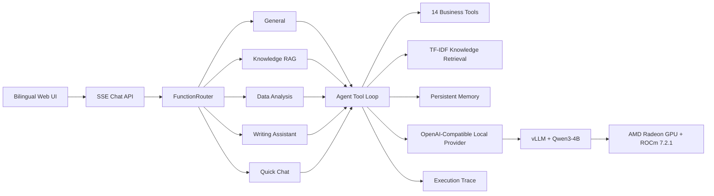

# Solo Worker OS

## Track 2 — Development and Local Deployment of Private AI Agents

Solo Worker OS is a private AI operations layer for freelancers and solo
businesses. It converts natural-language requests into structured business
actions such as creating projects, generating contracts and invoices, tracking
payments, searching private knowledge, and producing business summaries.

The competition deployment uses a participant-controlled AMD Radeon GPU
endpoint running Qwen3-4B with vLLM and ROCm. The application does not require a
commercial third-party LLM API in the inference path.

## 1. Application Scenario

Freelancers routinely place sensitive information into AI tools: client names,
budgets, contract terms, delivery dates, invoices, and payment history. Sending
that data to a commercial hosted model creates confidentiality, retention, and
vendor-dependency risks.

Solo Worker OS provides a single conversational interface for this workflow:

- Create and update client projects.
- Generate contracts, invoices, and payment follow-ups.
- Track deadlines and payment status.
- Search a private knowledge base using TF-IDF retrieval.
- Analyze revenue, workload, and overdue items.
- Preserve multi-turn conversation history.
- Inspect routing, model, and tool execution through trace observability.

The target users are independent designers, developers, consultants,
accountants, legal professionals, and other solo operators who handle private
business data but do not have a dedicated operations team.

## 2. Agent Architecture



### FunctionRouter

The router uses a two-layer decision process:

1. Fast keyword matching handles high-confidence requests with near-zero
   routing overhead.
2. An LLM classifier handles ambiguous requests as a fallback.

User corrections can adjust per-keyword weights, allowing routing behavior to
improve without retraining the model.

### Specialist Subagents

Five isolated subagent configurations reduce prompt noise and restrict each
role to the relevant tools:

- `general`: project operations, deadlines, pricing, and exchange rates.
- `knowledge_rag`: private document retrieval.
- `data_analysis`: revenue and workload analysis.
- `writing_assistant`: contracts, invoices, and follow-up messages.
- `quick_chat`: concise, low-overhead conversational responses.

### Tool Layer

The repository contains 14 registered business tools:

`create_project`, `update_project_status`, `get_exchange_rates`,
`get_pricing_benchmark`, `get_upcoming_deadlines`, `search_knowledge_base`,
`analyze_business_data`, `generate_contract`, `generate_invoice`,
`record_payment`, `generate_followup_message`, `export_monthly_report`,
`archive_deliverable`, and `browser_automate`.

## 3. Core Capabilities

### Tool Calling and Multi-Step Execution

The provider-neutral agent loop exposes declarative tool schemas to the model,
executes validated tool calls, returns tool results to the model, and streams
the final response through SSE. A request can therefore move from an
unstructured sentence to a persistent business record and then continue into a
follow-up action such as contract generation.

### Private Knowledge Retrieval

The knowledge layer uses TF-IDF retrieval for local documents, templates, and
notes. It provides deterministic, dependency-light retrieval suitable for a
private deployment. A future extension can replace it with a GPU embedding
model without changing the tool interface.

### Persistent Multi-Turn Memory

The `MemoryStore` abstraction supports two backends:

- Supabase for the hosted product configuration.
- Local JSONL files for a self-contained private configuration.

Conversation IDs associate user and assistant turns across sessions. Tool
actions and project state are also recorded so future requests can reference
earlier work.

### Trace Observability

The `/trace` interface records routing decisions, LLM duration, tool calls,
tool results, and errors. This makes agent behavior inspectable and provides a
debugging path for model or routing failures.

## 4. Model and Private Deployment Plan

### Verified Competition Stack

| Component | Verified configuration |
|---|---|
| GPU environment | Radeon Cloud, one AMD Radeon GPU |
| Device | AMD/ATI, ROCm architecture `gfx1100` |
| Software stack | ROCm 7.2.1, PyTorch 2.9, vLLM 0.16.x |
| Model | `Qwen/Qwen3-4B` |
| Context length | 4,096 tokens |
| API | OpenAI-compatible `/v1/chat/completions` |
| Application provider | `AGENT_PROVIDER=local` |

### vLLM Launch Command

```bash
nohup vllm serve Qwen/Qwen3-4B \
  --host 0.0.0.0 \
  --port 8000 \
  --trust-remote-code \
  --max-model-len 4096 \
  --gpu-memory-utilization 0.5 \
  --enable-auto-tool-choice \
  --tool-call-parser hermes \
  > /workspace/vllm.log 2>&1 &
echo $! > /workspace/vllm.pid
```

### Solo Worker OS Configuration

```env
AGENT_PROVIDER=local
LOCAL_LLM_BASE_URL=http://localhost:8000/v1/chat/completions
LOCAL_LLM_API_KEY=EMPTY
LOCAL_LLM_MODEL=Qwen/Qwen3-4B
DEMO_MODE=true
NEXT_PUBLIC_DEMO_MODE=true
SOLO_LOCAL_MODE=true
```

For the recorded competition demonstration, the Next.js application ran on the
participant workstation and connected to the dedicated Radeon instance through
a temporary HTTPS tunnel. This tunnel was stopped immediately after evidence
capture. A fully on-premises deployment can run the application and vLLM on the
same private network and use the default localhost endpoint.

## 5. Inference-Speed Optimization for AMD Radeon GPU

The current implementation applies conservative optimizations chosen for a
stable, reproducible single-GPU agent workflow:

- **Model size:** Qwen3-4B was selected after the larger configuration proved
  less reliable within the available memory envelope.
- **Context control:** the model server uses a 4,096-token context window, and
  the local provider limits generated output to 768 tokens.
- **Thinking disabled:** `enable_thinking: false` reduces unnecessary hidden
  reasoning tokens and keeps operational responses concise.
- **Memory allocation:** vLLM uses `--gpu-memory-utilization 0.5`, leaving
  headroom for the engine and ROCm runtime.
- **PagedAttention:** vLLM manages KV-cache memory efficiently for repeated
  agent requests.
- **Keyword-first routing:** high-confidence messages avoid an additional LLM
  intent-classification call.
- **SSE streaming:** users receive output as it is generated rather than waiting
  for the complete response.

No unverified throughput number is claimed. The repository includes the exact
configuration and evidence needed to reproduce a formal latency and tokens-per-
second benchmark.

## 6. AMD Radeon Verification

Verification was completed on 2026-08-06. The evidence shows:

1. A Radeon Cloud instance using a ROCm 7.2.1 vLLM image.
2. `rocm-smi` reporting an AMD/ATI GPU and 51% VRAM allocation while the model
   was loaded.
3. Active `vllm serve Qwen/Qwen3-4B` and EngineCore processes.
4. `/v1/models` returning `Qwen/Qwen3-4B`, owned by vLLM.
5. Multiple `/v1/chat/completions` requests returning HTTP 200.
6. Solo Worker OS reporting `provider: local`, `isLocal: true`, and
   `reachable: true`.
7. An end-to-end Chinese request creating a project through `create_project`.
8. A follow-up request producing a contract through `generate_contract`.

See [the evidence index](../docs/evidence/README.md) and the
[submission poster](poster/solo-worker-os-poster-v2.html).

## 7. Reproduction and Validation

```bash
npm install
npm run typecheck
npm test
npm run dev
```

After starting vLLM and the application, verify:

```text
http://localhost:3000/api/local-llm/status
```

The response must show `provider: local`, `reachable: true`, and the expected
served model. The local-provider TypeScript check passed, and the project test
suite reported 57 of 57 tests passing during the verified session.

## 8. Practical Value and Future Work

Solo Worker OS demonstrates that a useful private agent is more than a chatbot:
it combines routing, tool use, memory, retrieval, execution tracing, and a
business-specific interface. The provider boundary makes the same application
portable across workstation, private-server, and dedicated Radeon Cloud
deployments.

Future work includes GPU embedding-based RAG, structured benchmark automation,
longer-context model evaluation, and encrypted multi-user local storage.
