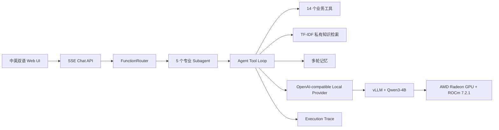

# Solo Worker OS 项目说明（中文辅助版）

> 正式提交以英文版 `PROJECT_SPECIFICATION.md` 为准。本文件用于北京赛区
> 中文阅读、录屏讲解和团队留档。

## 1. 应用场景

Solo Worker OS 是面向自由职业者和一人公司的私有 AI 业务操作系统。用户可以
用自然语言完成客户项目创建、合同与发票生成、收款记录、截止日期追踪、私有
知识检索和经营分析。

这些流程会处理客户姓名、预算、合同条款、付款记录等敏感数据。比赛版本将
核心推理切换到参赛者控制的 AMD Radeon GPU 端点，减少对第三方商业 LLM API
的依赖，并保留可审计的路由、工具调用和执行 Trace。

## 2. Agent 架构



FunctionRouter 先用关键词完成高置信度、低延迟路由；遇到模糊请求时再使用模型
分类。五个 Subagent 分别处理通用事务、知识检索、数据分析、智能写作和快速
对话，从而缩小提示词和工具范围。

## 3. 核心能力

- **工具调用与多步执行：** 14 个业务工具覆盖项目、合同、发票、收款、月报、
  交付物归档和浏览器自动化。
- **私有知识检索：** 使用本地 TF-IDF 检索合同模板、笔记和业务资料。
- **多轮记忆：** 支持 Supabase 后端，也支持本地 JSONL 的自包含部署。
- **可观测性：** `/trace` 展示路由、模型耗时、工具调用、工具结果和错误。
- **流式交互：** SSE 在推理完成前持续返回结果，改善等待体验。

## 4. 模型与 AMD 部署

| 项目 | 配置 |
|---|---|
| GPU | Radeon Cloud 单张 AMD Radeon GPU |
| 架构 | AMD/ATI，ROCm architecture `gfx1100` |
| 软件栈 | ROCm 7.2.1、PyTorch 2.9、vLLM 0.16.x |
| 模型 | `Qwen/Qwen3-4B` |
| 上下文 | 4096 tokens |
| 应用 Provider | `AGENT_PROVIDER=local` |

```bash
vllm serve Qwen/Qwen3-4B \
  --host 0.0.0.0 \
  --port 8000 \
  --trust-remote-code \
  --max-model-len 4096 \
  --gpu-memory-utilization 0.5 \
  --enable-auto-tool-choice \
  --tool-call-parser hermes
```

## 5. 推理速度与稳定性优化

- 选择 4B 模型，在单卡显存范围内稳定完成工具调用。
- 将上下文限制为 4096，输出上限限制为 768 tokens。
- 设置 `enable_thinking: false`，减少演示中不必要的思考 token。
- vLLM 显存利用率设置为 0.5，为 ROCm 和 EngineCore 保留余量。
- 使用 vLLM PagedAttention 管理 KV cache。
- 关键词优先路由避免高置信度请求额外调用一次模型分类。
- SSE 流式输出降低用户感知等待时间。

目前不声明未经正式基准测试的 tokens/s 数值，避免夸大性能。

## 6. AMD GPU 实测证据

2026-08-06 已完成以下验证：

1. Radeon Cloud 使用 ROCm 7.2.1 / vLLM 镜像。
2. `rocm-smi` 识别 AMD/ATI GPU，模型加载时显存分配约 51%。
3. `vllm serve Qwen/Qwen3-4B` 与 EngineCore 进程处于运行状态。
4. `/v1/models` 返回 `Qwen/Qwen3-4B`。
5. 多次 `/v1/chat/completions` 返回 HTTP 200。
6. Solo Worker OS 使用本地 Provider 完成 `create_project`。
7. 后续请求完成 `generate_contract`。

证据见 `docs/evidence/README.md`。录制完成后，公网隧道、vLLM、EngineCore 和
本地 Next.js 服务均已关闭；Radeon 实例未销毁，便于后续重新连接。

## 7. 验证与复现

```bash
npm install
npm run typecheck
npm test
npm run dev
```

已验证 TypeScript 检查通过，测试 57/57 通过。

## 8. 实际价值

Solo Worker OS 展示的不是单纯聊天机器人，而是由路由、工具、记忆、检索、
执行 Trace 和业务 UI 组成的完整私有 Agent。Provider 边界使同一应用能够在
工作站、企业内网服务器或参赛者控制的 Radeon Cloud 端点之间迁移。
