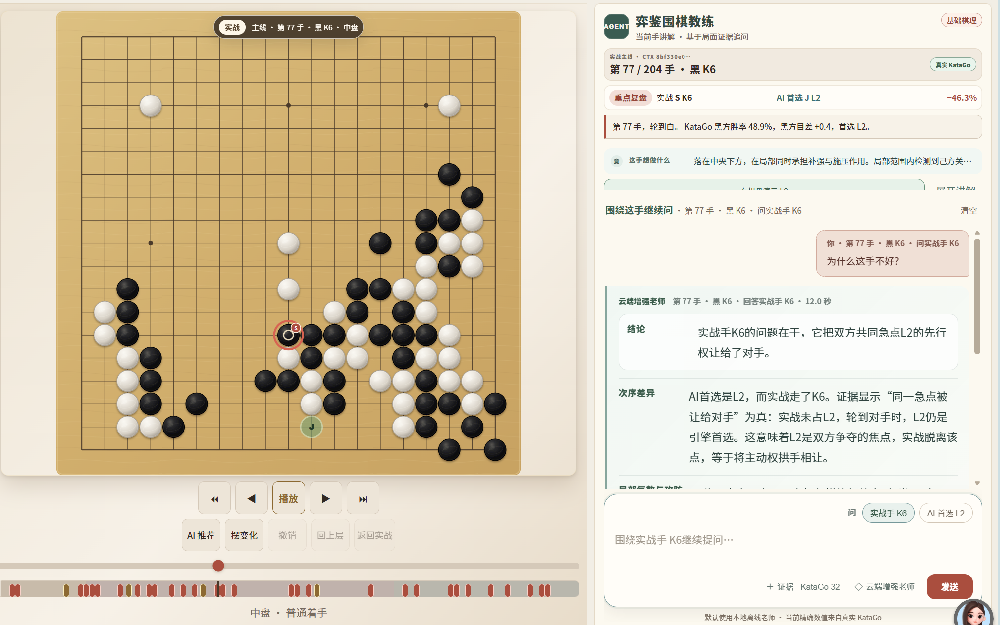

# YIJIAN - Evidence-Grounded Go Review Agent

**Track 2 | Ali Moqi | AMD Radeon PRO W7900 / ROCm**

YIJIAN turns a Go position into a traceable teaching conversation. A bounded Agent selects legal tools, the rules engine reconstructs board facts, KataGo supplies position analysis, local RAG contributes source-labelled principles, and opt-in memory stores only lessons the user explicitly approves.

> **Release decision:** YIJIAN LoRA v3 was trained and evaluated on the W7900, but failed the final anonymous human release gate. The sealed-once test remains unopened and the competition runtime stays on the stable 27B service. This fail-closed decision is part of the Agent's safety design.



## Reproduce before reading the claims

From this directory on Windows with Python 3.13:

```powershell
cd source
powershell -ExecutionPolicy Bypass -File scripts/reproduce_public.ps1
```

The command creates a clean temporary virtual environment, installs the pinned dependency lock, verifies the allowlist and SHA-256 manifest, compiles the source, runs all 189 public backend and training tests, and imports the application health endpoint. See [Reproducibility](REPRODUCIBILITY.md) for Linux and W7900/ROCm paths.

## Why this is an Agent, not a chat wrapper

The language model never owns board truth. The server binds each question to `actual`, `best`, `comparison`, or `position`, validates an `agent-plan-v1` plan against a tool whitelist, executes deterministic tools, and projects a hashed evidence bundle to the answer model. Unsupported coordinates, numeric claims, sources, and life-and-death conclusions are rejected or replaced by deterministic fallback.

```text
Browser -> FastAPI Agent orchestrator -> bounded planner / tool whitelist
        -> goboard + KataGo + local RAG + opt-in memory
        -> hashed evidence bundle -> selected W7900 model route
        -> validators / deterministic fallback -> teaching answer
```

## Verified evidence

| Item | Verified result |
|---|---:|
| Human-signed creator gold | 64 units; 48 train / 8 dev / 8 sealed |
| Agent SFT | 720 train / 24 dev / 24 sealed |
| Task mix | 216 planner / 288 answer / 144 follow-up / 72 memory-privacy |
| Qwen3-14B revision | `40c069824f4251a91eefaf281ebe4c544efd3e18` |
| 4-step BF16 smoke | PASS; 36.961 GiB peak reserved |
| 30-step micro | PASS; loss 4.0948 -> 3.6016 (-12.05%); 37.631 GiB peak |
| 2-epoch full training | PASS; 90 steps; dev loss 3.1131 -> 1.6685 (-46.40%); 38.643 GiB peak |
| Formal Agent runtime evaluation | PASS; 220/220 plans, 24/24 failure/privacy, 39/40 evidence-faithful unseen positions |
| W7900 coexistence | 0.72 / 0.75 / 0.78 all PASS 30/30, zero OOM; selected 0.72 combined P95 10.3355 s |
| Anonymous human review | FAIL for LoRA release: stable 27B 4.6133, base 14B 2.8500, LoRA 2.5400; LoRA severe contradictions 5 |
| Public clean-room reproduction | PASS; 141 allowlisted files; 189/189 tests; 0 secret/private/forbidden findings |
| Final alias | stable 27B; sealed test access count 0 |

The frozen experimental adapter tree SHA-256 is `9de29915ef28dfe66ee3b3239bc9ff70f5ee8a53176a09d918ac425c8cb90ff0`. It is not presented as the released competition model. The machine-readable source of truth is [`submission-status.json`](submission-status.json).

## Submission map

- [Project Specification](PROJECT_SPECIFICATION.md) and [PDF](YIJIAN-Project-Specification.pdf)
- [Architecture](ARCHITECTURE.svg)
- [Performance and Validation](PERFORMANCE_AND_VALIDATION.md)
- [Model Card](MODEL_CARD.md)
- [Reproducibility](REPRODUCIBILITY.md)
- [Demo Runbook](DEMO_RUNBOOK.md)
- [Evidence Index](EVIDENCE_INDEX.md)
- [Third-Party and Data Boundary](THIRD_PARTY_AND_DATA_BOUNDARY.md)
- [Public-safe source snapshot](source/README.md)
- [Track 2 presentation](YIJIAN-Track-2-Presentation.pptx)

## Demo video

Watch the [2 minute 46 second, 1920x1080 final YIJIAN Track 2 demonstration](https://github.com/almq666/Radeon-hackathon-2026-07/releases/download/yijian-demo-v1/YIJIAN-Track-2-Demo-Final-v2.mp4). The video is hosted as a GitHub Release asset so the reproducible source tree remains small and clean.

## Privacy and publication boundary

Private SGFs and memory stay local. Creator-authorized material is limited to non-commercial research and competition demonstration and is not published here. Model weights, the LoRA adapter, raw videos, review comments, databases, and sealed cases are excluded from Git. Public reproduction uses synthetic fixtures and the fixed Qwen3-14B base route; immutable evidence records the private authorized training run.
