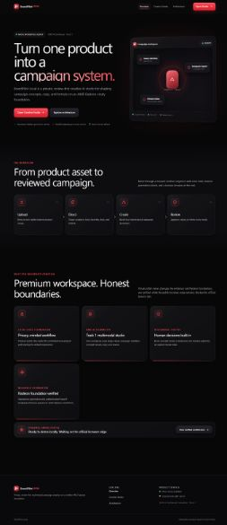
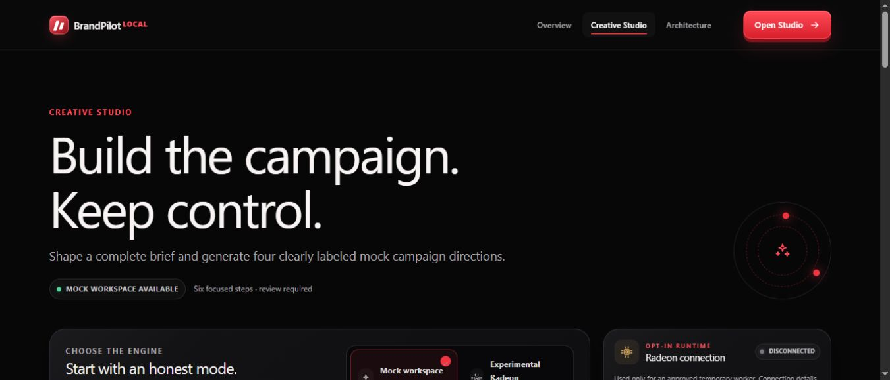
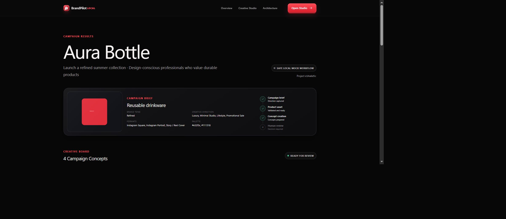
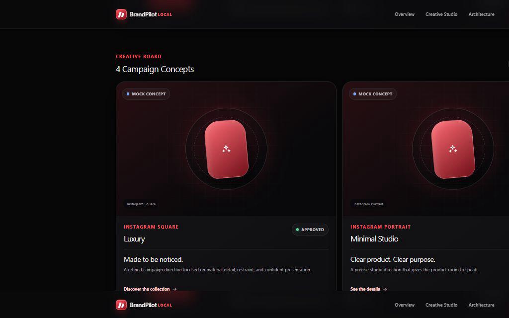
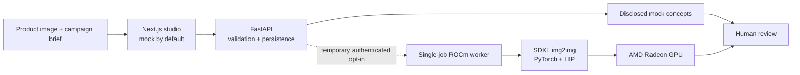
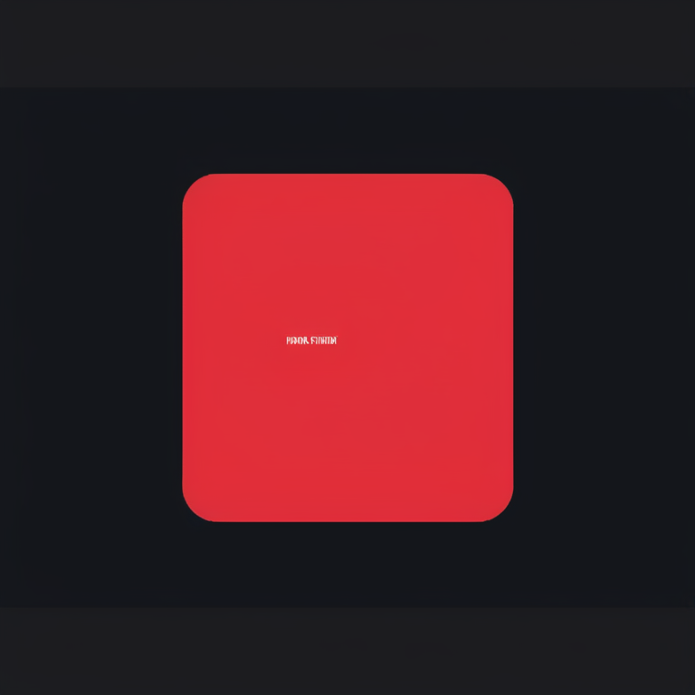

# BrandPilot Local

> An AMD Radeon-powered creative studio prototype that converts product images
> and campaign briefs into reviewable, platform-ready marketing concepts.



**AMD AI DevMaster Hackathon - Track 1: Multimodal AI**

**Team:** Talal Khawaja and Aqeela Urooj

BrandPilot Local gives small brands and creative teams one focused workspace
for product intake, campaign direction, visual concepts, copy, formats, and
human review. The polished local product runs in clearly disclosed mock mode by
default. Separately, real SDXL image-to-image inference and authenticated
FastAPI loopback generation were verified on AMD Radeon with ROCm.

## The problem

Small teams often split a single campaign across prompt tools, design files,
copy documents, and approval threads. That fragmentation slows iteration,
weakens traceability, and can expose sensitive product assets to unnecessary
services. BrandPilot Local explores a private, review-first alternative built
around an end-to-end campaign workflow.

## The solution

1. Upload a rights-cleared product image.
2. Define the product, objective, audience, benefits, tone, colors, and
   guardrails.
3. Select creative styles and output formats.
4. Generate four clearly labelled mock concepts locally, or opt into the
   temporary authenticated Radeon worker.
5. Review, edit, approve, reject, or request changes.
6. Reopen the project with persisted state.



## Key product features

- Premium responsive Next.js studio for desktop and mobile
- Validated PNG, JPEG, and WebP product-image intake
- Campaign configuration across audience, tone, colors, styles, formats, and
  safety guardrails
- Four disclosed mock campaign directions for an immediately demonstrable flow
- FastAPI project, asset, result, and review persistence
- Human approval, rejection, needs-changes, copy editing, and mock regeneration
- Experimental bearer-authenticated Radeon connection held only in
  `sessionStorage`
- Single serialized GPU job, lazy model load, pipeline reuse, protected output
  fetch, real stage/step polling, and no CPU/mock fallback

## Product experience

| Local UI demonstration | Review and accountability |
|---|---|
|  |  |

The mock workflow demonstrates the full product loop without a GPU. Every mock
visual stays visibly labelled and every output remains gated by a human review
state.

## Architecture



The browser never reads server storage directly. Uploads are decoded, signature
checked, size limited, renamed with UUIDs, and stored behind project-scoped API
routes. Experimental output retrieval requires authentication. See
[the architecture](docs/architecture.md) and
[temporary demo security](docs/temporary-demo-security.md).

## AMD Radeon and ROCm implementation

The verified pipeline is `StableDiffusionXLImg2ImgPipeline` in
`torch.float16`, using the Radeon device exposed through PyTorch's `torch.cuda`
API on HIP. It loads the exact pinned SDXL revision, runs with no CPU offload or
attention slicing, records measured timings and GPU memory, and writes a hashed
output. The FastAPI worker preserves the same configuration and refuses CPU or
mock fallback.

### Verified Radeon result

| Item | Measured value |
|---|---|
| GPU / architecture | AMD Radeon Graphics / `gfx1100` |
| Reported memory | 48 GiB |
| PyTorch / HIP | `2.9.1+gitff65f5b` / `7.2.53211-e1a6bc5663` |
| Model | `stabilityai/stable-diffusion-xl-base-1.0` |
| Exact revision | `462165984030d82259a11f4367a4eed129e94a7b` |
| Pipeline / dtype | SDXL img2img / fp16 |
| Resolution | 768 x 768 |
| Steps / strength / guidance | 15 / 0.35 / 6.5 |
| Seed | 20260725 |
| Cold model load | 132.295 s |
| Generation | 222.111 s |
| Total smoke test | 357.706 s |
| Peak allocated / reserved VRAM | 13.41 GiB / 14.31 GiB |
| Output SHA-256 | `bce21d016a8179ac4ddabcbf5869a71eacf03565948d0d1f97d24e279b125452` |



These are Session 1 measurements, not projections or comparative benchmarks.
The authenticated FastAPI loopback job later completed in 252.243 seconds from
start to completion and persisted an Approved review state. Its unrecovered
cloud-only memory/hash values are not substituted with Session 1 values.

## Honest validation matrix

| Capability | Status | Boundary |
|---|---|---|
| Premium responsive product workflow | Verified locally | Mock concepts disclosed |
| Standalone SDXL img2img on Radeon/ROCm | Verified on Radeon Cloud | One controlled run |
| Authenticated FastAPI-to-Radeon generation | Verified on loopback | One completed job |
| Official `rc-tunnel` install and activation | Verified | Version 0.3.0 |
| Chrome TLS/auth/CORS/project/upload through official tunnel | Verified in Session 2b | No completed generation |
| Full public browser-to-Radeon generation | Blocked | Assigned official hostname failed public DNS in final retry |
| Product/logo/packaging-text preservation | Not validated | No preservation claim |
| Commercial production clearance | Not completed | Prototype only |

The official browser-edge completion remained blocked because the
platform-assigned rc-tunnel hostname did not resolve in public DNS. The team
used no unofficial tunnel or TLS bypass and shut down every instance. See the
[claim audit](docs/final-claim-audit.md) and
[final retry results](docs/radeon-session-3-results.md).

## Run locally

Requirements: Node.js 20+, npm, and Python 3.12.

### Windows setup

```powershell
git clone https://github.com/kmt9967/brandpilot-local.git
cd brandpilot-local
cd backend
py -m venv .venv
.\.venv\Scripts\Activate.ps1
python -m pip install -r requirements.txt
cd ..\frontend
npm install
Copy-Item .env.example .env.local
```

After setup, start both services from the repository root:

```powershell
.\scripts\start-local.ps1
```

The script checks ports 3000 and 8000, verifies existing dependencies, starts
FastAPI on loopback and Next.js, and prints the frontend, API documentation,
and health URLs. It never installs packages automatically.

To run the services manually, start the backend from one PowerShell terminal:

```powershell
cd .\backend
.\.venv\Scripts\Activate.ps1
python -m uvicorn app.main:app --reload --host 127.0.0.1 --port 8000
```

Then start the frontend from another terminal:

```powershell
cd .\frontend
npm run dev
```

For a production-local frontend review, run `npm run build` and then
`npm run start` in `frontend`, while keeping the same FastAPI command active.

Open `http://localhost:3000`. The backend health endpoint is
`http://127.0.0.1:8000/health` and its local documentation is
`http://127.0.0.1:8000/docs`.
Docker users can run `docker compose up --build`; the compose setup remains
CPU/mock-only and does not package ROCm or model weights.

### Environment

| Variable | Purpose | Default boundary |
|---|---|---|
| `NEXT_PUBLIC_API_BASE_URL` | Local FastAPI URL | `http://127.0.0.1:8000` |
| `BACKEND_CORS_ORIGINS` | Explicit allowed frontend origins | Local origins only |
| `MAX_UPLOAD_SIZE_MB` | Upload limit | 10 MB |
| `STORAGE_ROOT` | Local JSON/assets directory | Local backend storage |
| `ENABLE_EXPERIMENTAL_ROCM` | Enables protected experimental routes | Disabled |
| `DEMO_AUTH_ENABLED` | Requires temporary bearer authentication | Disabled locally |

See [.env.example](.env.example), [.env.radeon.example](.env.radeon.example),
[backend setup](backend/README.md), [frontend setup](frontend/README.md), and
[inference setup](inference/README.md). Never commit real environment files.

## Mock mode and experimental Radeon mode

- **Mock mode is the default.** It needs no Torch, Diffusers, ROCm, model cache,
  or GPU and produces four labelled concepts.
- **Experimental mode is temporary and opt-in.** It requires a separately
  configured authenticated loopback worker and an official browser transport.
  Runtime URL/access values stay in the current browser session and clear on
  disconnect.
- No weights or Hugging Face cache are included in this repository.

## Responsible AI and human review

BrandPilot Local treats generation as a draft, not a publish decision. Teams
must use rights-cleared inputs, disclose generated media, avoid unsupported
product or safety claims, and complete human review. Local processing can
reduce unnecessary asset exposure; it does not replace copyright, trademark,
representation, or commercial-use review. See
[responsible AI](docs/responsible-ai.md) and
[data handling](docs/data-handling.md).

## Known limitations

- No completed public browser-to-Radeon generation or permanent Radeon backend
- No verified preservation of identity, logos, or packaging text
- No IP-Adapter, ControlNet, LoRA, fine-tuning, video, or batch pipeline
- No warm-run comparison, quality benchmark, or production security audit
- SDXL model license and project-source license require final legal review

## Repository map

```text
frontend/    Next.js App Router product experience and tests
backend/     FastAPI validation, persistence, protected routes, and tests
inference/   Mock contract and pinned ROCm SDXL pipeline
scripts/     Safe runtime, diagnostics, evidence, and validation helpers
examples/    Rights-safe demonstration asset and guidance
evidence/    Sanitized Radeon, DNS, shutdown, and UI proof
docs/        Architecture, results, claim audit, judging map, and checklist
submission/  Project Profile, presentation, and demo recording package
```

## Team

- **Talal Khawaja** - project lead; application development, Radeon integration,
  technical documentation, and demo preparation.
- **Aqeela Urooj** - product testing, output review, usability feedback, and
  documentation review.

## Submission artifacts

- [Official requirements](docs/official-submission-requirements.md)
- [Project Profile source](submission/project-profile.md) and
  [PDF](submission/BrandPilot-Local-Project-Profile.pdf)
- [Presentation](submission/BrandPilot-Local-Presentation.pptx) and
  [PDF export](submission/BrandPilot-Local-Presentation.pdf)
- [Demo script](submission/demo-script.md),
  [shot list](submission/demo-shot-list.md), and
  [captions](submission/demo-captions.srt)
- [Judging evidence map](docs/judging-evidence-map.md)
- [Final submission checklist](docs/final-submission-checklist.md)

## License status

No final application-source license has been selected. The SDXL CreativeML Open
RAIL++-M model terms, dependencies, example assets, screenshots, icons, and
presentation media are documented in [LICENSE-REVIEW.md](LICENSE-REVIEW.md).
This repository does not claim commercial production clearance.
