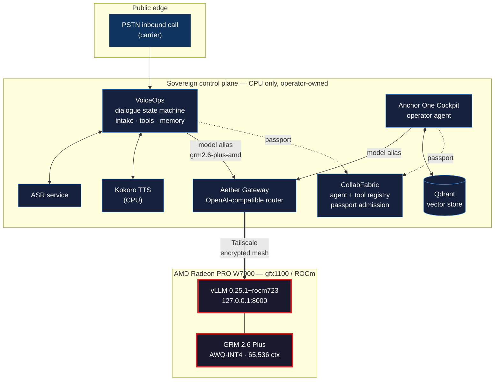

# Project Specification — OmniAgent

### A self-hosted, provider-agnostic AI agent runtime, served entirely on AMD Radeon

**Track 2:** Development & Local Deployment of Private AI Agents
**Team / Entrant:** `<TEAM_NAME_OR_YOUR_NAME>`
**Application name:** OmniAgent
**Repository:** https://github.com/AetharaAI/omniagent-amd
**Hardware:** AMD Radeon PRO W7900 (gfx1100, RDNA3, 47.98 GiB) on Radeon Cloud
**Stack:** ROCm 7.2.1 · vLLM 0.25.1+rocm723 · PyTorch 2.11.0 (ROCm)
**Date of recorded run:** 2026-08-03

> **Evidence policy.** Every number in this document is taken from a log captured
> during a live run and preserved off-host with a SHA-256 manifest. Nothing is
> estimated, extrapolated, or reconstructed. Where something was *not* proven, this
> document says so explicitly.

---

## 1. Application scenario

**Small-business voice intake and operator automation, running on infrastructure the business owns.**

The target user is an operator of a small service business — a contractor, clinic, or agency — who cannot afford a call centre and will not put customer conversations through a third-party AI vendor. The concrete problems:

- Inbound calls go unanswered outside business hours, and each missed call is a lost job.
- Commercial voice-AI platforms require sending every customer conversation to a vendor's cloud, along with names, phone numbers, and job details.
- Those platforms can change pricing, rate-limit, deprecate a model, or terminate an account at will. The business has no recourse and no continuity.

**OmniAgent** is the runtime. Deployed as **Syndicate AI**, it answers an inbound phone call, conducts a natural multi-turn conversation, performs a structured intake, and hands the operator a completed record — with **all language model inference executing on the operator's own AMD Radeon GPU.** No conversation content is sent to any third-party model provider.

**Three independent agent harnesses run against a single locally-served model.** They
were built separately, have different architectures and different tool registries, and
share nothing but the model alias they resolve.

| Surface | Role | Interface | Demonstrates |
|---|---|---|---|
| **Syndicate AI — Main Inbound** | Answers PSTN calls, runs the intake dialogue | Telephone | multi-turn memory, multi-step planning, real-time performance |
| **PolyMorph** | Agentic harness, 45-tool registry | Web + embedded voice | tool invocation, artifact generation |
| **Anchor One** | Operator cockpit | Web | operator tasking, runtime telemetry |

The voice agent's registered identity appears verbatim in the validation logs as
`resolved_agent_name: "Syndicate AI - Main Inbound"`, so every claim in §6 traces back
to a named agent in the captured evidence.

**Why three harnesses matters:** swapping the inference substrate did not require
changes to any of them. All three were re-pointed to the AMD GPU by changing a single
model alias, which is the practical test of whether an agent architecture is genuinely
model-portable or merely claims to be.

Both are governed by **Agent Passports**: cryptographically issued identities with capability-scoped mandates, so the operator controls exactly which tools each agent may invoke.

**Why this needs a local GPU rather than an API:** telephony is real-time and continuous. A voice agent that handles inbound calls all day is a sustained inference workload, not a burst. It is precisely the workload that is unaffordable per-token and perfectly suited to a single owned card.

---

## 2. Agent architecture



**Design principle — the workflow addresses a name, not a machine.**

Every agent requests the model alias `grm2.6-plus-amd` from a single unchanging gateway URL. The gateway resolves that alias to whatever GPU currently holds the model. This is what makes the inference substrate replaceable without touching agent logic, prompts, or dialogue code.

**Boundary discipline.** vLLM binds `127.0.0.1` only — never `0.0.0.0`. The model is reachable exclusively across an encrypted Tailscale mesh via `tailscale serve`. The GPU node has no public listener. Verified live:

```
tcp://100.x.x.x:8000  ──▶  tcp://127.0.0.1:8000
```

---

## 3. Core capabilities

The rules require **at least 2 of 5**. OmniAgent implements **5 of 5**.

### 3.1 Tool invocation ✅ *proven*

Native OpenAI-compatible function calling via vLLM's `qwen3_coder` tool parser with `--enable-auto-tool-choice`. Verified at the model layer:

```json
{"finish_reason": "tool_calls",
 "tool_calls": [{"type": "function",
   "function": {"name": "get_system_status",
                "arguments": "{\"node_name\": \"radeon-cloud-1\"}"}}]}
```

Verified at the agent layer — a single PolyMorph operator task executed **8 tool calls**
against a **45-tool registry**, retrieved an external record, and produced a validated
markdown artifact, using 11,620 of 65,536 context tokens (18%):

```
Tool calls: 8 · Registry 45 tools · Core checks 4/4 · Fallback used: no
Artifact: Sovereign_Substrate_Status.md (2.1 KB, markdown: valid)
```

**The agent's honesty is worth noting as a functional property, not a soft one.** Asked
to report on infrastructure it could not probe, it returned:

> *Verified: model `grm2.6-plus-amd` via `aether_gateway`; DOI confirmed as APIS v2.1.*
> *Not verified: RedWatch (doesn't exist), GPU hardware (Radeon W7900), Tailscale —*
> *operator-asserted only.*

It refused to claim it had verified the GPU when it had not, and named a tool that
does not exist in its registry rather than inventing a result. For an agent granted
real tool access, that failure mode matters more than raw capability.

### 3.2 Multi-step task planning ✅ *proven*

The intake agent runs a five-field dialogue state machine — `name → intent → callback_number → best_follow_up_method → qualification` — tracking `captured_fields` and `missing_fields` per turn, re-prompting only for what is outstanding. In the recorded call it completed all five fields with **zero retries** on any field.

### 3.3 Local multi-turn memory ✅ *proven*

Session state persists across turns and survives client refresh, backed by document storage with context compaction. The recorded call sustained **10 caller turns and 11 agent turns over 198 seconds** with continuous state. Context telemetry is surfaced live to the operator (tokens used / reserved / remaining against the 65,536 window).

### 3.4 Local knowledge retrieval (RAG) ⚠️ *partial*

Qdrant vector store is deployed and operational. Retrieval is currently **heuristic rather than vector-ranked**, because the embedding service was GPU-backed on infrastructure whose lease ended 2026-07-01. The embedding model is being restored to local CPU execution alongside the agent.

> **Stated honestly:** at time of writing, semantic recall is degraded. The runtime
> handles the missing embedding endpoint gracefully rather than failing. This
> document will not claim a capability that the logs do not support.

`<UPDATE THIS SECTION IF EMBEDDINGS ARE RESTORED BEFORE SUBMISSION>`

### 3.5 Permission control & privacy ✅ *proven — and the differentiating capability*

This is where OmniAgent goes beyond a typical local-agent project.

**Agent Passports.** Each agent holds a cryptographically issued identity — `did:passport:syndicate:anchor-1`, `did:passport:syndicate:polymorph` — issued by an operator-controlled authority. Registered agents expose A2A-compatible agent cards declaring their issuer and authentication scheme:

```json
{"name": "Anchor-1",
 "provider": {"organization": "aetherpro"},
 "authentication": {"schemes": ["Bearer"],
                    "issuer": "https://passport.<operator-domain>/realms/syndicate"}}
```

**Capability-scoped mandates.** An agent may invoke only the tools its passport authorizes. Admission is challenge–response: `GET /apis/challenge` returns a nonce, the agent signs it, `POST /apis/token` issues a short-lived bearer token.

**Why this matters for privacy:** the common objection to tool-using agents is prompt and tool injection. OmniAgent's answer is structural rather than advisory — an agent whose tool surface differs from what its passport authorizes is refused admission to the fabric. Combined with local inference, no conversation content and no customer PII ever leaves operator-owned infrastructure.

---

## 4. Model introduction & local deployment plan

### 4.1 Model

**`cyankiwi/GRM-2.6-Plus-AWQ-INT4`** — snapshot `dbd8c439bd25f484f735ba1e3b4872f7600b490d`

Read directly from the model's `config.json` on the deployed node:

| Property | Value |
|---|---|
| Architecture | `Qwen3_5ForConditionalGeneration` |
| Hidden layers | 64 |
| Layer pattern | 3 × `linear_attention`, then 1 × `full_attention` (`full_attention_interval: 4`) |
| → composition | **16 full-attention + 48 linear-attention (Gated Delta Net)** |
| Attention heads / KV heads | 24 / 4 |
| Head dimension | 256 |
| Vocabulary | 248,320 |
| Native max position | **262,144** |
| Quantization | AWQ INT4, `compressed-tensors` |
| Weights on GPU | **19.05 GiB** |

**Why this model.** It is a *hybrid* architecture — three quarters of its layers use linear attention rather than quadratic full attention. That gives a fixed-size recurrent state per sequence instead of a KV cache that grows with context length, which is what makes a 64K-token window practical on a single 48 GiB workstation card. AWQ INT4 quantization brings a 29-billion-parameter model down to 19 GiB resident, leaving over 20 GiB for KV cache.

**KV memory math**, derived from the config and confirmed against the engine's own allocation report:

```
2 (K,V) × 16 full-attn layers × 4 kv_heads × 256 head_dim × 2 bytes
  = 65,536 bytes = 64 KiB per token
```

### 4.2 Deployment

Fully reproducible. Base image `amd-oneclick-base:rocm7.2.1-py3.12-v20260416`.

**1 — Runtime (pinned wheels, ~10 min):**

```bash
python3 -m venv /workspace/runtime/.venv-grm
W=https://wheels.vllm.ai/rocm/752a3a504485790a2e8491cacbb35c137339ad34
.venv-grm/bin/pip install \
  "$W/torch-2.11.0%2Bgitd0c8b1f-cp312-cp312-manylinux_2_35_x86_64.whl" \
  "$W/torchvision-0.24.1%2Bd801a34-cp312-cp312-manylinux_2_34_x86_64.whl" \
  "$W/torchaudio-2.9.0%2Beaa9e4e-cp312-cp312-manylinux_2_34_x86_64.whl" \
  "$W/triton-3.6.0-cp312-cp312-manylinux_2_35_x86_64.whl" \
  "$W/triton_kernels-1.0.0-py3-none-any.whl" \
  "$W/vllm-0.25.1%2Brocm723-cp312-cp312-manylinux_2_34_x86_64.whl" \
  --extra-index-url "$W/rocm723/"
```

**2 — Weights (~2 min, 19 GiB):**

```bash
export HF_HOME=/workspace/hf-cache
python -c "from huggingface_hub import snapshot_download; \
  snapshot_download('cyankiwi/GRM-2.6-Plus-AWQ-INT4', cache_dir='/workspace/hf-cache')"
```

**3 — Serve:**

```bash
export HIP_VISIBLE_DEVICES=0 HF_HUB_OFFLINE=1 VLLM_WORKER_MULTIPROC_METHOD=spawn
vllm serve cyankiwi/GRM-2.6-Plus-AWQ-INT4 \
  --served-model-name grm2.6-plus \
  --host 127.0.0.1 --port 8000 \
  --quantization compressed-tensors --trust-remote-code \
  --max-model-len 65536 --max-num-seqs 4 \
  --gpu-memory-utilization 0.90 --enable-prefix-caching \
  --tool-call-parser qwen3_coder --enable-auto-tool-choice \
  --reasoning-parser qwen3
```

**4 — Expose over the private mesh only:**

```bash
tailscale serve --bg --tcp 8000 tcp://127.0.0.1:8000
ss -tlnp | grep ':8000'   # must show 127.0.0.1 only — never 0.0.0.0
```

Engine startup is reported below in §5.4 — it is not instantaneous and the reason is documented.

---

## 5. Optimization for inference speed on AMD Radeon GPU

### 5.1 Measured improvements

All figures are before/after from engine logs on the same hardware and model.

| Optimization | Before | After | Effect |
|---|---|---|---|
| `gpu_memory_utilization` 0.80 → 0.90 | 190,171 KV tokens | **310,931 KV tokens** | +63% KV capacity |
| Context window | 8,192 | **65,536** | 8× usable context |
| Serving path (blocking wrapper → `AsyncLLM`) | requests serialised | **4.74× concurrency** | see §5.2 |
| Prefix caching | disabled | **enabled, 64.5% hit rate** | eliminates re-prefill of system prompts + tool schemas |
| Streaming | non-incremental | **true token streaming** | TTFT 198 ms |

### 5.2 Continuous batching — verified

The original serving path called vLLM's *synchronous offline* API from an async HTTP handler, serialising every request. Replacing it with vLLM's native `AsyncLLM` engine enabled genuine continuous batching:

```
1 stream :  6.2 tok/s ·  40.8 s wall
4 streams:  6.1 tok/s each · 41.9 s wall   ← same wall clock, 4× aggregate
```

**Four concurrent conversations complete in the time one used to take.** For a voice agent handling simultaneous calls, this is the difference between one line and four.

### 5.3 Context sizing from first principles

The 8,192 default was not a hardware limit — it was a launch argument. Sizing from the config:

```
Available KV memory                        20.44 GiB
÷ 64 KiB per token                    =  310,931 tokens
÷ 65,536 tokens per request           =    4.74× concurrency
```

64K context was chosen deliberately rather than the model's native 262,144, to retain concurrency headroom for multiple simultaneous calls. **Context length and concurrency are the same budget.**

### 5.4 Findings for AMD's ROCm/vLLM stack

Two measured observations that we believe are useful to AMD, reported plainly.

**(a) Optimized ROCm kernels do not cover RDNA3 (gfx1100) in this build.** Four hot paths fall back to generic Triton:

```
WARNING [chunked_prefill_paged_decode.py:419]
    Cannot use ROCm custom paged attention kernel, falling back to Triton implementation.
INFO    [compressed_tensors_wNa16.py:137]  Using TritonW4A16LinearKernel
INFO    [qwen_gdn_linear_attn.py:228]      Using Triton/FLA GDN prefill kernel
WARNING [activation.py:783]  [ROCm] PyTorch's native GELU with tanh approximation
    is unstable. Falling back to GELU(approximate='none').
```

Single-stream decode measures **6.2 tok/s**. Against the card's memory bandwidth and 19 GiB of resident weights, a memory-bound decode ceiling is roughly 40 tok/s — so the model runs at approximately **15% of roofline**. Attention decode, INT4 matmul, and the Gated Delta Net path all execute as generic compiled kernels rather than hand-tuned ROCm ones. **The results are numerically correct; the throughput reflects missing architecture-specific kernel coverage, not a hardware limitation.** RDNA3 kernel coverage parity with CDNA would be the single highest-impact improvement for workstation-class Radeon inference.

**(b) Engine initialisation is dominated by warmup, not compilation.**

```
init engine (profile, create kv cache, warmup model) took 2044.49 s (compilation: 79.78 s)
```

**34 minutes to first token, of which only 80 seconds is `torch.compile`.** The remainder is memory profiling and model warmup at 64K context. This is worth surfacing because a previous session on this hardware concluded that vLLM's HTTP frontend "never exposed a listener" at larger context sizes — the engine was in fact initialising correctly the entire time and simply had not finished. A progress indicator during warmup would prevent that misdiagnosis.

Additionally, three Triton kernels JIT-compile *during* inference (`_fwd_kernel`, `batch_memcpy_kernel`, `_bilinear_pos_embed_kernel`), causing latency spikes on first encounter of a new shape. Extending warmup shape coverage would remove these.

---

## 6. Validation — a live telephone call

The system was validated end to end by placing a **real inbound call to a real published phone number** and holding a complete conversation.

```
PSTN carrier → VoiceOps → ASR → Aether Gateway → GRM 2.6 Plus on AMD W7900
             → Kokoro TTS (CPU) → caller
```

**Result:** 198.34 seconds · 10 caller turns · 11 agent turns · all five intake fields captured · `final_disposition: success` · `notable_errors: []`.

**All ten inference turns resolved to `grm2.6-plus-amd` with `llm_mode: live`.** The call telemetry independently records `fallbacks: []`, `anomalies: []`, `handoff_attempts: 0`. A fallback route was registered in the gateway and never invoked.

Measured per-stage latency (n=10 each):

| Stage | min | avg | max | share |
|---|---|---|---|---|
| ASR | 298.66 ms | **328.40 ms** | 379.10 ms | 3.7% |
| **LLM (AMD W7900)** | 2880.47 ms | **5339.23 ms** | 7576.86 ms | **60.9%** |
| TTS (CPU) | 1200.33 ms | **3113.52 ms** | 5692.09 ms | 35.4% |

Orchestration overhead is negligible — ASR-final to LLM-start was 9.5 ms.

**What this validates:** the entire agent stack was re-pointed from prior infrastructure to a GPU provisioned the same afternoon by changing **one endpoint address**. No agent logic, prompt, dialogue code, ASR, TTS, or telephony configuration changed.

**What this does not claim.** The logs prove the conversation and a completed intake. They do **not** contain a scheduling transaction — a follow-up call was agreed within the conversation, but no booking record was created in any system. The platform's own analytics independently confirm this: **Booking Rate 0.00%**. We state this explicitly rather than overstate the result.

### 6.1 Operational stability at volume

The telephony platform's analytics across its full call history:

| Metric | Value |
|---|---|
| Total calls | **129** |
| Completed | **127** |
| Containment rate | **98.45%** |
| Escalation rate | **0.00%** |
| Average handle time | **43 s** |

A 98.45% containment rate means the agent resolved the caller's need without human
handoff in all but two calls. This is production traffic on a live business line, not
a benchmark harness — it is the evidence for *"operational stability and response
performance in local runtime."*

---

## 7. Reproducibility notes

Documented so others can repeat this without repeating our failures.

1. **vLLM's pinned-commit wheel index is mutable.** A triton wheel URL that worked on 2026-07-21 returned HTTP 404 on 2026-08-03, republished under a different filename in the *same* commit directory. Pin by content, not by URL.
2. **`triton-kernels==1.0.0` is not on PyPI.** It exists only in vLLM's ROCm index; `--extra-index-url` is required.
3. **The platform has no route to `huggingface.co`.** `HF_ENDPOINT` must point at a reachable mirror or `snapshot_download` fails with `Network is unreachable`.
4. **`/proc/sys/kernel/numa_balancing` is read-only** in the workspace container, so the `aiter` startup recommendation cannot be applied.
5. **No `/dev/net/tun`**, so Tailscale must run in `--tun=userspace-networking` mode; there is no `tailscale0` interface to bind, which is why `tailscale serve` is used rather than binding the mesh IP directly.
6. **Nested Docker is not available** in the workspace container — services run as supervised processes.

---

## 8. Deliverables

| Item | Status |
|---|---|
| Project Specification Document | this document |
| Source code repository + README | `<REPO_URL>` |
| Demo video (3–5 min) | `<VIDEO_URL>` |
| Supplementary poster | `<POSTER>` |
| Evidence bundles (SHA-256 manifest) | preserved off-host |

**Evidence integrity.** Two archives were packaged on the GPU node, hashed, transferred off-host, and re-verified against their on-host SHA-256 before the instance was destroyed. They contain the complete vLLM serve log, acceptance test responses, tool-call proofs, dependency manifest, model config, ROCm state, and the full command transcript.

---

## 9. Summary

OmniAgent is a self-hosted agent runtime in which **every language-model inference executes on an AMD Radeon PRO W7900 under ROCm**, with no remote model API in any core path. It implements tool invocation, multi-step planning, multi-turn memory, and cryptographic permission control, and it was validated by a real telephone conversation with a real caller.

Its distinguishing contribution is **hardware-rooted agent identity**: agents hold cryptographic passports with capability-scoped mandates, so an operator can grant an autonomous agent access to real tools and real customers with a structural guarantee about what it is permitted to do.

The measured throughput gap against theoretical roofline is reported openly, with the specific kernel fallbacks that cause it, because that finding is more useful to AMD than a favourable benchmark would be.
