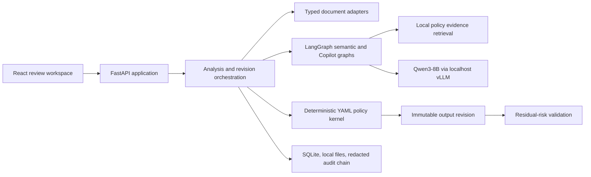

# PolicySeal

PolicySeal is a local enterprise disclosure-policy executor. It turns one
business document into the minimum necessary version for a specific recipient,
organization, purpose, channel, classification, and policy version, with an
auditable reason for every disclosure decision.

This repository is an AMD AI DevMaster Hackathon 2026 Track 2 submission.
PolicySeal is not a generic PII masker: the same source file produces different
results for internal counsel, an external auditor, a bidding supplier, and a
personal email channel.

## What The Demonstration Proves

- XLSX, DOCX, and text-PDF inputs run through real parsers and produce usable
  XLSX or traceable DOCX outputs.
- The XLSX hero scenario displays a four-recipient action matrix with `Keep`,
  `Mask`, `Remove`, `Filter`, `Generalize`, `Require Approval`, and `Block`.
- Deterministic YAML policy owns the final action. Qwen3-8B handles uncertain
  semantics and evidence selection but cannot grant access or weaken a rule.
- Review Copilot keeps task-local context for explanation, what-if simulation,
  and exception drafting. Exceptions create approval work; they do not override
  policy.
- Core inference runs through a localhost-only vLLM endpoint on AMD
  Radeon/ROCm. Source documents never go to a public model API.
- Every generated file passes a residual-risk check before it can become
  downloadable.

All committed demonstration documents are synthetic.

## Architecture



The domain and policy layers do not depend on FastAPI, storage, document
libraries, or the model client. Model calls accept stable region IDs and return
typed categories and evidence IDs; the policy evaluator computes the action.

## Repository Map

| Path | Purpose |
| --- | --- |
| `src/policyseal/` | Domain, policy, Agent graphs, document adapters, API, audit, and storage |
| `apps/web/` | React 19 + TypeScript operational review UI |
| `policies/v1/` | Versioned deterministic rules and human-readable evidence |
| `demo_data/` | Frozen synthetic XLSX, DOCX, and PDF sources |
| `evals/` | Independent scenario, semantic, retrieval, and dialogue goldens |
| `benchmarks/` | Reproducible Radeon comparison harness and JSON schema |
| `ops/radeon/` | Runtime validation and localhost service lifecycle |
| `docs/submission/` | English competition specification and evidence package |

## Local Development

Requirements:

- Python `3.12`
- `uv`
- Node.js `22.x`
- Corepack and pnpm `11.x`

Install the locked dependencies:

```bash
make install
cp .env.example .env
```

Run the API and web app in separate terminals:

```bash
make dev-api
make dev-web
```

Open `http://127.0.0.1:5173`. API health is available at
`http://127.0.0.1:8787/api/health`.

The deterministic workflows and fail-closed model-offline behavior can be
developed on a non-Radeon machine. Full semantic inference and the official
performance measurements require the Radeon environment below.

## Radeon / ROCm Deployment

The validated competition image is
`amd-oneclick-base:rocm7.2.1-py3.12-v20260416`. The project uses two isolated
Python environments:

- `/opt/venv`: image-provided ROCm PyTorch and vLLM runtime.
- `/workspace/PolicySeal/.venv`: API, Agent, parsers, tests, and evaluation code.

Place this source tree at `/workspace/PolicySeal`. On official images that do
not already run `sshd`, use the platform Jupyter terminal once to start the
key-only SSH service:

```bash
cd /workspace/PolicySeal
bash ops/radeon/bootstrap-ssh.sh
```

The commands below use `policyseal-radeon` as an illustrative local SSH alias.
Configure it with the host and external port shown for your own Radeon Cloud
instance. No endpoint or private key is stored in this repository. Then run:

```bash
ssh policyseal-radeon
cd /workspace/PolicySeal
bash scripts/bootstrap-cloud.sh
bash ops/radeon/download-model.sh
./ops/radeon/start-services.sh
./ops/radeon/health-check.sh
```

The model download is verified against
[`ops/radeon/qwen3-8b.sha256`](ops/radeon/qwen3-8b.sha256). The expected combined
model identity is:

```text
18c9bc524cc692247b4cc0c82c76260dd6539e29ab7af8e62313738624ec45b1
```

Expose only loopback ports to the local workstation:

```bash
ssh -N \
  -L 5173:127.0.0.1:5173 \
  -L 8787:127.0.0.1:8787 \
  policyseal-radeon
```

The services run in the `policyseal` tmux session as `web`, `api`, and `vllm`.
The vLLM server binds only to `127.0.0.1:8000`.

## Verification

Run the complete static, unit, scenario, and frontend gate:

```bash
make check
```

Run the four real-browser workflows:

```bash
make install-e2e-browser
POLICYSEAL_E2E_SKIP_BROWSER_INSTALL=1 make e2e
```

Validate all frozen assets:

```bash
make validate-evals
```

With Qwen3-8B already healthy on Radeon, reproduce the model evaluation and the
two optimization experiments:

```bash
.venv/bin/python scripts/evaluate_semantic_model.py \
  --output artifacts/benchmarks/semantic-evaluation.json

make benchmark
```

The benchmark intentionally requires at least ten warm repetitions and two
matching consistency passes.

## Frozen Results

| Gate | Measured result |
| --- | --- |
| Scenario acceptance | 30/30 frozen scenarios |
| High-risk leakage | 0 across frozen scenarios and accepted optimized strategies |
| Policy retrieval | 20/20 expected evidence hits at Recall@3 |
| Review Copilot | 6 dialogues, 18 context-preserving turns |
| Live semantic model | Macro-F1 `0.948485`, accuracy `0.933333`, 60 snippets |
| Python tests | 179 passed |
| Frontend unit tests | 11 passed |
| Browser journeys | 4 passed locally and on Radeon |

The official optimization run is bound to source commit
`522ef6bcb34c41618460b66c5ca4214f849c65b5` and the frozen input hash
`0df29d09f563290e8047d176304280600a0dc4e095e2179f6fab660437eedaac`.

| Experiment | Baseline | Optimized | Result |
| --- | ---: | ---: | --- |
| Stable-ID batching, warm p95 | `24,997.20 ms` | `22,312.93 ms` | `10.74%` lower; below the `20%` target |
| Deterministic short circuit, model regions | `300` | `90` | `70.00%` lower; target met |
| Deterministic short circuit, warm p95 | `74,517.27 ms` | `22,288.29 ms` | `70.09%` lower |

Stable-ID batching preserved zero leakage and improved the frozen nine-sample
quality result from macro-F1 `0.629630` to `1.000000`; its latency target was not
met and is reported as such. The optimized cascade retained macro-F1 `1.000000`,
zero leakage, deterministic logical output, and peak measured VRAM use of
`23,216,590,848` bytes.

Raw evidence is in
[`docs/submission/radeon-benchmark-results.json`](docs/submission/radeon-benchmark-results.json).
The copied cloud runtime, semantic evaluation, per-experiment outputs, process
status, and integrity hashes are preserved in
[`docs/submission/evidence/radeon-2026-08-02/`](docs/submission/evidence/radeon-2026-08-02/).

## Safety Boundary

- Unsupported embedded content, spreadsheet formulas, PDF attachments, and
  unextractable pages fail closed.
- Policy conflicts resolve as
  `Block > Require Approval > Transform > Keep`.
- Approval is exact-binding and separate-person; it is checked again at export
  and consumed once.
- Audit and Copilot checkpoints omit raw secrets, full source text, credentials,
  reversible masks, and hidden model reasoning.
- The source file is immutable. A context change creates a new revision.
- Only synthetic data is suitable for this competition build.

## P0 Limitations

- No OCR or scanned-PDF processing.
- PDF input produces a traceable DOCX reference draft, not a pixel-perfect PDF
  rewrite and not a signature-ready contract.
- No email/IM sending, enterprise SSO/IAM, DRM, malware scanning, or automatic
  legal-compliance claims.
- Policy packs are preconfigured and versioned; the model cannot create and
  activate policy.

## Competition Documents

- [English specification (Markdown)](docs/submission/PolicySeal_Specification_EN.md)
- [English specification (PDF)](docs/submission/PolicySeal_Specification_EN.pdf)
- [Demo video](docs/submission/PolicySeal_Demo_EN.mp4)
- [English captions](docs/submission/PolicySeal_Demo_EN.srt)
- [Presentation (PPTX)](docs/submission/PolicySeal_Deck_EN.pptx)
- [Presentation (PDF)](docs/submission/PolicySeal_Deck_EN.pdf)
- [Radeon benchmark summary](docs/submission/radeon-benchmark-results.json)
- [Raw Radeon evidence](docs/submission/evidence/radeon-2026-08-02/README.md)
- [Third-party notices](docs/submission/THIRD_PARTY_NOTICES.md)
