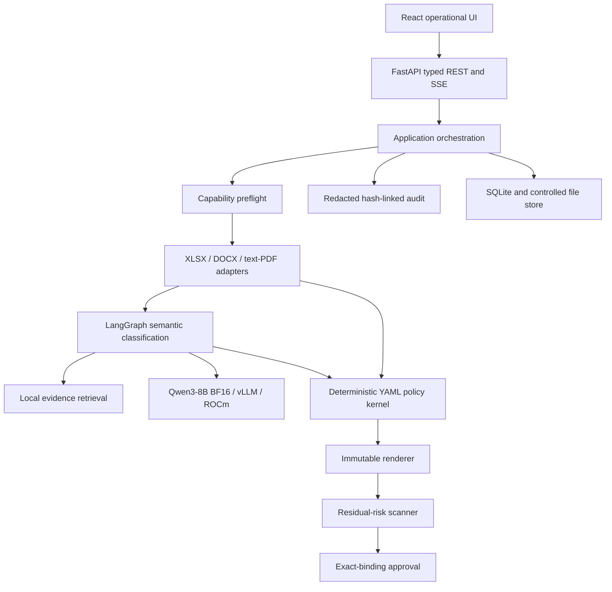

# PolicySeal Competition Specification

Version: 1.0 competition release candidate<br>
Competition: AMD AI DevMaster Hackathon 2026<br>
Track: 2 - Development & Local Deployment of Private AI Agents<br>
Team: `wangjiachang`<br>
Prepared: 2026-08-02 (UTC+8)

## 1. Executive Summary

PolicySeal is a local enterprise disclosure-policy executor. For the same
business document, it creates the minimum necessary version for a particular
recipient, organization, controlled purpose, channel, classification, and
policy version. Every decision is traceable to a stable document location, a
content category, an action, a rule ID, human-readable policy evidence, and an
immutable revision.

The product addresses a gap between basic sensitive-data detection and real
disclosure decisions. A phone number may be sensitive in every context, but an
invoice amount may be required by an auditor, forbidden to a competing bidder,
and fully visible to internal counsel. PolicySeal evaluates that context before
producing an output.

The competition build demonstrates:

- three real document paths: XLSX, DOCX, and text PDF;
- seven policy outcomes: Keep, Mask, Remove, Filter, deterministic Generalize,
  Require Approval, and Block;
- a four-recipient action matrix for one supplier-comparison workbook;
- evidence-grounded, three-turn Review Copilot interaction;
- non-mutating what-if analysis and exact-binding independent approval;
- local RAG, tool selection, multi-step planning, memory, and privacy controls;
- Qwen3-8B BF16 served locally by vLLM on AMD Radeon/ROCm; and
- two reproducible optimization experiments with quality and safety evidence.

The build is intentionally fail closed. A parsing failure, unsupported embedded
content, policy conflict, malformed model response, unavailable local model, or
unresolved residual risk never becomes implicit permission to disclose.

## 2. Product Problem

Business documents are routinely shared with lawyers, auditors, suppliers,
customers, incident-response partners, and regulators. Employees often create
temporary copies and manually delete content. This creates two simultaneous
risks:

1. under-redaction exposes personal data, credentials, commercial strategy, or
   security details; and
2. over-redaction removes information that the recipient legitimately needs.

Traditional masking tools primarily ask, "Is this content sensitive?"
PolicySeal asks a narrower operational question:

> What is the minimum information this recipient needs for this purpose through
> this channel?

The output is therefore a policy-governed disclosure version, not simply a file
with every detected pattern hidden.

## 3. Competition Scope

### 3.1 P0 document support

| Input | P0 behavior | Output |
| --- | --- | --- |
| XLSX | Parse cells, map supplier rows/columns, evaluate recipient matrix, transform and filter | XLSX |
| DOCX | Parse paragraphs and tables, preserve useful structure, transform regions | DOCX |
| Text PDF | Extract text and positions, render source-page previews, evaluate traceable regions | Reference DOCX marked not for signature |

Scanned PDFs and OCR are outside P0. A PDF page with no extractable text fails
closed instead of pretending that analysis succeeded.

### 3.2 Synthetic scenarios

1. **Supplier comparison workbook.** Supplier names, contacts, quotes, target
   prices, internal estimates, evaluation scores, negotiation comments, and
   approval notes are evaluated for four recipients.
2. **Security incident report.** Internal hostnames, credentials, named people,
   root-cause hypotheses, and response details are transformed differently for
   an external response partner and a regulator.
3. **Supplier contract.** Commercial terms, bank details, contact data, and
   nonstandard obligations demonstrate secure-channel output, approval, and
   personal-email Block.

All names, accounts, addresses, prices, systems, and events are fictional.

### 3.3 Explicit non-goals

The competition build does not provide OCR, arbitrary PDF layout restoration,
email or IM delivery, enterprise SSO/IAM, DRM, malware scanning, policy authoring
by an LLM, automated legal-compliance certification, or unattended handling of
real production secrets.

## 4. Disclosure Context

A policy request is not valid without all of these first-class inputs:

- recipient profile;
- recipient identity and organization;
- controlled disclosure purpose;
- delivery channel;
- source classification; and
- policy version.

Purpose is selected from a controlled vocabulary rather than accepted as an
untrusted free-form justification. A context change is a what-if simulation
until explicitly confirmed. Confirmation creates a new immutable revision; it
never mutates the prior result.

## 5. Hero Scenario: One File, Four Outcomes

The first review view is a four-column action matrix for the same supplier
comparison workbook.

| Recipient context | Minimum-disclosure behavior |
| --- | --- |
| Internal legal | Retain the complete authorized business context |
| External financial auditor | Retain evidence needed for audit; hide direct contacts and bank details |
| Supplier Bidder A | Retain Bidder A's own row and public requirements; filter competitors and remove internal strategy |
| Personal email | Block the entire disclosure before an output file is created |

This matrix is the product's central distinction. Sensitivity alone does not
determine the action; recipient, purpose, channel, and row ownership do.

## 6. Decision Model

Every policy decision contains:

- stable region ID and source location;
- content category;
- final action;
- rule ID and reason code;
- local evidence IDs;
- policy version and policy SHA-256;
- deterministic or fail-closed origin; and
- optional deterministic transform definition.

The action precedence is:

```text
Block > Require Approval > Transform > Keep
```

When transforms conflict, PolicySeal uses the intersection of information that
can be proven safe. If conservativeness cannot be proven, the result requires
approval. A model prediction never receives higher precedence than policy.

## 7. System Architecture



### 7.1 Layer boundaries

- The domain layer owns immutable task, revision, region, decision, approval,
  and audit concepts.
- The policy layer is deterministic and side-effect free.
- Document libraries, persistence, model HTTP, and FastAPI are adapters.
- The application layer coordinates stages and creates auditable failure
  decisions when output safety cannot be proven.
- The web application consumes typed APIs; it does not calculate policy.

## 8. Multi-Step Analysis Workflow

Each formal revision moves through named stages:

1. validate source identity and disclosure context;
2. preflight document capabilities;
3. parse stable regions;
4. apply deterministic preclassification;
5. retrieve local policy evidence for uncertain semantics;
6. classify uncertain regions through two matching local-model passes;
7. validate typed category and evidence output;
8. execute deterministic policy and resolve conflicts;
9. render a new output revision;
10. reopen the file and validate its structure;
11. scan the generated output for residual risk;
12. mark the revision Exportable, Awaiting Approval, Blocked, or Processing
    Failed; and
13. append redacted audit evidence.

Unsupported formulas, embedded objects, PDF attachments, and unextractable PDF
pages create stable system regions and Block decisions with rule evidence. A
residual hit deletes the candidate output and creates a non-waivable Block.

## 9. Local AI Agent

### 9.1 Semantic classification graph

The LangGraph classification graph uses these nodes:

```text
deterministic_preclassification
  -> local_model_call when needed
  -> typed_validation_and_evidence
  -> human_interruption when unresolved
  -> finish
```

High-confidence structured patterns skip the model. Uncertain regions are
grouped by file type, limited to eight stable IDs per request, and classified
twice. The model may return only a fixed content category and local evidence
IDs. Pydantic validation, category-evidence compatibility, and repeated-output
agreement determine whether the result can proceed.

If the local model is unavailable, unresolved semantics become Require Approval
with `PS-MODEL-OFFLINE-APPROVAL`. There is no public inference fallback.

### 9.2 Review Copilot graph

Review Copilot is task-scoped and supports three controlled intents:

- explain a decision using its rule and evidence;
- run a non-mutating what-if simulation; and
- draft an exception request that can be submitted for independent approval.

The graph loads the exact task and revision, classifies controlled intent,
invokes only the allowed tool, and stores a redacted checkpoint. It has no tool
that edits policy, approves a request, changes a decision in place, or bypasses
Block.

### 9.3 Local RAG

Human-readable policy sources cover disclosure principles, XLSX supplier
handling, incident response, and contract handling. The retrieval index contains
more than 40 citable chunks. Retrieval explains definitions and policy evidence;
vector similarity never decides access.

The frozen retrieval evaluation contains 20 questions. The measured result is
20/20 expected evidence hits at Recall@3.

## 10. Document Transformations

### 10.1 XLSX

The workbook adapter discovers headers, row ownership, metadata, and stable cell
locations. It supports cell masking/removal, row filtering, deterministic numeric
generalization, and approval-bound withholding while preserving workbook
structure. Formula evaluation is outside P0 and is blocked during preflight.

### 10.2 DOCX

The DOCX adapter processes paragraphs and table cells, strips unsupported custom
XML, creates stable task-local aliases for people and hosts, removes approval-
bound content from the external candidate, and reopens the resulting package.
Credential residuals are non-waivable.

### 10.3 Text PDF

The PDF adapter extracts positioned text and produces nonblank source-page
previews. The output is a traceable DOCX reference draft. Exact nonstandard
obligations may remain in an approval-only review draft; other unapproved
content is withheld. The output is visibly labeled `Reference Draft - Not for
Signature`.

## 11. Approval, Export, And Audit

- A requester may submit approval work but cannot approve the same revision.
- A reviewer may approve or reject but cannot edit the generated output.
- Approval binds to the source hash, output hash, context, policy version, and
  revision.
- An approved business download consumes that approval once.
- Evidence export is separate from business output.
- Blocked revisions cannot enter approval and cannot export.
- Audit records use controlled metadata and keyed HMACs when value identity must
  be compared. They omit full source text, raw secrets, credentials, reversible
  masks, and model hidden reasoning.

## 12. Operational Interface

The local React interface is optimized for repeated review work rather than a
marketing flow. It provides:

- task creation with explicit context fields;
- named local-analysis stages;
- the XLSX four-recipient matrix as the primary first view;
- synchronized source/result diff and rule evidence;
- PDF source-page previews and reference-output review;
- requester/reviewer role simulation clearly labeled as synthetic;
- what-if and formal revision controls;
- approval and one-time business export;
- a separate evidence package; and
- task-local Review Copilot below direct evidence.

The browser gate checks 1440x1000 desktop and 390x844 mobile layouts for
horizontal overflow, clipped buttons, incoherent overlap, blank previews, and
post-load movement.

## 13. Privacy And Threat Controls

| Risk | Control |
| --- | --- |
| Public model disclosure | Localhost-only vLLM; public and credentialed model URLs are rejected |
| Model grants access | Model cannot emit an action; deterministic policy owns the result |
| Malformed or inconsistent model output | Typed validation and two-pass agreement; otherwise approval |
| Unsupported document content | Preflight Block with a stable system decision |
| Secret copied into logs | Sanitized structured audit and redacted checkpoints |
| Unsafe generated file | Reopen validation and residual scan before export |
| Approval replay | Exact binding and one-time consumption |
| What-if accidentally becomes formal | Simulations are non-downloadable until a new revision is confirmed |
| Golden answers fit to implementation | Frozen independent fixtures and hashes; acceptance compares exact expected outcomes |

## 14. Evaluation Package

The repository freezes:

- 30 end-to-end scenarios;
- 60 semantic snippets;
- 20 evidence-retrieval questions; and
- 6 three-turn Copilot dialogues.

The scenario distribution is 12 Safe, 8 Require Approval, 8 Block, and 2
Processing Failed. Two scenarios deliberately inject a model outage and a
residual-output hit to make failure behavior reproducible. They are not normal
runtime claims.

Current final-code gates:

| Evidence | Result |
| --- | ---: |
| Frozen scenarios | 30/30 |
| High-risk leakage | 0 |
| Rule/evidence coverage | 100% for asserted decisions |
| Python tests | 179 passed |
| Frontend unit tests | 11 passed |
| Browser journeys | 4 passed locally and on Radeon |
| Retrieval Recall@3 | 20/20 |
| Copilot continuity | 18/18 turns |

The live Qwen3-8B evaluation on all 60 semantic snippets measured macro-F1
`0.948485`, accuracy `0.933333`, one fail-closed human-review outcome, p50 request
latency `8,894.77 ms`, p95 `11,318.75 ms`, and throughput `0.411368` regions per
second.

## 15. Radeon Runtime

The verified environment is:

| Component | Measured value |
| --- | --- |
| Platform | Ubuntu 24.04.4 LTS |
| GPU label | AMD Radeon Graphics |
| GPU architecture | `gfx1100` |
| Reported VRAM | `51,522,830,336` bytes |
| ROCm | `7.2.1` |
| HIP | `7.2.53211-e1a6bc5663` |
| Python | `3.12.3` |
| PyTorch | `2.9.1+gitff65f5b` |
| vLLM | `0.16.1.dev0+g89a77b108.d20260317` |
| Transformers | `4.57.6` |
| Model | Qwen3-8B, BF16, non-thinking mode |
| Attention | vLLM ROCm Triton attention |
| Model endpoint | `127.0.0.1:8000` |
| Maximum context | 8,192 tokens |
| Maximum sequences | 8 |
| GPU memory setting | 0.46 |
| Measured vLLM cold start | 34,150 ms |

The platform reports a generic GPU name, so this submission does not infer an
unverified retail product model. The eight critical model files are SHA-256
verified; their combined identity is
`18c9bc524cc692247b4cc0c82c76260dd6539e29ab7af8e62313738624ec45b1`.

## 16. Radeon Optimization Experiments

The official report is bound to source commit
`522ef6bcb34c41618460b66c5ca4214f849c65b5`. It uses 10 warm repetitions per
strategy and two consistency passes. Raw records include latency, model request
and region counts, tokens, GPU utilization, VRAM, output hashes, and quality.

### 16.1 Experiment A: stable-ID batching

| Metric | Per-region calls | Stable-ID batch size 8 |
| --- | ---: | ---: |
| Warm p50 | 24,989.73 ms | 22,264.37 ms |
| Warm p95 | 24,997.20 ms | 22,312.93 ms |
| Region throughput | 0.360145/s | 0.404114/s |
| Model requests across warm runs | 180 | 60 |
| Peak VRAM | 23,216,590,848 B | 23,216,590,848 B |
| Macro-F1 | 0.629630 | 1.000000 |
| Leakage | 0 | 0 |

Warm p95 improved by `10.738277%`, below the approved `20%` target. The result is
therefore `not_met`. The optimized configuration is still preferred because it
reduced requests, improved throughput, preserved zero leakage, and passed the
quality gate while the per-region baseline over-removed one sample and sent one
sample to review.

### 16.2 Experiment B: deterministic short circuit

| Metric | All regions through model | Deterministic short circuit |
| --- | ---: | ---: |
| Model regions across warm runs | 300 | 90 |
| Warm p50 | 74,510.84 ms | 22,257.27 ms |
| Warm p95 | 74,517.27 ms | 22,288.29 ms |
| End-to-end region throughput | 0.402635/s | 1.347738/s |
| Mean GPU utilization | 99.786147% | 98.812857% |
| Macro-F1 | 1.000000 | 1.000000 |
| Leakage | 0 | 0 |

The optimized path reduced model-region count by exactly `70.00%`, meeting its
target, and reduced warm p95 by approximately `70.09%` without changing accepted
quality. The result validates the product architecture: deterministic rules are
both the security authority and the largest measured performance optimization.

## 17. Reproduction

### 17.1 Local functional gate

```bash
make install
cp .env.example .env
make check
make install-e2e-browser
POLICYSEAL_E2E_SKIP_BROWSER_INSTALL=1 make e2e
make validate-evals
```

### 17.2 Radeon gate

```bash
ssh policyseal-radeon
cd /workspace/PolicySeal
bash scripts/bootstrap-cloud.sh
bash ops/radeon/download-model.sh
./ops/radeon/start-services.sh
./ops/radeon/health-check.sh

source ops/radeon/policyseal-env.sh
make check
.venv/bin/python scripts/evaluate_semantic_model.py \
  --output artifacts/benchmarks/semantic-evaluation.json
make benchmark
```

Generated files and caches stay under `/workspace`. Before an instance is
destroyed, source, frozen goldens, raw benchmark JSON, and required artifacts
must be synchronized back to the repository workspace.

## 18. Track 2 Evidence Map

| Judging area | PolicySeal evidence |
| --- | --- |
| Task definition and originality | Context-dependent minimum disclosure for the same document, not uniform masking |
| Core Agent capability | Tool selection, multi-step LangGraph flow, local RAG, typed model use, approval, and audit |
| Multi-turn interaction | Six frozen three-turn dialogues with explanation, what-if, and exception work |
| Local Radeon inference | Qwen3-8B BF16 through localhost vLLM on ROCm 7.2.1 |
| Radeon optimization | Stable-ID batching and deterministic short-circuit comparisons with raw quality evidence |

## 19. Release Position

PolicySeal is a competition prototype with strong safety boundaries and
reproducible synthetic evidence. It demonstrates how a private AI Agent can help
interpret uncertain language while keeping deterministic enterprise policy in
control. It is not a production DLP replacement or a legal-compliance product.

The intended final takeaway is simple:

> One source document. Different people and purposes. Only the minimum necessary
> disclosure, decided locally and explained line by line.
