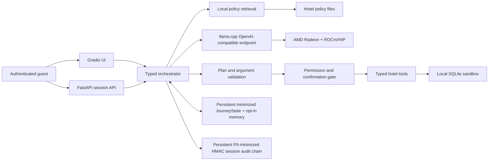

# RadeonStay

**Track 2 — Development & Local Deployment of Private AI Agents**

RadeonStay is a private, auditable hotel guest-journey agent whose competition
path is built for local core-model inference on an AMD Radeon GPU with ROCm;
retrieval, policy gates, and hotel state remain deterministic and local. It does
more than answer hotel policy
questions: it retrieves cited local policy, builds a bounded plan, invokes
typed hotel tools, pauses before every consequential write, restores a minimized
structured journey after restart, remembers guest preferences only with consent,
and emits a persistent privacy-minimized audit trail.

**RadeonStay is a private transactional journey agent that remains safe when
reality changes after preview.** A delayed flight, changed stay, stale transfer,
or restarted app preserves already confirmed work while retiring unsafe pending
capabilities and requiring a fresh authoritative preview for only the unsettled
part.

> Historical PDF, PPTX, MP4, subtitle, single-request Radeon/ROCm proof, and
> B/C/D candidate results were produced from a pre-C1 or pre-final-C2 revision.
> They are archived outside the repository boundary and are not final submission
> materials. The current Markdown and application behavior supersede them. The
> final C2-bound rerun, accepted baseline/optimized comparison, complete C3
> lifecycle, regenerated static materials, and five-run stability bundle remain
> pending. No final optimization winner is claimed.

## Why this project

Hotel conversations combine private guest data, operational rules, prices,
inventory, and actions with real consequences. A language model must not invent
these facts or write directly to a reservation database. RadeonStay therefore
uses the local model for planning and evidence selection while deterministic
tools own hotel state and monetary calculations. Final factual text is rendered
from validated citations and tool receipts rather than unconstrained model prose.

## Judge path

A guest asks:

> 我计划从 `{CHECK_IN}` 入住到 `{CHECK_OUT}` 退房，23:30 到店，带一名六岁儿童，
> 有严重花生过敏，需要安静房和机场接送。请引用酒店政策，查询可用房和准确报价，
> 并在我确认前只预览保留房间。

The Chinese request is intentional multilingual product input. In English: the
guest provides two exact future dates, a 23:30 arrival, one six-year-old child, a
severe peanut allergy, a quiet-room request, and airport-transfer needs; they ask
for cited policy, live inventory, an exact quote, and a preview-only hold.
The braces above document a template, not text to submit. When the UI is created,
it replaces them with explicit ISO values derived from the new session: check-in
is always 30–90 days in the future and checkout is two days later. The displayed
values must be used verbatim; no fixed 2030 dates are prefilled.

The judge-facing rail is derived from the existing `JourneyView`, `ActionCard`,
and `TrustCard`; it is not a second workflow state machine:

```text
Plan & Quote → Room Hold → Transfer → Delay Recovery → Privacy & Safety
```

The five groups summarize one deterministic ten-step judge guide. Memory,
Privacy Proof, and the required safety handoff are separate capabilities rather
than hidden business facts; the guide deliberately demonstrates them before
Step 10 while the backend keeps Privacy Proof outside Final Brief eligibility.
The first screen keeps that rail, the editable request, authoritative result,
current confirmation card, and one valid primary action together. It exposes
Send in an ordinary state, Confirm plus secondary Cancel for a live preview,
Repreview for stale or cancelled work, and Stay Brief only after the journey is
settled. Delay Recovery is disabled until the journey contains both an active
booking and a transfer ticket. A compact Radeon proof strip keeps ROCm, gfx,
exact `41/41` offload, current process binding, accepted winner/gain, C2, model,
binary, and report short hashes visible. Health, full Trust details, Timeline,
Stage Trace, and safe JSON receipts remain under **Advanced Proof**.

The primary flow demonstrates all five Track 2 capabilities in one journey:

1. **Local RAG** gathers up to five policy candidates with clause coverage across
   late-arrival, child, allergy, and transfer topics. The final answer publishes
   at most three selected document/section citations; candidate coverage is not
   presented as four final citations.
2. **Multi-step planning** produces a schema-validated, dependency-ordered plan.
3. **Tool calling** checks inventory and computes a quote from local SQLite data.
4. **Permission control** previews the reservation hold; nothing is written
   until the user confirms the action card. The new UI sends only its action ID;
   the single-use capability remains in server session state and only its hash is
   stored in SQLite. Current responses and replay caches never contain that
   capability. `ConfirmRequest.confirmation_token` remains accepted only for
   backward-compatible callers that already possess a legacy capability.
5. **Session continuity and local memory** carry the confirmed hold into later
   turns. After confirmation, the UI automatically prefills an editable airport-
   transfer request with the returned synthetic booking ID. The server does not
   trust that identifier: it revalidates ownership in the active identity and
   session before producing a separate preview. A confirmed transfer prefills
   Delay Recovery. After recovery, a severe-allergy request requires a separately
   previewed and confirmed staff safety handoff before the business journey can
   finish. Memory consent and one allow-listed preference remain separate,
   reversible demonstrations; the judge guide schedules them before its final
   brief step, but they are not backend business-completion gates.
   When a journey has multiple candidate bookings but no active booking, only an
   explicit candidate booking ID or one unambiguous ordinal selects it. Otherwise
   the agent asks the guest and invokes no booking-scoped tool.

The UI exposes two contextual journey shortcuts in the main flow: **Plan&Hold**
and **Delay Recovery · complete hold + transfer first**. **Injection & Access**
is a separate editable Privacy Boundary proof under **Advanced Proof** so it does
not compete with the unique business CTA. Sensitive-storage refusal remains an
optional manual/Advanced safety test and is not a visible preset. Flight Delay
Recovery extends the primary Plan&Hold journey and re-reads the
active booking and transfer ticket,
retrieves late-arrival/change/transfer policy, and shows a persistent Recovery
Impact card with old/new dates, old/new authoritative stay totals, the price
delta, ticket status, stable policy chunk IDs, and external transport price as
`not quoted`. The stay change and transport change are independently previewed
and confirmed. Cancelling or drifting state preserves any already confirmed
part and marks only the remaining work `needs_repreview`.

**Privacy Proof** combines a legitimate owner-scoped read with a delimited
`[UNTRUSTED_GUEST_NOTE]`. The server validates the boundary before retrieval or
model use, sends only the safe read scope onward, and never retains the note
body. Its audit event contains the isolated payload hash, attack category, and
limited status metadata needed to describe the partition result. The unsafe
scope is refused while the safe scope completes. A malformed boundary fails
closed; a mixed request containing a safe-scope write asks the guest to resubmit
without the note. The resulting Privacy Proof reports model invocation, read
count, zero business writes, `owner_scoped_result_count`, a receipt-derived
`cross_user_result_count`, `scope_verified`, owner scope, no retained secret, and
audit-chain status. Privacy Proof is an independent safety demonstration: it
does not unlock, block, or invalidate the business-completion path or Final Stay
Brief. A restored older Journey without `scope_verified=true` remains readable
and simply reports that the independent proof should be rerun before making a
new privacy claim.

The main result also exposes three deterministic business proofs. **Guest Needs
Ledger** tracks room, late arrival, allergy, transfer, child seat, quiet-room,
delay-recovery, and privacy needs as requested, grounded, previewed, confirmed,
or human follow-up; every state carries a citation, receipt, verified user fact,
or control reference. For a severe allergy, a policy-grounded staff handoff is a
required service outcome while the hotel team still performs the human safety
verification. A cancelled, expired, failed, grounding-invalidated, or
restart-retired preview is removed from the Ledger and outcome counts, while an
earlier confirmed write remains authoritative. **Claim Authority Map** maps each
rendered factual claim to its exact source. **Auditable Journey Outcome** totals
authoritative reads, confirmed writes, active previews, cross-user results, and
human follow-ups. These same projections enter the downloadable Final Stay Brief
with each Need source reference and a compact Claim Authority Map, so the judge
sees independently auditable business completion rather than only internal
traces. Before labeling the Brief Final, the server uniquely revalidates the
recorded transport ticket against the active booking, transport category, and
   active status. Any authoritative drift blocks the download. Booking expiry or
   cancellation returns to availability and Hold; date/total drift returns to
   Modify; transport drift preserves the confirmed stay and exposes only a fresh
   transport Repreview. Policy-only drift exposes a read-only refresh that rechecks
   the exact booking and transport state before rebinding both current policy topics.

## Architecture



## Safety boundary

- The competition path accepts only a loopback/private local model endpoint.
- There is no web search, email, payment, arbitrary HTTP, arbitrary SQL, or shell tool.
- The LLM cannot mutate the database and cannot calculate authoritative prices.
- Model output can select evidence, but cannot directly author factual final output.
- A deterministic Grounding Gate binds every rendered price, date, booking or
  ticket ID, status, and policy conclusion to an implemented source type: a
  stable citation chunk, tool-receipt step, server-authored pending-action
  preview, or privacy-control record. It may rebuild once from the
  original citations and receipts. A second failure returns a fixed unverifiable-
  summary response, invalidates any newly created confirmation capability,
  changes the action to `needs_repreview`, records `answer.grounding_failed`,
  marks Answer as failed and Complete as blocked, records `chat.completed` as
  denied, replaces the prior Authority Map with a fail-closed control claim, and
  performs no business write.
- Confirm, Cancel, Resume, and Stay Brief generation are deterministic local
  operations, so their Trust Card marks model Grounding as **not applicable**
  instead of carrying a previous agent request's claims forward. A returned tool
  receipt is counted when applicable; Resume truthfully reports zero receipts.
  The audit-chain result, runtime boundary, Journey verification, and elapsed time
  remain visible.
- Every write is classified and previewed. Its expiring, single-use server-side
  capability binds the actor, session, tool, payload, and authoritative preview
  terms, including private state fingerprints for bookings, service tickets,
  consent, and preferences. Those `_binding_*` values never enter a public
  preview; action-ID confirmation atomically recomputes them. Client request IDs
  and stable operation keys make transport retries idempotent.
- Only one write can await confirmation in a session. Later writes are blocked
  until the first write is confirmed. Cancelling the prerequisite discards its
  dependent continuation and requires a new plan; it never silently promotes the
  second write. Restart invalidates the old capability and persists only a
  capability-free step/tool descriptor marked `needs_repreview`.
- While the app process remains live, identity-bound **Resume** can restore only
  the display-safe pending-action projection: action/step IDs, tool, human preview,
  recursively checked `preview_data`, and expiry. It never exposes original tool
  arguments, confirmation or identity tokens, or private `_binding_*` fields.
  Confirm is enabled only while the matching live capability still exists and
  that safe preview is complete and unexpired; otherwise the UI requires
  **Repreview**. The guest may edit the visible request in natural language
  before clicking Repreview; the UI binds that edit to the one stale action and
  the server permits at most one matching write tool, rejects tool switching,
  and still produces a new authoritative preview before any write.
- The public product and judge journey are guest-facing and owner-scoped.
  Staff/admin identities are internal authorization fixtures and are omitted
  from the authenticated public demo.
- Operational booking and service-ticket IDs may come only from an ID stated
  explicitly in the current request or from the server-authored structured
  `JourneyState`. The planner cannot recover IDs from free-form prior chat or
  invent them.
- Long-term sensitive preferences are opt-in and can be deleted.
- Audit events store hashes and minimal metadata instead of raw private content.
- An early API Stay Brief is explicitly labeled **Provisional** and never marks
  the Journey complete. The UI exposes the **Final** Stay Brief only after Delay
  Recovery, every required service handoff, and all pending/deferred/Repreview
  work are settled. For the severe-allergy judge journey, the handoff is a
  separately confirmed, owner-scoped accessibility ticket bound to the active
  booking and current policy evidence; it records escalation but never promises
  that the environment is allergen-free. Privacy Proof remains an independent
  security demonstration and is not a Final Brief gate. The server then re-reads
  the booking and requires exact equality with the confirmed recovery dates and
  total, an active non-expired status, the exact confirmed transport
  status/version/state hash, the required handoff binding, an owner-scope
  attestation, and current-corpus citations covering stay change/late arrival,
  transport, and the required safety handoff. A cancelled or expired booking
  blocks the download and returns to availability, price, and a new Hold;
  date/total drift returns to Modify; transport drift blocks the download,
  preserves the confirmed stay, and requires a newly authoritative transport
  preview. Policy-only drift never repeats either business write: a dedicated
  **Refresh policy evidence** request must retrieve both current policy topics and
  re-read the exact owner-scoped booking and transport ticket before completion is
  restored. The server replaces any model-proposed write or incomplete refresh plan
  with the fixed three-step read-only plan, so this recovery path cannot create a
  confirmation preview.

## Source layout

```text
src/radeonstay/
├── config.py           # local-only environment and paths
├── contracts.py        # validated plans, receipts, citations and API requests
├── model_client.py     # minimal llama.cpp OpenAI-compatible client
├── planning.py         # local-LLM planner and explicit development fallback
├── retrieval.py        # local policy retrieval
├── domain/             # database, hotel tools, memory, permissions and audit
├── orchestrator.py     # end-to-end bounded agent flow
├── api.py              # FastAPI endpoints
├── ui.py               # Gradio judge interface
└── main.py             # application entry point
```

## Environment

- Python `3.12.3`
- ROCm `7.2.1`; HIP `7.2.53211-e1a6bc5663`
- Detected GPU: `AMD Radeon Graphics`, `gfx1100`, device ID `0x744b`, 96 compute
  units, and `51522830336` bytes of VRAM
- ROCm/HIP-enabled llama.cpp commit
  `0b14b87d7c20cb753b94b96854dd7b45306fc696`, with `llama-server` binary
  SHA256 `926e2297d7144a59182ba9d37de877ec972a0cf8d1b697baa82277b3066c45c6`
- Complete resolved Python package-version snapshot from the target validation
  virtual environment in [requirements.lock](requirements.lock)

The local alias `qwen3.6-35b-a3b-q6k` maps to
[`unsloth/Qwen3.6-35B-A3B-GGUF`](https://huggingface.co/unsloth/Qwen3.6-35B-A3B-GGUF)
at revision `a483e9e6cbd595906af30beda3187c2663a1118c`, file
`Qwen3.6-35B-A3B-UD-Q6_K.gguf`, licensed Apache-2.0. Its SHA256 is
`4fe53b148b46f9b88830e2a3055c5b15c3a4d1e3ddc9a1384a108d8b9d59f043`.
See [Third-party notices](THIRD_PARTY_NOTICES.md). The generic detected product
string above is retained verbatim; no retail GPU model is inferred from it.

`requirements.lock` was captured on 2026-08-04 with `python -m pip freeze --all`
from the clean Python 3.12.3 Radeon/ROCm validation virtual environment. It
excludes the environment's pip bootstrap and the editable RadeonStay entry. The
file records the complete resolved package versions present in that environment,
but contains no artifact hashes and is not a software bill of materials or a
license inventory.

For the separate macOS maintenance environment, its reproducible Python 3.12
setup, lightweight verification gate, and host-specific troubleshooting notes
are recorded in [Local development environment](docs/local-development.md).
Results from that workstation are development checks, not Radeon/ROCm evidence.

## Reproduce the pinned inference artifacts

Run artifact acquisition on the target Linux/ROCm host before the Python quick
start. Keep weights, upstream source, and build output outside this Git project;
otherwise the C2 clean-tree check rejects them as untracked inputs. Download
only the named file from the fixed model revision, then verify it before use.
This path requires Git, curl, CMake, GNU `sha256sum`, and the ROCm/HIP 7.2.1
development toolchain:

```bash
: "${RADEONSTAY_ARTIFACT_ROOT:?Export a writable absolute path outside the Git repository}"
mkdir -p "$RADEONSTAY_ARTIFACT_ROOT/model"
MODEL_REPO="unsloth/Qwen3.6-35B-A3B-GGUF"
MODEL_REV="a483e9e6cbd595906af30beda3187c2663a1118c"
MODEL_NAME="Qwen3.6-35B-A3B-UD-Q6_K.gguf"
MODEL_SHA256="4fe53b148b46f9b88830e2a3055c5b15c3a4d1e3ddc9a1384a108d8b9d59f043"
export MODEL_FILE="$RADEONSTAY_ARTIFACT_ROOT/model/$MODEL_NAME"
test ! -e "$MODEL_FILE"

curl --fail --location --retry 3 \
  "https://huggingface.co/$MODEL_REPO/resolve/$MODEL_REV/$MODEL_NAME?download=true" \
  --output "$MODEL_FILE"
printf '%s  %s\n' "$MODEL_SHA256" "$MODEL_FILE" | sha256sum --check --strict
```

Build `llama-server` from the pinned llama.cpp commit with its HIP backend and
the detected `gfx1100` target. The recorded SHA256 identifies the validated
release binary, not merely the source commit: a locally rebuilt binary may be
used as that identity only when its checksum matches. Otherwise it is a new
binary identity and all manifests, notices, and target evidence must bind its
actual hash rather than reusing the value below.

```bash
LLAMA_CPP_REV="0b14b87d7c20cb753b94b96854dd7b45306fc696"
LLAMA_SHA256="926e2297d7144a59182ba9d37de877ec972a0cf8d1b697baa82277b3066c45c6"
LLAMA_CPP_DIR="$RADEONSTAY_ARTIFACT_ROOT/llama.cpp"

git clone https://github.com/ggml-org/llama.cpp.git "$LLAMA_CPP_DIR"
git -C "$LLAMA_CPP_DIR" checkout --detach "$LLAMA_CPP_REV"
test "$(git -C "$LLAMA_CPP_DIR" rev-parse HEAD)" = "$LLAMA_CPP_REV"

cmake -S "$LLAMA_CPP_DIR" -B "$LLAMA_CPP_DIR/build-rocm" \
  -DGGML_HIP=ON \
  -DAMDGPU_TARGETS=gfx1100 \
  -DCMAKE_BUILD_TYPE=Release
cmake --build "$LLAMA_CPP_DIR/build-rocm" --config Release --parallel

export LLAMA_BIN="$LLAMA_CPP_DIR/build-rocm/bin/llama-server"
printf '%s  %s\n' "$LLAMA_SHA256" "$LLAMA_BIN" | sha256sum --check --strict
```

The official bundle additionally retains the full CMake configure output,
compiler/ROCm versions, `rocminfo`, startup log, final positive offload count,
and active same-GPU telemetry. A successful checksum alone is not proof that an
inference request ran on Radeon.

## Quick start

After the artifact checksum steps above, these commands recreate the pinned
Python environment and local launch configuration without embedding a target-host
address or credential.

```bash
cd submissions/track2-radeonstay
python3 -m venv .venv
source .venv/bin/activate
python -m pip install -r requirements.lock
cp .env.example .env
python - <<'PY'
from pathlib import Path
import secrets

path = Path(".env")
text = path.read_text(encoding="utf-8")
replacements = {
    "replace-with-a-random-local-secret": secrets.token_urlsafe(48),
    "replace-with-a-different-random-local-secret": secrets.token_urlsafe(48),
}
for placeholder, secret in replacements.items():
    if placeholder not in text:
        raise SystemExit(f"Missing expected placeholder: {placeholder}")
    text = text.replace(placeholder, secret, 1)
path.write_text(text, encoding="utf-8")
PY
```

RadeonStay loads the project-local `.env` itself; exported environment
variables take precedence. Every mode, including loopback-only use, requires two
different 32-byte-or-longer random secrets; the command above writes 48-byte
values without printing them. Keep `.env` local. Public demo mode, including a
loopback service exposed through Radeon Cloud Tunnel, is fail-closed unless UI
authentication is configured (`RADEONSTAY_UI_USERNAME` is at least 4 characters
and `RADEONSTAY_UI_PASSWORD` is at least 12 characters).

Export the frozen paths, then start the local ROCm model service. `MODEL_ALIAS`
must equal `RADEONSTAY_MODEL_NAME`; an alias is only a routing identifier, while
the evidence bundle binds the actual model and binary SHA256 values. Local
development may omit a runtime-instance manifest. A formal isolated lifecycle
must create a new private directory and export the same deployment identity and
manifest path to both the model and application terminals before either service
starts. The accepted proof keeps its separate evidence identity:

```bash
export RADEONSTAY_ISOLATED_DEMO=1
export RADEONSTAY_DEMO_RUN_ID=deployment-judge-001
export RADEONSTAY_EVIDENCE_RUN_ID=c3-accepted-winner-001
export RADEONSTAY_RUNTIME_PROOF_PATH=/absolute/path/to/sanitized-runtime-proof.json
install -d -m 0700 "runtime/${RADEONSTAY_DEMO_RUN_ID}"
export RADEONSTAY_RUNTIME_INSTANCE_PATH="$PWD/runtime/${RADEONSTAY_DEMO_RUN_ID}/runtime-instance.json"
test ! -e "$RADEONSTAY_RUNTIME_INSTANCE_PATH"
```

```bash
: "${LLAMA_BIN:?Export LLAMA_BIN as the frozen ROCm llama-server binary}"
: "${MODEL_FILE:?Export MODEL_FILE as the frozen local GGUF path}"
LLAMA_SERVER="$LLAMA_BIN" \
MODEL_PATH="$MODEL_FILE" \
MODEL_ALIAS="${RADEONSTAY_MODEL_NAME:-qwen3.6-35b-a3b-q6k}" \
EVIDENCE_RUN_ID="${RADEONSTAY_EVIDENCE_RUN_ID:-}" \
scripts/serve_model.sh
```

`serve_model.sh` creates the instance manifest as mode `0600` and records the
deployment run ID, live PID and Linux start ticks, executable/configuration SHA256 values,
port, alias, and model SHA256. Before publishing the manifest it also verifies
that this exact PID owns the declared loopback `LISTEN` socket. It refuses to
overwrite an existing manifest.

In a second terminal, repeat the five `RADEONSTAY_*` exports above (do not reuse
the manifest path for a different process), then start the app:

```bash
scripts/serve_app.sh
```

`RADEONSTAY_DEMO_RUN_ID` is the fresh `deployment_run_id`; it is appended to the
SQLite filename and binds the live runtime-instance manifest. A new deployment
must use a new ID, release directory, and database. Within one deployment, an App
process restart may reopen that exact database only after strict run-bound path,
regular-file, non-symlink, current-owner, `0700` directory, `0600` artifact,
schema, audit-key, Journey-HMAC, and audit-chain validation. Unconfirmed
capabilities are retired and require Repreview; confirmed state and the minimized
Journey survive. `RADEONSTAY_EVIDENCE_RUN_ID` separately equals the immutable
runtime proof's `run_id`. The separate runtime-instance manifest must bind the
configured endpoint to the same still-running `llama-server`; readiness and every model call verify the
recorded PID/start time, executable and command configuration, port, alias,
`--model` argument, ownership of the declared loopback `LISTEN` socket, manifest
model identity, and runtime-proof identity before and after inference. A mismatch
in one of those checked fields returns HTTP 503
with no deterministic-planner fallback. The request-time check compares the
model identity recorded in the private manifests; it does not re-hash the GGUF
file for every request. Formal artifact acquisition and evidence binding perform
the full model-file SHA256 verification. The proof must also bind ROCm, the GPU
arch, the pinned model's exact `41/41` layer offload, model/binary SHA256 values,
and active telemetry or readiness returns HTTP 503.
Its status must be `verified`, `verified_final`, `accepted`, or `accepted_final`;
candidate/non-final summaries are intentionally ineligible.
An `accepted` proof must additionally include the C2 commit, B–H winner label,
`winner_assessment_accepted=true`, accepted winner-report SHA256, winning core
metric, and its measured improvement of at least 5%. An `accepted_final` proof
is generated only after complete candidate-source recomputation, five accepted
fresh Stability lifecycles, and a separate passed long soak; it also binds their
source-index, report, and run-ID digests. Only the process-binding verdict and
opaque instance-manifest SHA are exposed to the browser; PID, paths, and command
line remain private.
Static isolation and proof failures keep operations disabled. A transient model
health failure returns not-ready/503 but is rechecked dynamically, so the mounted
UI recovers when the same bound process becomes healthy without an App restart.
When no proof path is configured, local development remains available but the
Trust card labels hardware evidence as unbound.

The default UI listens only on `127.0.0.1:7860`. For a controlled Radeon Cloud
judge tunnel, additionally enable public-demo mode and configure the UI
authentication variables in `.env`. Public mode removes the staff identity from
the UI. The model still runs inside the same controlled Radeon environment.

## Development-only deterministic mode

`RADEONSTAY_DETERMINISTIC_MODE=1` permits UI and permission-flow development
when a GPU endpoint is unavailable. It is clearly labeled in API/UI output,
must never be used for the Radeon performance report, and is not accepted as
competition inference evidence.
`RADEONSTAY_ISOLATED_DEMO=1` rejects this fallback at startup, even when an old
runtime-proof file is present.

## Local state boundaries

Hotel records, opt-in preferences, idempotency receipts, hashed confirmation
challenges, minimized `JourneyState`, schema version, and the HMAC-linked session
audit chain live in SQLite. Schema v7 stores a domain-separated, non-secret audit
key fingerprint, a row HMAC over session identity/order, and authenticated per-session
heads covered by a global catalog HMAC. A changed key, moved row, truncated tail, or
deleted chain fails closed. It also authenticates each minimized Journey snapshot,
including its owner, version, canonical state, and update time. Every persisted session
chain is verified from its genesis event before readiness or recovery; the public audit
view remains bounded.

Migrating a non-empty schema v3-v5 database is **trust-on-first-migration**. Those
legacy schemas did not authenticate every row identity and/or the complete tail set,
so a cross-session move, tail deletion, or whole-chain deletion that happened before
the first v6 migration cannot be authenticated retrospectively. A production upgrade
must first verify a trusted read-only backup or an operator-controlled external
manifest of the legacy database. Official competition evidence uses only a newly
created, isolated v7 database and never upgrades legacy audit history.

This is database-internal tamper evidence: even after v7 is established, detecting
rollback or replacement of the entire SQLite file requires an external backup digest
or hardware anchor. Raw chat is never persisted. Conversation
snippets, request replay cache, and live capabilities are process-local; after
restart an unconfirmed action becomes `needs_repreview`; only its safe step/tool
descriptor survives, while the old preview terms, arguments, and capability are
not restored. That transition appends `confirmation.retired` and
`session.recovered` control events to the same persistent HMAC audit chain.
This differs from same-process Resume, which may redisplay the safe pending-action
projection and permit confirmation only after the server verifies its matching
live capability. A process restart clears the authoritative preview projection
and capability, so current terms must be recomputed even though the UI can still
identify which allow-listed action needs re-preview.
Calls to `/v1/chat` must supply a stable `request_id` and reuse it only when
retrying the same logical request. Identity-bound session/brief/audit reads use
`X-Identity-Token`, never a query-string token.

Before **Clear / New Session** creates a replacement session, the current
identity asks the server to invalidate every live confirmation capability and
clear turns, pending records, replay cache, action cards, and `JourneyState` for
the old session. The UI then clears its input and proof panels. An identity that
does not own the old session cannot reset it; the old owner's server state remains
unchanged while the newly selected identity receives a separate new session.

Public endpoints retain `/v1/chat`, `/v1/confirm`, `/v1/audit/{session_id}`, and
`/health`, and add action cancellation, session recovery, Stay Brief download,
and distinct liveness/readiness checks: `/v1/actions/cancel`,
`/v1/sessions/{session_id}`, `/v1/sessions/{session_id}/projection`,
`/v1/sessions/{session_id}/brief`, `/health/live`, and `/health/ready`. The
projection endpoint atomically returns the owner-scoped Journey and capability-free
action cards used by Resume and post-action UI refresh. Session GET returns HTTP
404 when no live state, durable
JourneyState, or authorized persistent audit chain exists; an identity mismatch
returns HTTP 403. A verified audit-only session can recover a minimal empty
journey plus audit continuity, but never reconstructed chat or invented IDs.

## Evaluation

The fixed suite covers policy grounding, read tools, multi-step tasks, memory,
write confirmation, and permission attacks. The formal target-run bundle will
include raw request-level JSON for:

- llama-server timing fields (including TTFT only when the pinned build emits it)
  plus explicitly labeled HTTP-effective output tokens/s;
- end-to-end P50/P95 with per-stage timing;
- 1/2/4 request concurrency;
- peak VRAM, Radeon utilization, sampled power, and energy per successful task;
- tool-schema validity, task success, citation support, and denial rate;
- baseline versus optimized settings under the same model and prompts;
- negative results rejected by the quality gate.

The immutable 30-case suite and its 300-point score remain separate from the
independent 12-case stress suite (six security and six open-language cases). Every
A–H C3 lifecycle binds its own
`stress.json`; security cases must all pass and the open-language cohort must
meet its independent release gate without changing the official score or suite
hash.

No benchmark number will be manually inserted without a corresponding raw file.
The P0 evidence entry points are `evaluation/run_retrieval_eval.py`,
`evaluation/run_agent_eval.py`, `evaluation/benchmark_agent.py`, and
`scripts/collect_rocm_evidence.sh`; each refuses to overwrite an existing result.
All four use one shared C2 source-hash implementation. It hashes only committed
frozen inputs (`src`, `data`, `scripts`, `tests`, evaluation code/fixtures, the
dependency/configuration files, and license notices), rejects byte drift from
`HEAD`, and excludes documentation, media, runtime results, caches, `tmp`, and
Playwright artifacts. The separate commit and project-tree fields remain in every
bundle, so the scoped source hash never replaces Git provenance.
The official `data/policies/` corpus must be a real directory inside the project;
its path components, nested directories, and policy files may not be symbolic
links, and every resolved corpus path must remain inside the project.
`scripts/monitor_rocm.sh` captures the paired utilization, VRAM, power, and
temperature time series under the same evidence run ID.
`evaluation/compare_benchmarks.py` accepts only schema-v3 reports with complete
binding manifests, matched suite/workload/policy corpus/model endpoint/model
binary/hardware, passing quality gates, native llama.cpp ROCm initialization and
offload logs, and active same-GPU telemetry inside both evaluation windows. It
also requires baseline and optimized evidence to use identical
`common_active_gpu_indices` and physical GPU unique IDs. It writes
`assessment.accepted` and `optimization_winner=optimized` only when at least one
core metric improves by 5% or more, no core metric materially regresses, and the
bound quality score does not decline; `--require-accepted` turns that assessment
into a release gate.

The controlled matrix is A–H: thinking off, flash attention on, batch/ubatch
sizing, fused planning/evidence, minimum safe context, four parallel slots, and
an isolated Q8 KV-cache experiment. Every adjacent pair changes exactly one
declared group. Fused mode targets one model call, permits at most one explicitly
measured syntax or semantic repair, and forbids the former evidence-selector
call or any third call. Run E binds `context-selection.json`; run F binds
`context-proof.json`. Each context artifact records the source quality and
benchmark SHA256 values, is recomputed by the comparator, and must prove that F
reproduces E's minimum safe context choice.

After the adjacent single-variable reports, `evaluation/select_winner.py` admits
only complete 300/300 rows below 90% VRAM with no material core regression versus
the quality-qualified Reference. A is the Reference only when it scores 300/300.
If A fails quality, its bound negative package is retained, B must independently
pass every quality, stress, hardware, and lifecycle gate, and B becomes the
Reference; A is never used for a performance claim. The selector enforces the
best-latency P95 +5% limit, then ranks concurrency-4 throughput, P50, VRAM, and
measured energy. Release evidence requires
`assessment.accepted=true` and `optimization_winner=optimized`.

The release checklist names the immutable source/artifact freeze **C2** and one
complete target execution lifecycle **C3**. Stability evidence is five fresh C3
lifecycles of the single accepted final configuration—not five differently
tuned experiments. Each lifecycle starts and stops its own model service and
monitor and retains its own retrieval, official quality, independent stress,
benchmark, server, telemetry, and binding artifacts. The applicable E or F
context artifact is named and hashed in `binding-manifest.txt`; all copied raw
artifacts, including `stress.json` and that context artifact, are covered by
`SHA256SUMS.txt`. A separate accepted long-soak report must then pass before a
final runtime proof can be created.

For the B-Reference contract, the final builder command is shown below. Replace
`WINNER_LABEL` with `assessment.winner_experiment`; every path is an immutable
input except the two new output files. If A passes 300/300, omit
`--quality-negative`, add the A benchmark/binding as a candidate, and use A as
`--reference-binding`; the fully expanded A and B forms are in the
[evaluation plan](docs/evaluation-plan.md#final-runtime-proof-and-recovery-profile).

```bash
MATRIX_ROOT=/absolute/path/to/radeon-target-matrix
FINAL_ROOT=/absolute/path/to/final-evidence
SOAK_ROOT=/absolute/path/to/final-winner-soak-lifecycle
WINNER_LABEL=G

python evaluation/build_runtime_proof.py \
  --winner-report "${MATRIX_ROOT}/winner-selection.json" \
  --quality-negative A "${MATRIX_ROOT}/A/quality-negative/manifest.json" \
  --candidate B "${MATRIX_ROOT}/B/evidence/agent-benchmark.json" "${MATRIX_ROOT}/B/evidence/binding-manifest.txt" \
  --candidate C "${MATRIX_ROOT}/C/evidence/agent-benchmark.json" "${MATRIX_ROOT}/C/evidence/binding-manifest.txt" \
  --candidate D "${MATRIX_ROOT}/D/evidence/agent-benchmark.json" "${MATRIX_ROOT}/D/evidence/binding-manifest.txt" \
  --candidate E "${MATRIX_ROOT}/E/evidence/agent-benchmark.json" "${MATRIX_ROOT}/E/evidence/binding-manifest.txt" \
  --candidate F "${MATRIX_ROOT}/F/evidence/agent-benchmark.json" "${MATRIX_ROOT}/F/evidence/binding-manifest.txt" \
  --candidate G "${MATRIX_ROOT}/G/evidence/agent-benchmark.json" "${MATRIX_ROOT}/G/evidence/binding-manifest.txt" \
  --candidate H "${MATRIX_ROOT}/H/evidence/agent-benchmark.json" "${MATRIX_ROOT}/H/evidence/binding-manifest.txt" \
  --stability-report "${FINAL_ROOT}/final-winner-stability.json" \
  --soak-report "${FINAL_ROOT}/final-winner-soak.json" \
  --soak-benchmark "${SOAK_ROOT}/${WINNER_LABEL}/evidence/agent-benchmark.json" \
  --soak-binding "${SOAK_ROOT}/${WINNER_LABEL}/evidence/binding-manifest.txt" \
  --reference-binding "${MATRIX_ROOT}/B/evidence/binding-manifest.txt" \
  --winner-binding "${MATRIX_ROOT}/${WINNER_LABEL}/evidence/binding-manifest.txt" \
  --runtime-proof-output "${FINAL_ROOT}/runtime-proof.json" \
  --release-profile-output "${FINAL_ROOT}/release-profile.json"
```

The builder reopens all seven B–H candidates, revalidates the bound A negative,
recomputes Winner selection, and verifies five fresh Stability lifecycles plus
the separate passed soak. Only then does it emit the private schema-v2 runtime
proof and schema-v4 recovery profile with candidate, negative, Stability, and
soak hashes. See the evaluation plan and evidence index. Formal target results
remain pending; the current single-request proof and B/C/D candidate metrics are
retained only as explicitly labeled non-final evidence.
Raw and exploratory outputs under `evaluation/results/` stay local and ignored;
only a reviewed, recursively redacted C3 subset under
`evaluation/results/c3-selected/` is eligible for the later evidence-only commit.

## Documentation

- [Project specification](docs/project-specification.md)
- [Judge quickstart](docs/judge-quickstart.md)
- [Local development environment](docs/local-development.md)
- [Radeon Cloud Notebook recovery](docs/notebook-recovery.md)
- [Evaluation plan](docs/evaluation-plan.md)
- [Demo script](docs/demo-script.md)
- [Evidence index](docs/evidence-index.md)
- [Third-party notices](THIRD_PARTY_NOTICES.md)

## Existing non-final reference materials

- Legacy project specification PDF — pre-C1, not final
- Legacy English/Chinese competition deck — pre-C1, not final
- Legacy silent demo video — pre-C1 behavior, not final
- Legacy English subtitle source — superseded by the current demo script

The [evidence index](docs/evidence-index.md) records the historical SHA256 values
for integrity only. These files are deliberately archived outside the C1/C2
repository boundary, so a clean checkout contains no stale media link or
submission artifact. Regenerate the PDF, deck, video, and subtitles after the C2
source and accepted performance evidence are frozen. Hardware-run evidence
remains pending until it is reproduced from the clean local C2 commit and bound
into C3 bundles.

## Privacy and data

All hotel records and guests in this repository are synthetic. RadeonStay is a
competition sandbox, not a production property-management system. The code is
structured so a real adapter can be added later, but no real reservation,
payment, identity, or health data is included.

## License

RadeonStay source code is MIT licensed. The pinned model is Apache-2.0;
llama.cpp is MIT; ROCm components and Python dependencies retain their own
licenses. See [THIRD_PARTY_NOTICES.md](THIRD_PARTY_NOTICES.md). Model weights are
not committed to this repository; obtain the exact revision and file above, then
verify its SHA256 before use.
