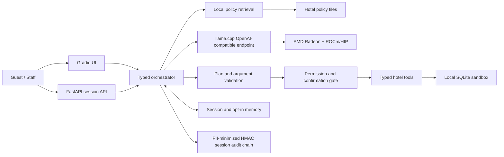

# RadeonStay

**Track 2 — Development & Local Deployment of Private AI Agents**

RadeonStay is a private, auditable hotel guest-journey agent whose competition
path is built for local core-model inference on an AMD Radeon GPU with ROCm;
retrieval, policy gates, and hotel state remain deterministic and local. It does
more than answer hotel policy
questions: it retrieves cited local policy, builds a bounded plan, invokes
typed hotel tools, pauses before every consequential write, remembers guest
preferences only with consent, and emits a privacy-minimized audit trail.

> The target hardware, ROCm/HIP runtime, model artifact, and llama.cpp binary
> identities have been verified. Performance values remain intentionally
> unclaimed until they are backed by the complete fixed-suite evidence bundle.

## Why this project

Hotel conversations combine private guest data, operational rules, prices,
inventory, and actions with real consequences. A language model must not invent
these facts or write directly to a reservation database. RadeonStay therefore
uses the local model for planning and evidence selection while deterministic
tools own hotel state and monetary calculations. Final factual text is rendered
from validated citations and tool receipts rather than unconstrained model prose.

## Judge path

A guest asks:

> 我计划在两个明确的未来日期入住和退房，23:30 到店，带一名六岁儿童，
> 有严重花生过敏，需要安静房和机场接送。请引用政策、查询房态和准确报价，
> 并在我确认前只预览保留房间。

The Chinese request is intentional multilingual product input. In English: the
guest provides two exact future dates, a 23:30 arrival, one six-year-old child, a
severe peanut allergy, a quiet-room request, and airport-transfer needs; they ask
for cited policy, live inventory, an exact quote, and a preview-only hold.

The P0 flow demonstrates all five Track 2 capabilities in one journey:

1. **Local RAG** retrieves late-arrival, child, allergy, and transfer policies
   with document and section citations.
2. **Multi-step planning** produces a schema-validated, dependency-ordered plan.
3. **Tool calling** checks inventory and computes a quote from local SQLite data.
4. **Permission control** previews the reservation hold; nothing is written
   until the user confirms an opaque, single-use, expiring token.
5. **Local memory** carries the confirmed hold into a follow-up turn. The guest
   can then create a transfer ticket and opt in before storing a preference.

An unauthorized identity then tries to reuse the bound session and is denied.
The UI shows citations, the plan, tool receipts, pending writes, and HMAC-linked
session audit evidence. This sequence exercises all five optional Agent
capabilities without pretending dependent writes completed in one turn.

## Architecture



## Safety boundary

- The competition path accepts only a loopback/private local model endpoint.
- There is no web search, email, payment, arbitrary HTTP, arbitrary SQL, or shell tool.
- The LLM cannot mutate the database and cannot calculate authoritative prices.
- Model output can select evidence, but cannot directly author factual final output.
- Every write is classified and previewed. Its expiring, single-use token binds the
  actor, session, tool, payload, and authoritative preview terms; confirmation
  atomically rechecks those terms. Client request IDs and stable operation keys
  make transport retries idempotent.
- Reservation reads are owner-scoped unless the user has a staff/admin role.
- Long-term sensitive preferences are opt-in and can be deleted.
- Audit events store hashes and minimal metadata instead of raw private content.

## Source layout

```text
src/radeonstay/
├── config.py           # local-only environment and paths
├── contracts.py        # validated plans, receipts, citations and API requests
├── model_client.py     # minimal llama.cpp OpenAI-compatible client
├── planning.py         # local-LLM planner and explicit development fallback
├── retrieval.py        # local policy retrieval
├── domain/             # database, hotel tools, memory, permissions and audit
├── orchestrator.py     # end-to-end bounded agent flow
├── api.py              # FastAPI endpoints
├── ui.py               # Gradio judge interface
└── main.py             # application entry point
```

## Environment

- Python `3.12.3`
- ROCm `7.2.1`; HIP `7.2.53211-e1a6bc5663`
- Detected GPU: `AMD Radeon Graphics`, `gfx1100`, device ID `0x744b`, 96 compute
  units, and `51522830336` bytes of VRAM
- ROCm/HIP-enabled llama.cpp commit
  `0b14b87d7c20cb753b94b96854dd7b45306fc696`, with `llama-server` binary
  SHA256 `926e2297d7144a59182ba9d37de877ec972a0cf8d1b697baa82277b3066c45c6`
- Complete resolved Python package-version snapshot from the target validation
  virtual environment in [requirements.lock](requirements.lock)

The local alias `qwen3.6-35b-a3b-q6k` maps to
[`unsloth/Qwen3.6-35B-A3B-GGUF`](https://huggingface.co/unsloth/Qwen3.6-35B-A3B-GGUF)
at revision `a483e9e6cbd595906af30beda3187c2663a1118c`, file
`Qwen3.6-35B-A3B-UD-Q6_K.gguf`, licensed Apache-2.0. Its SHA256 is
`4fe53b148b46f9b88830e2a3055c5b15c3a4d1e3ddc9a1384a108d8b9d59f043`.
See [Third-party notices](THIRD_PARTY_NOTICES.md). The generic detected product
string above is retained verbatim; no retail GPU model is inferred from it.

`requirements.lock` was captured on 2026-08-04 with `python -m pip freeze --all`
from the clean Python 3.12.3 Radeon/ROCm validation virtual environment. It
excludes the environment's pip bootstrap and the editable RadeonStay entry. The
file records the complete resolved package versions present in that environment,
but contains no artifact hashes and is not a software bill of materials or a
license inventory.

## Quick start

These commands reproduce the verified software identities without embedding any
target-host address or credential.

```bash
cd submissions/track2-radeonstay
python3 -m venv .venv
source .venv/bin/activate
python -m pip install -r requirements.lock
python -m pip install --no-deps -e .
cp .env.example .env
python - <<'PY'
from pathlib import Path
import secrets

path = Path(".env")
text = path.read_text(encoding="utf-8")
replacements = {
    "replace-with-a-random-local-secret": secrets.token_urlsafe(48),
    "replace-with-a-different-random-local-secret": secrets.token_urlsafe(48),
}
for placeholder, secret in replacements.items():
    if placeholder not in text:
        raise SystemExit(f"Missing expected placeholder: {placeholder}")
    text = text.replace(placeholder, secret, 1)
path.write_text(text, encoding="utf-8")
PY
```

RadeonStay loads the project-local `.env` itself; exported environment
variables take precedence. Every mode, including loopback-only use, requires two
different 32-byte-or-longer random secrets; the command above writes 48-byte
values without printing them. Keep `.env` local. A non-loopback UI bind is
fail-closed unless public demo mode and UI basic authentication are also
configured (`RADEONSTAY_UI_USERNAME` is at least 4 characters and
`RADEONSTAY_UI_PASSWORD` is at least 12 characters).

Export the frozen paths, then start the local ROCm model service. `MODEL_ALIAS`
must equal `RADEONSTAY_MODEL_NAME`; an alias is only a routing identifier, while
the evidence bundle binds the actual model and binary SHA256 values.

```bash
: "${LLAMA_BIN:?Export LLAMA_BIN as the frozen ROCm llama-server binary}"
: "${MODEL_FILE:?Export MODEL_FILE as the frozen local GGUF path}"
LLAMA_SERVER="$LLAMA_BIN" \
MODEL_PATH="$MODEL_FILE" \
MODEL_ALIAS="${RADEONSTAY_MODEL_NAME:-qwen3.6-35b-a3b-q6k}" \
scripts/serve_model.sh
```

In a second terminal:

```bash
radeonstay
```

The default UI listens only on `127.0.0.1:7860`. For a controlled Radeon Cloud
judge tunnel, additionally enable public-demo mode and configure the UI
authentication variables in `.env`. Public mode removes the staff identity from
the UI. The model still runs inside the same controlled Radeon environment.

## Development-only deterministic mode

`RADEONSTAY_DETERMINISTIC_MODE=1` permits UI and permission-flow development
when a GPU endpoint is unavailable. It is clearly labeled in API/UI output,
must never be used for the Radeon performance report, and is not accepted as
competition inference evidence.

## Local state boundaries

Hotel records, opt-in preferences, idempotency receipts, and hashed
confirmation challenges live in SQLite. Conversation turns, hashed pending-token
mappings, request-response replay cache, and the HMAC-linked session audit view
are process-local for the single-worker competition demo. Calls to `/v1/chat`
must supply a stable `request_id` and reuse it only when retrying the same logical
request. The API never accepts an identity token in an audit query string;
clients send `X-Identity-Token` instead.

## Evaluation

The fixed suite covers policy grounding, read tools, multi-step tasks, memory,
write confirmation, and permission attacks. The final report will include raw
request-level JSON for:

- llama-server timing fields (including TTFT only when the pinned build emits it)
  plus explicitly labeled HTTP-effective output tokens/s;
- end-to-end P50/P95 with per-stage timing;
- 1/2/4 request concurrency;
- peak VRAM and Radeon utilization;
- tool-schema validity, task success, citation support, and denial rate;
- baseline versus optimized settings under the same model and prompts;
- negative results rejected by the quality gate.

No benchmark number will be manually inserted without a corresponding raw file.
The P0 evidence entry points are `evaluation/run_retrieval_eval.py`,
`evaluation/run_agent_eval.py`, `evaluation/benchmark_agent.py`, and
`scripts/collect_rocm_evidence.sh`; each refuses to overwrite an existing result.
The official `data/policies/` corpus must be a real directory inside the project;
its path components, nested directories, and policy files may not be symbolic
links, and every resolved corpus path must remain inside the project.
`scripts/monitor_rocm.sh` captures the paired utilization, VRAM, power, and
temperature time series under the same evidence run ID.
`evaluation/compare_benchmarks.py` accepts only schema-v3 reports with complete
binding manifests, matched suite/workload/policy corpus/model endpoint/model
binary/hardware, passing quality gates, native llama.cpp ROCm initialization and
offload logs, and active same-GPU telemetry inside both evaluation windows. It
also requires baseline and optimized evidence to use identical
`common_active_gpu_indices` and physical GPU unique IDs. It reports deltas but
never declares a winner without paired-evidence review.

## Documentation

- [Project specification](docs/project-specification.md)
- [Judge quickstart](docs/judge-quickstart.md)
- [Evaluation plan](docs/evaluation-plan.md)
- [Demo script](docs/demo-script.md)
- [Evidence index](docs/evidence-index.md)
- [Third-party notices](THIRD_PARTY_NOTICES.md)

## Privacy and data

All hotel records and guests in this repository are synthetic. RadeonStay is a
competition sandbox, not a production property-management system. The code is
structured so a real adapter can be added later, but no real reservation,
payment, identity, or health data is included.

## License

RadeonStay source code is MIT licensed. The pinned model is Apache-2.0;
llama.cpp is MIT; ROCm components and Python dependencies retain their own
licenses. See [THIRD_PARTY_NOTICES.md](THIRD_PARTY_NOTICES.md). Model weights are
not committed to this repository; obtain the exact revision and file above, then
verify its SHA256 before use.
