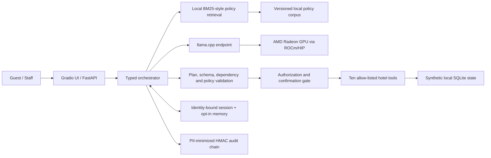
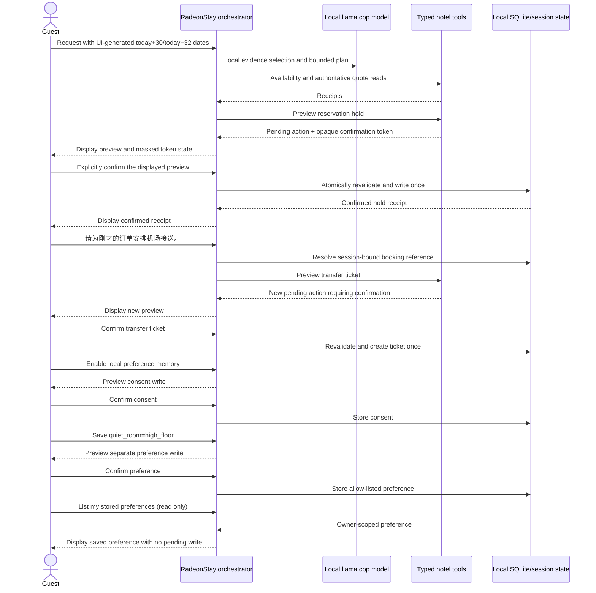

# RadeonStay Project Specification

## 1. Application scenario

RadeonStay is a local hotel guest-journey agent for guests and hotel staff who
need policy-grounded answers and safe operational actions without sending
private conversations or reservation data to a third-party model provider.

The primary journey combines late arrival, a child, an allergy, a quiet-room
request, airport transfer, room inventory, quoting, a reservation hold, and a
follow-up checkout change. This intentionally crosses knowledge, planning,
tools, memory, and permissions in a single inspectable flow.

The UI creates explicit ISO dates at page construction: check-in is local
`date.today() + 30 days` and checkout is local `date.today() + 32 days`.
There are no fixed 2030 defaults. After the confirmed hold, the demonstration
operator replaces the editable next-prompt suggestion with
`请为刚才的订单安排机场接送。` (“Arrange an airport transfer for the booking we
just made.”) without copying the booking ID into the prompt, so the follow-up
actually exercises identity-bound session reference resolution.

### 1.1 Agent architecture

### 1.2 Confirmation and multi-turn sequence

## 2. Product principles

1. **Local by construction:** core inference and data remain in the controlled
   Radeon/ROCm environment.
2. **Evidence before language:** policy statements require citations and hotel
   facts require tool receipts.
3. **The model proposes; the server disposes:** the LLM does not own prices,
   permissions, state transitions, or database access.
4. **Fail closed:** invalid plans, missing evidence, expired confirmation, and
   unauthorized reads/writes never produce a guessed action. Missing or twice-
   invalid planning information yields a safe terminal clarification with no
   hotel operation; forbidden or privacy-crossing requests are refused when
   necessary.
5. **Minimal retention:** session context is local; long-term preferences need
   explicit consent; audits avoid raw private values.

## 3. Agent capabilities

### 3.1 Local retrieval

Hotel policy Markdown files are indexed locally. Retrieval gathers up to five
ranked candidates and applies clause coverage so a compound request can surface
distinct topics. Every candidate preserves the document, heading, source path,
excerpt, and score. The local model may select only supplied citation IDs, and
the final response contains at most three selected citations. Candidate coverage
and final cited evidence are therefore reported separately. Final policy text is
rendered by the server from the matching excerpts; unconstrained model prose is
never treated as a fact.
For official evaluation, `data/policies/` must be a real directory inside the
project. Its path components, nested directories, and policy files cannot be
symbolic links, and every resolved corpus path must remain inside the project.

### 3.2 Typed tool calling

Tools publish a JSON-compatible schema and an effect classification. Read tools
may execute after authorization. Write tools return a preview and an opaque,
single-use, expiring confirmation token stored only as a hash in SQLite. The
confirmed server call atomically rechecks the user, session, tool, original
arguments, authoritative preview terms, expiry, operation key, and permission.
If inventory, price, or booking state changes, the old token fails closed and the
user must review a fresh preview.
Each chat call carries a client-generated request ID. Same-session retries replay
the cached response, while a stable actor/session/request/write-ordinal key keeps
confirmed domain writes idempotent across a lost response.

### 3.3 Multi-step planning

The local LLM returns an `AgentPlan` containing no more than eight steps with
unique IDs and backward-only dependencies. Pydantic validates the plan. Unknown
tools, future dependencies, and malformed arguments trigger one bounded semantic
repair attempt. If that second plan still fails validation, the server returns a
terminal `ask_user` clarification and invokes no hotel business tool; a refusal
is reserved for a request that is itself forbidden or has no independent safe
scope. Chat and confirmation execution is serialized per session so two browser
requests cannot reorder memory or confirm one action twice.

### 3.4 Local memory

Conversation state and reservation references are session-scoped. Long-term
preferences are stored only after an explicit opt-in action and can be listed or
deleted. Sensitive values are never copied into the audit message. Session
audit events form an HMAC-linked chain; the operational SQLite log remains a
separate, staff-only privacy-minimized trail.

### 3.5 Permissions and privacy

Guest, staff, and admin roles have different read/write permissions. Guests can
only access their own reservation and session. Consequential actions require
confirmation, are idempotent, and produce a receipt. Attempts to cross the
ownership boundary are refused without returning private data.

## 4. Model and local deployment

The competition path uses a `llama-server` binary built from llama.cpp with its
HIP backend enabled for the target AMD Radeon environment. The server exposes a
loopback OpenAI-compatible API consumed by a minimal `httpx` client with
environment proxy inheritance disabled. Public model hosts are rejected. Health
checks require the endpoint to advertise the configured alias, but that alias is
only a routing identifier and is not proof of model identity or GPU execution.

The configured alias `qwen3.6-35b-a3b-q6k` maps to the pinned target-validation
artifact described below. `--n-gpu-layers 999` requests maximum offload; native ROCm/HIP
initialization, a positive final offload count, and same-device active telemetry
remain the authoritative proof that an official inference run used Radeon.

| Release field | Recorded target-validation value | Evidence rule |
| --- | --- | --- |
| Python | `3.12.3` | Record the interpreter version with every official bundle |
| Model repository | `unsloth/Qwen3.6-35B-A3B-GGUF` | Fetch only the pinned revision below |
| Model revision | `a483e9e6cbd595906af30beda3187c2663a1118c` | Keep unchanged across baseline and optimized runs |
| Model artifact | `Qwen3.6-35B-A3B-UD-Q6_K.gguf` | SHA256 `4fe53b148b46f9b88830e2a3055c5b15c3a4d1e3ddc9a1384a108d8b9d59f043`; Apache-2.0 |
| llama.cpp | Commit `0b14b87d7c20cb753b94b96854dd7b45306fc696` | Binary SHA256 `926e2297d7144a59182ba9d37de877ec972a0cf8d1b697baa82277b3066c45c6` |
| ROCm / HIP | ROCm `7.2.1`; HIP `7.2.53211-e1a6bc5663` | Retain `rocminfo`, version, and initialization logs |
| Detected GPU | `AMD Radeon Graphics`; `gfx1100`; device ID `0x744b`; 96 CUs; `51522830336` VRAM bytes | Preserve the detected strings and values; do not infer a retail model name |
| Context | `16384` default | Use the same value in both comparison runs |
| Offload | `--n-gpu-layers 999` request | Prove positive final offload and active same-GPU telemetry |
| Flash attention | `auto`; controlled `off` baseline and `on` optimization run | Use only when the pinned binary exposes the flag; retain raw logs |
| Batch / micro-batch | `512` / `128` defaults | Change one measured variable at a time |
| Parallelism | One slot by default | Compare controlled 1/2/4 request workloads without changing the fixed suite |

The README reproduction procedure downloads the named GGUF through the pinned
revision URL and verifies it with GNU `sha256sum`. It checks out llama.cpp in a
detached state at the commit above and configures CMake with `GGML_HIP=ON` and
`AMDGPU_TARGETS=gfx1100`. Source revision and binary identity are separate: a
rebuild that does not match the recorded `llama-server` SHA256 must be treated as
a new binary and cannot reuse an existing binding manifest. The official bundle
also keeps the configure output and compiler/ROCm versions; checksum equality by
itself does not prove that inference executed on Radeon.

Baseline and optimized evidence use the same model file, llama-server binary,
source tree, workload, and detected target hardware. Third-party ownership and
licensing are recorded in `THIRD_PARTY_NOTICES.md`.

## 5. Radeon optimization methodology

The benchmark changes one variable at a time under the same model, prompt set,
generation limit, temperature, machine, and service build. It records TTFT,
when exposed by the pinned llama.cpp build, plus server timing fields,
HTTP-effective output throughput, end-to-end percentiles, VRAM, utilization and
task quality. A valid bundle must show native llama.cpp ROCm/HIP initialization,
non-zero model-layer offload, the exact endpoint and alias used by both evaluators,
and same-device non-zero GPU utilization plus VRAM use inside both the quality and
benchmark windows. The two windows need distinct active samples and a shared
physical GPU unique ID; baseline and optimized runs must retain identical common
active GPU indices and physical IDs. Missing TTFT is reported as unavailable
rather than inferred.

Planned comparisons:

1. thinking enabled versus disabled with all server settings fixed (A/B);
2. flash attention off versus on with thinking disabled (B/C);
3. batch and micro-batch sizing with the preceding settings fixed (C/D);
4. one versus four parallel slots while keeping the same request set (D/E).

Every A–E row is a fresh full target lifecycle with its own raw evidence. The
automation emits quality-gated formal A/B, B/C, C/D, and D/E comparisons so each
step changes only thinking, flash attention, batch sizing, or parallelism. A
rejected candidate keeps its raw bundle and cannot support an optimization claim.
The five-run stability proof is different: it repeats one accepted final row five
times without changing configuration.

Local RAG Top-K/schema ablations and a possible ROCm embedding path are exploratory
quality studies, not inputs to the official baseline/optimized comparator, because
that comparator requires the same commit, project tree, source hash, policy corpus,
model, binary, context, workload, hardware, and active physical GPU identity.

Different quantizations may be explored separately, but they are not accepted
as the evidence-controlled baseline/optimized comparison because the model-file
hash must match.

Optimization is accepted only if at least one material performance metric
improves while tool validity, citations, permission denials, and task success
remain above their release gates. Failed optimization attempts remain in the
evidence bundle.

## 6. Output and limitations

RadeonStay outputs an answer, citations, plan, tool receipts, pending-action
previews, confirmation results, and audit IDs. The included database is a
synthetic hotel sandbox. There is no payment, identity verification, emergency
dispatch, or real property-management integration. Production deployment would
require independent security, privacy, legal and operational review.
