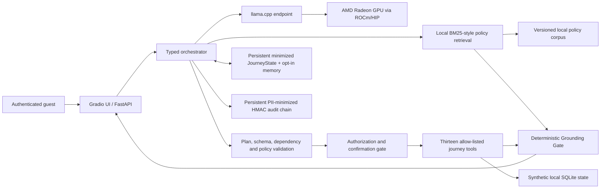
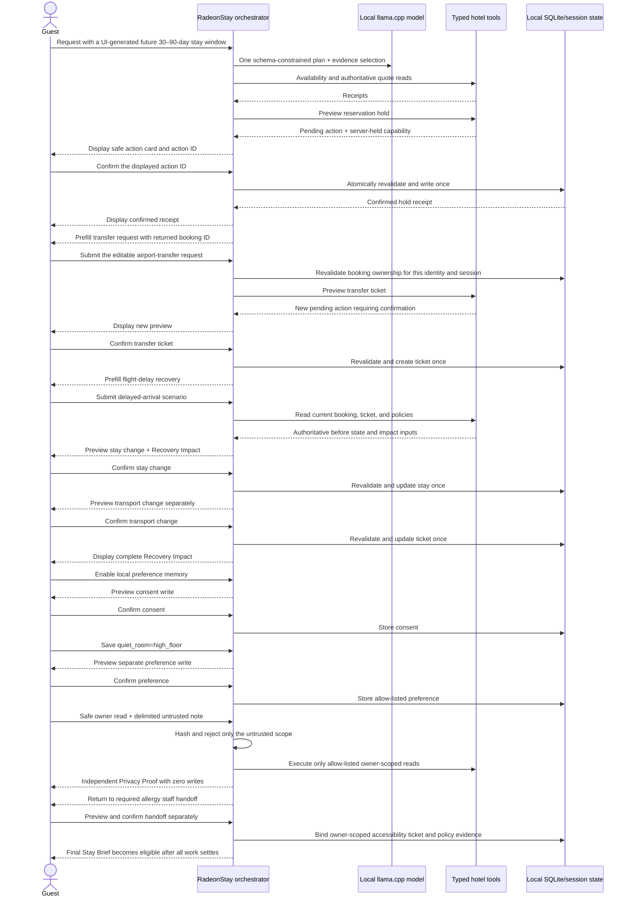

# RadeonStay Project Specification

> This Markdown file describes frozen C2 v3 and the released accepted B→C
> comparison. The final English deck, narrated demo video, and English subtitle
> sidecar are included in `docs/`; the historical project PDF remains excluded.

**RadeonHotel** is the competition-facing submission name. **RadeonStay** is
the repository, package, and runtime implementation name.

## 1. Application scenario

RadeonStay is a guest-facing local hotel journey agent for travelers who need
policy-grounded answers and safe operational actions without sending private
conversations or reservation data to a third-party model provider. Internal
staff/admin roles remain access-control fixtures and are excluded from the
public judge UI; they are not a second product workflow.

Two contextual main-flow shortcuts and one separate Advanced proof make the
product value and safety boundary inspectable: (1) **Plan&Hold** for cited
policy, inventory, authoritative quote, a reservation-hold preview,
confirmation, and a separately confirmed transfer; (2) **Delay Recovery ·
complete hold + transfer first** across the active reservation and transfer
ticket; and (3) **Injection & Access** under Advanced Proof, combining a
legitimate owner-scoped read with an untrusted guest note. Sensitive-storage
refusal remains an optional manual safety test. Privacy Boundary is an
independent security proof, not a business-completion prerequisite. Together
the journeys exercise
retrieval, planning, tools, state recovery, memory, permissions, and privacy
without granting the model direct database access.

The judge interface presents one five-stage rail derived only from the server's
existing Journey, action, and Trust projections:

```text
Plan & Quote → Room Hold → Transfer → Delay Recovery → Privacy & Safety
```

The five groups summarize a ten-step judge guide derived from the same server
projection; no parallel UI workflow is persisted. Consent, preference and
Privacy Proof are deliberately demonstrated before Step 10, while Privacy Proof
remains outside the backend business-completion gate. The first screen shows the rail,
editable request, authoritative result, current confirmation card, and exactly
one valid primary operation. A compact Radeon proof strip shows ROCm/gfx,
`41/41` offload, current process binding, accepted winner/gain, and short C2,
model, binary, and report hashes. Health, full Trust, Timeline, Stage Trace, and
safe JSON remain under Advanced Proof. Delay Recovery stays disabled until an
active booking and transfer ticket exist.

The UI creates explicit ISO dates for every new session: check-in is derived
from the session but always 30–90 days in the future, and checkout is two days
later; the request also names the default `standard` room type. There are no
fixed 2030 defaults. After the confirmed hold, the UI automatically
prefills an editable airport-transfer request with the returned synthetic booking
ID and pickup details. The identifier is evidence, not authorization: the server
still revalidates that the booking belongs to the active identity and session
before it can produce a separate transfer preview. Confirming the transfer
prefills Delay Recovery. Recovery completion exposes any required service
handoff. In the primary journey, the severe peanut allergy requires a separately
confirmed, policy-grounded staff handoff before business completion. Consented
memory and Privacy Boundary remain separate demonstrations and do not determine
Final Stay Brief eligibility.

### 1.1 Agent architecture



### 1.2 Confirmation and multi-turn sequence



## 2. Product principles

1. **Local by construction:** core inference and data remain in the controlled
   Radeon/ROCm environment.
2. **Evidence before language:** policy statements require citations and hotel
   facts require tool receipts.
3. **The model proposes; the server disposes:** the LLM does not own prices,
   permissions, state transitions, or database access.
4. **Fail closed:** invalid plans, missing evidence, expired confirmation, and
   unauthorized reads/writes never produce a guessed action. Missing or twice-
   invalid planning information yields a safe terminal clarification with no
   hotel operation; forbidden or privacy-crossing requests are refused when
   necessary.
5. **Minimal, recoverable retention:** raw chat is process-local and never
   persisted. A minimized identity-bound journey and audit chain survive restart;
   long-term preferences need explicit consent and audits avoid raw private values.

## 3. Agent capabilities

### 3.1 Local retrieval

Hotel policy Markdown files are indexed locally. Multilingual lexical retrieval
gathers up to five ranked candidates and applies clause coverage so a compound
request can surface distinct topics. Every candidate preserves a stable chunk ID,
corpus SHA, document, heading, source path, excerpt, score, and support relation.
The local Radeon model may select only supplied citation IDs in the constrained
planning response, and the final response contains at most three selected
citations. Candidate coverage and final cited evidence are therefore reported
separately. Final policy text is rendered by the server from matching excerpts;
unconstrained model prose is never treated as a fact.
For official evaluation, `data/policies/` must be a real directory inside the
project. Its path components, nested directories, and policy files cannot be
symbolic links, and every resolved corpus path must remain inside the project.

### 3.2 Typed tool calling

Tools publish a JSON-compatible schema and an effect classification. Read tools
may execute after authorization. Write tools return a preview and a single-use,
expiring capability kept only in server session state; only its hash is persisted.
The public pending-action contract and request replay cache contain no capability;
the UI receives a secret-free action card and submits its action ID. The confirmed
server call atomically rechecks the user, session, action ID, tool, original
arguments, authoritative preview terms, expiry, operation key, and permission.
Its public `PendingActionView` is limited to the action ID, plan-step ID, tool,
human-readable preview, recursively validated `preview_data`, and expiry. It does
not contain original arguments, confirmation or identity tokens, or private
`_binding_*` values. During the same app process, Resume may redisplay that safe
projection; Confirm is enabled only when the corresponding live server capability
still exists and the projection is complete and unexpired.
If inventory, price, booking, or journey state changes, the old action fails
closed and the user must request a fresh authoritative preview. A session exposes
at most one awaiting-confirmation write; later writes remain blocked until the
first is confirmed. Cancelling the prerequisite discards its dependent
continuation and requires replanning; it never promotes a second write.
Each chat call carries a client-generated request ID. Same-session retries replay
the cached response, while a stable actor/session/request/write-ordinal key keeps
confirmed domain writes idempotent across a lost response.

### 3.3 Multi-step planning

The local LLM produces a schema-constrained `PlanEnvelope`: no more than eight
steps with unique IDs and backward-only dependencies, selected citation IDs,
response language, missing fields, and one next action. Fusing evidence selection
removes the former second selector call. Pydantic and the server validate the tool
allow-list, argument types, dependencies, citation range, journey preconditions,
and write constraints. A syntax or semantic failure permits one bounded repair
with explicit error context. If the repaired output still fails, the server
returns a terminal `ask_user` clarification and invokes no hotel business tool;
model connection failure remains HTTP 503. Chat, cancellation, and confirmation
are serialized per session so two browser requests cannot reorder state or
confirm one action twice.

Booking resolution is a server-owned precondition rather than a model guess. If
the journey contains multiple candidate bookings and no active booking, the user
must name exactly one candidate booking ID or use one unambiguous ordinal. Any
other reference produces `ask_user`, and no booking-scoped tool is invoked.
The same provenance rule covers service tickets: booking and ticket identifiers
are accepted only when stated explicitly in the current request or projected from
the server-authored structured `JourneyState`; free-form conversation text and
model output are not identifier stores.

### 3.4 Grounded response rendering

The final response is first represented as internal structured claims. Every
price, date, booking or service-ticket ID, operational status, and policy
conclusion must reference an implemented source type: a stable citation chunk
ID, tool-receipt step ID, server-authored pending-action preview, or privacy-
control record. A deterministic renderer, not unconstrained model
prose, turns the verified claims into the guest-facing answer. `GroundingProof`
reports the claim count, unsupported count, stable source references, renderer,
and whether one deterministic rebuild was required.

Confirm, Cancel, Resume, and Stay Brief generation do not invoke the model.
Their operation-scoped Trust Card therefore reports Grounding as **not
applicable**, with zero inherited claims, while reporting only receipts actually
returned by that operation, the audit-chain result, Journey verification, and
elapsed time. Resume therefore reports zero tool receipts.

If the first verification fails, the server may rebuild once from the original
Citation and ToolReceipt objects without another model call. A second failure
returns a fixed unverifiable-summary response, immediately retires any newly
created confirmation capability, marks the action `needs_repreview`, records
`answer.grounding_failed`, marks Answer as failed and Complete as blocked,
records completion as denied, replaces the prior Authority Map with one
fail-closed control claim, and performs no business write.

#### 3.4.1 Outcome-oriented journey proof

The judge-facing result turns the verified claims into three business-level
projections without another model call:

- **Guest Needs Ledger** tracks room, late arrival, allergy, transfer, child
  seat, quiet-room preference, delay recovery, and owner-only privacy handling.
  Each state is backed by a Citation chunk, ToolReceipt, verified user fact, or
  deterministic control event. A successful read cannot falsely confirm a
  missing service ticket.
- **Claim Authority Map** displays the exact source reference and authority type
  for each rendered conclusion, result, confirmation, and policy claim.
- **Auditable Journey Outcome** counts authoritative reads, confirmed writes,
  active previews, cross-user results, and required human follow-ups.

Preview is deliberately not monotonic. Cancellation, expiry, confirmation
failure, Grounding Gate retirement, or restart removes the invalid preview source
and returns an unexecuted need to `requested` or `grounded`; a separately
confirmed earlier write is never rolled back. Delay recovery is `confirmed` only
after both the stay and transport changes are authoritative. A severe-allergy
need remains a human-safety boundary until a separately previewed and confirmed
staff handoff is recorded as an owner-scoped accessibility ticket. That handoff
binds the active booking, ticket status/update time/state SHA, current corpus,
and direct allergy-policy chunks; it records escalation while explicitly
retaining human follow-up responsibility.

The same Ledger and Outcome, per-Need source references, and a compact Authority
Map are rendered into the owner-scoped Final Stay Brief. Eligibility requires a
complete Recovery, every required Service Handoff, and no pending, deferred, or
Repreview work. Privacy Proof is deliberately independent and is not consulted
by this business gate. Brief generation re-reads an owner-scoped snapshot and
requires exact equality between authoritative and confirmed recovery check-in,
check-out, and total, plus an active non-expired booking. It also requires one
matching active `transport` ticket and every required handoff ticket with exact
confirmed status, `updated_at`, and privacy-safe state SHA values. Persisted
policy chunk IDs are re-resolved against the current corpus SHA and must cover
stay change/late arrival, transport, and each required handoff topic. A cancelled
or expired booking blocks the downloadable Final Brief, clears stale business
completion, and returns to availability, price, and a new Hold.
Date/total drift returns to a fresh Modify preview. Transport-only drift keeps
the confirmed stay but blocks the downloadable Final Brief and requires a new
transport preview. Multiple active transport tickets require an explicit current-message
ID or unambiguous ordinal; the model may not silently choose the first row.

### 3.5 Local memory

Raw conversation text is never persisted. A versioned `JourneyState` retains only
the task phase, active/candidate bookings, verified facts, missing fields,
completed steps, pending-action metadata, next action, and state version. It is
updated only from validated user input, tool receipts, and confirmation receipts;
model output is a proposal. On restart, an unfinished write becomes
`needs_repreview`; a capability-free step/tool descriptor survives so the UI can
name the action to rebuild, but no old arguments, authoritative terms, or
capability are restored. The recovery appends
`confirmation.retired` and `session.recovered` control events to the restored
HMAC chain, preserving an inspectable record that no write ran. Long-term
preferences are stored only after explicit opt-in and can be listed or deleted.
The restart path clears the authoritative pending preview and reconstructs only a
non-confirmable Repreview card from the minimized descriptor. Missing, incomplete,
or expired projections direct the guest to generate a new authoritative preview.
Persistent session audit events form an HMAC-linked chain. SQLite schema v7 binds
that history to a domain-separated, non-secret HMAC key fingerprint, authenticates
each row, and covers every per-session count/tail head with a global catalog HMAC.
It also authenticates the owner, version, canonical JSON, and update time of each
minimized Journey snapshot.
Every chain is verified from genesis before readiness or recovery; a mismatched key,
moved row, truncated tail, or deleted chain fails closed. The operational SQLite log
remains a separate, staff-only privacy-minimized trail.

A non-empty schema v3-v5 database is **trust-on-first-migration**. The legacy
schemas did not authenticate every row identity and/or the complete tail set, so
an upgrade cannot retrospectively prove that a cross-session move, tail deletion,
or whole-chain deletion did not occur before v6 created its row and catalog anchors.
Production migration therefore requires prior verification against a trusted
read-only backup or an operator-controlled external manifest. Formal competition
evidence uses only a newly created, isolated v7 database and does not migrate legacy
audit history.

This is database-internal tamper evidence, not external notarization. Even after
v7 is established, detecting rollback or replacement of the entire SQLite file
requires an operator-controlled backup digest, TPM-backed anchor, or equivalent
external control.

Identity-bound session GET never creates an arbitrary session: it returns HTTP
404 when no live session, durable JourneyState, or authorized persisted audit
chain exists, and HTTP 403 when the session belongs to another identity. A legacy
session that retains only a verified audit chain may recover a minimal empty
JourneyView and that chain; raw chat and operational IDs are not rebuilt.

**Clear / New Session** first uses the current identity to revoke live
confirmation capabilities and clear turns, pending records, replay cache, action
cards, and `JourneyState` on the server; only then does the UI create a new
session and clear its input and evidence panels. Identity binding is enforced on
reset: a different identity cannot erase or mutate the previous owner's session.

### 3.6 Permissions and privacy

Guest, staff, and admin roles have different read/write permissions. Guests can
only access their own reservation and session. Consequential actions require
confirmation, are idempotent, and produce a receipt. Attempts to cross the
ownership boundary are refused without returning private data.

Every write preview is also bound to a server-only fingerprint of the relevant
authoritative booking, service-ticket, consent, or preference state. The
fingerprint is recomputed atomically at confirmation and is recursively removed
from public previews, receipts, the UI, exports, and logs. Any drift retires the
old capability and changes the action to `needs_repreview` without a domain write.
During Repreview, the shared journey precondition gate permits at most one write
and requires its tool to match the persisted stale/deferred action; natural-language
edits cannot switch the request into another write capability.

Mixed-scope privacy requests use an explicit
`[UNTRUSTED_GUEST_NOTE]...[/UNTRUSTED_GUEST_NOTE]` boundary. Before retrieval or
model use, the server deterministically validates the boundary, extracts only the
safe outer request, and never retains the isolated note body. Its audit event
contains a SHA256 digest, attack category, and limited status metadata describing
the partition result. Missing, nested, or unclosed boundaries fail closed. An empty
safe scope is fully refused; a safe scope containing a write asks the guest to
remove the note and resubmit. Otherwise the unsafe scope is refused while the
legitimate read completes. `security.scope_partitioned` enters the minimized
audit chain. `PrivacyProof` reports model invocation, read and write counts,
`owner_scoped_result_count`, `cross_user_result_count`, `scope_verified`, identity
scope, secret retention, and chain status. The zero cross-user result is derived
from typed owner-scoped/public-safe read receipts and their bounded result counts,
not assigned as a constant. A minimal successful proof is persisted in
`JourneyView.known_facts` so Resume can display the same authoritative security
claim. Privacy Proof neither grants nor revokes Final Stay Brief eligibility; a
direct API brief generated before business completion is still labelled
**Provisional**. An older Journey snapshot may load with compatibility defaults,
but absent `scope_verified=true` requires a fresh proof before making a new
privacy claim. The Privacy Need becomes `confirmed` only when unsafe scope refusal, a completed
owner-scoped read, zero business writes, zero cross-user results, no retained
secret, and a valid audit chain are all simultaneously verified. The
`local-hotel-store` attestation count is recomputed from the returned safe shape.

## 4. Model and local deployment

The competition path uses a `llama-server` binary built from llama.cpp with its
HIP backend enabled for the target AMD Radeon environment. The server exposes a
loopback OpenAI-compatible API consumed by a minimal `httpx` client with
environment proxy inheritance disabled. Public model hosts are rejected. Health
checks require the endpoint to advertise the configured alias, but that alias is
only a routing identifier and is not proof of model identity or GPU execution.

The configured alias `qwen3.6-35b-a3b-q6k` maps to the pinned target-validation
artifact described below. `--n-gpu-layers 999` requests maximum offload; native ROCm/HIP
initialization, a positive final offload count, and same-device active telemetry
remain the authoritative proof that an official inference run used Radeon.

| Release field | Recorded target-validation value | Evidence rule |
| --- | --- | --- |
| Python | `3.12.3` | Record the interpreter version with every official bundle |
| Model repository | `unsloth/Qwen3.6-35B-A3B-GGUF` | Fetch only the pinned revision below |
| Model revision | `a483e9e6cbd595906af30beda3187c2663a1118c` | Keep unchanged across baseline and optimized runs |
| Model artifact | `Qwen3.6-35B-A3B-UD-Q6_K.gguf` | SHA256 `4fe53b148b46f9b88830e2a3055c5b15c3a4d1e3ddc9a1384a108d8b9d59f043`; Apache-2.0 |
| llama.cpp | Commit `0b14b87d7c20cb753b94b96854dd7b45306fc696` | Binary SHA256 `926e2297d7144a59182ba9d37de877ec972a0cf8d1b697baa82277b3066c45c6` |
| ROCm / HIP | ROCm `7.2.1`; HIP `7.2.53211-e1a6bc5663` | Retain `rocminfo`, version, and initialization logs |
| Detected GPU | `AMD Radeon Graphics`; `gfx1100`; device ID `0x744b`; 96 CUs; `51522830336` VRAM bytes | Preserve the detected strings and values; do not infer a retail model name |
| Context | `16384` | Same value in B and C |
| Offload | `--n-gpu-layers 999` request | Prove positive final offload and active same-GPU telemetry |
| Flash attention | B `off`; released C `on` | The only changed B→C variable; retain raw logs |
| Batch / micro-batch | `256` / `64` | Same value in B and C |
| Parallelism | `1` model slot; measured request concurrency `1` and `4` | Same service configuration in B and C |
| KV cache | `f16` / `f16` | Same value in B and C |
| Thinking | `off` | Same value in B and C |
| Fused planning/evidence | `off` | Same value in B and C |

The README reproduction procedure downloads the named GGUF through the pinned
revision URL and verifies it with GNU `sha256sum`. It checks out llama.cpp in a
detached state at the commit above and configures CMake with `GGML_HIP=ON` and
`AMDGPU_TARGETS=gfx1100`. Source revision and binary identity are separate: a
rebuild that does not match the recorded `llama-server` SHA256 must be treated as
a new binary and cannot reuse an existing binding manifest. The official bundle
also keeps the configure output and compiler/ROCm versions; checksum equality by
itself does not prove that inference executed on Radeon.

Baseline and optimized evidence use the same model file, llama-server binary,
source tree, workload, and detected target hardware. Third-party ownership and
licensing are recorded in `THIRD_PARTY_NOTICES.md`.

An isolated deployed App additionally binds the configured endpoint to one live
`llama-server` process. `serve_model.sh` creates a new mode-`0600` instance
manifest inside a mode-`0700` directory identified by
`RADEONSTAY_RUNTIME_INSTANCE_PATH`. It records the `deployment_run_id`, PID, Linux start
ticks, executable and command-configuration SHA256 values, port, model alias,
and model SHA256. The app opens this manifest without following symlinks and
verifies the recorded PID/start ticks, executable and command configuration,
endpoint, alias, `--model` argument, ownership of the declared loopback `LISTEN`
socket, manifest model identity, and runtime-proof identity before and after every
inference. A mismatch in one of those checked
fields returns HTTP 503; the competition path never substitutes a deterministic
planner. This request-time binding compares the model identity recorded in the
private manifests; it does not re-hash the GGUF file on every request. Formal
artifact acquisition and evidence binding perform the full model-file SHA256
verification. Browser-visible proof contains only `process_binding_valid` and
the opaque manifest SHA256.

## 5. Radeon optimization methodology

The benchmark changes one variable at a time under the same model, prompt set,
generation limit, temperature, machine, and service build. It records TTFT,
when exposed by the pinned llama.cpp build, plus server timing fields,
HTTP-effective output throughput, end-to-end percentiles, VRAM, utilization and
task quality. A valid bundle must show native llama.cpp ROCm/HIP initialization,
non-zero model-layer offload, the exact endpoint and alias used by both evaluators,
and same-device non-zero GPU utilization plus VRAM use inside both the quality and
benchmark windows. The two windows need distinct active samples and a shared
physical GPU unique ID; baseline and optimized runs must retain identical common
active GPU indices and physical IDs. Missing TTFT is reported as unavailable
rather than inferred.

### Released minimal B→C comparison

The submission release uses the completed B→C comparison only. Both fresh
lifecycles use C2 v3, the same model, binary, corpus, 16-case workload, context,
batch, parallelism, KV cache, and physical GPU. B disables Flash Attention and C
enables it. Both complete 16/16 requests with zero model-call failures and the
same disclosed 15/16 citation-section projection. The comparator accepts C on
measured performance; this release does not claim 300/300, the full A–H matrix,
five-run Stability, a long soak, or `accepted_final`.

### Post-submission full protocol — not claimed for this release

The controlled A–H sequence changes exactly one declared variable group per row:

| Run | Only change from the preceding run |
| --- | --- |
| A | Initial quality candidate: thinking on, flash attention off, batch/ubatch 256/64, parallel 1, separate planning/evidence; Reference only if quality-qualified |
| B | Disable thinking |
| C | Enable flash attention |
| D | Set batch/ubatch to 512/128 |
| E | Fuse planning and citation selection and compress the prompt |
| F | Select the smallest context with 25% headroom over the largest request |
| G | Set parallel slots to 4 |
| H | Evaluate Q8 KV cache in isolation; reject and restore G if gates fail |

Every A–H row is a fresh target lifecycle with its own raw evidence. Automation
emits quality-gated adjacent comparisons and rejects configuration drift outside
the declared variable. A is the Reference when it scores 300/300. If A fails
quality, it is retained only as a bound negative package; B must pass the full
quality, stress, Radeon, and lifecycle gates and becomes the Reference, so formal
performance comparisons start at B/C. A rejected candidate cannot support an
optimization claim. The five-run stability proof is different: it repeats one
accepted final row five times without changing configuration, followed by a
long-running stability check.

Each C3 bundle contains a separate `stress.json` in addition to retrieval,
official quality, and benchmark results. Run E also binds
`context-selection.json`, while run F binds `context-proof.json`; exactly the
artifact applicable to that row is copied into the bundle. Its filename and
SHA256 are recorded in `binding-manifest.txt`, and both it and `stress.json` are
covered by `SHA256SUMS.txt`. The context artifact binds the source quality and
benchmark hashes, is independently recomputed, and the E/F comparator requires
F's selected minimum-safe context to equal E's hash-bound selection. These are
evidence requirements, not claims that a final target run has passed.

Local RAG Top-K/schema ablations and a possible ROCm embedding path are exploratory
quality studies, not inputs to the official baseline/optimized comparator, because
that comparator requires the same commit, project tree, source hash, policy corpus,
model, binary, context, workload, hardware, and active physical GPU identity.

Q5/Q4 model quantizations may be explored separately against the pinned Q6_K
quality reference. A smaller model can replace Q6_K only if every quality gate
passes and either P95 improves by at least 10% or concurrent throughput improves
by at least 15%. It cannot be mixed into the same-hash A–H comparison.

Promotion under this future full protocol requires the fixed 30-case suite to
score 300/300; permission, confirmation, citation, and state-order gates to be
100%; at least one core metric to improve by 5% or more; no core metric to
regress by 5% or more; peak VRAM to remain below 90% of available memory; and no
OOM or crash. Among accepted configurations, concurrent throughput wins only
when single-request P95 is within 5% of the best-latency configuration. P50,
VRAM, and energy per successful task break later ties. Failed attempts remain
in the evidence bundle. These are future promotion gates, not the claim boundary
of the released minimal B→C comparison above.

## 6. Output and limitations

RadeonStay outputs an answer, stable citations, safe journey/action views, a task
timeline, an Operation Trust Card, tool receipts, confirmation results, stage timing,
and audit-chain status. Advanced Proof contains the validated plan and raw safe
receipts; confirmation capabilities are recursively removed from API, UI, export,
and logs. An identity-bound local HTML Stay Brief contains no identity token,
capability, complete audit ID, or internal path.

The UI obtains a lock-consistent owner-scoped projection from
`GET /v1/sessions/{session_id}/projection` after Resume, Confirm/Cancel, and Stay
Brief. State-aware controls disable invalid actions, and deterministic follow-ups
publish their own real tool/total timing with `model_invoked=false` instead of
reusing a prior model request's timing.

The process exposes separate liveness and fail-closed readiness checks. A
configured runtime-proof manifest must bind ROCm, GPU architecture, full model
offload at exactly `41/41`, pinned model/binary hashes, and active telemetry;
without a configured
proof path, development remains available but the Trust Card labels Radeon proof
as unbound. Runtime identity is split deliberately. The immutable accepted
proof's `run_id` is `evidence_run_id` and must match
`RADEONSTAY_EVIDENCE_RUN_ID`. A fresh `deployment_run_id`, exposed to the app as
`RADEONSTAY_DEMO_RUN_ID`, binds the release directory, isolated database
filename, and live runtime-instance manifest. A new deployment must use a new ID
and database; it never overwrites or imports an earlier deployment's state.

Within the same deployment, an App-process restart may reopen its exact
run-bound database only after the directory and every SQLite artifact pass
current-owner, `0700`/`0600`, regular-file, non-symlink, and unchanged-path
checks. SQLite schema, audit-key fingerprint, Journey HMAC, and persistent audit
chain are then validated before readiness. Confirmed state and the minimized
Journey can recover; every old unconfirmed capability is retired and requires a
new authoritative Repreview. The separate runtime-instance manifest must still
validate the same live model process. Either missing or stale proof or process
binding fails readiness. An accepted release proof also carries the C2 commit,
selected experiment label, accepted report SHA256, winning core metric, and its
measured improvement. The current minimal release selects C from B→C; an A–H
winner label is required only after the full post-submission matrix. Runtime
directories are mode `0700`; the instance manifest, database, WAL/SHM sidecars,
`.env`, and generated briefs are mode `0600`.
Immutable security/proof failures keep isolated operations disabled. Model health
is deliberately dynamic: a transient not-ready state returns 503, then recovers
without an App restart once the same process-bound endpoint becomes healthy.

`RecoveryImpactView` makes disruption recovery inspectable without retaining
chat: it shows old/new dates, authoritative stay totals and delta, old/new ticket
status, stable policy chunk IDs, external transport price as `not quoted`, and
one of `previewed`, `stay_confirmed`, `transport_pending`, `complete`,
`needs_repreview`, or `cancelled`. Confirmed portions survive a later cancellation
or drift; only unresolved work becomes Repreview. Recovery accepts only direct
corpus-bound chunks whose text semantically supports delay recovery or transfer;
an unrelated direct citation cannot populate Recovery policy evidence. A completed
Recovery is updated only by a pending action explicitly classified server-side as
part of that Recovery; an unrelated update to the same transport ticket cannot
silently re-certify it. Policy-only drift exposes a read-only refresh action. It
must retrieve both current policy topics and re-read owner-scoped booking and ticket
state; only exact date, total, status, update-time, and ticket-state-hash equality
restores `complete`, with zero business writes. The Final Stay Brief includes a
guest-safe Verification Basis containing booking status, guests, total/currency,
transport and required-handoff ticket status/update time/short state hashes, an
owner-scope attestation, and current policy-corpus coverage. The
UI labels this operation **Refresh policy evidence**, not a write preview. If the
model proposes a write, extra tool, duplicate read, or incomplete refresh plan, the
server replaces it with exactly `respond_with_policy` → `hotel.my_bookings` →
`hotel.list_service_tickets`; the constrained model call remains traceable, but no
confirmation capability can be created by this control path.

The included database is a synthetic hotel sandbox. There is no payment, identity
verification, emergency dispatch, arbitrary network, shell, SQL, or real
property-management integration. Production deployment would require independent
security, privacy, legal, and operational review.
