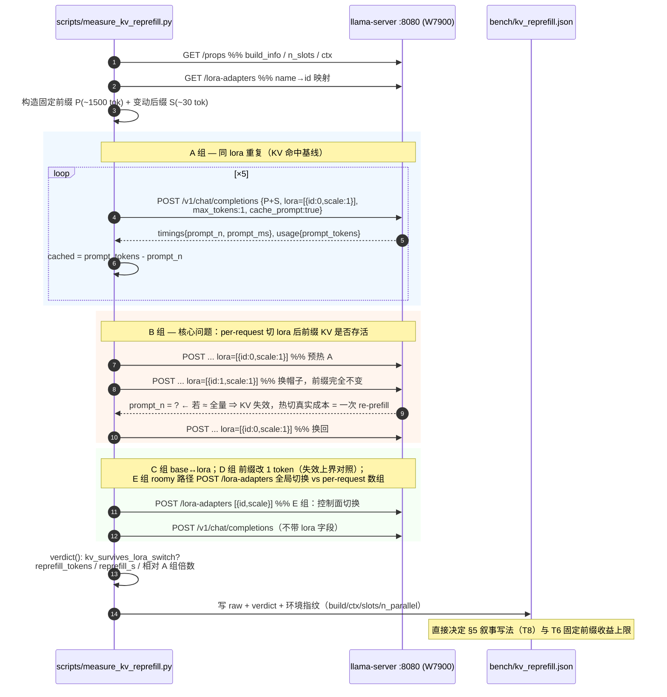
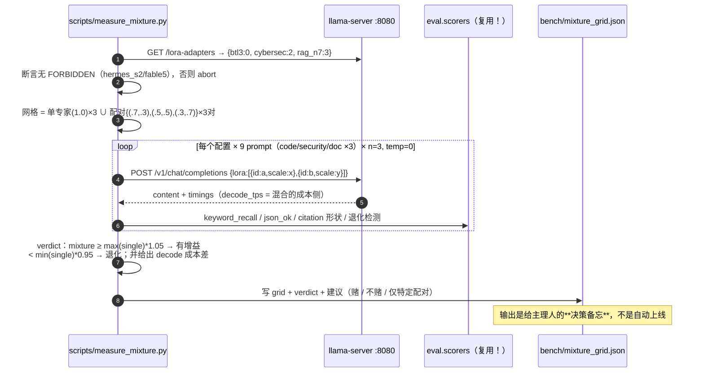
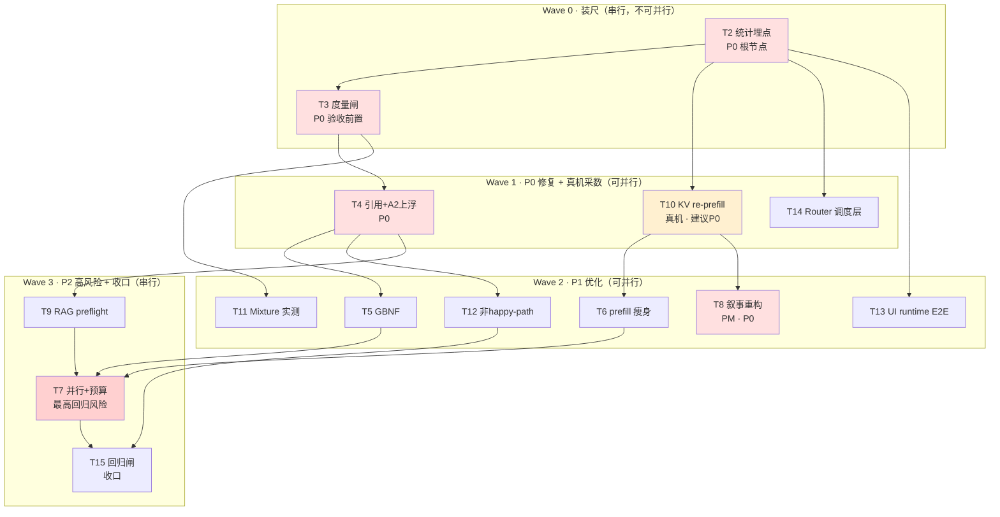

# ScrewShell 端到端优化 —— 架构蓝图（文件级 / 可直接落地）

> **作者**：高见远（首席架构师，team `software-e2e-opt`）
> **日期**：2026-08-02
> **依据**：`docs/E2E_OPTIMIZATION.md`（策略书）+ `docs/TRUTH.md`（唯一信源）+ 代码实读（`screwshell/` 全量 3528 行）
> **地位**：本文是**工程蓝图**，不是信源。技术事实以 `docs/TRUTH.md` 与 `screwshell/` 代码为准。
> **约束**：本文只做设计，不含实现代码；工程师按 §5 任务表逐档执行。

---

## 0. 一页总览

| 维度 | 结论 |
|---|---|
| 技术栈 | **不动**。纯 Python 3.10+ / stdlib / 既有 llama.cpp HTTP 契约。**零新增硬依赖** |
| 侵入 `orchestrator.py` 的任务 | 仅 4 项：T2 埋点、T4 引用+错误上浮、T6 prefill、T7 预算/并行。其余全部独立成模块 |
| 新增模块数 | 8 个源码模块 + 1 个新包（`screwshell/eval/`）+ 4 个脚本 + 5 个测试文件 |
| 行为契约红线 | `RunResult.stats` 既有 5 键只增不改；`GenStats` 新字段一律带默认值；`SkillRouter.route()` 签名不变；串行路径字节级保持 |
| 验收基线 | `pytest tests/ -q` ≥ **133 passed / 1 skipped / 1 failed**；`python scripts/verify_bugfixes.py` EXIT=0。每个任务收尾都必须过 |
| 最高杠杆顺序 | **T2 埋点 → T3 度量闸 → T4 P0 → 其余**。没有尺，任何"优化生效"都不可辩护（§12.2 原话） |

**一句话架构判断**：这不是"加功能"，是**给一条已跑通但不可观测的链路装上仪表盘和安全带**。因此埋点（T2）与度量闸（T3）必须先行，其余全部是它们的下游。

---

## 1. 实现方案与框架选型

### 1.1 核心技术挑战（真实代码级）

| # | 挑战 | 代码证据 | 应对 |
|---|---|---|---|
| C1 | **不可观测**：一次 4 步调查 ≈ 17 次串行 LLM 调用，但 `RunResult.stats`（`orchestrator.py` L525-531）只有 5 个键，无 prompt/prefill/decode 分解 | L525-531 | `GenStats` 扩字段 + 新模块 `core/metrics.py` 聚合 |
| C2 | **引用恒空**：`EvidenceCard(claim=..., citations=[], confidence=0.75)`（L509-510）是死代码，最终答案的行级引用 100% 压在一次 LLM 自觉上 | L509-510 | 新模块 `core/citations.py` + 回填 step 工具引用 |
| C3 | **错误静默吞没**：`MoLLlamaCpp.chat` 失败返回 `("", GenStats(0,0))`（`mol_engine_llamacpp.py` L216-220）→ `_extract_json`→None→浪费 action→`step failed` 不上浮→**产出伪答案** | L216-220 + `orchestrator.py` L482-485, L511 | `GenStats.ok/error` + `EngineCallError` + `RunResult.status/degradations` |
| C4 | **prefill 隐性大头**：每次 ReAct 重发 `json.dumps(self.toolkit.spec(), indent=1)`（L478）全量 6 工具 + 3×1800 字符 observations（L480），无 token 预算 | L475-481 | 新模块 `core/prompting.py`：按 skill 裁剪 + 压缩 + 预算 + 固定前缀 |
| C5 | **KV 前缀被滑窗打碎**：`_llm` 用 `memory.history(limit=8)`（L395）是**滑动窗口**——第 9 轮起前缀每轮变化，llama.cpp slot KV 复用必然失效 | L395 | 稳定窗口（锚定式）+ 工具规格上提到 system |
| C6 | **调用预算移植错误**：`for _ in range(self.max_actions)` 默认 5（L141/L475），本地每次 30-45s | L141, L475 | 降默认 + planner 直出首工具调用 + I/O 型工具并行 |
| C7 | **格式脆弱**：`_extract_json` 靠正则+三次修复兜底小模型 JSON 翻车 | L121-133 | llama.cpp `response_format: json_schema` 服务端约束 |
| C8 | **能力探测缺失**：`response_format` / `timings` / `cache_prompt` 三个字段能否用，取决于真机 llama.cpp 构建版本；不探测就上，最坏是 400 把 chat 打挂 | — | `MoLLlamaCpp.capabilities()` 一次性探测 + 优雅降级 |

### 1.2 选型：不引入任何框架

| 候选 | 判断 |
|---|---|
| LangChain / LlamaIndex 编排 | **拒绝**。TRUTH §1.3 明写"agent 编排为自研 ReAct 循环（MoL Router 即编排核心）"，是参赛叙事根基，换框架等于自毁卖点 |
| `jsonschema` 做本地 schema 校验 | **拒绝**。schema 由 llama.cpp 服务端强制；本地只需 30 行 `_validate_shape()` 做 enum/必填校验，不值一个依赖 |
| `pydantic` 做数据契约 | **拒绝**。既有全部用 `@dataclass`，混用两套契约是纯负债 |
| `pytest-benchmark` / `pytest-timeout` | **可选，不强制**。度量闸自己记时间；超时用 `signal`/线程 join |
| `gradio_client`（T13 UI E2E） | **已是 `gradio` 的传递依赖**，白嫖；仍需 `try/except ImportError` 降级 |
| `numpy` | 已在 `requirements.txt`，仅 `rag/pipeline.py` 用。**新模块一律禁止 import numpy/torch/gradio** |

### 1.3 模块化原则：三个"独立模块"与四处"侵入"

```
┌─ 独立新模块（零侵入，可单独单测、可单独回滚）────────────────────┐
│  core/citations.py    引用校验器（T4 的一半）                    │
│  core/metrics.py      度量采集器（T2 的一半）                    │
│  core/prompting.py    prefill 瘦身工具箱（T6 的一半）            │
│  core/schemas.py      JSON Schema 定义（T5 的一半）              │
│  core/preflight.py    RAG 前置（T9 的一半）                      │
│  core/config.py       全局 feature flag（所有任务共用）           │
│  core/errors.py       异常契约（T4）                             │
│  safety/sanitize.py   检索内容中和（T12 轴1）                    │
│  eval/                度量闸整包（T3/T12/T15）                   │
└──────────────────────────────────────────────────────────────┘
┌─ 必须侵入（按顺序改，每次改完跑全套测试）──────────────────────┐
│  core/mol_types.py            GenStats 扩字段            (T2)   │
│  core/mol_engine_llamacpp.py  chat 扩参 + timings + 探测  (T2/T5/T13) │
│  core/mol_engine.py           chat 同步扩参（签名一致性！）(T2)  │
│  core/orchestrator.py         run/_llm/step 循环          (T2/T4/T6/T7/T9) │
│  core/router.py               缓存/延迟/恢复（向后兼容）  (T14)  │
└──────────────────────────────────────────────────────────────┘
```

**架构决策记录（ADR）**

- **ADR-1：`orchestrator.py` 只做编排，不做算法。** 引用校验、prompt 装配、度量聚合、schema 定义全部外置。`orchestrator.py` 只增"调用一行 + 存结果一行"。理由：该文件已 540 行且承载 12 个咬死行为的测试，是全仓最高回归风险面。
- **ADR-2：一切优化都必须可关。** 每项优化配一个 `core/config.py` 开关，默认值集中管理。**没有开关就无法做 A/B，没有 A/B 就无法量化贡献，度量闸（T3）就退化成一个跑分脚本。** 这是 T3 能否成立的前置条件。
- **ADR-3：只增不改公共契约。** `RunResult.stats` 的 `seconds/l3_mode/engine/switches/switch_kind/fast_path` 六键是测试契约（`test_switch_log_is_per_query_not_cumulative`、`test_fast_path_*` 共 5 处断言），新数据一律放新键。
- **ADR-4：mock engine 提升为一等产物。** `screwshell/eval/fakes.py` 里的 `ScriptedEngine/FaultyEngine/TimedEngine` 同时服务单测、度量闸自检、CI 闸。度量闸**必须能在无 GPU 的本地跑通全流程**，否则它自己就不可回归。
- **ADR-5：真机能力先探测后使用。** 任何依赖 llama.cpp 服务端新特性（json_schema / timings / cache_prompt / stream）的代码路径，都必须先过 `capabilities()`，不支持则降级 + 一次性 WARN + 在报告里标 `coverage`。**绝不伪造数字**（缺 timings 就填 `None`，不用 wall time 冒充 prefill）。

---

## 2. 文件清单（相对 `D:\AI\git\screwshell`）

### 2.1 新建 —— 源码

| 路径 | 职责 | 归属任务 | 约行数 |
|---|---|---|---|
| `screwshell/core/config.py` | `E2EConfig` 全局开关（env + 构造双通道） | T2（先建，全员共用） | ~60 |
| `screwshell/core/errors.py` | `ScrewShellError` / `EngineCallError` / `StepFailure` | T4 | ~25 |
| `screwshell/core/metrics.py` | `CallRecord` / `RunMetrics`（每 query 一实例） | T2 | ~180 |
| `screwshell/core/citations.py` | `Citation` / `CitationIssue` / `CitationValidator` / `validate_citations()` / `merge_citations()` / `normalize_source()` | T4 | ~220 |
| `screwshell/core/schemas.py` | `PLAN_SCHEMA` / `react_schema()` / `validate_shape()` | T5 | ~120 |
| `screwshell/core/prompting.py` | `prune_tools` / `render_tools` / `compress_observations` / `estimate_tokens` / `PromptBudget` / `fit` / `build_messages` | T6 | ~200 |
| `screwshell/core/preflight.py` | `PreflightResult` / `rag_preflight()` | T9 | ~90 |
| `screwshell/safety/sanitize.py` | `neutralize_retrieved()` / `INJECTION_PATTERNS` | T12 | ~70 |
| `screwshell/eval/__init__.py` | 空 | T3 | 0 |
| `screwshell/eval/types.py` | `EvalCase` / `CaseResult` / `EvalReport` / `Scorer` Protocol | T3 | ~140 |
| `screwshell/eval/scorers.py` | 7 个纯函数打分器 | T3 | ~180 |
| `screwshell/eval/harness.py` | `run_eval()` | T3 | ~200 |
| `screwshell/eval/report.py` | `to_json` / `to_markdown` / `compare()` | T3 | ~150 |
| `screwshell/eval/thresholds.py` | 闸门阈值单一来源 | T3（T15 复用） | ~30 |
| `screwshell/eval/fakes.py` | `ScriptedEngine` / `FaultyEngine` / `TimedEngine` / `FakeRouter` / `FakeToolkit` | T3（全员复用） | ~220 |
| `screwshell/eval/cases/core_10.json` | 10 条核心黄金集 | T3 | 数据 |
| `screwshell/eval/cases/adversarial_5.json` | 5 条非 happy-path（投毒/注入/越权/失败/跨会话） | T12 | 数据 |

### 2.2 新建 —— 脚本 / 基准

| 路径 | 职责 | 归属 | 运行环境 |
|---|---|---|---|
| `bench/eval_e2e.py` | 度量闸 CLI 入口，产出 `bench/eval/<ts>.json` + `.md` | T3 | 本地(mock) / 真机 |
| `bench/eval/baseline.json` | 提交的基线报告（回归闸对比基准） | T15 | 产物 |
| `bench/eval/thresholds.json` | 阈值覆盖（可选，覆盖 `eval/thresholds.py`） | T3 | 数据 |
| `scripts/eval_gate.py` | 回归闸：current vs baseline，退化即 EXIT=1 | T15 | CI/本地 |
| `scripts/measure_kv_reprefill.py` | §4 KV 失效实测（纯 stdlib HTTP） | T10 | **W7900 真机** |
| `scripts/measure_mixture.py` | §3.2 Mixture 混合行为实测 + 裁决 | T11 | **W7900 真机** |
| `scripts/ui_runtime_e2e.py` | §12② gradio :7860 流式 / TTFT / 边缘延迟 | T13 | 真机 + 隧道 |
| `bench/kv_reprefill.json` | T10 原始数据 | T10 | 产物 |
| `bench/mixture_grid.json` | T11 原始数据 | T11 | 产物 |
| `bench/ui_runtime.json` | T13 原始数据 | T13 | 产物 |

### 2.3 新建 —— 测试（全部无 GPU 可跑）

| 路径 | 覆盖 |
|---|---|
| `tests/test_metrics.py` | `GenStats` 新字段默认值 / `RunMetrics.summary()` 分相/分适配器聚合 / timings 缺失时 coverage<1 且不伪造 |
| `tests/test_citations.py` | 正则抽取（含中文路径、Windows `\`）/ 三层校验 / 三种 mode / `merge_citations` 去重合并 / 幻觉引用被标注 |
| `tests/test_orchestrator_e2e_opt.py` | A2 上浮（chat 失败→status=failed，不产伪答案）/ 引用回填非空 / 预算生效 / 并行工具顺序确定 / preflight 事件 |
| `tests/test_prompting.py` | 按 skill 裁剪 / observations 压缩 / token 预算裁剪优先级 / 固定前缀不变性 |
| `tests/test_eval_harness.py` | 用 `ScriptedEngine` 跑 3 条 case 端到端产出 `EvalReport`；`compare()` 能识别退化 |
| `tests/test_router_sched.py` | 路由缓存命中/失效（skill_map 被改后必须失效）/ 决策延迟埋点 / `recover()` 四条策略 |
| `tests/test_safety_nonhappy.py` | 注入中和 / `.env` 拒绝 / 跨会话记忆 / 故障注入降级可见 |

### 2.4 修改 —— 源码

| 路径 | 改动 | 任务 | 风险 |
|---|---|---|---|
| `screwshell/core/mol_types.py` | `GenStats` 追加 10 个带默认值字段 | T2 | 低 |
| `screwshell/core/mol_engine_llamacpp.py` | `chat()` 扩参 + `timings` 解析 + `capabilities()` + `stream` | T2/T5/T13 | 中 |
| `screwshell/core/mol_engine.py` | `chat()` **同步扩参**（签名一致性测试强制） | T2 | 中（真机才跑到） |
| `screwshell/core/orchestrator.py` | `_llm`/`run`/step 循环/`RunResult`/`StepTrace` | T2/T4/T6/T7/T9 | **高** |
| `screwshell/core/router.py` | `RouteDecision` 扩字段 + 缓存 + `recover()` + `coerce_skill()` + `VALID_SKILLS` | T14 | 中 |
| `screwshell/safety/permissions.py` | `AuditLog.record` 加 `threading.Lock`（并行前置） | T7 | 低 |
| `screwshell/memory/stores.py` | `EvidenceStore` 加写锁 + `search()`（B6）；`SessionMemory.history` 稳定窗口选项 | T6/T12 | 中 |
| `screwshell/app.py` | 注入 `E2EConfig` / validator / metrics 到 Orchestrator | T2/T4 | 低 |
| `screwshell/cli.py` | 打印 degradations + `llm` 分解 | T2/T4 | 低 |
| `screwshell/ui/app.py` | 降低轮询间隔 / degradation 面板 / 流式 token | T13 | 中 |

### 2.5 修改 —— 文档（T8，PM 落地，我只点位置）

| 路径 | 位置 | 见 §6.3 |
|---|---|---|
| `README.md` | §5 表格第 2 行 + L115-116 note + §5 标题 | ✔ |
| `docs/TRUTH.md` | §1.5 表格第 2 行 + §1.6 双档描述 + §8.3 追加 v8 变更行 | ✔ |
| `screwshell/core/orchestrator.py` | L16-17 docstring | ✔ |
| `docs/SPEC.md` | §5 对应段（提交交付物，须同步） | ✔ |
| `bench/BENCHMARK_STATUS.md` | 权威数字表 0.65ms 行加"这测的是什么"列 | ✔ |

---

## 3. 数据结构与接口（类 / 函数签名级）

### 3.1 `core/mol_types.py` —— `GenStats` 扩展

```python
@dataclass
class GenStats:
    # ---- 既有 4 个位置参数，顺序绝不可动 ----
    adapter: Optional[str]
    prompt_tokens: int
    new_tokens: int
    seconds: float
    # ---- 新增：全部带默认值，追加在尾部 ----
    prefill_ms:  Optional[float] = None   # llama.cpp timings.prompt_ms（真实预填充墙钟）
    decode_ms:   Optional[float] = None   # llama.cpp timings.predicted_ms
    prefill_tps: Optional[float] = None   # timings.prompt_per_second
    decode_tps:  Optional[float] = None   # timings.predicted_per_second
    cached_tokens: int = 0                # KV 命中数 = prompt_tokens - timings.prompt_n
    ttft_ms:     Optional[float] = None   # 仅 stream=True 有值
    finish_reason: Optional[str] = None   # "stop" | "length" | ...
    constrained: bool = False             # 本次是否走了 json_schema 约束解码
    ok: bool = True                       # False == 调用失败（A2 上浮的信号源）
    error: Optional[str] = None           # 失败原因（HTTP 码 / 异常类名）

    @property
    def tokens_per_s(self) -> float:      # 既有，不动
        return self.new_tokens / self.seconds if self.seconds > 0 else 0.0

    @property
    def kv_hit_rate(self) -> float:       # 新增
        return self.cached_tokens / self.prompt_tokens if self.prompt_tokens else 0.0
```

**回填方式（llama.cpp）**——`POST /v1/chat/completions` 响应体除 `choices`/`usage` 外带一个 `timings` 对象：

| GenStats 字段 | llama.cpp 来源 | 缺失时 |
|---|---|---|
| `prefill_ms` | `timings.prompt_ms` | `None`（**不用 wall time 冒充**） |
| `decode_ms` | `timings.predicted_ms` | `None` |
| `prefill_tps` | `timings.prompt_per_second` | `None` |
| `decode_tps` | `timings.predicted_per_second` | 退化为 `new_tokens/seconds` |
| `cached_tokens` | `max(0, usage.prompt_tokens - timings.prompt_n)` | `0` |
| `finish_reason` | `choices[0].finish_reason` | `None` |

> **关键洞察**：llama.cpp 的 `timings.prompt_n` 只计**真正被预填充**的 token（命中 KV 的不计）。因此 `usage.prompt_tokens - timings.prompt_n` 就是**免费的 KV 命中探针**——T10 的核心测量量、T6 的收益证明，都靠这一个减法。

### 3.2 `mol_engine_llamacpp.py` —— `chat()` 扩参与能力探测

```python
def chat(self, messages: list[dict], max_new_tokens: int = 512,
         temperature: float = 0.0, enable_thinking: bool = False,
         # ---- 新增，全部有默认值 ----
         response_format: Optional[dict] = None,   # 直传 OAI 形状，最高优先级
         json_schema:     Optional[dict] = None,   # 便捷入口，内部包成 response_format
         grammar:         Optional[str]  = None,   # 原生 GBNF（备用通道）
         cache_prompt:    bool = True,             # llama.cpp 前缀 KV 复用
         stream:          bool = False,
         on_token:        Optional[Callable[[str], None]] = None,
         ) -> tuple[str, GenStats]:
```

payload 映射：

```python
if json_schema is not None and response_format is None:
    response_format = {"type": "json_schema",
                       "json_schema": {"name": "screwshell",
                                       "strict": True,
                                       "schema": json_schema}}
if response_format and self.capabilities()["json_schema"]:
    payload["response_format"] = response_format
elif response_format:                      # 不支持 → 降级，不报错，只标记
    stats.constrained = False; _warn_once("json_schema unsupported by server")
if grammar and self.capabilities()["grammar"]:
    payload["grammar"] = grammar
payload["cache_prompt"] = cache_prompt     # 未知字段被旧版忽略；探测确认后才发
```

```python
def capabilities(self) -> dict:
    """{'json_schema': bool, 'grammar': bool, 'timings': bool,
        'cache_prompt': bool, 'stream': bool, 'build': str}

    一次性探测，结果缓存在 self._caps。实现：
      1. GET /props   -> 读 build_info / default_generation_settings
      2. 一次 max_tokens=1 的探针请求带 response_format+cache_prompt，
         200 且响应含 timings -> 相应能力为 True；4xx -> 逐项关闭重试一次
    永不抛异常；探测失败则全部 False（= 完全走既有老路径）。
    """
```
`status()` 追加 `"caps": self.capabilities()`，从而进入 `RunResult.stats["engine"]["caps"]` → 度量闸报告里能看到"这次跑的服务端到底支持什么"。

> ⚠️ **签名一致性红线**：`tests/test_mol_llamacpp.py::test_interface_parity_with_peft` 断言 `MoLLlamaCpp.chat` 与 `MoLEngine.chat` 的**参数名和默认值完全相同**。该测试在无 torch 的本地被 skip（即 TRUTH §3 里那个 "1 skipped"），**在 GPU 真机上会真跑**。因此 `mol_engine.py` 必须同步加完全一样的参数（peft 侧忽略并 `_warn_once`），且 `capabilities()` 也要在 peft 侧给一个返回全 False 的同名方法。**这是最容易被漏掉、且只在真机炸的坑。**

### 3.3 `core/citations.py` —— 引用校验器

```python
CITE_RE = re.compile(r"(?P<src>[^\s()\[\]<>\"'，。；]+?\.[A-Za-z0-9_]+)"
                     r"#L(?P<s>\d+)(?:\s*[-–~]\s*L?(?P<e>\d+))?")

def normalize_source(p: str) -> str:
    """反斜杠→正斜杠、去 './'、去首尾空白。跨平台引用的唯一入口。
    Toolkit._t_read_file 用 os.path.relpath，在 Windows 上产出 'a\\b.py'，
    而 RAG chunk 的 source 是正斜杠 —— 不统一则校验器永远判 file_missing。"""

@dataclass(frozen=True)
class Citation:
    source: str; start_line: int; end_line: int
    raw: str; span: tuple[int, int]          # 在原文中的字符区间，供 annotate/strip 精确改写

@dataclass
class CitationIssue:
    kind: str      # malformed | outside_workspace | file_missing |
                   # line_out_of_range | not_retrieved
    citation: Optional[Citation]
    detail: str

@dataclass
class ValidationReport:
    total: int; valid: int; issues: list[CitationIssue]
    @property
    def accuracy(self) -> float: ...         # valid/total；total==0 时返回 0.0（无引用 = 不合格）
    def to_dict(self) -> dict: ...           # 进 RunResult.stats["citations"]

class CitationValidator:
    def __init__(self, workspace: str,
                 evidence: "EvidenceStore",
                 artifacts: "ArtifactStore | None" = None,
                 mode: str = "annotate"):    # off | annotate | strip
        ...
    def refresh_index(self) -> None
        """从 evidence.active() 的 citations 重建 {source: [(s,e), ...]} 检索索引。
        每次 validate 前调一次；证据卡是增量的，索引必须跟上。"""
    def extract(self, text: str) -> list[Citation]
    def check(self, c: Citation) -> Optional[CitationIssue]
    def extract_valid(self, text: str) -> list[dict]
        """抽出并只保留通过校验的引用，转成 EvidenceCard.citations 的 dict 形状。
        —— 这是修 L509-510 死代码时给 finding 回填引用的第二来源。"""
    def validate(self, text: str) -> tuple[str, ValidationReport]

# 团队约定的函数式入口（薄封装，内部构造一次性 validator）
def validate_citations(text: str, evidence_store, artifacts,
                       workspace: str = ".",
                       mode: str = "annotate") -> tuple[str, list[CitationIssue]]

def merge_citations(cites: list[dict], max_n: int = 8) -> list[dict]
    """同 source 的相邻/重叠行区间合并；按 score 降序截断到 max_n。"""
```

**三层校验（廉价→昂贵，短路）**

| 层 | 检查 | 失败 kind | 成本 |
|---|---|---|---|
| 1 语法 | 正则命中；`0 < start <= end` | `malformed` | O(1) |
| 2 文件 | `realpath` 落在 workspace 内；文件存在；`end <= 行数`（行数带 LRU 缓存，按 mtime 失效） | `outside_workspace` / `file_missing` / `line_out_of_range` | 一次 stat + 一次读 |
| 3 来源 | 该区间与**本次实际检索过**的区间**有交叠**（`not (e < rs or s > re)`，用交叠不用包含——模型常缩窄区间） | `not_retrieved` | O(区间数) |

**三种 mode**

| mode | 行为 | 用途 |
|---|---|---|
| `off` | 原样返回 | A/B 对照组（度量闸测"没有校验器时引用准确率多低"） |
| `annotate`（默认） | **不删任何内容**；行内 `(a.py#L1-L9)` → `(a.py#L1-L9 ⚠未证实)`，文末追加"⚠ 引用校验：N 条中 M 条未证实"清单 | 生产默认 —— 修引用绝不能改答案语义 |
| `strip` | 仅删除无法证实的引用标记本身，保留句子 | 演示/截图用 |

### 3.4 `core/errors.py` + A2 错误上浮契约

```python
class ScrewShellError(RuntimeError): ...
class EngineCallError(ScrewShellError):
    def __init__(self, phase: str, detail: str, stats: "GenStats"): ...
class StepFailure(ScrewShellError): ...
```

`orchestrator.StepTrace` / `RunResult` 扩展（全部带默认值，既有构造点不动）：

```python
@dataclass
class StepTrace:
    step: str; skill: str; adapter: Optional[str]; switch_ms: float
    actions: list[dict] = field(default_factory=list)
    finding: str = ""
    # ---- 新增 ----
    status: str = "pending"                       # pending|done|failed|degraded|skipped
    error: Optional[str] = None
    citations: list[dict] = field(default_factory=list)
    llm_calls: int = 0
    seconds: float = 0.0

@dataclass
class RunResult:
    answer: str; task: TaskCard; traces: list[StepTrace]; stats: dict
    # ---- 新增 ----
    status: str = "ok"                            # ok | degraded | failed
    degradations: list[dict] = field(default_factory=list)
```

`_llm` 的新契约：

```python
def _llm(self, prompt: str, max_new_tokens: int = 512, *,
         phase: str = "", step_idx: Optional[int] = None,
         json_schema: Optional[dict] = None,
         system_extra: str = "") -> str:
    """失败即抛 EngineCallError；调用方决定降级策略。
    绝不再把 '' 当作一个合法答案往下传 —— 那正是 A2 吞没链的起点。"""
```

三处调用方的降级策略：

| 相位 | 捕获后行为 | 用户可见 |
|---|---|---|
| plan | 记 degradation，退化为单 `agent` 步（沿用既有 fallback，但现在**有记录**） | stats.degradations + `warning` 日志 |
| step | `trace.status="failed"`、`trace.error=...`、**立即 break 该步循环**（不再空烧预算） | `on_event("degradation")` → CLI/UI |
| final | **不产伪答案**。`answer` 换成显式失败文案 + 已收集证据摘要；`status="failed"` | 答案顶部一行 ⚠ |

**熔断**：`self._engine_error_streak >= 2` → 整个 `run()` 提前收敛为 `failed`，不再遍历剩余步骤。

### 3.5 `core/metrics.py` —— 度量采集

```python
@dataclass
class CallRecord:
    phase: str                      # preflight|plan|react|final|quick
    step_idx: Optional[int]; adapter: Optional[str]
    prompt_tokens: int; cached_tokens: int; new_tokens: int
    seconds: float
    prefill_ms: Optional[float]; decode_ms: Optional[float]; ttft_ms: Optional[float]
    ok: bool; error: Optional[str]
    constrained: bool = False
    json_ok: Optional[bool] = None  # 该次输出能否被 _extract_json 解析（None=非 JSON 相位）

class RunMetrics:
    """每次 Orchestrator.run() 一个实例。纯累加，无 IO。"""
    def __init__(self, clock: Callable[[], float] = time.perf_counter): ...
    def record(self, stats: GenStats, *, phase: str,
               step_idx: Optional[int] = None,
               json_ok: Optional[bool] = None) -> CallRecord
    def tool(self, name: str, ok: bool, seconds: float, parallel: bool = False) -> None
    def mark(self, name: str) -> None            # 相位边界打点
    def summary(self) -> dict
```

`summary()` 产出（→ `RunResult.stats["llm"]`）：

```python
{
 "calls": 17, "failed_calls": 0,
 "prompt_tokens": 41230, "cached_tokens": 12800, "new_tokens": 2310,
 "prefill_s": 21.4, "decode_s": 88.6, "unaccounted_s": 3.1,
 "prefill_pct": 18.9, "decode_pct": 78.4,
 "decode_tps": 26.1, "prefill_tps": 98.0,
 "kv_hit_rate": 0.31,
 "json_ok_rate": 0.94, "constrained_rate": 1.0,
 "by_phase":   {"preflight": {...}, "plan": {...}, "react": {...}, "final": {...}},
 "by_adapter": {"btl3": {...}, "base": {...}},
 "coverage":   {"timings": 1.0}          # 有真实 timings 的调用占比；<1 时报告须标注
}
```

`RunResult.stats` 最终形状（**既有 6 键原样保留**）：

```python
{
 "seconds", "l3_mode", "engine", "switches", "switch_kind",   # 既有，不动
 "fast_path",                                                 # 既有（仅快路径）
 "llm":     RunMetrics.summary(),                             # T2
 "phases":  {"preflight_s":.., "plan_s":.., "steps_s":.., "final_s":..},  # T2
 "tools":   {"calls":n, "ok":n, "seconds":s, "parallel_batches":k},       # T7
 "budget":  {"max_actions":2, "actions_used":3, "preseeded":1},           # T7
 "citations": ValidationReport.to_dict(),                     # T4
 "router":  SkillRouter.route_cache_stats() | {"p50_us":..},  # T14
 "status":  "ok|degraded|failed",                             # T4
 "degradations": [ {...}, ... ],                              # T4
}
```

### 3.6 `core/schemas.py` —— 约束解码

```python
PLAN_SCHEMA: dict = {
  "type": "object", "additionalProperties": False, "required": ["steps"],
  "properties": {"steps": {
    "type": "array", "minItems": 1, "maxItems": 4,
    "items": {"type": "object", "additionalProperties": False,
              "required": ["desc", "skill"],
              "properties": {
                "desc":  {"type": "string", "minLength": 1, "maxLength": 300},
                "skill": {"enum": ["doc","code","tool","agent","security"]},
                "first_action": {                        # T7：planner 直出首工具调用
                  "type": "object", "required": ["tool"],
                  "properties": {"tool": {"type": "string"},
                                 "args": {"type": "object"}}}}}}}}

def react_schema(tool_names: list[str], allow_parallel: bool = False) -> dict:
    """动态构建：tool 的 enum 来自**本步裁剪后**的工具名列表（与 T6 联动）。
    oneOf:
      {"action":"tool",  "tool": <enum>, "args": {...}}
      {"action":"tools", "calls":[{tool,args}...]}    # allow_parallel 时才出现
      {"action":"finish","finding": str}
    """

def validate_shape(obj: dict, schema: dict) -> list[str]:
    """30 行本地兜底校验（必填/类型/enum），用于服务端不支持 json_schema 时。
    返回错误串列表，空 = 通过。不引 jsonschema。"""
```

`router.py` 同步导出（skill 词表的唯一权威）：

```python
VALID_SKILLS: frozenset = frozenset({"doc","code","tool","agent","security"})
SKILL_ALIASES: dict = {"document":"doc","coding":"code","sec":"security",
                       "planning":"agent","plan":"agent","search":"tool", ...}
def coerce_skill(s: str) -> str:
    """B5：小模型会发明 skill。lower/strip → 别名 → 前缀匹配 → 兜底 'agent'。"""
```

**JSON 获取的四级降级链**（每级都记进 `json_ok_rate`）：
`约束解码` → `_extract_json 修复` → `一次重试（追加 "Reply ONLY with JSON."）` → `相位降级`

### 3.7 `core/prompting.py` —— prefill 瘦身

```python
SKILL_TOOLS: dict[str, list[str]] = {
  "doc":      ["rag_search", "read_file"],
  "code":     ["grep", "read_file", "list_dir", "rag_search"],
  "tool":     ["grep", "list_dir", "read_file", "shell_readonly", "rag_search"],
  "security": ["grep", "read_file", "rag_search", "list_dir"],
  "agent":    ["rag_search", "read_file", "grep"],
}

def prune_tools(spec: list[dict], skill: str,
                extra: Iterable[str] = ()) -> list[dict]
def render_tools(spec: list[dict], compact: bool = True) -> str
    """紧凑一行式：'grep(pattern, glob=*, max_hits=40) — regex search across files'
    取代 json.dumps(spec, indent=1)。实测口径：6 工具 JSON ≈ 420 token；
    裁剪到 3 工具 + 紧凑渲染 ≈ 95 token（≈ -77%），每步每次 action 都省。"""

def compress_observations(obs: list[str], budget_chars: int = 2400,
                          keep_last: int = 2, digest_cap: int = 900) -> str
    """最近 keep_last 条按 digest_cap 截断保留；更早的压成一行摘要
    'TOOL grep -> 12 hits / 4 files (artifact art-xxxx)'。
    现状是 3×1800=5400 字符全量重发。"""

def estimate_tokens(text: str) -> int
    """无 tokenizer 依赖的估算：CJK 字符 /1.6 + 其余 /4。误差 ±15%，
    足够做预算裁剪；**不用于对外报数字**（对外一律用 usage.prompt_tokens）。"""

@dataclass
class PromptBudget:
    ctx_tokens: int = 8192
    reserve_output: int = 768
    safety: int = 256
    @property
    def max_prompt_tokens(self) -> int      # ctx - reserve_output - safety

@dataclass
class Section:
    name: str; text: str; priority: int; compressible: bool

def fit(sections: list[Section], budget: PromptBudget) -> tuple[str, dict]
    """按 priority 升序裁剪（observations 先砍 → evidence 次之 →
    工具规格与 step desc 永不砍）。返回 (拼好的文本, {"dropped": [...], "est_tokens": n})。"""

def build_messages(system: str, tool_block: str, history: list[dict],
                   variable_tail: str) -> list[dict]
    """固定前缀 KV 复用的唯一装配点：
       msgs[0] system = SYSTEM + '\n\n## Tools\n' + tool_block   ← 每 skill 一份，步内不变
       msgs[1:]       = history（稳定窗口）
       msgs[-1] user  = evidence + observations + step            ← 变动尾部
    """
```

**⚠️ 必须同步修的隐性 KV 杀手**：`orchestrator._llm` 现在用 `self.memory.history(limit=8)` —— 这是**滑动窗口**，第 9 轮起每轮前缀都变，llama.cpp slot 前缀 KV 必然全失效。设计要求 `SessionMemory.history()` 增加 `stable: bool = False` 模式：锚定起点，直到条数超过 `2*limit` 才整体前移一次（把"每轮失效"降为"每 8 轮失效一次"）。

### 3.8 `core/preflight.py` —— 证据前置 RAG

```python
@dataclass
class PreflightResult:
    hits: list[dict]; cards: list["EvidenceCard"]
    seconds: float; top_score: float
    ok: bool; error: Optional[str] = None

def rag_preflight(query: str, toolkit: "Toolkit", evidence: "EvidenceStore",
                  artifacts: "ArtifactStore", *,
                  top_k: int = 5, min_score: float = 0.0,
                  sanitize: bool = True) -> PreflightResult:
    """plan 之前无条件跑一次 RAG（embedding 是 GPU 毫秒级，0 次 LLM 调用）。
    走 toolkit.run('rag_search') 而非直连 rag_fn —— 免费获得权限门 + 审计 +
    统一 citations 形状。RAG 不可用（rag_search_fn is None）时返回 ok=False，
    绝不抛异常、绝不阻塞主流程。
    写入 EvidenceCard(confidence=min(0.9, score), citations=[...], origin='preflight')。
    sanitize=True 时检索文本先过 safety.sanitize.neutralize_retrieved（T12 轴1）。"""
```

### 3.9 `router.py` —— 调度层（T14）

```python
@dataclass
class RouteDecision:
    skill: str; adapter: Optional[str]; reason: str
    # ---- 新增，全部默认值；既有 RouteDecision(skill, adapter, reason) 构造不变 ----
    latency_us: float = 0.0
    cached: bool = False
    confidence: float = 1.0          # 1.0 显式 tag / 0.8 关键词 / 0.4 兜底
    matched: tuple[str, ...] = ()
    mixture: Optional[dict[str, float]] = None   # T11 若裁决"赌"，此处承载 scale 组合

@dataclass
class MisrouteSignal:
    kind: str        # mount_failed | empty_output | json_fail_streak |
                     # tool_denied_streak | no_citations
    detail: str; step_idx: Optional[int] = None

class SkillRouter:
    def __init__(self, skill_map: dict | None = None, *,
                 cache_size: int = 256,
                 on_event: Optional[Callable[[str, dict], None]] = None): ...
    def route(self, query: str, task_tag: str | None = None) -> RouteDecision   # 签名不变
    def route_cache_stats(self) -> dict     # {hits, misses, size, hit_rate, p50_us, max_us}
    def clear_cache(self) -> None
    def recover(self, decision: RouteDecision,
                signal: MisrouteSignal) -> Optional[RouteDecision]
```

**缓存失效的真实陷阱**：`app.py` L84-86 在 `SkillRouter()` **构造之后**直接改写 `router.skill_map[skill] = None`（优雅降级）。因此缓存 key 必须带 `skill_map` 指纹：`key = (task_tag, hash(query.strip().lower()), self._map_fingerprint())`，`_map_fingerprint()` = `tuple(sorted(self.skill_map.items()))` 的 hash（仅 6 项，开销可忽略）。**不能用 `functools.lru_cache`。**

`recover()` 策略表：

| 信号 | 触发源 | 恢复动作 | 上限 |
|---|---|---|---|
| `mount_failed` | `SwitchRecord.mode == "mount_failed_base"` | 本 query 内拉黑该 adapter → 重决策（通常落 base），记 degradation | 每 adapter 1 次 |
| `json_fail_streak` | 同一步连续 2 次 JSON 解析失败 | 降级到 base（adapter 可能在伤害格式遵从） | 每步 1 次 |
| `empty_output` | 连续 2 次空答 | 降 base + 请 governor 关 thinking | 每 query 1 次 |
| `no_citations` | 步完成但零引用且 skill≠agent | 改路由到 `doc`/`tool` 重试一次 | 每 query 1 次 |

决策延迟埋点：`perf_counter` 包住 `route()` 主体，写入 `latency_us`。**意义不是"路由很慢要优化"，而是要拿出"路由决策 <0.1ms，占端到端 <0.001%"这个数字，去防守"只在需要的步骤付费"的叙事**——证明调度本身不是成本。

### 3.10 `screwshell/eval/` —— 度量闸（T3，最高杠杆）

```python
# ---- types.py ----
@dataclass
class EvalCase:
    id: str; query: str
    workspace: str = "demo_workspace"
    kind: str = "qa"                     # qa|safety|rag|memory|routing|failure
    must_cite: list[str] = field(default_factory=list)       # 必须出现的 source（子串匹配）
    must_not_cite: list[str] = field(default_factory=list)   # .env / secrets
    must_include: list[str] = field(default_factory=list)
    must_not_include: list[str] = field(default_factory=list)# 注入标记串
    expect_skills: list[str] = field(default_factory=list)   # 路由期望（T14）
    expect_refusal: bool = False
    expect_status: str = "ok"                                # T12 失败轴：期望 degraded/failed
    gold_chunks: list[str] = field(default_factory=list)     # "path#Ls-Le"，算 recall@k
    follow_up: Optional[str] = None                          # 跨会话追问（T12 轴3）
    max_seconds: Optional[float] = None
    tags: list[str] = field(default_factory=list)

@dataclass
class CaseResult:
    case_id: str; answer: str; ok: bool
    scores: dict[str, float]; stats: dict; citations: dict
    seconds: float = 0.0; error: Optional[str] = None
    follow_up_answer: Optional[str] = None

@dataclass
class EvalReport:
    started: str; git_sha: str; engine: str; config: dict
    cases: list[CaseResult]
    def aggregate(self) -> dict          # 各 scorer 均值 + p50/p95 延迟 + token 账 + coverage
    def to_json(self, path: str) -> None
    def to_markdown(self) -> str

class Scorer(Protocol):
    name: str
    def __call__(self, res: CaseResult, case: EvalCase) -> float: ...   # 0.0~1.0

# ---- harness.py ----
def run_eval(cases: list[EvalCase],
             orchestrator_factory: Callable[[EvalCase], object],
             scorers: Optional[list[Scorer]] = None,
             *, repeats: int = 1, tag: str = "",
             out_dir: str = "bench/eval",
             fail_fast: bool = False) -> EvalReport:
    """harness 本身**绝不构造 engine**、绝不 import torch/gradio。
    orchestrator_factory 由调用方注入：
      - 本地单测  -> 返回挂 ScriptedEngine 的 Orchestrator（无 GPU 可跑）
      - 真机 bench-> 返回 build_app(...).orchestrator
    这是 ADR-4 的落点：度量闸自己必须可回归。"""

# ---- scorers.py ----
def citation_accuracy(res, case) -> float     # 校验器 valid/total
def citation_coverage(res, case) -> float     # must_cite 命中率
def keyword_recall(res, case) -> float        # must_include 命中率
def leak_penalty(res, case) -> float          # 命中任一 must_not_* → 0.0，否则 1.0
def rag_recall_at_k(res, case, k=5) -> float  # gold_chunks 在检索结果中的召回
def routing_accuracy(res, case) -> float      # traces skills vs expect_skills（顺序无关集合）
def latency_score(res, case) -> float         # <=max_seconds → 1.0，线性衰减
def status_match(res, case) -> float          # T12：期望 degraded 就必须 degraded

# ---- thresholds.py ----
THRESHOLDS = {"citation_accuracy": 0.90, "citation_coverage": 0.70,
              "keyword_recall": 0.70, "leak_penalty": 1.00,
              "json_ok_rate": 0.95, "p95_seconds": 300.0,
              "regression_tolerance": 0.05}

# ---- report.py ----
def compare(baseline: EvalReport | dict, current: EvalReport | dict,
            tolerance: float = 0.05) -> dict
    """{"regressions":[{metric,baseline,current,delta}], "improvements":[...],
        "verdict": "pass"|"fail"}  —— T15 回归闸的裁决核心。"""
```

`bench/eval_e2e.py` CLI：
```
python bench/eval_e2e.py --cases core_10 [--cases adversarial_5] \
    --workspace demo_workspace --mode {mock,real} \
    --flags "gbnf=1,prefill_slim=1,max_actions=2" \
    --repeats 1 --out bench/eval/2026-08-03T12.json
```
`--flags` 直接映射 `E2EConfig` → **一条命令做 A/B**，这是所有 P0-P2 项"declare done"的唯一凭据。

### 3.11 `eval/fakes.py` —— 共享 mock engine 契约（ADR-4）

```python
class ScriptedEngine:
    """按 prompt 子串匹配返回预设文本的确定性引擎。
    实现 llama.cpp 5 方法契约 + 新 chat 参数 + 完整 GenStats（含 timings）。
    script: list[tuple[str_or_regex, str]]，首个命中者胜；无命中 → default。"""
    def __init__(self, script, *, tok_per_s=26.0, prefill_tps=100.0,
                 cached_ratio=0.0, adapters=None): ...

class FaultyEngine(ScriptedEngine):
    """故障注入（T12 轴2）：fail_on={3}, empty_on={5}, nonjson_on={2},
    timeout_on={7} —— 按调用序号触发对应失败模式。"""

class TimedEngine(ScriptedEngine):
    """可控 tok/s 与 timings，用于档位机 / 性能闸的确定性回归。"""
```
现有 `tests/test_orchestrator_l3.py::FakeEngine` **保持原地不动**（不动 113 测试基线）；`ScriptedEngine` 是其超集。后续可选清理，本轮不做。

---

## 4. 程序调用流程（Mermaid）

### 4.1 改造后的 `Orchestrator.run()` 全流程

```mermaid
sequenceDiagram
    autonumber
    actor U as User (UI/CLI)
    participant O as Orchestrator
    participant M as RunMetrics
    participant PF as preflight.rag_preflight
    participant TK as Toolkit
    participant EV as EvidenceStore
    participant R as SkillRouter
    participant PR as prompting
    participant E as MoLLlamaCpp
    participant CV as CitationValidator

    U->>O: run(query)
    O->>M: new RunMetrics(); mark("t0")
    O->>E: capabilities()  %% 一次性缓存
    O->>O: switch_log.clear(); _is_simple_query?
    alt 快路径（问候）
        O->>E: chat(quick_prompt)  [phase=quick]
        O->>M: record(stats, phase="quick")
        O-->>U: RunResult(fast_path=True, llm=summary)
    end

    rect rgb(238,246,255)
    note over O,EV: 阶段 0 — RAG preflight（T9，0 次 LLM）
    O->>PF: rag_preflight(query, toolkit, evidence, artifacts)
    PF->>TK: run("rag_search", query, top_k=5)
    TK-->>PF: ToolResult(digest, citations)
    PF->>EV: add(EvidenceCard(conf=min(.9,score), origin="preflight"))
    PF-->>O: PreflightResult(top_score, seconds)
    O->>M: mark("preflight")
    end

    rect rgb(240,255,240)
    note over O,E: 阶段 1 — Plan（约束解码 + 已有证据）
    O->>R: route(query, task_tag="agent")
    R-->>O: RouteDecision(adapter, latency_us, cached)
    O->>O: _mount(adapter)
    O->>PR: build_messages(SYSTEM, tools=∅, history, evidence+query)
    O->>E: chat(msgs, json_schema=PLAN_SCHEMA, cache_prompt=True)
    alt chat 失败
        E-->>O: GenStats(ok=False, error=...)
        O->>O: raise EngineCallError → 记 degradation → 退化单步
    else 成功
        E-->>O: (json, GenStats(prefill_ms, decode_ms, cached_tokens))
    end
    O->>M: record(stats, phase="plan", json_ok=?)
    O->>O: coerce_skill() 白名单兜底 → TaskCard
    end

    loop 每个 step（_order_steps 后）
        rect rgb(255,250,235)
        O->>R: route(step.desc, task_tag=step.skill)
        O->>O: _mount(adapter)
        alt SwitchRecord.mode == "mount_failed_base"
            O->>R: recover(decision, MisrouteSignal("mount_failed"))
            R-->>O: 降级决策 + degradation
        end
        opt planner 直出 first_action（T7）
            O->>TK: run(tool, **args)   %% 0 次 LLM
            O->>EV: add(EvidenceCard(citations=result.citations, conf=0.6))
        end
        loop 最多 max_actions（默认 2）
            O->>PR: prune_tools(spec, skill) + compress_observations + fit(budget)
            O->>E: chat(msgs, json_schema=react_schema(pruned_names))
            O->>M: record(stats, phase="react", step_idx=i, json_ok=?)
            alt action = tools（并行，仅 PARALLEL_SAFE 工具）
                par 最多 3 并发
                    O->>TK: run(t1) 
                and
                    O->>TK: run(t2)
                end
                O->>M: tool(..., parallel=True)
            else action = tool
                O->>TK: run(tool, **args)
            else action = finish
                O->>O: trace.finding = finding; break
            end
            O->>EV: add(EvidenceCard(claim=..., citations=result.citations, conf=0.6))
        end
        O->>CV: extract_valid(trace.finding)
        O->>O: cites = merge_citations(step_cites + valid_from_text)
        O->>EV: add(EvidenceCard(finding, citations=cites,<br/>conf=0.75 if cites else 0.40))
        note right of EV: 修 L509-510：不再 citations=[] / 恒 0.75
        end
    end

    rect rgb(255,240,245)
    note over O,CV: 阶段 3 — Final + 引用校验
    O->>R: route("", task_tag="doc")
    O->>E: chat(FINAL_PROMPT, cache_prompt=True)
    alt chat 失败
        O->>O: status="failed"；answer = 显式失败文案 + 证据摘要（**不产伪答案**）
    else
        O->>CV: validate(answer)
        CV->>CV: 语法 → 文件/行号 → 是否被检索过
        CV-->>O: (annotated_answer, ValidationReport)
    end
    O->>M: record(...); mark("final")
    end

    O->>M: summary()
    O-->>U: RunResult(answer, traces, stats{llm,citations,tools,budget,router,<br/>status,degradations}, status, degradations)
```

### 4.2 KV 失效 re-prefill 实测脚本调用流（T10，真机）



### 4.3 Mixture GPU 实测调用流（T11，真机）



---

## 5. 任务列表（有序，含依赖）

> **任务号对齐主理人 TaskList `#2–#15`**（`#1` 是本蓝图）。每个任务内部再分 a/b/c 档，工程师可逐档提交、逐档跑测试。
> **每档收尾硬性要求**：`pytest tests/ -q` ≥ 133 passed / 1 skipped / 1 failed **且** `python scripts/verify_bugfixes.py` EXIT=0。

### 5.1 任务总表

| ID | 任务 | 主要文件 | 依赖 | 优先级 | 风险 | 真机 |
|---|---|---|---|:--:|:--:|:--:|
| **T2** | 统计埋点：GenStats / chat / RunResult.stats 分解 | `mol_types.py` `mol_engine_llamacpp.py` `mol_engine.py` `core/metrics.py` `core/config.py` `orchestrator.py` `tests/test_metrics.py` | — | **P0** | 中 | 验证需 |
| **T3** | 度量 / 效果评测闸（e2e eval harness） | `screwshell/eval/*` `bench/eval_e2e.py` `tests/test_eval_harness.py` | T2 | **P0** | 低 | 否（mock 可跑） |
| **T4** | P0 引用验证器 + 修 `citations=[]` + A2 错误上浮 | `core/citations.py` `core/errors.py` `orchestrator.py` `app.py` `cli.py` `tests/test_citations.py` `tests/test_orchestrator_e2e_opt.py` | T2 | **P0** | 中 | 否 |
| **T10** | §4/§5 KV 失效 re-prefill 真机实测 | `scripts/measure_kv_reprefill.py` `bench/kv_reprefill.json` | T2(字段解析复用) | **P0**⬆ | 低 | **是** |
| **T5** | P1 GBNF 约束解码 | `core/schemas.py` `router.py`(coerce_skill) `orchestrator.py` `mol_engine_llamacpp.py` | T2,T4 | P1 | 中 | 验证需 |
| **T6** | P1 prefill 瘦身 + 固定前缀 KV 复用 | `core/prompting.py` `orchestrator.py` `memory/stores.py` `tests/test_prompting.py` | T2,T10 | P1 | 中 | 验证需 |
| **T14** | §12⑤ Router 调度层（缓存/延迟/误路由恢复/可观测） | `router.py` `orchestrator.py` `tests/test_router_sched.py` | T2 | P1 | 低 | 否 |
| **T9** | P2 证据前置 RAG preflight | `core/preflight.py` `orchestrator.py` `app.py` | T2,T4 | P2 | 低 | 验证需 |
| **T7** | P2 工具并行 + 调用预算 | `orchestrator.py` `safety/permissions.py` `memory/stores.py` `core/schemas.py` | T3,T4,T5,T6 | P2 | **高** | 验证需 |
| **T12** | §12③ 非 happy-path 三轴 | `safety/sanitize.py` `eval/cases/adversarial_5.json` `eval/fakes.py` `memory/stores.py` `tests/test_safety_nonhappy.py` | T3,T4 | P1 | 中 | 否 |
| **T11** | §3.2/§9 Mixture 真机实测 + 裁决 | `scripts/measure_mixture.py` `bench/mixture_grid.json` `router.py`(mixture 字段) | T3(scorers) | P1 | 中 | **是** |
| **T13** | §12② 产品 UI runtime E2E（流式/TTFT/边缘延迟） | `mol_engine_llamacpp.py`(stream) `ui/app.py` `scripts/ui_runtime_e2e.py` | T2 | P1 | 中 | **是** |
| **T15** | §12⑥ e2e 性能 / 质量回归闸 | `scripts/eval_gate.py` `bench/eval/baseline.json` `eval/report.py::compare` | T3,T4,T5,T6,T7 | P1 | 低 | 否 |
| **T8** | §5 叙事重构（PM 落地） | `README.md` `docs/TRUTH.md` `orchestrator.py`(docstring) `docs/SPEC.md` `bench/BENCHMARK_STATUS.md` | **T10** | **P0** | 低 | 否 |

> **优先级调整建议（请主理人裁决）**：设计书把 T10 列为 P1，但它是 **T8（P0 叙事）** 与 **T6（prefill 收益上限）** 的共同前置。我建议**升为 P0 并尽早排真机窗口**——它只是一个纯 HTTP 脚本，跑一次 15 分钟，却裁决两条 P0 链路的写法。

### 5.2 逐档分解

#### T2 统计埋点（P0，全表根节点）
| 档 | 内容 | 验收 |
|---|---|---|
| a | 新建 `core/config.py`（`E2EConfig` + env 读取），`core/metrics.py`（`CallRecord`/`RunMetrics`） | `tests/test_metrics.py` 覆盖 summary 聚合与空输入 |
| b | `mol_types.py` `GenStats` 追加 10 字段（**必须全部带默认值、追加在尾部**） | 既有 `GenStats(a,b,c,d)` 位置构造全部仍通过 |
| c | `mol_engine_llamacpp.py`：解析 `timings` 回填；新增 `capabilities()`；`status()` 加 `caps` | 扩展 `tests/test_mol_llamacpp.py` 的 mock 服务器返回 `timings`，断言回填正确；**mock 不返回 timings 时字段为 None 而非 0** |
| d | `mol_engine.py` 同步 `chat` 签名 + `capabilities()`（peft 侧空实现 + 一次性 WARN） | `test_interface_parity_with_peft` 在真机通过（本地 skip） |
| e | `orchestrator.py`：`_llm` 加 `phase/step_idx`，接 `RunMetrics`；`stats` 增 `llm`/`phases`；工具调用计时 | `stats` 既有 6 键不变；新键存在；全套测试通过 |
| f | `cli.py` 打印 `prefill/decode/kv_hit` 一行 | 人工核 |

#### T3 度量闸（P0，验收前置）
| 档 | 内容 | 验收 |
|---|---|---|
| a | `eval/types.py` + `eval/fakes.py`（ScriptedEngine/FaultyEngine/TimedEngine） | `tests/test_eval_harness.py` 能用 fakes 造出完整 Orchestrator |
| b | `eval/scorers.py` 7 个纯函数 + `eval/thresholds.py` | 每个 scorer 独立单测（含边界：0 引用、空答案） |
| c | `eval/harness.py::run_eval` + `eval/report.py`（json/markdown/compare） | mock 模式下 3 case 端到端出报告 |
| d | `eval/cases/core_10.json`（10 条，覆盖 doc/code/security/tool/agent 五 skill + 2 条多步） | 每条 case 都有 `must_cite` 或 `gold_chunks`，不允许纯主观 |
| e | `bench/eval_e2e.py` CLI（`--mode mock/real`、`--flags` A/B） | `python bench/eval_e2e.py --mode mock` 本地无 GPU 出报告 |

#### T4 P0 引用 + 错误上浮
| 档 | 内容 | 验收 |
|---|---|---|
| a | `core/citations.py`（含 `normalize_source` 跨平台） | `tests/test_citations.py`：Windows 反斜杠、中文路径、越界行号、未检索区间各一例 |
| b | `core/errors.py` + `_llm` 抛 `EngineCallError` + 三处降级策略 + 熔断 | 用 `FaultyEngine`：chat 失败 → `status=="failed"`、答案含 ⚠、**断言答案不含伪造结论** |
| c | 修 L509-510：`citations=merge_citations(step_cites + extract_valid(finding))`，`confidence=0.75/0.40` | 断言正常路径下 EvidenceCard.citations **非空** |
| d | `final` 后接 `validator.validate()`，`stats["citations"]` 落盘；`app.py` 注入 validator | 度量闸 `citation_accuracy` 有真实数值 |
| e | `on_event("degradation")` + `cli.py`/`ui/app.py` 展示 | 人工核 + UI 面板出现 |

#### T5 GBNF（P1）
a `core/schemas.py`（PLAN_SCHEMA / react_schema / validate_shape） → b `router.coerce_skill`+`VALID_SKILLS` → c orchestrator plan/react 接入 + 四级降级链 + `json_ok` 埋点 → d 度量闸 A/B：`--flags gbnf=0` vs `gbnf=1` 对比 `json_ok_rate`。
**验收硬指标**：`json_ok_rate` 开启后 ≥0.95，且关闭开关时行为与今日**完全一致**。

#### T6 prefill 瘦身（P1）
a `core/prompting.py` 全套纯函数 + 单测 → b `SessionMemory.history(stable=True)` 稳定窗口 → c orchestrator 用 `build_messages` 重排（system=SYSTEM+工具块 / 尾部=变动） → d `cache_prompt=True` + 度量 `kv_hit_rate` → e A/B 报告：prompt_tokens 下降% / kv_hit_rate 上升% / 端到端秒数。
**前置**：T10 结论。若 KV 在换 lora 后失效，则"固定前缀复用"在 roomy 多专家场景收益≈0，此档应把重心全部压到"裁剪 + 压缩"，并在报告里如实说明。

#### T7 工具并行 + 预算（P2，最高回归风险）
a `AuditLog` 加锁 + `EvidenceStore` 加锁（**并行前置，先做**） → b `max_actions` 默认 5→2（配置化） → c planner `first_action` 预置执行 → d `PARALLEL_SAFE` 白名单 + `ThreadPoolExecutor(3)` + observations 顺序确定化 → e 短路策略（preflight top_score ≥阈值时 doc 步跳过 ReAct，默认关）。
**红线**：`E2EConfig.tool_parallel=0` 时**必须走与今日字节级相同的串行代码路径**；`test_full_run_emits_ordered_phase_events` 等 12 个行为测试一个都不能改。

#### T9 RAG preflight（P2）
a `core/preflight.py` → b orchestrator 在 plan 前调用（快路径跳过） → c `phases.preflight_s` + `on_event("preflight")` → d 度量闸 A/B：LLM 调用次数、plan 质量、端到端秒数。

#### T10 KV re-prefill 实测（**建议 P0**，真机）
a 脚本骨架 + `/props` `/lora-adapters` 探测 → b A/B/C/D/E 五组矩阵 → c `verdict()` 判据 → d 真机跑（`ssh -p 31010 root@36.150.116.206`）+ 落 `bench/kv_reprefill.json` → e 一页结论交 PM（T8 输入）。
**判据**：`median(prompt_n[换 lora 后]) > 0.5 × prompt_n[冷启]` ⇒ 判定 KV 失效。

#### T11 Mixture 实测 + 裁决（P1，真机）
a 脚本 + 禁用专家断言 → b 网格执行 → c 复用 `eval/scorers` 客观打分 + decode 成本 → d `verdict` + 决策备忘 → e（仅当"赌"）`RouteDecision.mixture` + `chat(lora=[...])` 接线，默认 `SCREWSHELL_MIXTURE=0`。

#### T12 非 happy-path 三轴（P1）
a 轴1 `safety/sanitize.py` + `demo_workspace/_poison/inject.md` + 3 条 safety case（注入 / `.env` 读取 / 越界路径） → b 轴2 `FaultyEngine` 4 种故障 × 断言 `status/degradations` 可见 → c 轴3 `EvidenceStore.search()` + 跨会话 `follow_up` case（重建 SessionMemory 同 session_id） → d 全部进 `adversarial_5.json`，`leak_penalty` 必须 1.00 才算过。

#### T13 UI runtime E2E（P1，真机）
a `MoLLlamaCpp.chat(stream=True, on_token=...)` SSE 解析 + `ttft_ms` → b `ui/app.py` 轮询 1.0s→0.25s + degradation 面板 + final 相位 token 流式 → c `scripts/ui_runtime_e2e.py`（`gradio_client` 可用则用，否则 raw SSE） → d 真机 + SSH 隧道跑，落 `bench/ui_runtime.json`（page load / 首事件 / TTFT / 总时长 / 隧道 RTT）。

#### T14 Router 调度层（P1）
a `RouteDecision` 扩字段 + `latency_us` → b 版本指纹缓存（**必须处理 `app.py` 事后改 `skill_map`**） → c `recover()` 四策略 + orchestrator 接信号 → d `stats["router"]` + `routing_accuracy` scorer 接入度量闸。

#### T15 回归闸（P1，收口）
a `report.compare()` → b `scripts/eval_gate.py`（读 baseline，超容差即 EXIT=1） → c 生成并提交 `bench/eval/baseline.json` → d 文档化：与 `pytest` + `verify_bugfixes.py` 并列为第三道闸。

#### T8 叙事重构（P0，PM，依赖 T10）
见 §6.3。

### 5.3 建议实现顺序（波次）



**排期口径**：
- Wave 0 必须**串行且一人做完**（T2/T3 契约耦合紧，分人做必打架）。
- Wave 1 的 T10 一旦拿到真机窗口就插队跑——它是 T6 与 T8 的共同前置，且只需 15 分钟。
- T7 放最后：它改的是 12 个行为测试咬死的主循环，前面所有优化都已进 baseline，T7 一旦引入回归，`eval_gate` 能立刻指出是谁干的。

---

## 6. 依赖包与叙事落点

### 6.1 依赖结论：**零新增硬依赖**

| 包 | 结论 | 理由 |
|---|---|---|
| `jsonschema` | ❌ 不引 | schema 由 llama.cpp 服务端强制；本地 `validate_shape()` 30 行 stdlib 够用 |
| `pydantic` | ❌ 不引 | 与既有全 dataclass 契约冲突 |
| `pytest-benchmark` | ❌ 不引 | 度量闸自己记时间且要落 JSON，插件反而挡路 |
| `pytest-timeout` | ⚠️ 可选 | 仅防 eval 单测卡死；不引也可用线程 join 超时 |
| `requests` / `httpx` | ❌ 不引 | 现有全部 `urllib.request`，SSE 流式用 `urlopen` 逐行读即可 |
| `gradio_client` | ✅ 白嫖 | 已是 `gradio` 传递依赖；仍需 `try/except ImportError` 降级到手工流程 |
| `numpy` | ✅ 已有 | 仅 `rag/pipeline.py`；**新模块禁止引入** |

`requirements.txt` **不改**。若 T15 要进 CI，再单独讨论 `pytest-timeout`。

### 6.2 共享知识（跨文件约定，工程师必须遵守）

1. **引用格式唯一形态**：`path#Lstart-Lend`。`path` 是**工作区相对路径 + 正斜杠**。任何产生 source 的地方（`Toolkit._t_read_file` 的 `os.path.relpath`、`_t_grep`、RAG chunk）都必须过 `citations.normalize_source()`。Windows 上不做这一步，校验器会 100% 误判 `file_missing`。
2. **`EvidenceCard.citations` 元素形状**：`{"source": str, "start_line": int, "end_line": int, "score"?: float, "chunk_id"?: str, "origin"?: "tool"|"model"|"preflight"}`。新增键一律可选。
3. **confidence 约定**（消除现在的"恒 0.75"谎报）：preflight/RAG = `min(0.9, score)`；工具观察 = `0.6`；step finding **有**引用 = `0.75`；step finding **无**引用 = `0.40`。
4. **`RunResult.stats` 只增不改**：`seconds / l3_mode / engine / switches / switch_kind / fast_path` 是测试契约，改名即挂。
5. **`GenStats` 新字段全部带默认值且追加在尾部**；`GenStats(a,b,c,d)` 四位置参数构造在 4 处代码 + 2 处测试里存在。
6. **新模块禁止 import**：`torch` / `gradio` / `numpy` / 任何第三方。这是"tests/ 无 GPU 可跑"的生命线。
7. **feature flag 单一来源**：`core/config.py::E2EConfig`，env 名统一 `SCREWSHELL_*`。**每项优化必须可关，且关闭时行为与今日一致**——否则度量闸无法做 A/B。
8. **mock engine 唯一来源**：`screwshell/eval/fakes.py`。新单测一律复用，不要再各写一份 FakeEngine。`tests/test_orchestrator_l3.py::FakeEngine` 本轮**保持不动**。
9. **绝不伪造测量值**：服务端没给 `timings` 就填 `None`，报告里体现为 `coverage.timings < 1.0`。用 wall time 冒充 prefill 是本项目最忌讳的"能跑通≠跑得对"。
10. **禁用专家红线**：任何新增的 adapter 处理路径（尤其 T11 Mixture）都必须过 `router.is_forbidden()`；`hermes_s2` / `fable5` 永久禁用（TRUTH §6）。
11. **并发前置**：任何引入线程的改动（T7/T13）之前，`AuditLog.record` 与 `EvidenceStore._save` 必须先加锁。`EvidenceStore.add()` 现在每次都全量重写 JSON，并发下既竞争又 O(n²)。
12. **每档收尾三件套**：`pytest tests/ -q`（≥113 passed）→ `python scripts/verify_bugfixes.py`（EXIT=0）→ `python bench/eval_e2e.py --mode mock`（不退化）。

### 6.3 §5 叙事重构落点（T8 给 PM 的施工图，我不写文案，只定坐标与方向）

| 文件 | 精确位置 | 现状措辞 | 改写方向 |
|---|---|---|---|
| `README.md` | §5 表格第 2 行 "Skill switch" | `**avg 0.65 ms** (POST /lora-adapters scale toggle...)` | 把 0.65ms **从主行降级为注脚**；主行改为"按步付费的换装总账 = 控制面 ≈0.65ms + 激活态 decode 税 15–25% + （若 T10 判定失效）一次前缀 re-prefill X s" |
| `README.md` | L115-116 现有 *Note* | 已部分补救（decode tax 已提） | 升格：把 note 内容**上提进表格**，并补 T10 的 re-prefill 数字 |
| `README.md` | §5 标题 `AMD Radeon GPU Inference Optimization` | 单维度（只讲推理核心） | 扩为 **Agent Stack Optimization on Radeon**，补编排层数字：prompt_tokens 下降%、kv_hit_rate、LLM 调用次数下降、引用准确率（全部来自 T2/T3 的真实报告） |
| `docs/TRUTH.md` | §1.5 表格第 2 行 + 正文段 | 同 README | 同步；**并按 §8.3 纪律追加一行 v8 变更记录**（TRUTH 硬规则，不可跳过） |
| `docs/TRUTH.md` | §1.6 双档调度描述 "热切 ≈ 0.65 ms，零重启" | "零重启"易被读成"零成本" | 改为"零重启（控制面 ≈0.65ms）；运行时成本见 §1.5 decode 税 / re-prefill" |
| `screwshell/core/orchestrator.py` | L16-17 docstring | `scale toggle, ~0.65ms on W7900, no restart` | 改为控制面/真实成本二分表述，并引 `docs/E2E_OPTIMIZATION.md §4` + `bench/kv_reprefill.json` |
| `docs/SPEC.md` | §5 对应段 | 需核（参赛交付物①） | 与 README 同步（TRUTH §4 要求提交前反向同步） |
| `bench/BENCHMARK_STATUS.md` | 权威数字表"热切"行 | 只有数值 | 加一列**"这个数字测的是什么"**，并链到 `kv_reprefill.json` |

**可防守的叙事骨架（给 PM 的结构，不是最终文案）**：
> 换帽子是免费的，戴着帽子不是。控制面切换 ≈0.65 ms（我们主动说明它只是一次 `POST /lora-adapters`）。真实成本有两笔：① 未合并 LoRA 对**每个生成 token** 征收 15–25% decode 税（31.0 → 23.4–26 tok/s，实测）；②〔T10 结论填入〕换帽子后共享前缀 KV 是否失效、若失效则每步一次 X 秒 re-prefill。因此 ScrewShell 的优化命题不是"切换很快"，而是**"按步付费——只在专家真正挣回成本的那一步戴帽子"**：per-request 路由让 N 步里的 N−1 步跑在无税的基座上。VRAM 18.9 GB / 加载 9 s 两个数字不受影响，原样保留。

---

## 7. 待明确事项（需主理人 / 用户拍板）

| # | 议题 | 选项 | 我的建议 | 阻塞谁 |
|---|---|---|---|---|
| Q1 | **调用预算默认值** `max_actions` | 1 / 2 / 3 | **2**。取 1 时"调工具→finish"在一步内不可能完成，必须依赖 planner `first_action` 全部命中；2 是"能自救"的最小值。可在 T3 报告出来后再压到 1 | T7 |
| Q2 | **Mixture 赌不赌**（设计书 §3.2 悬置项） | 赌（进 PPT 正文）/ 不赌（future work）/ **先测后定** | **先测后定**：T11 只花一次真机窗口产出客观网格，用数据裁决。代码侧只留 `RouteDecision.mixture` 字段 + 默认关的开关，零成本保留可能性 | T11 |
| Q3 | **T10 优先级** | 维持 P1 / **升 P0** | **升 P0**。它是 T8（P0 叙事）与 T6（收益上限）的共同前置，成本仅一个 stdlib 脚本 + 15 分钟真机 | T6, T8 |
| Q4 | **prefill 压缩阈值** | `budget_chars` 2400 / `keep_last` 2 / `digest_cap` 900 | 先按建议值落地，**T3 度量闸出 A/B 后再调**。不要凭感觉定死 | T6 |
| Q5 | **引用校验器默认 mode** | off / **annotate** / strip | **annotate**。生产绝不能让"修引用"改动答案语义；strip 只用于演示截图 | T4 |
| Q6 | **final 失败时的答案形态** | 返回空 / 返回错误文案 / **错误文案 + 证据摘要** | **错误文案 + 已收集证据摘要**。用户至少拿到证据卡，且明确知道"这不是完整答案"——这正是 A2 修复的意义 | T4 |
| Q7 | **真机窗口排期** | — | T10 / T11 / T13 三个真机任务能否**合并到同一次 SSH 会话**？三者共用一个已加载的 llama-server，串起来跑约 60–90 分钟，比分三次省两次 27B 冷启（每次 9 s + 环境准备） | T10,T11,T13 |
| Q8 | **`tests/test_orchestrator_l3.py::FakeEngine` 是否合并进 `eval/fakes.py`** | 合并 / **保持双份** | **本轮保持双份**。合并会动 113 测试基线，收益只是去重，风险不对等。留作后续清理 | T3 |
| Q9 | **UI 流式范围** | 全相位流式 / **仅 final 流式** / 不做 | **仅 final 流式**。中间相位输出的是 JSON，流式渲染是噪音；final 流式才是 TTFT 叙事的落点 | T13 |
| Q10 | **回归闸容差** | 3% / **5%** / 10% | **5%**（`regression_tolerance`）。本地 27B Q4 单次运行方差不小，3% 会天天误报；建议同时要求 `repeats>=2` 取中位数 | T15 |
| Q11 | **`demo_workspace/_poison/` 投毒语料是否入仓** | 入仓 / 仅本地 | **入仓但目录名显式标注**（`_poison/README.md` 说明用途）。评审看到"我们主动测了注入"是加分项，但必须让人一眼看出这是靶子而非真语料 | T12 |

---

## 8. 风险登记（Top 3 + 次级）

### 🔴 R1 —— KV re-prefill 未测，两条 P0 链路悬空
**内容**：若 per-request 切 lora 导致共享前缀 KV 全部失效，则（a）T6 的"固定前缀 KV 复用"在 roomy 多专家场景收益≈0，我们会把力气花在错误的地方；（b）T8 的 §5 叙事会写成"控制面 ≈0 + decode 税"，**漏掉每步一次 re-prefill 的大头**——被懂 llama.cpp 的评审一问就穿帮，而这正是设计书 §1.2 要根治的"脆弱数字"问题的**同型复发**。
**缓解**：T10 升 P0、插队进最近一个真机窗口；T6 的收益宣称与 T8 的定稿都**卡在 T10 结论之后**；判据写死在脚本里（`prompt_n > 0.5×冷启` ⇒ 失效），不靠人眼看。

### 🔴 R2 —— T7 触碰 ReAct 主循环，是全表最高回归风险
**内容**：`orchestrator.run()` 的 step 循环被 12 个行为测试咬死（`test_full_run_emits_ordered_phase_events` 断言 `["step_1_2","step_2_2"]`、`test_fast_path_*` 5 项、switch 会计 3 项）。并行还会破坏两件事：① `AuditLog.record` 无锁追加 → 审计日志交错甚至截断（**安全叙事的证据面**）；② `observations` 顺序非确定 → 同一 case 两次跑出不同答案，**度量闸自身失去可复现性**。
**缓解**：`AuditLog` / `EvidenceStore` 加锁作为 T7 的**第一档**（先于任何并行代码）；并行仅限 `PARALLEL_SAFE = {rag_search, read_file, list_dir, grep}`（`shell_readonly` 永远串行）；并行结果**按提交顺序而非完成顺序**写回 observations；`tool_parallel=0` 时走字节级相同的串行分支；T7 排在最后一波，让 `eval_gate` 能精准归因。

### 🔴 R3 —— 真机 llama.cpp 能力未知，T2/T5/T13 可能"什么都没测到"或直接打挂
**内容**：`response_format: json_schema`、`timings`、`cache_prompt`、`stream` 四个特性是否可用，完全取决于 W7900 上那个 HIP 构建的 llama.cpp 版本。最坏路径：发了不支持的字段 → 服务端 400 → `chat()` 抛异常 → **恰好触发刚修好的 A2 上浮** → 整个程序全量报 `failed`，看起来像 T4 把系统改坏了，实际是能力不匹配。次坏路径：静默忽略 → `prefill_ms` 恒 `None`、`constrained` 恒 `False` → T2 装了个空仪表盘、T5 交付了个不生效的优化，而**报告上完全看不出来**。
**缓解**：`capabilities()` 一次性探测（`GET /props` + 1-token 探针，逐项降级重试）作为 T2 的 **c 档、先于所有使用方**；探测结果进 `stats["engine"]["caps"]` 与 eval 报告首屏；`RunMetrics.summary().coverage.timings` 低于 1.0 时报告必须显式告警；任何降级都走 `_warn_once` + `degradations`，**绝不静默**。

### 🟡 次级风险

| # | 风险 | 缓解 |
|---|---|---|
| R4 | `test_interface_parity_with_peft` 断言两个 engine 的 `chat` 参数名/默认值完全相同，本地 skip、**真机才炸** | T2-d 强制同步 `mol_engine.py`；把这条写进 T2 的 checklist |
| R5 | `app.py` L84-86 在构造后改写 `router.skill_map` → 路由缓存会缓存到过期决策 | 缓存 key 带 `skill_map` 指纹；禁用 `lru_cache` |
| R6 | `memory.history(limit=8)` 滑窗使前缀每轮变化，悄悄抵消 T6 的 KV 复用 | `SessionMemory.history(stable=True)` 锚定窗口；T6-b 单独一档 |
| R7 | `Toolkit._t_read_file` 用 `os.path.relpath` 在 Windows 产出 `\`，与 RAG 的 `/` 不一致 → 校验器全判 `file_missing` | `citations.normalize_source()` 统一入口 + 单测钉死 |
| R8 | `EvidenceStore.add()` 每次全量重写 JSON，长会话 O(n²) + 并发竞争 | 加锁（T7-a）；卡数超阈值时改增量追加（本轮不做，登记） |
| R9 | 度量闸黄金集若只用 `demo_workspace`，可能过拟合到这一份语料 | `core_10.json` 里至少 3 条指向仓库自身（`screwshell/`、`docs/`），交叉验证 |
| R10 | 真机窗口稀缺（T10/T11/T13 各需一次），排期不当会拖垮 8/6 截点 | Q7：三者合并到同一次 SSH 会话，共用已加载的 llama-server |

---

## 9. 附：改造前后对照（一眼看清增量）

| 维度 | 现状 | 改造后 |
|---|---|---|
| 一次调查的可观测性 | 5 个 stats 键（秒数/模式/引擎/换装/类型） | + LLM 分相位 prefill/decode/token 账 + KV 命中率 + JSON 成功率 + 工具账 + 预算账 + 路由账 |
| 最终答案引用 | `citations=[]` 死代码，100% 靠 LLM 自觉 | 工具引用回填 + 三层程序校验 + 未证实引用显式标注 + 准确率进闸 |
| 引擎调用失败 | 返回 `("", GenStats(0,0))`，静默产伪答案 | `ok=False` → `EngineCallError` → 三处降级 + 熔断 + `status=failed` + 用户可见 |
| 单次 ReAct prompt | 全量 6 工具 JSON + 3×1800 字符 observations，无预算 | 按 skill 裁 3 工具 + 紧凑渲染 + 压缩 + token 预算 + 固定前缀 |
| 每步 LLM 往返 | 最多 5 次串行 | 默认 2 次 + planner 直出首调用 + I/O 工具最多 3 并发 |
| JSON 可靠性 | 正则 + 三次字符串修复 | 服务端 schema 约束 → 修复 → 重试 → 降级，四级链且每级可量化 |
| "优化生效"的证明 | 无。只有微基准与跑通脚本 | `bench/eval_e2e.py` 一条命令 A/B，`scripts/eval_gate.py` 退化即 EXIT=1 |
| §5 叙事 | 主打 `0.65ms`（控制面 no-op，易被挑战） | decode 税 + 按步付费（+ re-prefill，待 T10 定），18.9GB/9s 原样保留 |

---

*本蓝图基于 2026-08-02 的 `D:\AI\git\screwshell` 代码实读产出。任何与 `screwshell/` 代码或 `docs/TRUTH.md` 冲突之处，以代码与 TRUTH 为准。*

