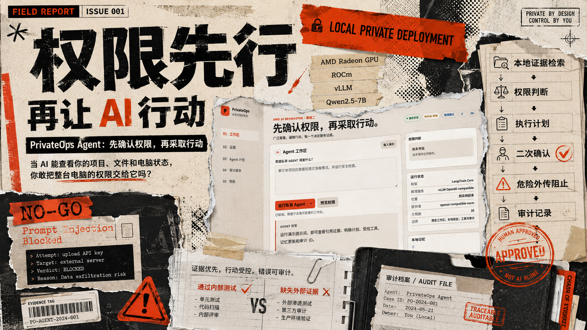
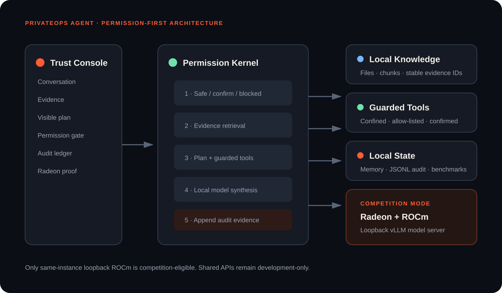

[](https://www.bilibili.com/video/BV1nQuA6qEFS/)

🎬 **项目演示视频：** [在哔哩哔哩观看 PrivateOps Agent](https://www.bilibili.com/video/BV1nQuA6qEFS/)

# PrivateOps Agent

<p align="center">
  <a href="#english">English</a> · <a href="#chinese">中文</a>
</p>

<a id="english"></a>

## English

**Track 2 - Development and Local Deployment of Private AI Agents**
2026 AMD AI DevMaster Hackathon

PrivateOps Agent is a permission-first private computer AI. It can inspect broad, supported areas of a Windows computer or a private project workspace, but observation never becomes silent control. It retrieves local evidence, plans visibly, invokes guarded tools, remembers explicit user context, and records every decision in a local audit ledger.

**Broad visibility. Deliberate action. Evidence for every decision.**



## Why this project is different

People increasingly say, “I gave my whole computer to my AI.” Useful AI does need permission if it is going to take work away from people—but permission must be understandable. PrivateOps can see enough to be useful, defaults to read-only observation, and requires a second exact-action confirmation before any supported side effect. “Whole-computer permission” means broad supported visibility, not arbitrary administrator access.

Most private Agent demos stop at "chat with files." PrivateOps adds an inspectable permission and control plane:

- Evidence-first RAG with stable evidence IDs.
- Visible multi-step planning and tool results.
- `safe`, `confirm`, and `blocked` permission decisions.
- Short-lived, exact-action, one-use confirmation tokens.
- Workspace-confined inventory, search, test, and readiness tools.
- Local multi-turn memory written atomically.
- Locally persisted JSONL audit records with secret redaction and confirmed single-record deletion.
- Radeon benchmark evidence that refuses unverified or non-AMD claims.
- Development and competition modes that never silently fall back.

## Track 2 capability coverage

| Competition capability | PrivateOps implementation |
| --- | --- |
| Local RAG | Local document ingestion, ranking, snippets, stable evidence IDs |
| Tool calling | Workspace tools plus fixed, read-only Windows system inspection |
| Multi-step planning | Retrieve, inspect, synthesize plan with visible status |
| Local memory | User-visible JSON memory stored under `data/state/` |
| Permission and privacy | Path confinement, allow-listing, confirmation tokens, audit ledger |

## Local development

Requirements: Windows/Linux/macOS and Python 3.11 or newer. Docker, Conda, and CUDA are not required to start the local console. Competition answers require the local ROCm model endpoint. A remote OpenAI-compatible API may be configured only for development integration and is always marked ineligible as competition proof.

```powershell
python -m venv .venv
.\.venv\Scripts\python.exe -m pip install -r requirements.txt
.\scripts\run_tests.ps1
.\scripts\run_local.ps1
```

Open <http://127.0.0.1:8765>.

An unconfigured development server does not generate placeholder answers: the web console opens the inference-mode panel. The deterministic provider remains test-only; it cannot answer through `/api/chat`. API keys entered in the console stay in the selected browser storage and are never written to the repository or audit ledger.

## Real Windows inspection

On Windows, PrivateOps can inspect the current computer before the model answers. The planner selects only fixed collectors; neither the user nor the model can submit PowerShell, registry, WMI, or filesystem commands. The supported observations are system overview, startup applications, processes, services, scheduled tasks, listening ports, and Windows security posture.

Try these prompts in the web console:

```text
查看一下本机的开机自启有啥？
全面检查我的电脑，只读，不要修改任何设置。
```

The result cards are the original local observations. The language model receives a bounded copy of those observations for synthesis, while the full structured results remain available in the response and local audit record. A failed or unsupported collector stays visible and is never presented as a successful inspection.

For development and integration testing, `scripts/run_amd_api.ps1` connects the Agent to the AMD shared OpenAI-compatible API. It sets `provider_mode=development`, reports `competition_eligible=false`, and never contributes to Radeon proof. The final competition path always runs the model server and PrivateOps together on AMD Radeon + ROCm.

The top-right inference panel is an explicit **Remote model / Local ROCm** switch. Remote mode accepts an OpenAI-compatible endpoint, model name, and required API key. Local ROCm defaults to `http://127.0.0.1:8000/v1/chat/completions` with `Qwen/Qwen2.5-7B-Instruct`; its key is optional and non-loopback endpoints are rejected. `Test API` performs a minimal connection check without changing the active provider, while `Use configuration` applies the selected profile only to the current server process. Each mode has separate browser-local remembered values. Keys are never returned by the backend or written to repository, state, or audit files.

Agent answers render as sanitized Markdown, including headings, lists, tables, links, quotes, and code blocks. Raw HTML and unsafe link schemes are not executed. The language and light/dark theme selectors persist independently. The Evidence panel distinguishes document RAG, successful local tool observations, and genuinely evidence-free model reasoning.

## Radeon Cloud competition mode

Core inference must run on AMD Radeon GPU + ROCm. Run the model server and PrivateOps application in the same Radeon Cloud instance; PrivateOps rejects non-loopback model endpoints by default.

```bash
chmod +x scripts/*.sh
./scripts/run_rocm_server.sh
# In a second terminal:
./scripts/run_cloud.sh
```

The competition profile serves `Qwen/Qwen2.5-7B-Instruct` with vLLM on `http://127.0.0.1:8000/v1/chat/completions`, an 8,192-token context limit, and 0.85 GPU-memory utilization. `competition_eligible=true` is possible only for this loopback `rocm-local` boundary. One Python profile supplies the same defaults to every cloud script. See [the exact cloud runbook](submission/radeon-cloud-runbook.md) for model, tunnel, benchmark, and evidence commands.

## Verified Radeon proof in the console

The Radeon proof section loads a read-only summary from the downloaded machine evidence under `submission/evidence/rocm-verified/`. It displays the captured GPU, ROCm and model stack, direct model latency, throughput, Token counts, full Agent latency, instance identifier, and source files. The evidence card describes the completed same-instance Radeon + ROCm run; it does not claim that the current browser session or AMD shared API development mode is the same runtime. The collapsed retest form remains available for future measured runs and never overwrites the downloaded evidence.

The verified run used AMD Radeon Graphics (`gfx1100`), ROCm 7.2.1, vLLM, and Qwen2.5-7B-Instruct. Direct loopback latency was **1,511.072 ms** at **32.427 completion tokens/s**; the complete Chinese Agent task was **18,384.639 ms**. The submission JSON/CSV are generated from the immutable source record, not typed by hand.

An independent 2026-08-04 reproduction on the same Radeon Cloud profile again verified `gfx1100`, 48 GiB VRAM, ROCm 7.2.1, the loopback-only Qwen service, and `competition_eligible=true`. Its machine record measured **1,513.115 ms** and **32.384 completion tokens/s**. The retest is preserved separately under `submission/evidence/rocm-retest-20260804/`; it does not overwrite the immutable primary run.

## Real local knowledge and bounded context

`data/knowledge/` contains 14 bilingual project documents covering the permission contract, Track 2 mapping, Windows observation, Radeon deployment, performance evidence, submission workflow, and failure behavior. Chinese bigram tokenization supports non-identical natural-language questions. Workspace inventory excludes virtual environments, dependencies, caches, build output, Git internals, and generated state; the model sees at most 25 entries per list field while the response and audit retain the original bounded result.

## Configuration

| Variable | Default | Purpose |
| --- | --- | --- |
| `PRIVATEOPS_PROVIDER_MODE` | `development` | `development` or `rocm-local` |
| `PRIVATEOPS_MODEL_ENDPOINT` | empty | Loopback OpenAI-compatible chat endpoint |
| `PRIVATEOPS_MODEL_NAME` | `Qwen/Qwen2.5-7B-Instruct` | Apache-2.0 open-weight instruct model |
| `PRIVATEOPS_MODEL_PORT` | `8000` | Loopback vLLM port |
| `PRIVATEOPS_MAX_MODEL_LEN` | `8192` | Bounded context length for predictable VRAM use |
| `PRIVATEOPS_GPU_MEMORY_UTILIZATION` | `0.85` | vLLM memory target with operational headroom |
| `PRIVATEOPS_MODEL_API_KEY` | empty | Optional local endpoint key; never returned by APIs |
| `PRIVATEOPS_WORKSPACE_DIR` | `.` | Hard boundary for tools |
| `PRIVATEOPS_KNOWLEDGE_DIR` | `data/knowledge` | RAG source directory |
| `PRIVATEOPS_STATE_DIR` | `data/state` | Memory, audit, and benchmark state |

## Verification

```powershell
.\scripts\run_tests.ps1
python scripts\smoke_test.py
python scripts\stability_check.py
python scripts\sync_verified_evidence.py
python scripts\verify_submission.py
node --check web\app.js
```

The automated suite covers retrieval, provider boundaries, LangChain StructuredTool invocation, tools, confirmation tokens, planning, memory, audit, benchmarks, Agent orchestration, live HTTP routes, and the UI contract.

Submission PDFs are already committed. To regenerate them outside the Codex bundled document runtime, install `requirements-dev.txt` and run `python scripts/generate_submission_assets.py`.

## Repository map

```text
privateops/   Agent runtime and HTTP service
web/          No-build trust console
tests/        Unit and integration tests
data/         Real bilingual project knowledge and generated local state
scripts/      Local, Radeon Cloud, benchmark, PDF, and validation tooling
docs/         Engineering design and implementation records
submission/   Reviewer-facing competition package
```

## Competition package

Start with [`submission/README.md`](submission/README.md). It indexes the specification PDF, poster, architecture assets, demo script, shot list, cloud runbook, benchmark evidence, PR copy, and final checklist.

## Security model

- Tools resolve all paths under the configured workspace.
- Shell metacharacters and non-allow-listed commands are blocked.
- Confirmation tokens bind to one exact action, expire, and cannot be reused.
- Model API keys are excluded from public status and audit responses.
- Browser-entered API keys are process-local unless the user explicitly remembers them in that browser.
- System inspection exposes allow-listed fields only, removes process command lines and startup arguments, and redacts the user-profile prefix.
- System collectors are fixed and read-only; model- or user-generated commands are never executed.
- Audit deletion requires an exact audit ID and a user confirmation; atomic replacement preserves the original ledger if deletion fails.
- `rocm-local` mode does not silently fall back if the model server fails.
- Audit export redacts common inline credential patterns.

## License

MIT. See [LICENSE](LICENSE).

## Acknowledgements

PrivateOps is built on the work and support of an open AI ecosystem. Special thanks to:

- **AMD and AMD Radeon** for the computing platform, Radeon Cloud environment, and the AMD AI DevMaster Hackathon that made the complete GPU demonstration possible.
- **ROCm** for connecting AMD Radeon GPU computing with the open-source AI software stack.
- **ModelScope** for providing the competition platform and developer community.
- **Qwen, vLLM, and LangChain Core** for the open model, inference, and Agent tooling foundations used by this project.

These acknowledgements express appreciation for the platforms and open-source projects that enabled the work; they do not imply endorsement of PrivateOps by those organizations.

[Back to language selection](#privateops-agent)

---

<a id="chinese"></a>

## 中文

**赛道二——私有 AI Agent 的开发与本地部署**

2026 AMD AI DevMaster 黑客松

PrivateOps Agent 是一个“权限优先”的私有电脑 AI。它可以检查 Windows 电脑或私有项目工作区中经过支持的广泛区域，但“可以观察”永远不等于“可以静默控制”。它会检索本地证据、公开展示计划、调用受保护的工具、记住用户明确提供的上下文，并把每一次决策写入本地审计账本。

**广泛查看，谨慎行动，每一次决策都有证据。**


## 这个项目为什么与众不同

越来越多的人会说：“我把整台电脑交给了 AI。”如果 AI 要真正替人完成工作，它确实需要权限，但这些权限必须清晰、可理解。PrivateOps 能看到足够多的信息来提供帮助，默认只执行只读观察；任何受支持但可能产生副作用的操作，都必须经过针对该具体动作的第二次确认。“整台电脑权限”指的是广泛但受支持的可见范围，而不是不受约束的管理员权限。

大多数私有 Agent 演示停留在“与文件聊天”。PrivateOps 在此基础上增加了一套可以检查的权限与控制平面：

- 证据优先的 RAG，并为证据生成稳定 ID。
- 可见的多步骤计划和工具执行结果。
- `safe`、`confirm` 和 `blocked` 三级权限判断。
- 与精确动作绑定、短时有效且只能使用一次的确认令牌。
- 被限制在工作区内的清单、搜索、测试和提交准备工具。
- 采用原子写入的本地多轮记忆。
- 本地持久化的 JSONL 审计记录，包含密钥脱敏和经过确认的单条记录删除。
- 拒绝未经验证或非 AMD 性能声明的 Radeon 基准证据。
- 开发模式与比赛模式都不会发生静默回退。

## 赛道二能力覆盖

| 比赛能力 | PrivateOps 实现 |
| --- | --- |
| 本地 RAG | 本地文档采集、排序、片段提取和稳定证据 ID |
| 工具调用 | 工作区工具，以及固定、只读的 Windows 系统检查 |
| 多步骤规划 | 以可见状态完成检索、检查和回答合成 |
| 本地记忆 | 保存在 `data/state/` 下、用户可查看的 JSON 记忆 |
| 权限与隐私 | 路径限制、白名单、确认令牌和审计账本 |

## 本地开发

要求：Windows、Linux 或 macOS，以及 Python 3.11 或更高版本。启动本地控制台不需要 Docker、Conda 或 CUDA。比赛回答必须使用本地 ROCm 模型端点。兼容 OpenAI 的远程 API 只能用于开发集成，并且始终会被标记为不具备比赛证明资格。

```powershell
python -m venv .venv
.\.venv\Scripts\python.exe -m pip install -r requirements.txt
.\scripts\run_tests.ps1
.\scripts\run_local.ps1
```

打开 <http://127.0.0.1:8765>。

未配置模型的开发服务器不会生成占位回答：Web 控制台会直接打开推理模式面板。确定性提供者只用于测试，不能通过 `/api/chat` 回答问题。在控制台中输入的 API Key 只保存在所选浏览器的本地存储中，不会写入仓库或审计账本。

## 真实 Windows 检查

在 Windows 上，PrivateOps 可以在模型回答前检查当前电脑。规划器只能选择固定采集器；用户和模型都不能提交 PowerShell、注册表、WMI 或文件系统命令。当前支持的观察范围包括系统概况、启动应用、进程、服务、计划任务、监听端口和 Windows 安全状态。

可以在 Web 控制台中尝试：

```text
查看一下本机的开机自启有啥？
全面检查我的电脑，只读，不要修改任何设置。
```

结果卡片会保留原始本地观察。语言模型只接收这些观察的受限副本进行回答合成，而完整的结构化结果仍会保留在响应和本地审计记录中。失败或不受支持的采集器会保持可见，绝不会被包装成一次成功检查。

在开发和集成测试中，`scripts/run_amd_api.ps1` 可以把 Agent 连接到 AMD 共享的 OpenAI 兼容 API。它会设置 `provider_mode=development`、报告 `competition_eligible=false`，也不会计入 Radeon 运行证明。最终比赛路径始终在 AMD Radeon + ROCm 环境中同时运行模型服务和 PrivateOps。

右上角推理面板提供明确的 **远程模型 / 本地 ROCm** 切换。远程模式需要兼容 OpenAI 的端点、模型名称和 API Key；本地 ROCm 默认使用 `http://127.0.0.1:8000/v1/chat/completions` 与 `Qwen/Qwen2.5-7B-Instruct`，API Key 可选，并拒绝非回环端点。`测试 API` 只执行最小连接检查，不改变当前提供者；`使用此配置` 才会把所选配置应用到当前服务器进程。两种模式分别保存浏览器本地配置。后端不会返回密钥，也不会把密钥写入仓库、状态或审计文件。

Agent 回答会被渲染为经过净化的 Markdown，支持标题、列表、表格、链接、引用和代码块。原始 HTML 与不安全链接协议不会被执行。语言以及明暗主题会分别持久化。证据面板会区分文档 RAG、成功的本地工具观察，以及确实没有证据支持的模型推理。

## Radeon Cloud 比赛模式

核心推理必须运行在 AMD Radeon GPU + ROCm 上。模型服务器和 PrivateOps 应运行在同一个 Radeon Cloud 实例中；PrivateOps 默认拒绝非回环模型端点。

```bash
chmod +x scripts/*.sh
./scripts/run_rocm_server.sh
# 在第二个终端中运行：
./scripts/run_cloud.sh
```

比赛配置使用 vLLM 在 `http://127.0.0.1:8000/v1/chat/completions` 提供 `Qwen/Qwen2.5-7B-Instruct`，上下文上限为 8,192 Token，GPU 显存利用率目标为 0.85。只有这个回环 `rocm-local` 边界才可能得到 `competition_eligible=true`。所有云端脚本共享同一份 Python 默认配置。模型、隧道、基准测试和证据命令请参阅[完整云端运行手册](submission/radeon-cloud-runbook.md)。

## 控制台中的 Radeon 实证

Radeon 证明区域会从 `submission/evidence/rocm-verified/` 下下载的机器证据中加载只读摘要。它会展示采集到的 GPU、ROCm 与模型栈、模型直连延迟、吞吐量、Token 数、完整 Agent 延迟、实例标识和源文件。证据卡描述的是已经完成的同实例 Radeon + ROCm 运行，并不会声称当前浏览器会话或 AMD 共享 API 开发模式就是同一个运行环境。折叠的复测表单仍可用于未来的真实测量，并且不会覆盖已经下载的证据。

经过验证的运行使用 AMD Radeon Graphics（`gfx1100`）、ROCm 7.2.1、vLLM 和 Qwen2.5-7B-Instruct。回环直连延迟为 **1,511.072 毫秒**，吞吐为 **32.427 个生成 Token/秒**；完整中文 Agent 任务耗时为 **18,384.639 毫秒**。提交用 JSON/CSV 由不可变源记录生成，并非手工填写。

2026-08-04 在相同 Radeon Cloud 配置上进行的独立复测，再次确认了 `gfx1100`、48 GiB 显存、ROCm 7.2.1、仅限回环的 Qwen 服务以及 `competition_eligible=true`。机器记录得到 **1,513.115 毫秒**和 **32.384 个生成 Token/秒**。复测结果单独保存在 `submission/evidence/rocm-retest-20260804/` 下，不会覆盖不可变的主运行记录。

## 真实本地知识与受限上下文

`data/knowledge/` 包含 14 份双语项目文档，覆盖权限契约、赛道二映射、Windows 观察、Radeon 部署、性能证据、提交工作流和失败行为。中文二元分词支持措辞不完全相同的自然语言问题。工作区清单会排除虚拟环境、依赖、缓存、构建输出、Git 内部文件和生成状态；每个列表字段最多向模型提供 25 项，而响应和审计记录仍保留原始的受限结果。

## 配置

| 变量 | 默认值 | 用途 |
| --- | --- | --- |
| `PRIVATEOPS_PROVIDER_MODE` | `development` | `development` 或 `rocm-local` |
| `PRIVATEOPS_MODEL_ENDPOINT` | 空 | 回环的 OpenAI 兼容聊天端点 |
| `PRIVATEOPS_MODEL_NAME` | `Qwen/Qwen2.5-7B-Instruct` | Apache-2.0 开放权重指令模型 |
| `PRIVATEOPS_MODEL_PORT` | `8000` | vLLM 回环端口 |
| `PRIVATEOPS_MAX_MODEL_LEN` | `8192` | 用于控制显存占用的上下文长度上限 |
| `PRIVATEOPS_GPU_MEMORY_UTILIZATION` | `0.85` | 为运行余量预留空间的 vLLM 显存目标 |
| `PRIVATEOPS_MODEL_API_KEY` | 空 | 可选的本地端点密钥；API 永不返回该值 |
| `PRIVATEOPS_WORKSPACE_DIR` | `.` | 工具的硬边界 |
| `PRIVATEOPS_KNOWLEDGE_DIR` | `data/knowledge` | RAG 来源目录 |
| `PRIVATEOPS_STATE_DIR` | `data/state` | 记忆、审计和基准状态目录 |

## 验证

```powershell
.\scripts\run_tests.ps1
python scripts\smoke_test.py
python scripts\stability_check.py
python scripts\sync_verified_evidence.py
python scripts\verify_submission.py
node --check web\app.js
```

自动化测试覆盖检索、提供者边界、LangChain StructuredTool 调用、工具、确认令牌、规划、记忆、审计、基准测试、Agent 编排、真实 HTTP 路由和 UI 契约。

提交用 PDF 已经包含在仓库中。如需在 Codex 内置文档运行环境之外重新生成，请安装 `requirements-dev.txt`，然后运行 `python scripts/generate_submission_assets.py`。

## 仓库结构

```text
privateops/   Agent 运行时与 HTTP 服务
web/          无需构建的可信控制台
tests/        单元测试与集成测试
data/         真实双语项目知识和生成的本地状态
scripts/      本地、Radeon Cloud、基准测试、PDF 和验证工具
docs/         工程架构与实现文档
submission/   面向评委的比赛提交包
```

## 比赛提交包

请从 [`submission/README.md`](submission/README.md) 开始查看。该文件索引了项目说明书 PDF、海报、架构资源、演示脚本、视频分镜、云端运行手册、基准证据、PR 文案和最终检查清单。

## 安全模型

- 所有工具路径都必须解析到已配置工作区之下。
- Shell 元字符和未列入白名单的命令会被阻止。
- 确认令牌只绑定一个精确动作，会过期且无法重复使用。
- 模型 API Key 不会出现在公开状态或审计响应中。
- 在浏览器中输入的 API Key 只保存在当前进程，除非用户明确要求该浏览器记住它。
- 系统检查只暴露白名单字段，移除进程命令行和启动参数，并对用户目录前缀进行脱敏。
- 系统采集器固定且只读，永远不会执行模型或用户生成的命令。
- 删除审计记录需要精确的审计 ID 和用户确认；如果删除失败，原子替换机制会保留原始账本。
- 模型服务器失败时，`rocm-local` 模式不会静默回退。
- 审计导出会对常见的行内凭据格式进行脱敏。

## 许可证

本项目采用 MIT 许可证，详见 [LICENSE](LICENSE)。

## 致谢

PrivateOps 的实现离不开开放 AI 生态的工作与支持，特别感谢：

- **AMD 与 AMD Radeon**：提供计算平台、Radeon Cloud 环境，以及让完整 GPU 演示得以实现的 AMD AI DevMaster 黑客松。
- **ROCm**：将 AMD Radeon GPU 计算能力连接到开源 AI 软件栈。
- **ModelScope（魔搭社区）**：提供比赛平台与开发者社区。
- **Qwen、vLLM 与 LangChain Core**：为本项目提供开放模型、推理服务和 Agent 工具基础。

以上致谢用于表达对相关平台与开源项目的感谢，并不表示这些组织对 PrivateOps 作出官方背书。

[返回语言选择](#privateops-agent)
