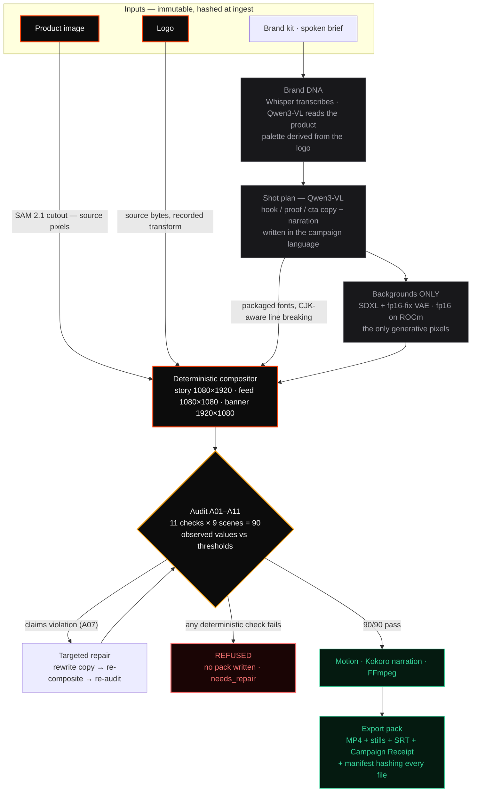

# Track 1, Team Rivet, Rivet

**Verified multimodal ad creation on one AMD Radeon GPU. The model never touches the product.**

**▶ Demo video: https://youtu.be/NI-S_5lD79M** · **Live studio (nothing to install): https://rivet-amd.vercel.app** · **Source: https://github.com/damishafe/Rivet**

A product image, brand kit and spoken brief become a three-scene vertical advertisement in three delivery formats, narrated in the campaign's language. The product, logo and typography are composited deterministically from source files — never redrawn by a model — and **every scene is checked against eleven named audit checks before an export is allowed to exist**. A failing export is refused: no pack is written. The refusal is demonstrated below, and in the video.

## ▶ Demo video (4:56)

https://github.com/user-attachments/assets/972d1c57-2051-45eb-830b-921bfe72ca65

Also on YouTube: **https://youtu.be/NI-S_5lD79M**

The terminal scenes were recorded live on the Radeon cloud instance — the address bar carries the instance id, and `rivet doctor` prints gfx1100 / 49136 MB / ROCm 7.2.53211 because it *is* that machine. Wherever the picture is compressed, an on-screen clock counts **true seconds** and states the multiplier; the run is never silently sped up.

## The one shot that explains the project

| Verified | Refused — same run, same seed, tampered product file |
|---|---|
|  |  |

The two stills are pixel-identical. The right one was refused anyway: A01 compared the brand-confirmed sha256 against the bytes actually composited, found a mismatch, and no export pack was written. **The advertisement looks fine, and it is still wrong, and the tool knows.**

---

# The Track 1 rubric, answered

## 1 · Project background

Generative tools made advertising cheap without making *checking* it cheap. A merchant can generate fifty advertisements tonight; if one says "clinically proven" — because a language model reached for a phrase that sounded like marketing — that is a regulatory fine, a platform ban, or a brand-damaging likeness they never cleared. A large brand has a review process standing between them and that mistake. A small seller has a phone.

Every existing tool answers this with *trust*: trust the prompt, trust the model, trust your own eye at 2 a.m. Several tools composite logos deterministically — that much is table stakes. The question none of them answer is **how you know it worked**. Rivet's answer: check every output against named, thresholded audit checks, put the evidence in a signed receipt, and refuse to export what fails. A refusal reproduces exactly like a pass.

## 2 · Target users & application scenarios

**Primary: small commerce sellers** — the people generating their own advertising with no legal review between them and a platform's ad policy. Rivet gives them what only enterprises had: a compliance reviewer, built into the tool, that cannot be talked out of a failing check.

**Scenarios demonstrated in this submission:**
- **Product launch campaign** — image + logo + spoken brief → three-scene vertical video with narration and captions, plus feed (1080×1080) and banner (1920×1080) variants, all audited ([gallery](https://github.com/damishafe/Rivet/blob/main/docs/gallery/README.md))
- **Brand-safety enforcement** — a forbidden claim ("waterproof") written by the planner is caught by A07, automatically rewritten, re-composited and re-audited; the repair is recorded in the receipt
- **Tamper detection** — the product file is altered *after* brand approval; A01 refuses the export ([demo](https://youtu.be/NI-S_5lD79M), 2:20)
- **Cross-market campaigns** — the same fixture produced and audited in **Mandarin**: copy written in Chinese rather than translated, a Mandarin voice, a font that carries the script, claims audited as written ([LANGUAGE-ZH.md](https://github.com/damishafe/Rivet/blob/main/docs/gallery/LANGUAGE-ZH.md))
- **Agency throughput** — three brands (speaker, insulated flask, coffee press) through one pipeline with nothing configured per brand ([DIVERSITY.md](https://github.com/damishafe/Rivet/blob/main/docs/gallery/DIVERSITY.md))

## 3 · System architecture

Protected assets route **around** the generative path — that is the entire design:



The product and logo (red-bordered) never enter a model. The audit is a gate, not a report: the refused path is a first-class outcome, demonstrated in the video and the gallery.

- **`rivet/`** core package: `domain/` (Pydantic contracts) · `pipeline/` (DAG, stage runner, content-addressed cache, state machine) · `adapters/` (one per model, behind a common `Stage` protocol) · `compositor/` (protected layers, per-format geometry, typography with CJK line-breaking) · `audit/` (deterministic checks + advisory semantic judge) · `render/` · `telemetry/` · `storage/` (SQLite + content-addressed artifacts)
- **`services/api`** — FastAPI + SSE; **`apps/web`** — React 19 studio (the live link above); **`cli/`** — the headless path shown in the video
- **Audit runs before motion and narration**, so a certified still is the still the video contains
- **Atomic ingestion** (temp-file → fsync → rename) so a partial upload can never become the product a campaign builds from
- 277 automated tests; golden tests assert **byte-identical** compositing

## 4 · Models & algorithms

| Model | Role | Why this one |
|---|---|---|
| SDXL 1.0 + `sdxl-vae-fp16-fix` | scene backgrounds — the only generative pixels | fp16 end-to-end on the W7900; SDXL's own VAE overflows in half precision |
| Qwen3-VL-4B-Instruct | reads the product image, writes distinct hook/proof/cta copy + narration per language; advisory A08 judge | vision-grounded copywriting; its opinion is *advisory* because a model's opinion is not evidence |
| SAM 2.1 Hiera Small | product cutout | the cutout is composited from source pixels, never redrawn |
| Kokoro-82M | narration, six languages | per-language voice + grapheme-to-phoneme chain, pinned at install |
| Whisper tiny.en | spoken brief transcription | the brief is voice-first |

All revisions pinned by commit hash; licenses recorded per model, font and demo asset in [`MODEL_LICENSES.md`](https://github.com/damishafe/Rivet/blob/main/MODEL_LICENSES.md).

**The algorithmic contribution is the audit.** Eleven named checks per scene with observed values against thresholds: sha256 lineage (A01), pixel-level logo and product fidelity (A02/A09), exact copy integrity (A03), palette drift in hue degrees (A04), safe-area and overflow at the real rendered size (A05), product share of frame (A06), forbidden-claims policy across copy *and narration* (A07), WCAG contrast against the measured background behind each text box (A10), and **A11 — every rendered character exists in the font that drew it**, added after a Mandarin campaign passed every check while rendering empty boxes. Deterministic checks block; the semantic judge (A08) never does.

## 5 · Adaptation for AMD Radeon GPU / ROCm

Everything below was learned on the contest hardware and is enforced in code, not documented as a caution ([full account](https://github.com/damishafe/Rivet/blob/main/docs/profile.md)):

- **The ROCm torch is not replaceable, and the installer proves it.** Any transitive `torch` install pulls the CPU wheel over the ROCm build — the GPU disappears and the pipeline keeps running silently at a hundredth of the speed. [`install.sh`](https://github.com/damishafe/Rivet/blob/main/install.sh) records the torch version before installing, re-reads it after, and **aborts if it changed**. It also selects the interpreter that *owns* the ROCm torch, because on the contest image `python3` is a different interpreter.
- **fp16 end to end** via the `sdxl-vae-fp16-fix` VAE; the model fetcher special-cases that repo because there the weight file it normally skips *is* the model.
- **SDXL attention runs through ROCm's AOTriton** efficient-attention path on gfx1100 — not a generic fallback.
- **One heavy model resident at a time**, enforced by a residency scheduler rather than convention: acquire releases the previous model and empties the allocator cache first. Measured over alternating arms after a discarded warmup: **24% faster end to end** (median 42.2s vs 55.8s). `RIVET_MODEL_RESIDENCY=0` disables it — and the benchmark's comparison arm is what sets that flag.
- **Honest VRAM instrumentation**: peak reported only where a true per-stage counter exists (`torch.cuda.max_memory_allocated`, reset per stage — the ROCm path); elsewhere the report prints `n/a` and says why.
- **Kokoro's per-language phoneme toolchains** (spaCy model, `misaki[zh]`) fetch at first use, which fails offline *after* the GPU work is spent — both pinned at install time.

## 6 · Execution performance on the Radeon PRO W7900

gfx1100 · 49136 MB · ROCm 7.2.53211 · PyTorch 2.9.1 · fixture `kora-arc`. **Every number regenerates from a checked-in command** ([docs/benchmarks/](https://github.com/damishafe/Rivet/blob/main/docs/benchmarks), raw logs in [docs/evidence/](https://github.com/damishafe/Rivet/blob/main/docs/evidence)):

| | seconds | audit |
|---|---:|---|
| Full campaign, cold — plan, generate, audit, render, pack | **71.7** | 90/90 |
| Hot — models already resident | **45.4** | 90/90 |
| Offline — every outbound socket blocked at the Python layer | — | 90/90, **0 connection attempts** |

- Peak VRAM **9168 MB of 49136** — 81% of the card left free while producing a full campaign
- Determinism: content digest `347606b58a93ba16` identical across **eleven runs** — digested over still bytes, seeds and audit observations, so paths and ids cannot satisfy it

## 7 · Clarity, stability and diversity of outputs

- **Clarity** — final typography is real fonts on real geometry, never diffusion-drawn text; A10 enforces WCAG contrast against the measured background; A11 refuses copy the font cannot draw. CJK headlines are set with proper line-breaking rules (no line opens with a comma, no stranded ideograph).
- **Stability** — enforced, not sampled: golden tests assert byte-identical compositing; seeds are threaded explicitly; the benchmark's determinism gate compares content digests across runs, including both residency arms.
- **Diversity** — three brands with nothing configured per brand (palettes derived from each logo) · three formats with independent composition geometry, each audited separately · six languages where the language drives the voice, the typography *and the claims the audit reads* — demonstrated end to end in English, Portuguese and Mandarin.

## 8 · Practical value & creative scenarios (supplementary: poster)

[`poster.pdf`](https://github.com/damishafe/Rivet/blob/main/poster.pdf) — one page: the problem, the architecture, the checks, the numbers.

The practical value is the part that never varies: **evidence**. Every export carries a Campaign Receipt — input hashes, model revisions, seeds, per-stage wall time, peak VRAM, every check with its observed value, and any repairs — hashed as one record, beside a manifest hashing every file in the pack. A seller can hand a platform, a client or a regulator the receipt instead of a promise. A repair is recorded, not silent. A refusal is reproducible.

---

## Deliverables checklist

| Requirement | Artifact |
|---|---|
| Project Profile Document (PDF) | [`project-profile.pdf`](https://github.com/damishafe/Rivet/blob/main/project-profile.pdf) |
| Complete source code | https://github.com/damishafe/Rivet — MIT, 277 tests |
| README: environment, startup, dependencies | [`README.md`](https://github.com/damishafe/Rivet/blob/main/README.md) · one-command Radeon setup: [`install.sh`](https://github.com/damishafe/Rivet/blob/main/install.sh) |
| Demo video (3–5 min) | https://youtu.be/NI-S_5lD79M — 4:56, embedded above |
| Supplementary material | [`poster.pdf`](https://github.com/damishafe/Rivet/blob/main/poster.pdf) |
| Live demo | **https://rivet-amd.vercel.app** |

## The submission audits itself

```
$ make submission-check
checking 279 tracked files
  [  ok] required deliverables present
  [  ok] internal planning files excluded
  [  ok] no secrets in tracked files
  [  ok] every model has a license row
  [  ok] no tracked file over 50 MB
submission-check: pass
```

## Reproduce it

```bash
./install.sh                                     # guarded install — aborts if torch is replaced
make offline-demo                                # the whole pipeline, every socket blocked
make benchmark-cold FIXTURE=fixtures/kora-arc    # regenerates the table above
uv run python scripts/showcase.py --language zh  # the Mandarin campaign
```

The pipeline caught its own authors eight times — a lineage check that could not fail, an audit that certified stills the video did not contain, a benchmark that measured run order, a Mandarin campaign that passed while rendering boxes. Each one traces to a check or test that now exists: [the bugs that taught something](https://github.com/damishafe/Rivet/blob/main/README.md#engineering-decisions--the-bugs-that-taught-something). Kora Arc and the other demo brands are fictional, created and licensed for this submission.

---

*The model gets to be creative. It doesn't get to be trusted.*
