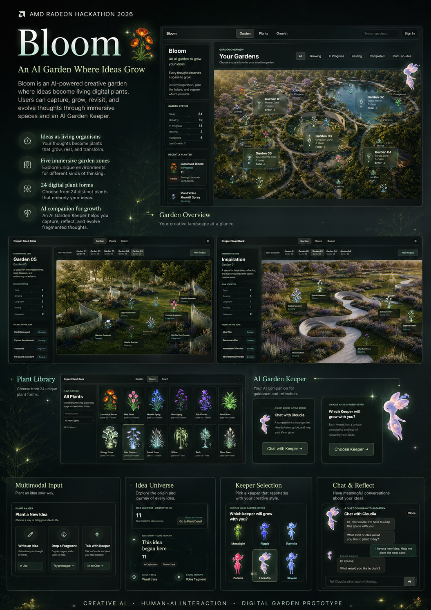

# Bloom

**Track:** Track 1 — Development of Multimodal Content Creation Tools  
**Participant:** Yangzi  
**Original project name:** Project Seed Bank

> **Bloom is an AI-powered creative garden where ideas are treated as living organisms. Users can capture, grow, and revisit ideas through digital plants, immersive gardens, and an AI Garden Keeper.**



## Submission Materials

- [Project Profile Document (PDF)](documents/Bloom_AMD_Project_Profile.pdf)
- [Poster 01 — Product Overview](assets/Bloom_AMD_Poster_Overview.png)
- [Poster 02 — Multimodal Workflow and Idea Universe](assets/Bloom_AMD_Poster_Workflow.png)
- [Project source code](https://github.com/yangzi831/project-seed-bank/tree/feature/bloom-idea-universe-demo)
- [Demo video](https://youtu.be/0u12Z967xWs)

## Project Overview

Bloom is a creative AI environment that gives unfinished thoughts a place to remain alive. Instead of reducing inspiration to tasks, tickets, or deadlines, Bloom turns ideas into digital plants that can grow, pause, change form, and be rediscovered.

The experience combines a spatial garden interface, a library of original digital plants, multimodal idea-entry concepts, an AI Garden Keeper, and an experimental Idea Universe in which one idea becomes an inhabitable digital space.

## Problem

People continuously generate fragments: a sentence, an image, a sound, a half-formed plan, or a question that is not ready to become a project. Conventional productivity tools expect these fragments to become structured tasks immediately. This often removes their ambiguity and emotional context, and many promising ideas disappear because they do not yet have a clear destination.

Creative AI tools can generate content, but they often focus on a single prompt and a single output. They rarely help users maintain a long-term relationship with ideas across different media and different stages of development.

## Solution

Bloom proposes an AI-native idea garden where:

- An idea is represented as a living digital plant rather than a task card.
- Different Garden Zones support different modes of thinking and creative attention.
- Multimodal fragments can become starting points without requiring a polished brief.
- An AI Garden Keeper helps the user reflect, connect fragments, and decide whether an idea should be planted.
- Each plant can eventually open into an Idea Universe containing its story, traces, process, and future outputs.

The AI is positioned as a companion for creative reflection, not an automatic replacement for the user's intention.

## Features

### Digital Idea Garden

- A spatial overview of the user's creative ecosystem.
- Five Garden Zones: Inspiration, Water Mirror, Exhibition, Forest, and Experimental.
- Growth stages that represent creative rhythms: Growing, Forming, Dormant, and Harvested.
- Growth journals and records of what an idea has formed.

### Plant Library

- 24 original digital plant forms.
- Each plant gives an idea a distinct visual identity and life state.
- Plants function as living representations, not category labels.

### AI Garden Keeper

- Six selectable Keeper personalities with different styles of companionship.
- Context-aware reflection based on the current idea, Garden Zone, growth journal, and Keeper personality.
- Structured Seed Discovery, Growth Companion, and Harvest Assistant flows.
- Provider-compatible AI requests with designed mock and demo fallbacks for reliable presentation.

### Multimodal Idea Input

- Write an Idea for direct text entry.
- Drop a Fragment as the prototype entry for image, audio, video, and file input.
- Talk with Keeper for conversational exploration before planting.
- A structured suggestion step proposes an idea name, description, Garden Zone, and plant form before the user confirms.

### Idea Universe

- A prototype internal universe for the Luminous Bloom plant.
- A structured Three.js particle organism with a complete spatial rotation.
- Scattered story, journal, visual, audio, link, and Keeper-reflection traces.
- An exploration of how a creative idea can become an interactive digital environment.

## Multimodal AI Workflow

```text
Text / Image / Audio / Video / File fragment
                    |
                    v
          Multimodal understanding
                    |
                    v
     AI Garden Keeper intent and context layer
                    |
          +---------+---------+
          |                   |
          v                   v
  Explore and clarify   Prepare an idea suggestion
                              |
                              v
        Name + description + Garden Zone + plant form
                              |
                              v
                     User confirmation
                              |
                              v
                  Plant the idea in Bloom
```

In the current prototype, the complete interaction framework and text-based Keeper flow are implemented. Image, audio, video, and file ingestion are presented as a working UI prototype for the next inference stage. The architecture keeps the user in control: the Keeper interprets and proposes, while the user decides whether and how the fragment enters the garden.

## Architecture and Tech Stack

### Frontend

- React 19
- TypeScript
- Vite
- CSS-based spatial and glass-interface system
- Local demo state with optional Supabase-backed synchronization

### AI and Data Layer

- Garden Keeper product-layer Agent interface
- Shared request, context, response, and suggestion structures
- Supabase client and Edge Function integration for provider-backed AI calls
- Context assembled from idea metadata, Garden Zone, growth journal, outputs, and Keeper personality
- Mock and demo fallback responses for stable offline presentation

### Visualization

- Three.js
- Particle-based digital plant sculpture
- Original transparent plant and Keeper assets
- Immersive garden scenes, light traces, star fields, and spatial content fragments

### AMD Radeon / ROCm Adaptation

Bloom is designed for AI-native creative workflows. AMD Radeon GPU acceleration can support:

- Local multimodal inference for private text, image, audio, video, and file understanding.
- Faster iteration between an unstructured fragment and a visible creative direction.
- Denser real-time particle visualization and responsive digital organisms.
- Future interactive 3D idea environments powered by local generative models.

The current submission demonstrates the product experience, Agent architecture, multimodal interaction framework, and real-time visualization direction. A future AMD-native build can move multimodal inference on-device through ROCm-compatible models while preserving the same frontend and Agent contracts.

## How to Run

### Requirements

- Node.js 18 or newer
- npm
- A modern browser with WebGL support

### Start the Local Demo

```bash
git clone https://github.com/yangzi831/project-seed-bank.git
cd project-seed-bank
git checkout feature/bloom-idea-universe-demo
npm install
npm run dev
```

Open:

```text
http://127.0.0.1:5173/garden
```

The visual demo and designed fallback conversations work without cloud credentials. To enable the optional Supabase-backed community and Garden Keeper API paths, copy `.env.example` to `.env` and provide:

```text
VITE_SUPABASE_URL=your-project-url
VITE_SUPABASE_ANON_KEY=your-anon-key
```

Create a production build with:

```bash
npm run build
```

## Demo Video

**Link:** <https://youtu.be/0u12Z967xWs>

The final 3–5 minute demo will show this sequence:

1. Enter the Bloom Garden.
2. Explore different Garden Zones.
3. Browse the Plant Library.
4. Choose and interact with an AI Garden Keeper.
5. Bring a new idea into Bloom through the multimodal entry flow.
6. Enter the Luminous Bloom Idea Universe.

## Current Prototype Scope

Implemented in the submitted source version:

- Interactive Garden overview and five Garden Zones
- Idea planting, growth stages, journals, and formed outputs
- 24-plant visual library
- Six Garden Keeper identities and contextual chat experience
- Provider-backed Agent path with safe mock/demo fallback
- Multimodal entry interaction prototype
- Luminous Bloom Idea Universe
- Real-time structured particle plant experiment

Planned extensions include production multimodal file processing, ROCm-accelerated local inference, broader AMD GPU profiling, and generalized Idea Universes for all plant forms.

## Future Vision

Bloom aims to build a bridge between AI, creativity, and everyday life. It imagines a future where anyone—not only professional creators—can preserve an unfinished thought, recognize patterns across years of exploration, and experience personal ideas as evolving digital life.

AI becomes a companion that helps people stay in relationship with their own imagination. The garden becomes a living archive not only of what was completed, but of everything that was once worth growing.
