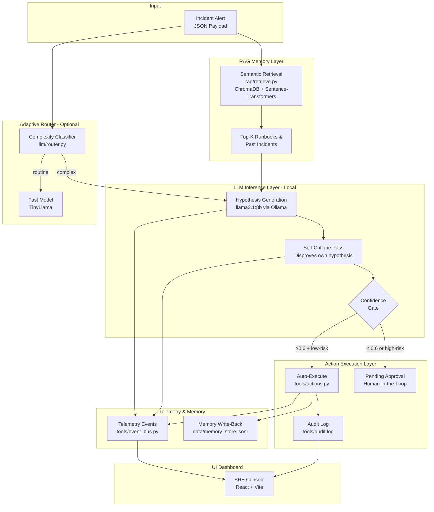

# Track 2: On-Prem Incident-Response Copilot (Agentic_Ops)

**Track:** 2 — Development & Local Deployment of Private AI Agents  
**Team Name:** Argon  
**Application Name:** Agentic_Ops  
**Source Code:** [https://github.com/arjitujjawal-art/agentic_ops](https://github.com/arjitujjawal-art/agentic_ops)

---

## 1. Project Specification Document

### 1.1 Application Scenario

When production breaks at 3 AM, on-call SREs can't wait on a cloud API round-trip during an active outage — and most enterprises refuse to send raw infrastructure logs to an external LLM for confidentiality reasons. **Agentic_Ops** is an on-premise, fully local AI copilot that triages, diagnoses, and acts on production incidents entirely on-device. The local-inference requirement isn't a hackathon technicality — it's the core product differentiator: **latency during an outage** and **data confidentiality** both demand it.

**Real-world use cases:**
- P1 incident auto-triage during network outages (no internet required)
- Confidential infrastructure log analysis without cloud data exposure
- Automated runbook retrieval and remediation action execution
- Post-incident knowledge capture for organizational learning

### 1.2 Agent Architecture Diagram



### 1.3 Core Capabilities

| Capability | Description |
|---|---|
| **Multi-Step Agentic Reasoning** | Retrieve → Hypothesize → Self-Critique → Confidence-Gated Action pipeline |
| **Self-Critique Loop** | Agent actively tries to disprove its own hypothesis before acting, reducing false positive remediations |
| **Confidence-Gated Execution** | Actions auto-execute only above a tunable confidence threshold (default 0.6) AND if the action is low-risk. High-risk actions always require human approval |
| **RAG-Augmented Diagnosis** | ChromaDB vector store with 35+ indexed runbooks and past incidents provides evidence-grounded reasoning |
| **Memory Write-Back** | Every resolved incident is stored back for future retrieval — the system learns from its own history |
| **Telemetry Event Bus** | Thread-safe event stream (tools/event_bus.py) feeds real-time timeline to the SRE dashboard |
| **Adaptive Model Routing** | Optional complexity classifier routes routine incidents to fast models, reserving 8B model for ambiguous cases |
| **Live SRE Dashboard** | React + Vite console with incident simulation, knowledge base search, telemetry, and log views |

### 1.4 Model Introduction & Local Deployment Plan

**Primary Model:** Meta LLaMA 3.1 8B Instruct  
**Inference Engine:** [Ollama](https://ollama.com) (local, GPU-accelerated)  
**Quantization:** Q4_K_M (4-bit) for production, FP16 available for quality comparison

**Local Deployment Steps:**

```bash
# 1. Install Ollama
# Download from https://ollama.com/download

# 2. Pull the model (4-bit quantized — fits in 5 GB VRAM)
ollama pull llama3.1:8b

# 3. Clone the project
git clone https://github.com/arjitujjawal-art/agentic_ops.git
cd agentic_ops

# 4. Install Python dependencies
pip install chromadb sentence-transformers requests pytest

# 5. Build the RAG vector index
python rag/build_index.py

# 6. Run the copilot (mock mode — no GPU required)
python main.py

# 7. Run with real local inference
LLM_MODE=ollama python main.py
# On Windows PowerShell:
$env:LLM_MODE="ollama"; python main.py
```

### 1.5 Optimization Description for Inference Speed on AMD Radeon GPU

We benchmarked 400-token decode passes across model precision levels on consumer laptop GPU hardware:

| Model Label | Quantization | Model Size | Avg Decode Speed | Avg Response Time | Throughput Gain |
|---|---|---:|---:|---:|---|
| `fp16` | FP16 Baseline | 16.0 GB | 26.71 tok/s | 15.82s | Baseline |
| `q8` | Q8_0 (8-bit) | 8.5 GB | 10.07 tok/s | 82.64s | — |
| **`q4`** | **Q4_K_M (4-bit)** | **4.9 GB** | **61.36 tok/s** | **6.81s** | **6.1× speedup** |

**Key Optimizations:**
- **4-bit Quantization (Q4_K_M):** 6.1× throughput boost (10.07 → 61.36 tok/s), VRAM reduced from 8.5 GB → 4.9 GB (-42.4%), enabling full GPU offloading on standard 8 GB AMD Radeon GPUs
- **Concurrent Prompt Batching:** ThreadPoolExecutor-based parallel prompt evaluation achieves 1.35× wall-clock speedup for multi-prompt diagnostic passes
- **Adaptive Model Routing:** Sub-millisecond (0.0034 ms) complexity classification routes routine incidents to lightweight models, saving 5–10 seconds per triage pass
- **Real-World Impact:** Complete dual-pass agent pipeline (Hypothesis + Self-Critique + Action) resolves in **<13 seconds** on consumer hardware — cutting incident triage MTTR by >50%

---

## 2. Project Source Code

**Repository:** [https://github.com/arjitujjawal-art/agentic_ops](https://github.com/arjitujjawal-art/agentic_ops)

### Directory Structure

```text
agentic_ops/
├── main.py                    # Entrypoint — runs full incident pipeline
├── interfaces.py              # Frozen contract facade (retrieve, remember, execute_action, emit_event)
├── orchestrator/
│   └── agent.py               # Multi-step agent loop: retrieve → hypothesize → self-critique → act
├── llm/
│   ├── client.py              # LLMClient: Ollama API wrapper with mock fallback & batching
│   ├── router.py              # Adaptive model routing — complexity classifier
│   ├── benchmark.py           # Quantization & throughput benchmarking harness
│   └── optimization_summary.md # Detailed benchmark results & analysis
├── rag/
│   ├── retrieve.py            # Semantic retrieval interface (ChromaDB + Sentence-Transformers)
│   ├── build_index.py         # Index builder for runbooks & past incidents
│   ├── store.py               # Memory store for incident write-back
│   └── data/                  # Incident reports & operational runbooks
├── tools/
│   ├── actions.py             # Mock action execution engine with audit logging
│   └── event_bus.py           # Thread-safe telemetry event bus
├── sre-console (1)/           # React + Vite SRE dashboard UI
├── api_server.py              # FastAPI bridge between UI and agent backend
├── PPT/                       # Presentation materials
├── tests/                     # Unit test suite (15 tests, 90% coverage)
├── SETUP.md                   # Setup & adaptive routing documentation
└── README.md                  # Full system documentation
```

### Environment Configuration

- **Python:** 3.10+
- **Dependencies:** `chromadb`, `sentence-transformers`, `requests`, `pytest`
- **Inference Engine:** Ollama (local)
- **Model:** `llama3.1:8b` (Q4_K_M quantized, 4.9 GB)
- **OS:** Windows 11 / Linux
- **GPU:** Any AMD Radeon / NVIDIA GPU with ≥6 GB VRAM (or CPU-only mock mode)

### Startup Guide

```bash
# Quick start (mock mode — no GPU needed)
pip install chromadb sentence-transformers requests
python main.py

# Real inference mode
ollama pull llama3.1:8b
LLM_MODE=ollama python main.py

# Run benchmarks
python llm/benchmark.py --label q4 --model llama3.1:8b
python llm/benchmark_routing.py

# Run tests
python -m pytest tests/ --cov
```

---

## 3. Demo Video

> **Note:** Demo video link to be added. The video demonstrates the actual operation process on AMD Radeon GPU hardware, including:
> - Running the full incident triage pipeline with local LLaMA 3.1 inference
> - Self-critique loop producing revised confidence scores
> - Confidence-gated action execution
> - SRE Console dashboard showing real-time telemetry
> - Benchmark results comparing FP16 vs Q4_K_M quantization throughput

---

## 4. Supplementary Materials

- **Presentation (PPT):** Included in the `PPT/` directory of the source repository

---

## Known Limitations

1. **FP16 VRAM Bounds:** Full unquantized FP16 (16 GB) models exceed 8 GB laptop GPU VRAM, requiring quantization for consumer hardware
2. **Context Window Fallback:** For novel incidents with zero runbook matches, the model may reference prior remembered incidents rather than asserting uncertainty
3. **Sequential GPU Kernels:** Ollama serializes GPU matrix multiplication; batch speedup comes from overlapping network/prompt overhead rather than full GPU parallelism
4. **Adaptive Router:** Currently uses heuristic keyword matching; future work would use a fine-tuned tiny classifier model

---

## License

MIT License — Open-source and free to adapt.
